# Migrate Ansari Faithful Cards to public SAGA packages

Draft awaiting human design review.

## Problem and current behavior

Ansari Faithful Answers renders the answer returned by Ansari together with its attribution in a custom Lit card. Its current implementation owns the direct source API client, HTTP transport, event storage, answer presentation, host delivery and generic A2UI integration. These responsibilities currently live in the maintained private application, version 0.8.1.

The destination is the [`apps/` directory on `iaser-ai/ansari`'s `develop` branch](https://github.com/iaser-ai/ansari/tree/develop/apps/). The application will be transplanted there in **one migration**, consuming the public SAGA libraries and inheriting the destination's [MIT license](https://github.com/iaser-ai/ansari/blob/d9ea8ac40d478c044cb5cc67eeb184b103f06cc9/LICENSE), which carries the 2026 IASER copyright notice. The current private repository will not be made public in place, and its history is not transplanted. At inspected destination revision `d9ea8ac40d478c044cb5cc67eeb184b103f06cc9`, `apps/` contains `api`, `auth` and `frontend`; the new application's directory name remains to be chosen.

The proposed ownership model is IASER ownership and operation of the hosted service and each host's publisher account and listing. Machine Wisdom AI would contribute the migration under the destination's MIT license, with contributor attribution and no additional rights or restrictions reserved by Machine Wisdom AI. Existing license notices and third-party terms remain intact. IASER's agreement and its operational/account readiness still need confirmation; this describes the intended arrangement rather than an established handover.

The migration preserves the maintained answer contract and custom card while replacing generic delivery and rendering integration with SAGA. It introduces no authentication rollout, source-provider change, generic FaithfulCard replacement or unrelated presentation feature. The server and view changes can be prepared and tested in parallel, but the destination receives one complete working application with one coherent installation and resource recipe.

## Proposed behavior

A host invokes `ask_ansari` with a question. The transplanted application's existing API client obtains the answer once. The application preserves the returned source text, constructs the current answer presentation and attribution, and supplies them to the installed SAGA MCP connector. SAGA validates and delivers the declared result with its linked immutable HTML resource.

The view receives the delivered answer through SAGA's MCP view interface. The application converts its maintained answer contract into presentation updates for the SAGA core/Lit adapter and its own catalog. The user sees the same question binding, answer order, Arabic/RTL behavior, attribution, typography and theme behavior. Initialization consumes the answer already delivered to that view; it must not invoke Ansari again merely to render it.

### From parallel preparation to the destination merge

The server migration (ANSARI1) moves delivery onto the SAGA MCP connector. The view migration (ANSARI2) moves rendering onto the SAGA core and Lit adapter. Both are developed in parallel against pinned SAGA candidate builds and are preparation slices of one migration, not separate production migrations or releases. They join in ANSARI3, the single destination PR to `develop`, which carries the complete installation, compatibility and rollback checks. Destination CI and maintainer review decide the merge.

The SDK work that Ansari consumes must meet its full requirements. [CORE3](https://github.com/MachineWisdomAI/saga-a2ui/issues/16) establishes the connector's complete bounded failure and lifecycle contract through installed public exports. [VIEW2](https://github.com/MachineWisdomAI/saga-a2ui/issues/18) moves the full account, selection, cancellation and teardown fixtures onto the public adapter. [PACK1](https://github.com/MachineWisdomAI/saga-a2ui/issues/21) and [PACK2](https://github.com/MachineWisdomAI/saga-a2ui/issues/22) cover packing and release readiness, including own-catalog and optional FaithfulCard consumers, the protected synthetic workflow, external installation, matched resources and upgrade/rollback evidence. Ansari uses its own catalog and need not use the optional FaithfulCard components, but that does not remove any of this SDK qualification.

Public release is a prerequisite for the merge only. Server and view preparation, joining them in the ANSARI3 candidate, and testing against pinned candidates can all proceed before it. Private CI artifacts and locally packed candidates can support that work, but neither satisfies the merge prerequisite. Before ANSARI3 merges, the release and packaging checks must pass, the SAGA source repository must be made public through the authorized publication action, the tested versions must be published to npm, and a clean checkout with no private credentials must install those exact versions. The first public SAGA installation must use **npm packages**; release tarballs are not an alternative distribution path for this migration.

Running the candidate in the required hosts does not wait for the merge. Host runs (described under Verification outcomes) start as soon as a candidate and authorized access exist, and their results are recorded separately.

### Library release, hosting and directory listings

Releasing the SAGA libraries, hosting the application and listing it in a host directory are separate deliverables with separate gates.

| Deliverable | What it is | Relation to the destination merge |
| --- | --- | --- |
| SAGA library release | Public SAGA source and exact npm package versions | A hard prerequisite for the merge |
| Hosted application | The deployed MCP service that serves `ask_ansari` and its UI resource | Preparation proceeds with the migration; operational readiness is unconfirmed |
| Host listing | The ChatGPT plugin directory and Claude directory entries that make the application discoverable | Prepared alongside migration; external directory review is not a merge prerequisite |

The proposed release outcome includes packaging Ansari for installation through ChatGPT's plugin directory and Claude's directory. IASER is the proposed owner of the hosted service and the listings, pending agreement and account readiness. A working open-source application can merge while its listings await external review.

[Editable Mermaid](../../diagrams/ansari-adoption.mmd) · [Editable Excalidraw](../../diagrams/ansari-adoption.excalidraw) · [PNG](../../diagrams/ansari-adoption.png)

## Responsibilities and interfaces

SAGA owns reusable MCP delivery, renderer-independent A2UI processing and the Lit adapter. The destination application owns its domain result, source API client, transport configuration, logging policy and branded presentation. SDK code must not import application configuration or know Ansari's catalog identifier, attribution copy, fonts or backend service.

| Concern | Responsibility after migration |
| --- | --- |
| Source request and answer preparation | Application API client, answer text, question binding, attribution and safe source failures. |
| HTTP and long-running delivery | Application listener and EventStore configuration; supported SAGA integration preserves JSON/SSE, progress and delayed completion. |
| Tool and resource delivery | SAGA public server/view exports supply generic metadata, linkage and lifecycle; application supplies its contracts and resource identities. |
| Presentation | Application-owned catalog/components, Markdown rules, branding, fonts, themes and source fidelity. Core/Lit supplies generic decoding, binding and disposal. |
| Package and resource compatibility | Exact npm versions and the built resource form a tested combination; the application owns its answer-contract and resource rollout. |
| Destination distribution | The application follows the verified `iaser-ai/ansari` layout and license, with third-party notices and redistribution rights preserved. |
| Host distribution | IASER is the proposed service and listing owner, with Machine Wisdom AI credited as contributor. The confirmed publisher would own the endpoint, listing identity, legal/support information and release approval. Proposed SAGA tooling prepares and checks host artifacts; the host owns directory review. |

The destination is a pnpm workspace driven by Turborepo: Node is at least 22.18.0, pnpm is pinned to 10.33.0, and the root `pnpm-lock.yaml` is authoritative. Its shared toolchain catalog currently selects TypeScript `~6.0.3`. Public npm distribution of SAGA does not require using the npm CLI inside this repository. The transplant must join the destination's scripts, environment declarations, cache inputs and CI task coverage rather than adding an independent lockfile or carrying over the old workspace root. A new application's checks must actually run in CI; existing API/auth/frontend checks alone cannot establish that.

The server-side starting points are the current application's `apps/ansari/src/create-server.ts`, `http-server.ts`, `event-store.ts` and `ansari-client.ts`. The view-side starting points are `packages/sdui/src/view-bridge.ts`, `view/mcp-app.ts`, `answer-surface.ts` and `answer-renderer.ts`. These paths describe the source being transplanted, not a prescribed destination layout. Do not copy the old repository wholesale or import its private records and history as a convenience.

Two dependency sets are involved. The maintained Ansari application currently uses MCP Apps 2.0.3, split MCP server/client 2.3.1 and Node integration 2.1.1 with Zod 4.2-compatible schemas, and its A2UI packages are 0.9.1. SAGA's prototype uses MCP Apps 1.7.5, MCP SDK 1.32.1, Zod 3.25.76 and A2UI 0.13.0. Both A2UI integrations use `/v0_9`. The [connector compatibility decision](reusable_mcp_connector.blueprint.md#responsibilities-and-interfaces) selects ext-apps 2.0.3 and the split MCP target as the extraction direction. That target is selected, not qualified: its complete peer and engine recipe still requires migration work, and the connector Blueprint records that an unchanged copy of SAGA's merged source, installed with complete peers, produced 32 TypeScript diagnostics. This migration does not assume a wire incompatibility, silently downgrade Ansari or retain duplicate conflicting framework instances.

The installed packages must expose real supported interfaces. Cross-checkout aliases, copied SDK source and a private fork inside the destination are not acceptable substitutes. If an installed SAGA export cannot preserve a required behavior, produce a minimal reproducer and repair its owning SDK interface before integrating the transplant.

## Failure and recovery

| Trigger | Required outcome |
| --- | --- |
| Ansari fails, times out or returns an unusable result | Preserve safe tool failure and fallback behavior without exposing source diagnostics, questions or credentials in ordinary logs. No duplicate upstream request is introduced by the view. |
| The result arrives before view initialization, is repeated, or is replaced | Handler ordering preserves the latest accepted answer and its question binding; initialization does not discard an early answer or display it twice. |
| A malformed, unsupported or oversized current answer contract arrives | Clear the prior presentation and show the established safe fallback. No partial valid-looking answer or stale attribution remains. |
| Work is cancelled, the view is disposed, or a retired result arrives | Release owned listeners/state and ignore retired output. A result from another request or instance cannot restore an old answer. |
| A host lacks the supported link callback or omits optional font metadata | Links remain readable and inert; use the established font fallback without fetching an undeclared origin. |
| Supplied content tries to change policy or action arguments | It remains content. The trusted Standard/Strict policy, image allowlist and application actions are unchanged. |
| Package, answer-contract or cached resource versions do not match | Use the documented compatible combination or safe unsupported fallback; do not claim an older resource implements the new adapter. |
| Public npm installation is unavailable or the dependency is private/local | The destination integration remains unmerged. Development may continue against a pinned candidate, but no public installation claim is made. |

Preserve Standard with an empty image allowlist as the application default, and preserve the existing supported Strict behavior; the [content safety levels Blueprint](https://github.com/MachineWisdomAI/saga-a2ui/blob/b10a8882fa5b15ad9a7243f592e5c3dc086d5340/blueprints/features/content_safety_levels.blueprint.md) describes both. Configuration and navigation callbacks remain instance-owned. Any difference between the current application's handling of invalid configuration and the SDK's declared contract needs an explicit compatibility decision; migration is not authority to silently loosen content rules.

## Host packaging and directory publication

The [host publication proposal](host_publication.blueprint.md) supplies reusable preparation and validation through a proposed `@saga-a2ui/publish` package behind the SAGA CLI. Ansari supplies its own listing copy, assets, endpoint and tested release identities. Hosting remains application-owned; a plugin package points to the deployed MCP service and its UI resources rather than deploying that service. The packaging tool is a development dependency, outside the server and browser runtime.

For ChatGPT, prepare the plugin ZIP with its remote MCP connection, publisher metadata, assets and review material, then use OpenAI's [submission flow](https://developers.openai.com/plugins/deploy/submission). The answer card remains an MCP App UI. Additional [plugin extensions](https://developers.openai.com/plugins/build/extensions), such as a sidebar entry or conversation panel, require an explicit user experience and runtime capability design; packaging alone cannot add them. The initial proposal preserves the existing inline answer experience.

For Claude, submit the hosted server as an MCP connector. Add a GitHub-backed plugin bundle if Ansari also supplies useful skills or onboarding; that bundle references the same endpoint and does not replace connector submission. Follow the current [directory publication guidance](https://claude.com/docs/directory/publish). A local Desktop bundle or Claude Code installation does not establish distribution of the web card.

The ChatGPT plugin ZIP, the Claude connector submission and the optional Claude plugin bundle are distinct artifacts. Prepare them against the exact application, SDK versions, built UI resource and advertised tools used in the required host runs. Use screenshots and examples from successful runs of that candidate. Keep test-account credentials outside package contents and public records. Track preparation, submission, platform approval and live listing separately for each host. A failed scan or review directs a repair; it does not turn a working custom connection into a public directory listing. The platform documents linked here were checked on 2026-10-16; their rules can change before submission.

The source migration can complete while a listing awaits external review. If shared publishing tooling is not ready, the same reviewed host artifacts can be prepared through each platform's documented native flow. The proposal therefore adds a distribution outcome without making completion of the whole CLI or either marketplace queue a new dependency of the destination merge. Required host runs and the public SDK/npm prerequisite remain intact.

## Verification outcomes

Establish the comparison baseline before changing either integration. Reuse synthetic API responses, vetted public passages, the answer corpus and current layout tests. Retain only fixtures that can be redistributed in the destination; private questions, credentials and host-account material must not enter source, history or evidence.

| Condition | Observable result |
| --- | --- |
| The same synthetic question/answer runs through old and proposed server integrations | The actual MCP wire result preserves answer text, question binding, progress, safe failures and supported JSON/SSE delayed completion with one source request. |
| The existing answer corpus runs through installed core/Lit and the application catalog | Exact source text and content order, attribution, Arabic/RTL, long answers, fonts, themes, keyboard behavior and narrow layout remain correct. |
| Standard and Strict render hostile Markdown, links and images | Trusted policy holds, including actual navigation callbacks and network requests; content cannot override it. |
| Early/repeated/late results and teardown exercise the built resource | Hook ordering, fallback and request-isolated state survive the migration without duplicate listeners or stale restoration. |
| A clean destination checkout installs exact public npm versions through pnpm | Root lint, typecheck, test and build tasks include the new app; its affected browser/layout checks pass without a sibling checkout, private package access or undeclared files. |
| The complete package/resource/answer-contract combination is upgraded or restored | Current and supported preceding resources behave according to their own contracts; documented rollback restores a tested complete combination. |
| Public source and dependency contents are inspected | Destination license and third-party notices cover included material; no private records or credentials are introduced. |
| Host distribution artifacts are prepared from a tested candidate | Supported validators accept the package structure; endpoint, tool and resource identities match the host evidence. Required listing material is present or reported as missing; credentials and unrelated files are excluded. |
| An authorized directory release becomes available | Retain the actual listing URL and version, then install through that listing in each claimed web host and reproduce the faithful answer. A custom connection, uploaded ZIP or pending review does not satisfy this outcome. |

The SDK obligations of CORE3, VIEW2, PACK1 and PACK2 (see the path above) remain intact, including both own-catalog and optional FaithfulCard packed consumers and the protected synthetic workflow. Ansari's different domain does not remove them. The destination transplant uses the resulting supported public packages, and its complete installation is verified independently of the SDK workspace.

Run the migrated application in ChatGPT web, Claude web and the existing supported Alexa+ path as soon as its candidate and authorized access are available. Each required host run records invocation, rendered answer, source fidelity, resource identity and observed limitations. Keep its outcome separate from local/browser tests and from the final maintainer acceptance decision. Host runs are not postponed merely because that acceptance is pending; a failed or inaccessible required path stays open and directs a concrete repair or access step.

## Implementation sequence

First complete the shared SDK dependency decision and establish the Ansari comparison fixtures. Refresh the destination source and follow its [contributor workflow](https://github.com/iaser-ai/ansari/blob/d9ea8ac40d478c044cb5cc67eeb184b103f06cc9/CONTRIBUTING.md) and [agent guidance](https://github.com/iaser-ai/ansari/blob/d9ea8ac40d478c044cb5cc67eeb184b103f06cc9/AGENTS.md), including the destination feature specification, plan and review. Confirm which fixtures and assets can be transplanted under the MIT license while retaining third-party notices; resolve any asset whose redistribution rights are not established.

ANSARI1 and ANSARI2 can then be prepared in parallel against pinned SAGA candidates. Server work preserves the old view for its comparison; renderer work uses the existing delivery seam for its comparison. Shared manifests, resource/version identities and final composition have one integration owner.

In parallel, confirm the proposed IASER ownership arrangement and authorized accounts, prepare listing assets with Machine Wisdom AI contributor attribution, and maintain the host package sources with the destination application. Finalize submission inputs against a qualified deployed candidate. The existing migration tickets do not already cover this distribution outcome or the shared CLI work, so the normal Blueprint breakdown review must reconcile them. Submit and release through the authorized owner when the platform prerequisites are met, recording each host's result independently.

The public-release prerequisite described under "From parallel preparation to the destination merge" applies to the ANSARI3 merge even if implementation and review completed earlier. Branch from and target `develop`. The destination's required CI and maintainer review remain authoritative; a contributor's own workflow approvals do not replace them. Its contributor guide supports fork PRs and requires a maintainer-approved workflow run for a first-time fork contribution. Publication of SAGA does not grant destination merge permission.

React parity, demo, CLI and tour work in the SDK keep their requirements but do not impose a React-before-Ansari implementation sequence. The full SDK quality checks and host work remain. Normal Blueprint design approval and breakdown approval precede execution; pending final maintainer signoff can remain open while compatible downstream work advances. No publication or destination merge authority is created by this draft.

## Open decisions

1. **What is the exact destination application layout?** Choose the new directory, package name and scripts under `apps/`, integrating the verified pnpm/Turborepo conventions and shared toolchain without changing unrelated applications. Keep the transplant one coherent change.
2. **Which complete dependency recipe will SAGA publish?** The connector and adapter compatibility work must resolve the real upstream APIs before migration types and lockfiles are finalized. Exact npm versions must exist and install publicly before the destination merge.
3. **Which source assets and fixtures are redistributable under MIT and their retained third-party terms?** The destination license is established; included fonts, branding, corpus provenance and any source-specific notices still need inspection. The source repository's current access does not establish those rights.
4. **Which prior resource combinations remain supported after the transplant?** Exercise the current maintained rollback contract and define destination resource identities without pretending a previous resource contains SAGA. Keep application compatibility separate from a first-version SDK release.
5. **Is the proposed IASER ownership arrangement ready for submission?** Confirm IASER's agreement, publisher accounts, stable endpoint/domain, support and privacy URLs, review access and update ownership. Agree where Machine Wisdom AI's contributor attribution appears. Destination repository maintainers must participate where the host requires repository push access; SDK npm ownership does not determine the application publisher.
6. **Does the first Claude release need a plugin bundle as well as its connector?** Define any useful skill or onboarding behavior before adding it. Sidebar, panel and other host-specific UI extensions remain separate proposals until their user experience and host support are established.

## References

- [Destination application directory](https://github.com/iaser-ai/ansari/tree/develop/apps/), [workspace definition](https://github.com/iaser-ai/ansari/blob/d9ea8ac40d478c044cb5cc67eeb184b103f06cc9/pnpm-workspace.yaml), and [root package recipe](https://github.com/iaser-ai/ansari/blob/d9ea8ac40d478c044cb5cc67eeb184b103f06cc9/package.json).
- [Reusable MCP connector](reusable_mcp_connector.blueprint.md), [reusable Lit adapter](https://github.com/MachineWisdomAI/saga-a2ui/blob/b10a8882fa5b15ad9a7243f592e5c3dc086d5340/blueprints/features/reusable_lit_adapter.blueprint.md), [content safety levels](https://github.com/MachineWisdomAI/saga-a2ui/blob/b10a8882fa5b15ad9a7243f592e5c3dc086d5340/blueprints/features/content_safety_levels.blueprint.md), [package ownership](../../packages/README.md), and [coding standards](../../CODING_STANDARDS.md).
- [CORE3](https://github.com/MachineWisdomAI/saga-a2ui/issues/16), [VIEW2](https://github.com/MachineWisdomAI/saga-a2ui/issues/18), [PACK1](https://github.com/MachineWisdomAI/saga-a2ui/issues/21) and [PACK2](https://github.com/MachineWisdomAI/saga-a2ui/issues/22).
