# Application setup for new and existing backends

## Status

- Design: approved on 2026-10-16 at [`6785ae1d8205a45e668f478ea303fbdd7e474663`](https://github.com/MachineWisdomAI/saga-a2ui/blob/6785ae1d8205a45e668f478ea303fbdd7e474663/blueprints/features/application_setup.blueprint.md).
- Implementation: partial for this broader application-setup Blueprint; the scoped STARTER1 first pair is complete in reviewed source. [PR160](https://github.com/MachineWisdomAI/saga-a2ui/pull/160) implements `templates/lit-node`, the `lit-mcp` stack on `node` with `@modelcontextprotocol/node` 2.1.1. Actual landed code: [`cdb9f45091c247fe16a2b7960a883842bd6280bf`](https://github.com/MachineWisdomAI/saga-a2ui/commit/cdb9f45091c247fe16a2b7960a883842bd6280bf). Its repaired head `b640a43013445b419869e1c0acf83ddf8dad8abb` received [independent approval5581562063](https://github.com/MachineWisdomAI/saga-a2ui/pull/160#pullrequestreview-5581562063); [required CI39381158601](https://github.com/MachineWisdomAI/saga-a2ui/actions/runs/39381158601) passed before merge.
- STARTER1 acceptance: all seven [SDK23](https://github.com/MachineWisdomAI/saga-a2ui/issues/23) criteria map to the first-pair evidence below. No SDK runtime is copied or changed. Maintained source, clean output, public imports, per-request authorization, template-derived snippets, direct instance actions and explicit cleanup are qualified together. The actual merged-SHA record must land before coordinator issue closeout.
- DEMO1: [PR163](https://github.com/MachineWisdomAI/saga-a2ui/pull/163) supplies the standalone synthetic download for the same qualified Lit/MCP/Node pair. Landed code: [`e94e1dff38581abdadd0dc883955d6149109f454`](https://github.com/MachineWisdomAI/saga-a2ui/commit/e94e1dff38581abdadd0dc883955d6149109f454). Repaired head `9188d36dc94ecfcdbd9e7f9be59b76803937355c` received [independent approval5582477855](https://github.com/MachineWisdomAI/saga-a2ui/pull/163#pullrequestreview-5582477855); [CI39391758966](https://github.com/MachineWisdomAI/saga-a2ui/actions/runs/39391758966) passed before merge. All five scoped SDK24 criteria map below; coordinator closeout follows the reviewed landed-SHA record.
- Remaining application-setup work: the required `express`, `hono`, `fastify` and `hapi` integrations ([#62](https://github.com/MachineWisdomAI/saga-a2ui/issues/62), [#63](https://github.com/MachineWisdomAI/saga-a2ui/issues/63), [#64](https://github.com/MachineWisdomAI/saga-a2ui/issues/64), [#65](https://github.com/MachineWisdomAI/saga-a2ui/issues/65)), including Hapi identity wiring, plus guides and CLI. These remain separate delivery scopes, not missing acceptance of the first qualified pair. No actual-assistant-host run, OAuth flow, public registry release or deployment is claimed for this starter.

## Problem and current behavior

A TypeScript developer who already runs a backend, and an SDK implementer who maintains the starting points, need one way to get SAGA's MCP delivery into an application without copying an unverified example. At design approval no SAGA CLI, template, starter or guide existed. STARTER1 now supplies the first maintained template; PACK1/PACK2 supply installed candidate qualification. CLI and guides remain downstream, and candidate artifacts are not a public package release.

The planned work is already ticketed. [STARTER1](https://github.com/MachineWisdomAI/saga-a2ui/issues/23) is the clean starter, [DEMO1](https://github.com/MachineWisdomAI/saga-a2ui/issues/24) the demo, [GUIDE1](https://github.com/MachineWisdomAI/saga-a2ui/issues/25) and [GUIDE2](https://github.com/MachineWisdomAI/saga-a2ui/issues/27) the developer guides with their attach-to-an-existing-backend recipes, and [CLI1](https://github.com/MachineWisdomAI/saga-a2ui/issues/26) and [CLI2](https://github.com/MachineWisdomAI/saga-a2ui/issues/29) the CLI. This feature covers the scope of those four roles (starter, demo, developer guide, CLI) and adds the decisions below. The design is approved; implementation follows the accepted ticket breakdown and separate dispatch authority.

The server side depends on official `@modelcontextprotocol` middleware. Package choices were checked against the upstream typescript-sdk `packages/middleware` source on 2026-10-16 and are compared below. Available source is not proof that an adapter installs or works with SAGA. The [reusable MCP connector](reusable_mcp_connector.blueprint.md) already selects Node integration 2.1.1, together with MCP Apps 2.0.3, split MCP SDK 2.3.1 and Zod 4.2+, and STARTER1 qualifies the selected Node adapter for the one Lit/MCP pair only. This design pins no further versions; the versions for the other adapters, and qualification of each pair, remain open.

| Server target | Integration |
| --- | --- |
| `node` | Official `@modelcontextprotocol/node` adapter |
| `express` | Official `@modelcontextprotocol/express` adapter |
| `hono` | Official `@modelcontextprotocol/hono` adapter |
| `fastify` | Official `@modelcontextprotocol/fastify` adapter |
| `hapi` | No official adapter; reuse the existing owned Hapi bridge over the official Node/server SDK |

The Hapi bridge is existing owned source that lives outside SAGA. It has explicit Hapi route authentication and synthetic denial tests, but its callback does not yet receive request identity. Route authentication alone therefore does not show that identity reaches SAGA's handlers. This design makes no production, deployment or existing test matrix success claim. Framework adapters, HTTP handling and authentication remain application or template integration; none of them is a SAGA package.

## Proposed behavior

**New project.** A developer runs `saga init --a2ui-stack <renderer>-mcp --server <target>`, for example `lynx-mcp` with `hono`. The stack value names a renderer plus MCP delivery, never a combined word such as `lymcp`. A stack is a template choice, not an npm package; the packages remain the flat `@saga-a2ui/*` names. Required server targets are the five in the table above. Hapi is required scope, not postponed because it lacks an official adapter. It reuses the existing bridge with no transport redesign and without inventing a Hapi npm package; this does not decide any later packaging of the bridge.

Init creates a new directory only. It refuses to overwrite existing files, follow unsafe symlinks, install dependencies implicitly or run remote hooks, and it never modifies an existing application. It offers only pairs that CI has qualified. For any other pair it refuses and prints the list of supported pairs. The generated starter is clean: it contains no demo content, synthetic identity or media, and no test verifier.

**Existing backend.** A developer with a running server follows the attach-SAGA recipe in the developer guides, which also cover Hapi. The recipe's authentication and server snippets are not hand-written copies. They are generated from the same maintained, tested template files that init uses, and CI qualifies those templates. Both paths therefore use qualified stack and server pairs and share glue, but not business fixtures.

**Identity handoff.** In both paths the application authenticates the request and gives SAGA its verified identity through the verified-identity hook proposed in the [reusable MCP connector](reusable_mcp_connector.blueprint.md). The application keeps authentication and domain authorization. For Hapi, the bridge callback does not yet receive the identity that route authentication establishes, so passing it to the hook is new work. Identity stays per-request. A protected operation that receives no verified identity fails closed; a declared public operation needs none and receives no fabricated identity.

**Demo.** One qualified stack and server pair serves as the demo. It matches the standalone release download and keeps the full synthetic allowed, denied, expired and recovery semantics. There is no demo for every pair. The demo reuses the shared glue but keeps its own fixtures, separate from the starter, and the choice of pair is open (below).

[Editable Mermaid](../../diagrams/application-setup.mmd) · [Editable Excalidraw](../../diagrams/application-setup.excalidraw) · [PNG](../../diagrams/application-setup.png)

## Responsibilities and interfaces

The shared template files are owned by the SDK, tested in CI, and are the single source for init output and guide snippets. The CLI tickets own the flags, the supported-pair list and the safety refusals. The starter ticket owns the clean starter and the demo ticket owns the demo. The guide tickets own the attach recipes. The application owns authentication, domain authorization and its business fixtures. No new runtime API is introduced here; the identity hook is the connector's existing proposal. The CI harness may supply a test identity from outside, but test verifiers are not placed in production starter output.

## Failure and recovery

| Trigger | Observable result and recovery |
| --- | --- |
| The requested pair is not qualified | Init exits without writing, names the pair as unsupported and lists supported pairs. |
| The target directory exists, or contains an unsafe symlink | Init refuses and writes nothing; the developer chooses a new path. |
| Init is interrupted while copying | Only output that this run newly created is cleaned up; nothing that existed before is touched, and the developer reruns with a clean path. |
| A request to a protected operation carries no authentication | The request fails closed; no handler runs. A declared public operation is unaffected. |
| Two requests with different identities overlap | Each handler sees only its own request's identity. |
| A template changes and a pair fails CI | The pair is withdrawn from the supported list until it passes again. |

## Verification outcomes

### STARTER1 first-pair acceptance

| SDK23 criterion | Accepted implementation and bounded evidence |
| --- | --- |
| Clean public-import starter | `templates/lit-node` imports public SDK interfaces and ships no synthetic account, credential, media, business fixture or demo verifier. Its application verifier refuses credentials until configured. Packed artifacts and the exported files were checked; the public status route runs without identity. |
| Shared template and first qualified pair | The same maintained source identifies `lit-mcp`/Node2.1.1. Real HTTP MCP qualification covers allowed, policy-denied and missing-auth protected calls, public calls, concurrent identities and immutable identity despite verifier object reuse. |
| CI export/install/build and policy ownership | Root build exports and builds the template with its own configurations and typechecks both projects. Packed SDK copies are installed outside the checkout; an additional actual external npm install/typecheck/build was independently verified. Test verifier and authorization fixtures stay in the external harness. Application authorization and the closed content policy are explicit. |
| Required other server targets | #62–#65 retain their own templates, versions, attach recipes and qualification. Node passing qualifies the first pair; no other framework is implied. |
| Exact-source backend snippets | `starter:snippets` extracts `register-protected-operation`, `identity-handoff` and `bind-action` regions from the maintained template. Tests compare exported lines and reject malformed regions. Downstream guides/CLI reuse those sources rather than maintaining copies. |
| Ordinary direct action and prerequisite | The template constructs a fluent local Clear action and binds it to the rendered control; browser evidence covers clearing/refocus without a server call. External async-prerequisite refusal sends no protected request; proceeding sends exactly one. Fixture identity never enters starter output. |
| Explicit ownership and cleanup | Idempotent retirement stops discovery, disposes bindings and removes the view on teardown/pagehide; pagehide also disposes its connection. Retained controls become inert. No generated action registry or promise-combinator API is added, and binding disposal does not claim to stop server work. |

Independent original-head evidence comprises28 headless template/qualification cases and5 local-host browser cases, plus actual external npm installation/build. The repaired head reused those unchanged seams and passed10 focused HTTP/identity cases, a fresh exported installed build/typecheck, and the original partial-body reproduction. Before repair, a partial request remained open beyond a100ms request deadline; afterward the original400ms observation saw both response and connection closure. The repair covers operation/total body expiry, no protected work after expiry, disconnect isolation, invalid/oversized bodies and finite slow-response cleanup. A committed200 response is truncated on expiry without attempting a replacement status; subsequent requests still work. Transport finish is not proof that the end user received buffered bytes.

The template uses the existing3s operation/10s total server budgets, starting before authentication; body and finite delivery now share that lifetime. Accepted30s action work/5s per-hook defaults and the shared action/runtime semantics are reused. Larger worker-reported repository totals remain separate from the independent affected checks above. No runtime tests were repeated for this lifecycle record.

This first-pair result reuses PACK1/PACK2 package provenance and existing CORE/VIEW runtime qualification. The new starter HTML is qualified in the local host fixture, not claimed to be the previously observed ChatGPT/Claude playback bytes. Previous named-host receipts remain valid for their unchanged shared behavior; no additional host gate is introduced here. No actual-host audio, OAuth/DCR, public registry install or production deployment is asserted.

### DEMO1 standalone acceptance

| SDK24 criterion | Implementation and evidence |
| --- | --- |
| One qualified pair and separate fixtures | The download chooses STARTER1's accepted Lit/MCP/Node2.1.1 pair, reuses its authentication and identity source verbatim and records their digests. All synthetic account, credential, episode, note and media fixtures remain in `demo/lit-node/fixtures`, outside the clean starter and SDK packages. |
| Complete installed workflow | External candidate-tarball builds produce the application listener, browse/episode/playback/notes pages and local host page. Downloaded-process browser qualification covers scoped browse, Standard/Strict descriptions and consent revocation, entitled/denied/revoked/expired/recovered Play, sign-in changes, label-loss retirement and teardown. |
| Explicit demonstration authentication | The host banner and every process start identify fixed public credentials as local-only, with no credential-entry field; production mode is refused. The README preserves source-entry/run guidance. Remote hosts require their supported authentication; this local run claims no OAuth/DCR or remote-host authentication. |
| Reusable non-playback actions | The existing PACK1 own-catalog notes application runs beside protected playback with fluent definitions, async prerequisites, direct instance attachment and per-binding state. Its interface is not inferred from Play, and optional-card package qualification remains with PACK1/PACK2. |
| Failure, uncertain effects and resource ownership | Prerequisite refusal sends no archive request; server denial remains authoritative; closing a view while the backend works does not roll back its effect. Application holds are released or transferred independently of invocation settlement. MappingA player ownership is unchanged. |

Independent original evidence comprises18 headless cases,17 local-host browser cases and an actual external42-package npm install/start of the download. The repaired head passed5 affected HTTP cases,3 additional independent HTTP regressions, the original simultaneous partial-body/held-archive reproduction and a fresh installed-candidate download build. Before repair both operations remained pending past3800ms; afterward body receipt answered/closed and the archive returned unavailable within that observation, without a private payload or false definite-no-effect marker. New notes endpoint operation waits and body receipt use the enclosing request's remaining budget; late writes are neither rolled back nor retried. Disconnect aborts that request's backend signal without disturbing another request. A safe response may settle in the deadline event-loop turn, not a renewed delivery budget.

The automated harness links declared third-party dependencies for repeated local execution; the separate actual npm installation is the standalone dependency-resolution evidence. `release.json` records source, candidate versions/tarball digests, qualified pair, starter glue and built files. The download is a local candidate artifact, not a published SDK release or production deployment. Broader worker-reported totals remain distinct from the independent affected evidence above.

The exact repaired installed playback HTML remains CARD2's accepted `7ea1d8d0d696a20921896d1df45905cd22455f5f17fa20cd1d41243591224afd`. Production player/card/browser-facing bytes are unchanged; existing named-host evidence is reused for its established scope. The new page and forwarding surface are a local stand-in host, so its17 browser cases do not claim ChatGPT/Claude/Alexa acceptance. Local audio-clock progress is not remote-host audio success. No new host matrix or runtime retest was performed for this record.

### Remaining broader setup verification

Each additional offered stack/server pair must still pass allowed/denied/missing-auth/public/concurrent-identity qualification; Hapi additionally proves authenticated identity reaches its hook. CLI tickets own overwrite/unsafe-symlink/implicit-install/remote-hook/unsupported-pair/interrupted-copy behavior in the actual init path. Template export and region extraction tests do not preclaim that CLI implementation. Guides still validate their consumption of the exact template snippets. DEMO1 has qualified the scoped synthetic allowed/denied/expired/recovery download above. These scopes remain open independently of STARTER1.

## Implementation sequence

Delivery keeps the existing dependency edges. Both the starter and the demo wait on PACK2 ([#22](https://github.com/MachineWisdomAI/saga-a2ui/issues/22)), the package release-readiness ticket. The developer guide GUIDE1 waits on the starter and the demo, and GUIDE2 waits on GUIDE1. The first CLI ticket waits on the starter, and the second CLI ticket waits on the first CLI ticket and the demo. The first supported pair needs only itself to be qualified; the other combinations are not a precondition, and Ansari adoption is not gated on React, Lynx or a complete matrix. The public source and npm gate, required host runs, deferred final signoff, ownership and license checks, and optional publish tooling (see [host publication](host_publication.blueprint.md)) are unchanged.

## Open decisions

1. **Which qualified pair is the demo?** Resolved by STARTER1 qualification and DEMO1: Lit/MCP on Node2.1.1. No other server pair is implied.
2. **How is framework-authenticated identity wired through the Hapi bridge callback into the identity hook?** The bridge's callback does not yet receive identity; the design settles it with the Hapi qualification.
3. **Which adapter versions, beyond the selected Node integration 2.1.1, are qualified for each server target?** The connector design selects Node integration 2.1.1 without qualifying it; STARTER1 now qualifies that version for the one `lit-mcp`/`node` pair only. Versions for the express, hono and fastify adapters are not selected, and no pair is qualified until it passes the checks above.

## References

- [Reusable MCP connector](reusable_mcp_connector.blueprint.md), [package layout](../../packages/README.md), [host publication](host_publication.blueprint.md), [coding standards](../../CODING_STANDARDS.md).
- Issues: [PACK2 #22](https://github.com/MachineWisdomAI/saga-a2ui/issues/22), [STARTER1 #23](https://github.com/MachineWisdomAI/saga-a2ui/issues/23), [DEMO1 #24](https://github.com/MachineWisdomAI/saga-a2ui/issues/24), [GUIDE1 #25](https://github.com/MachineWisdomAI/saga-a2ui/issues/25), [CLI1 #26](https://github.com/MachineWisdomAI/saga-a2ui/issues/26), [GUIDE2 #27](https://github.com/MachineWisdomAI/saga-a2ui/issues/27), [CLI2 #29](https://github.com/MachineWisdomAI/saga-a2ui/issues/29).
- Upstream [typescript-sdk middleware packages](https://github.com/modelcontextprotocol/typescript-sdk/tree/main/packages/middleware), checked 2026-10-16.
