# Authorized playback

Draft awaiting human design review — E04.

## Problem and current behavior

A subscriber should be able to press Play on an episode and hear protected audio only while their current access permits it. Showing an episode or a subscription in the view does not authorize playback: access may have expired or been revoked since that information was loaded. Each attempt to acquire media therefore needs a fresh server decision about the user and the episode.

The current Lit application has a public episode view and a protected subscription-browse path. At source revision `b7f67e11f39cc2ecc30d9d18d31c8af1298e39d1`, the application-owned [HTTP listener](../../apps/lit-host/src/mcp/listener.ts) authenticates the protected path before constructing its MCP server. [Request authentication](../../apps/lit-host/src/mcp/request-auth.ts) takes an immutable snapshot of verified identity for that request. The [subscription handler](../../apps/lit-host/src/mcp/subscriptions-server.ts) reads that identity from the MCP SDK's per-request context, constructs an explicit validated result and establishes an opaque view-session label. That label identifies a sign-in for view freshness; it is not an authorization credential.

These are useful foundations, but the current browse scope and result format are not a playback contract. The application does not yet implement the Play operation, a protected media service or a foreground player. The locally configured development verifier is not a remote-host authentication solution. SDK packages remain planned; this first capability extends the runnable application with responsibilities that can later be extracted along the [coding standards](../../CODING_STANDARDS.md).

## From Play to audible media

Consider synthetic subscriber A, who may access an episode, and user B, who may not. A selects the episode and presses Play in the Lit view. The developer-authored action sends only the episode identifier, such as `{ "episodeId": "episode-one" }`, through the host's supported app-only operation path. It does not send an account identifier or a copy of the view model as proof of access.

The application verifies the request's identity, validates the episode argument and checks A's current entitlement before protected work. An entitlement is the backend's decision that this user may access this episode now. The application must also have a supported route for returning sensitive data to the view without including it in model output. If that route is unavailable, Play reports unsupported behavior without issuing a media capability or fetching protected media.

Once those checks succeed, the synthetic media service issues a short-lived capability scoped to the episode and authorized user. A capability is a grant used to acquire protected media; its exact representation and user-binding mechanism remain [open decisions](#open-decisions). The application constructs a runtime-validated view result containing only the fields the player needs. The model receives only the permitted safe result, without the capability, raw backend record or credentials.

The view accepts the result only for its still-current session, selection and request. One foreground player acquires the media under the service's delivery policy and starts in response to the user's gesture. The control shows pending while waiting and playing only when playback actually starts. Duplicate clicks do not start duplicate requests or a second player. If B makes the same request, the server denies it before media acquisition, even if B copied A's visible episode identifier.

## Responsibilities and interfaces

SAGA supplies middleware for presentation and host delivery. The consuming application owns authentication, domain authorization and protected effects. A2UI describes the presentation; neither a rendered Play button nor a valid A2UI message grants access. Keeping this boundary means changing a renderer or host cannot change who may hear an episode.

| Component | Responsibility and boundary |
| --- | --- |
| Application HTTP/auth adapter | Verify the credential for each invocation and supply immutable request identity. Reject missing, malformed, expired or service-only identity before protected work; never infer a user from action arguments or shared current-user state. |
| Application Play operation and entitlement backend | Accept one minimal episode-ID argument, validate it, and check current access before requesting a grant. Application-owned backend calls and credentials stay on the server. |
| Synthetic protected media service | Issue a short-lived, user- and episode-scoped grant after authorization; enforce expiry, scope and revocation for new media requests. Own the allowed-origin, redirect, range-request and cache policy. |
| SAGA/MCP Apps delivery | Declare the app-only operation, validate explicit recipient projections and use the supported host channel. Fail safely if required recipient separation is unavailable. |
| Lit view and foreground player | Translate the user gesture into Play, show its outcome, accept only current results, and own playback and cleanup. The view cannot grant or refresh access. |

These are behavioral interfaces, not new exported TypeScript APIs. Concrete names, runtime schemas and the media transport still need selection. The design reuses upstream MCP/MCP Apps/A2UI and renderer tooling; it does not add a general media proxy, a new application framework or a real Patreon integration.

App-only visibility controls how the operation is exposed. It is not authorization and does not make data invisible to the host provider. “View-only” means withheld from the model through a supported host channel. The actual wire mapping must be verified for each selected host; a host that cannot preserve it cannot support this playback path. Ordinary logs and model-visible fields must never contain media capabilities. Runtime validation must happen before serialization, rather than relying on the browser to remove private fields later.

Account/session and selection isolation belong to the existing state work, including [STATE2](https://github.com/MachineWisdomAI/saga-a2ui/issues/13). E04 supplies player cleanup and integrates with those lifetime boundaries. It does not independently redesign account switching or stale-result handling. Likewise, [Strict content policy](https://github.com/MachineWisdomAI/saga-a2ui/issues/7) owns whether content-supplied links and images cause effects. Standard/Strict policy remains distinct from authorization of developer-authored actions: Strict does not turn Play into an offline-only operation. Host acceptance exercises both policies with this player.

## Failure, expiry and cleanup

| Trigger | Required behavior |
| --- | --- |
| Missing, forged, expired or service-only identity; invalid episode arguments; denied entitlement | Return the applicable safe authentication or operation failure. Issue no grant and perform zero protected media fetches. Clear any active media. An account identifier supplied in arguments cannot override verified identity. |
| Unsupported app-only action or recipient route | Show unsupported. Do not fall back to a public MP3, place a URL in chat or promote view fields into model output. |
| Invalid projected result, backend failure or bounded request timeout | Stop the pending operation, clear media and show a safe recoverable failure. Omit backend details and discard any late result. A retry is a new checked request. |
| Capability expiry | Show expired and stop using the old grant. Recovery requires an explicit fresh Play request with current identity and entitlement, or a safe denial. View state cannot extend the grant. |
| Revocation or attempted reuse by another user/for another episode | Deny new acquisition and reject disallowed new byte requests. A short expiry alone does not prove revocation or user binding; the chosen media mechanism must enforce them. |
| Origin or redirect outside the declared policy; invalid range or unsafe cache behavior | Refuse the disallowed media request. Delivery must prevent shared-cache disclosure and cannot broaden destinations because a view supplied them. |
| Known session/account change, new selection, disconnect requiring revalidation, or view disposal | Stop and clear the player, release listeners/timers/media resources and retire pending work. Cancellation is best effort; ignoring late results is mandatory. An old result cannot restart audio. |
| Browser refuses playback after the asynchronous response | Show a recoverable playback outcome instead of claiming audio is playing. Resolve the user-gesture/resume behavior for each supported host before acceptance. |

Playback has a physical limit: bytes already buffered or downloaded cannot be recalled. Revocation prevents further authorized acquisition under the selected delivery policy; it cannot erase a listener's copy or retroactively remove sound already played. Stopping the local player is cleanup, not proof that those bytes disappeared.

A host that provides no account-change notification cannot give the view immediate knowledge of an invisible account switch. The state design must bound that exposure through expiry and revalidation on the supported resume path. Fresh Play calls still recheck request identity and entitlement. This limitation must remain visible in actual-host findings rather than being hidden behind the session label.

## Verification outcomes

The following are required outcomes, not results already obtained for E04.

| Boundary exercised | Observable result |
| --- | --- |
| Real HTTP listener and Play operation | A receives only an authorized, scoped grant. B, forged/missing/expired/service-only credentials and invalid arguments cause no grant or protected fetch. Concurrent requests retain their own verified identity. |
| Serialized model/view results and ordinary logs | Only allowlisted, validated fields leave the server. Canary private fields, credentials and capabilities are absent from model output and logs. Unsupported recipient routing fails safely. |
| Controlled media service and the same built player | Expiry, revocation before reacquisition, cross-user/cross-episode misuse, origin/redirect constraints, range requests and cache controls behave as specified. Expiry recovers through a fresh authorization decision or denial. |
| Browser player and state integration | User-initiated foreground audio, pending/playing/denied/expired/unsupported states and duplicate-click suppression work. Session or selection changes, timeouts, late replies and disposal cannot restore old audio; cleanup releases resources. |
| Actual ChatGPT web host | The built resource and authenticated synthetic-user path separately demonstrate invocation, rendering, recipient separation, entitlement and audible playback. Exercise pending account/selection changes, expiry and both content levels, including callbacks, image requests and resource/CSP constraints. |
| Actual Claude web host | Independently demonstrate those same integration outcomes on its actual built resource and authenticated path; local audio, a simulator or a result from a different application does not substitute. |

Host verification reuses unchanged browse setup evidence and identifies the exact changed source, resource and upstream versions plus the host/browser and date. Receipts omit credentials, capability URLs and personal account details. The Captain performs authorized host automation; the human supplies genuinely unavailable login, consent or audible-confirmation steps. A missing required outcome keeps its host gate open. Local tests, successful deployment and a bounded investigation do not establish host acceptance.

## Implementation sequence

First, build the complete allowed/denied Play path in [PLAY1](https://github.com/MachineWisdomAI/saga-a2ui/issues/10): request identity and fresh entitlement lead to a validated view result and one foreground player. This builds on the existing verified-identity browse behavior and all of PLAY1's recorded prerequisites. Resolve the necessary media and recipient contracts before implementing affected behavior.

Next, [PLAY2](https://github.com/MachineWisdomAI/saga-a2ui/issues/11) completes expiry, revocation, misuse and delivery-policy behavior using the same application and player. This makes the original flow reliable when access changes or a media request fails.

Finally, integrate the account/selection work and Standard/Strict content policy, then verify the built result separately in ChatGPT and Claude. The existing host-verification tasks depend on PLAY2, state isolation, content policy and their respective browse-host gates. Those cross-epic relationships remain in the existing issues; this sequence does not reorder them or authorize execution.

## Open decisions

- **Grant and media transport.** Choose how a short-lived grant binds the verified user and episode, how the browser presents it without leaking it, and how the service rejects misuse, revoked access and expired grants on new byte requests. The design must explain any in-flight request limit as well as already buffered bytes. A reusable bearer URL alone does not establish cross-user protection.
- **Delivery policy.** Select the finite grant lifetime, trusted origins, redirect handling, accepted range behavior and cache controls for the synthetic service. Specify which checks run at acquisition and at media delivery. Test the resulting policy; no exact lifetime or allowlist is chosen here.
- **Host recipient mapping.** Establish the supported app-only declaration and result channel for each pinned host/upstream version. Define the minimal runtime-validated player result and safe model result. The existing browse projection is not evidence that a sensitive media capability can take the same path.
- **Player recovery and authentication scope.** Decide the Play-specific credential scope and bounded waits, and how a host's browser preserves or reacquires the user gesture after authorization. Align the player with the state work's session/selection and resume contracts instead of introducing competing lifetime rules.

These choices must be resolved in the design before affected implementation proceeds. Actual-host results remain a separate verification requirement even after the design is approved.

## References

- [PLAY1: Fresh entitlement and foreground playback](https://github.com/MachineWisdomAI/saga-a2ui/issues/10)
- [PLAY2: Expiry and media delivery constraints](https://github.com/MachineWisdomAI/saga-a2ui/issues/11)
- [BROWSE1: Verified request identity](https://github.com/MachineWisdomAI/saga-a2ui/issues/8)
- [STATE2: Stale selections and cancelled work](https://github.com/MachineWisdomAI/saga-a2ui/issues/13)
- [POL2: Strict content behavior](https://github.com/MachineWisdomAI/saga-a2ui/issues/7)
- [Diagram sources and rendered formats](../../diagrams/README.md)
