# Prepare an application for host publication

## Status

Design approved. ChatGPT preparation (CLI3), Claude connector materials (CLI4) and the resumable submission handoff (CLI5) are implemented and independently verified through fixtures. None of these tools establishes publication.

| Design revision | Decision |
| --- | --- |
| [`19fb26c84116b15a56fec31bfa358898fe96d791`](https://github.com/MachineWisdomAI/saga-a2ui/blob/19fb26c84116b15a56fec31bfa358898fe96d791/blueprints/features/host_publication.blueprint.md) | Approved 2026-10-16. |

| Scope | Design implemented | Landed code | PR / issue | Review and checks | Limits and what it does not show |
| --- | --- | --- | --- | --- | --- |
| CLI3: ChatGPT preparation (SDK #66) | [`19fb26c84116b15a56fec31bfa358898fe96d791`](https://github.com/MachineWisdomAI/saga-a2ui/blob/19fb26c84116b15a56fec31bfa358898fe96d791/blueprints/features/host_publication.blueprint.md) | [`373f467761251d34c621d5d83ba2a321c22308d7`](https://github.com/MachineWisdomAI/saga-a2ui/commit/373f467761251d34c621d5d83ba2a321c22308d7) | [#186](https://github.com/MachineWisdomAI/saga-a2ui/pull/186) [#66](https://github.com/MachineWisdomAI/saga-a2ui/issues/66) | [review 5588900817](https://github.com/MachineWisdomAI/saga-a2ui/pull/186#pullrequestreview-5588900817) [CI 39464761155](https://github.com/MachineWisdomAI/saga-a2ui/actions/runs/39464761155) [CI 39464761231](https://github.com/MachineWisdomAI/saga-a2ui/actions/runs/39464761231) reviewed head `9ccd7f70b133c03418c4f2b6dd7851d738a85c83` | Five SDK #66 criteria mapped in [Implemented scope and acceptance mapping](#implemented-scope-and-acceptance-mapping). |
| CLI4: Claude connector materials | [`19fb26c84116b15a56fec31bfa358898fe96d791`](https://github.com/MachineWisdomAI/saga-a2ui/blob/19fb26c84116b15a56fec31bfa358898fe96d791/blueprints/features/host_publication.blueprint.md) | [`63e857ea6ca9326735657caa0dc2b75622d1082a`](https://github.com/MachineWisdomAI/saga-a2ui/commit/63e857ea6ca9326735657caa0dc2b75622d1082a) | [#189](https://github.com/MachineWisdomAI/saga-a2ui/pull/189) | [review 5590281447](https://github.com/MachineWisdomAI/saga-a2ui/pull/189#pullrequestreview-5590281447) [CI 39481128657](https://github.com/MachineWisdomAI/saga-a2ui/actions/runs/39481128657) [CI 39481128672](https://github.com/MachineWisdomAI/saga-a2ui/actions/runs/39481128672) reviewed head `0c149400c07b7c437fdc7938e3bcf895c55115d9` | Recorded in [Implemented scope and acceptance mapping](#implemented-scope-and-acceptance-mapping). |
| CLI5: `saga publish handoff`, resumable handoff record (#68) | [`19fb26c84116b15a56fec31bfa358898fe96d791`](https://github.com/MachineWisdomAI/saga-a2ui/blob/19fb26c84116b15a56fec31bfa358898fe96d791/blueprints/features/host_publication.blueprint.md) | [`260b475fdc457dd3d3ca45f7caa9c8b59dcf2bdb`](https://github.com/MachineWisdomAI/saga-a2ui/commit/260b475fdc457dd3d3ca45f7caa9c8b59dcf2bdb) | [#193](https://github.com/MachineWisdomAI/saga-a2ui/pull/193) [#68](https://github.com/MachineWisdomAI/saga-a2ui/issues/68) | [review 5591522127](https://github.com/MachineWisdomAI/saga-a2ui/pull/193#pullrequestreview-5591522127) [CI 39494167535](https://github.com/MachineWisdomAI/saga-a2ui/actions/runs/39494167535) [CI 39494167594](https://github.com/MachineWisdomAI/saga-a2ui/actions/runs/39494167594) reviewed head `067e05a64eb58f0dc4a7ac9382922b404e056793` | Fixture-verified only. Recorded in [Implemented scope and acceptance mapping](#implemented-scope-and-acceptance-mapping). |

**Acceptance still open.** Application-owner agreement, authorized submissions and each host's directory approval remain separate; design approval authorizes none of them.

The [Implemented scope and acceptance mapping](#implemented-scope-and-acceptance-mapping) section keeps the CLI3, CLI4 and CLI5 criterion mappings.

## Problem and current behavior

A working saga a2ui application still needs host-specific packaging, listing materials and submission evidence before people can find it in ChatGPT or Claude. Publishing an npm library does not publish an application to either directory. Hosting is the application owner's deployed HTTPS MCP service; nothing here deploys it. A directory listing is the host's own review and publication decision.

The saga a2ui CLI already has init and demo commands. `saga publish check` and `saga publish prepare` (CLI3, CLI4) and `saga publish handoff` (CLI5) add optional workspace publication tooling. They prepare ChatGPT artifacts or a Claude connector dossier with a shared evidence record, and keep a resumable handoff record. They do not deploy, submit or establish a live listing. No separately published `@saga-a2ui/publish` package is claimed.

## Behavior

A maintainer supplies a built release, an already deployed HTTPS MCP endpoint, intended hosts and listing materials. The commands validate those inputs and produce host artifacts, a findings report and a resumable submission record ([CLI5 README](../../scripts/publish/README.md#resuming-a-handoff-saga-publish-handoff-cli5)). Missing information produces specific findings without stopping unrelated preparation.

By default, checking reads local artifacts and does read-only endpoint discovery. It invokes no application tools, changes no remote state and fabricates no host acceptance. Running test cases needs an explicitly selected fixture and authorized credentials.

[Editable Mermaid](../../diagrams/host-publication.mmd) · [Editable Excalidraw](../../diagrams/host-publication.excalidraw) · [PNG](../../diagrams/host-publication.png)

| Target | Prepared output and distribution path |
| --- | --- |
| ChatGPT | A portable package with root `plugin.json` and `mcp.json`, assets and applicable `extensions.com.openai` metadata. The ZIP references the remote endpoint and follows the portal's **With MCP** flow. [Packaging](https://developers.openai.com/plugins/build/plugins), [submission](https://developers.openai.com/plugins/deploy/submission). |
| Claude | A connector submission dossier for the remote endpoint and MCP App. An optional GitHub plugin bundle can add skills; its connector still needs a separate submission. Desktop `.mcpb` files and Code-only installation do not replace web distribution. [Directory publishing](https://claude.com/docs/directory/publish), [surface support](https://claude.com/docs/plugins/platform-support). |

The maintainer can resume an explicitly authorized portal operation with the prepared materials. The record separates preparation, submission, approval and publication, with platform identifiers and observed timestamps, and never equates a generated ZIP or finished upload with a live listing. No undocumented submission API is assumed. Existing authorization can cover the workflow; no confirmation is required at every step.

## Responsibilities and interfaces

The optional tooling in `scripts/publish/` owns publication inputs, validation, host artifact generation and submission records behind the saga a2ui CLI, with one adapter per host. The approved design called this responsibility `@saga-a2ui/publish`; no package with that name is shipped. It reuses official schemas and validators (including Claude's plugin validator) rather than competing manifest definitions, and adds checks for application and resource consistency that upstream validators do not make.

The application owns deployment, hosting, identity, backend effects, listing claims and publisher authority. Credentials stay in the authorized credential mechanism; local records hold references only, and no secret enters an archive, report or screenshot. Inputs distinguish the application publisher from credited contributors and the SDK's npm publisher. Preparation never substitutes the tool operator for the intended listing owner, and the target publisher and its authority must be confirmed before submission.

Runtime host negotiation and optional [OpenAI MCP extensions](https://developers.openai.com/plugins/build/extensions) belong in `@saga-a2ui/mcp` host adapters. Publication checks declared support and packages metadata; it implements no sidebar, transport or renderer logic. OpenAI's manifest namespace and runtime extension protocol are separate contracts.

A release record ties source revision, installed saga a2ui versions, build and archive digests, endpoint deployment identity, tool-definition snapshot, UI resource URIs and digests to host-test evidence. If an endpoint cannot establish its deployment identity, the report says so. OpenAI may pick up hosted-server changes independently of a new ZIP, so the record compares the deployed contract as well as packaged files. The application must keep live tool and resource compatibility or roll back. [Remote server review](https://developers.openai.com/plugins/deploy/app-review).

## Implemented scope and acceptance mapping

Each slice below was implemented against the approved design revision recorded in Status; PRs, reviewed heads, reviews and CI runs are in the Status implementation table. Per-slice test counts and chronology stay in the linked reviews and the pre-cleanup Status.

**CLI3: ChatGPT preparation ([SDK #66](https://github.com/MachineWisdomAI/saga-a2ui/issues/66)).**

| Criterion | Accepted scope |
| --- | --- |
| Release inputs, records, validators | Portable manifest schemas pinned with source, license and digest attribution; validator identities recorded; the OpenAI authorization extension stays an explicit portal handoff, not silently accepted under a closed schema. |
| Application and identity validation | Reuses the packed starter build and listener, serves the built Lit resource, records observed installed package versions separately from declarations, and checks build/resource correspondence, tool and resource definitions, assets and attribution. Endpoint name and version equality is bounded evidence, not publisher or domain authority; unresolved deployment identity stays explicit. |
| No-effect discovery, secrets | Default discovery invokes no application tools; fixture invocation needs opt-in. Output is sanitized, including unexpected errors, with synthetic-token regressions covering stdout, stderr and artifacts. |
| Readiness, determinism, interruption | Missing or invalid input, unavailable validators and truncated discovery prevent readiness. Contract metadata and validator changes invalidate affected freshness. Unchanged inputs keep content digests. Directory identity checks preserve replaced user data; staged interruption cannot leave an apparently complete artifact. Malformed PNG or SVG XML is rejected; unavailable XML validation is unknown. |
| One optional CLI, preparation only | Reuses the existing parser and output-ownership safety. No deployment, submission, runtime extension or package publication. |

**CLI4: Claude connector materials ([SDK #67](https://github.com/MachineWisdomAI/saga-a2ui/issues/67)).**

| Criterion | Accepted scope |
| --- | --- |
| Shared records and deterministic generation | `saga publish --target claude` reuses CLI3 inputs, record identities, ownership and interruption safety, and target-aware prior-artifact checks. The locally available official Claude plugin validator passed; unavailable validation stays a finding. |
| Connector identity without distribution claims | The dossier records the declared endpoint and exact tool, resource and release evidence, including the documented UI-domain calculation. Local well-formedness does not establish directory approval, Desktop or Code installation, or web distribution. |
| Optional bundle needs supplied scope | Assembles only supplied skills, README and license, pointing at the declared endpoint; no sidebar, invented onboarding or runtime extension. Excess screenshot input is rejected, not truncated (the checked official constraint was three to five). |
| No effects, safe outputs, honest gaps | Default discovery against the synthetic Node listener makes no tool calls. Bundled text, extensionless files and LICENSE are scanned for recognized credentials. Missing publisher authority, materials and validators stay findings. |

**CLI5: `saga publish handoff` ([SDK #68](https://github.com/MachineWisdomAI/saga-a2ui/issues/68)).**

| Criterion | Accepted behavior and boundary |
| --- | --- |
| Durable identity, evidence, freshness | The local record keeps host-specific identity, release evidence, explicitly unverified publisher-authority references and observed timestamps. Changed preparation or deployment evidence invalidates affected readiness even when a historical live-listing observation exists. An older observation cannot supersede a newer one. |
| Uncertain outcomes, safe retry | Attempt, submission, review and listing states stay distinct. An uncertain outcome requires inspecting the existing record before retry. Fixtures cover interruption, concurrency and transitions without duplicate upload or silent publication. Ownership checks refuse replacement and preserve foreign files, including the macOS non-`/proc` cleanup path. |
| Supported handoff, no invented service | Local records for documented manual or native handoff only. No network submission, undocumented API, hosting service or bundled credential. |
| Fixture verification versus publication | Acceptance uses fixtures and public-command regressions. Authority references are not independently verified, and recording a listing is not named-host installation evidence. Actual submission, review and installation need their own authorized evidence. |

CLI5 verification limits: the independent macOS run did not newly qualify the Linux-only `/proc` branch. A broad-suite collection failure from a missing Lynx dependency in the reused environment was not a CLI5 defect; no broad runtime or host matrix was repeated.

Across all three: application-owner agreement, authorized submission, platform review, listing installation and named-host evidence are not supplied by a ZIP, a ready preparation record or a handoff record. No upload, submission, installation, deployment or publication was performed. The Status table records the reviewed lifecycle revisions for all three scopes.

## Failure and recovery

Invalid manifests, missing assets or mismatched resources prevent a ready result for the affected target. Partial generation leaves no apparently complete archive; a rerun replaces generated output only after validation. A host rejection keeps its reference and feedback. An uncertain upload outcome requires checking the existing portal record before retry.

Changed tool definitions, deployment identity or resource bytes make affected evidence stale, and rechecking says which host checks to rerun. A timeout, unavailable validator or changed platform rule yields unknown or blocked, never a pass; reports record validator version and documentation date.

Missing publisher access, verification, reviewer credentials or platform approval leaves the handoff pending while other preparation continues. These are platform requirements to surface, not bypass. Claude bundle submission, for example, checks GitHub push access, and its publication mode decides whether passing updates publish automatically. [Claude submission](https://claude.com/docs/plugins/submit).

## Verification outcomes

- A built fixture and matching endpoint yield valid artifacts for each target that refer to the same tools and UI resources. Unchanged inputs reproduce content digests.
- Default discovery makes zero tool calls and causes no domain effects. Opted-in fixture tests stay separate from real-host observations.
- A missing asset, invalid manifest, secret in output or changed resource prevents a ready claim and names the repair.
- Interruption and retry keep the existing submission identity and never duplicate an upload or silently publish.
- Actual ChatGPT web and Claude web runs establish installation, card rendering and supported interactions for the recorded release. Local validators, protocol tests and directory approval do not replace them.

## Implementation sequence

CLI3 and CLI4 implement the release-input, evidence and target-preparation interfaces; CLI5 adds the local handoff record. Their landed revisions and qualification limits are recorded in Status. Preserve init and demo and the full renderer matrix, including init's fail-closed behavior against overwrites, unsafe symlinks, implicit installs and remote hooks.

Publication tooling is optional developer tooling. Neither it nor external directory approval is a new prerequisite for the [Ansari migration](ansari_adoption.blueprint.md); a first listing can use each platform's native flow. The migration's gate is unchanged: the saga a2ui source must be public and the exact package versions must install anonymously from public npm. Design approval creates no tickets or publication authority.

## Open decisions

**Settled in the implemented tooling** ([publication tooling README](../../scripts/publish/README.md)):

- **Configuration and record format.** The release input is `saga-publication/1`; the handoff record is a directory of numbered, hash-chained event files.
- **Validator versions.** The ChatGPT package is checked against the official Agent Plugins 1.0.0 schemas, pinned by digest.
- **Deployment identity.** The release input supplies `endpoint.expectedServer` (name and version), compared with what the endpoint reports in `initialize`; anything else stays `unknown`.

**Still open.** Portal automation needs a supported interface or an explicitly authorized browser workflow; the tooling does not automate submission. Credentials, publisher ownership and platform review stay outside package generation.

## References

[Reusable MCP connector](reusable_mcp_connector.blueprint.md), [application setup](https://github.com/MachineWisdomAI/saga-a2ui/blob/b10a8882fa5b15ad9a7243f592e5c3dc086d5340/blueprints/features/application_setup.blueprint.md), [package ownership](../../packages/README.md) and [coding standards](../../CODING_STANDARDS.md) define the runtime responsibilities this design preserves. Platform sources were checked on 2026-10-16; recheck them before fixing a supported recipe.
