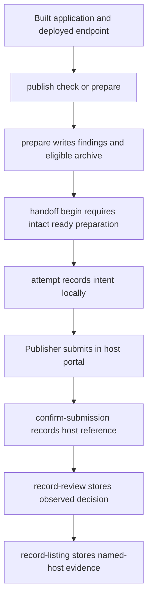

# Prepare an application for host publication

## Status

The approved design is implemented as optional repository tooling: ChatGPT preparation (CLI3), Claude connector preparation (CLI4) and fixture-verified manual handoff records (CLI5). The [lifecycle record](host_publication.lifecycle.md#status) preserves the exact approved design, reviewed heads, landed revisions and verification limits. None establishes an actual submission, host approval, installation or live listing.

The source baseline is [`cdad54747dfbba756464676ac3b1b8c90148a566`](https://github.com/MachineWisdomAI/saga-a2ui/tree/cdad54747dfbba756464676ac3b1b8c90148a566). The CLI lives in the public repository’s workspace root, whose manifest sets `private: true`, not a published `@saga-a2ui/publish` npm package. Installing a renderer or stack does not install this command.

## Problem and current behavior

A working SAGA application still needs host-specific packaging, listing materials and submission evidence before people can discover it in ChatGPT or Claude. Publishing an npm library does not publish an application to either directory. Hosting is the application owner's deployed HTTPS MCP service, and the tooling does not deploy it. A directory listing is the host's own review and publication of the application, which only the host can grant.

The existing single SAGA CLI provides init and demo commands. The CLI includes `saga publish check` and `saga publish prepare` through optional workspace publication tooling. It prepares ChatGPT artifacts or a Claude connector dossier with the shared evidence record; it does not deploy an application, submit it or establish a live directory listing. No separately published `@saga-a2ui/publish` package is claimed.

## Preparation and manual handoff

An application maintainer supplies a built release, its already deployed HTTPS MCP endpoint and listing materials in a `saga-publication/1` release input. `publish check` assesses one target without writing files. `publish prepare` performs the assessment and writes `findings.json` plus the target archive when package checks permit it. The findings verdict is `ready` only when every check passed, `incomplete` when none failed but a check is unknown, and `blocked` when any failed. Owner-only handoff requirements stay pending even when the preparation is ready.

For example, suppose a maintainer has built an application, deployed its endpoint and filled in `saga-publication.json` with the build views, publisher identity, endpoint and ChatGPT listing assets. From a prepared SDK source checkout, the maintainer runs:

```sh
npx tsx scripts/saga.ts publish check --target chatgpt --release path/to/saga-publication.json
npx tsx scripts/saga.ts publish prepare --target chatgpt --release path/to/saga-publication.json --out ./publication
```

A ready preparation contains `chatgpt-plugin.zip` and the digest-bound findings record. A missing image or a view that differs from the served resource prevents readiness; the findings name the repair. Malformed release input is refused before preparation, and secret-bearing output is not written. The maintainer repairs those inputs and prepares again before beginning a handoff. The [tooling README](../../scripts/publish/README.md) owns the full release schema, fixture and command recipes.

`publish handoff begin` accepts an intact ready preparation and an `--authority-ref`, then creates a local record. The authority reference is supplied by the operator and is not independently verified. `attempt` records intent before the maintainer submits manually; `confirm-submission` records the host’s reference afterward. A recorded approval is still separate from `record-listing`, which requires current preparation evidence, a named host and a reference to an observed listing. These commands record supplied observations; they do not inspect the host or perform any submission.

By default, checking reads local artifacts and performs read-only endpoint discovery. It does not invoke application tools, change remote state or fabricate host acceptance. Executing test cases requires an explicitly selected test fixture and authorized credentials. Assessment findings identify missing information. Unusable release inputs are refused before assessment.

**Historical approved-design diagram.** The proposed package label predates the implemented `scripts/publish/` tooling. Its portal and listing steps are performed outside the CLI; the current local-record flow follows below.


[Editable Mermaid](../../diagrams/host-publication.mmd) · [Editable Excalidraw](../../diagrams/host-publication.excalidraw) · [PNG](../../diagrams/host-publication.png)

The current command boundary is:



Only the publisher’s portal step submits anything. A lost response between that step and confirmation leaves an unresolved attempt; the maintainer inspects the existing host submission before confirming it or recording that no submission exists with `void-attempt`.

The implemented target adapters use the platform requirements recorded with CLI3–CLI5 on 2026-10-20. Their links identify that design basis, not a fresh verification of today’s portal rules:

| Target | Prepared output and distribution path |
| --- | --- |
| ChatGPT | A portable package with root `plugin.json` and `mcp.json`, assets and applicable `extensions.com.openai` metadata. The ZIP references the remote endpoint and follows the portal's **With MCP** flow. [Packaging](https://developers.openai.com/plugins/build/plugins), [submission](https://developers.openai.com/plugins/deploy/submission). |
| Claude | A connector submission dossier for the remote endpoint and MCP App. An optional GitHub plugin bundle can add skills; its connector still requires a separate submission. Desktop `.mcpb` files and Code-only installation are not substitutes for web distribution. [Directory publishing](https://claude.com/docs/directory/publish), [surface support](https://claude.com/docs/plugins/platform-support). |

The maintainer can resume an explicitly authorized portal operation with the prepared materials. The record distinguishes preparation, submission, approval and actual publication, with platform identifiers and observed timestamps. It never equates a generated ZIP or completed upload with a live listing. No undocumented submission API is assumed. Existing authorization can cover the workflow; the design introduces no mandatory confirmation at every step.

## Responsibilities and interfaces

[`scripts/publish/`](../../scripts/publish/README.md) owns publication inputs, validation, host artifact generation and submission records behind the SAGA CLI. The single parser in `scripts/saga.ts` loads it only for publication commands. The ChatGPT and Claude target adapters apply their respective formats and rules, using pinned manifest schemas and the available Claude plugin validator. A missing validator is unknown, not a pass; the connector dossier itself has no offline portal acceptance validator. SAGA adds checks for application/resource consistency and evidence that upstream validators do not establish.

The application owns deployment, hosting, identity, backend effects, listing claims and publisher authority. Publication consumes an endpoint; it does not introduce a hosting platform. Credentials remain in the authorized credential mechanism, with references in local records and no secrets in archives, reports or screenshots.

Publication inputs distinguish the application publisher from credited contributors and the SDK's npm publisher. Preparation preserves that attribution without substituting the tool operator's identity for the intended listing owner; the target publisher and its authority must be confirmed before submission.

Runtime host negotiation and optional [OpenAI MCP extensions](https://developers.openai.com/plugins/build/extensions) belong in `@saga-a2ui/mcp` host adapters. The publication module checks declared support and packages its metadata; it does not implement sidebar behavior, transport or renderer logic. OpenAI's manifest namespace and runtime extension protocol remain separate contracts.

A release record associates source revision, installed SAGA versions, build/archive digests, endpoint deployment identity, tool-definition snapshot, UI resource URIs and resource digests with host-test evidence. If an endpoint cannot establish its deployment identity, the report states that uncertainty. OpenAI may pick up hosted-server changes independently of a new ZIP; the record therefore compares the deployed contract as well as packaged files. The application must preserve live tool/resource compatibility or roll back its deployment. [Remote server review](https://developers.openai.com/plugins/deploy/app-review).

## Failure and recovery

Invalid manifests, missing assets or mismatched resources prevent a ready result for the affected target. Partial generation leaves no apparently complete archive; a rerun replaces generated output only after validation. A recorded host rejection retains its reference. `changes-requested`, `approved` and `rejected` end the recorded review; a changed submission needs a new release and handoff. An uncertain upload outcome requires checking the existing portal record before retrying, preventing the local workflow from advising a duplicate attempt. The tool cannot prevent an operator from submitting outside it.

Changed tool definitions, deployment identity or resource bytes make affected evidence stale. Rechecking identifies what changed and which host checks need rerunning. A timeout or unavailable validator produces an unknown or failed finding, never a pass. Reports record validator identity and documentation date. They do not automatically detect a change in external platform rules.

Missing publisher access, verification, reviewer credentials or platform approval leaves the handoff pending while other preparation continues. These are platform requirements, not failures to hide or bypass. Claude bundle submission, for example, checks GitHub push access; its publication mode determines whether passing updates can publish automatically. [Claude submission](https://claude.com/docs/plugins/submit).

## Verification outcomes

The lifecycle record contains the observed fixture and source acceptance for preparation and handoff. These remain the qualification boundaries:

- Given a built fixture and matching endpoint, each target produces valid artifacts referring to the same tools and UI resources. Unchanged inputs reproduce their content digests.
- Default discovery causes zero application tool calls or domain effects. Opted-in fixture tests remain separately identified from real-host observations.
- A missing asset, invalid manifest, secret in output or changed resource prevents a ready claim and identifies the repair.
- Interruption and retry retain the local submission identity and refuse an unresolved second attempt. The tooling itself performs no upload or publication.
- Separate actual ChatGPT web and Claude web runs are needed to establish installation, card rendering and supported interactions using the recorded release. Local validators, protocol tests and directory approval do not replace these observations.

## Record integrity and remaining authority

Handoff events are numbered JSON files linked by their predecessor’s digest. Commands append events rather than rewriting history. Concurrent writers cannot claim the same event number; altered records, missing events and unexpected files are refused. Directory identity checks avoid writing into a replacement directory. An interruption before the atomic link can leave an ignored temporary dot-file; after the link, the complete event is already committed. An event is committed whole or not at all. Inspect the record before retrying. Observed timestamps cannot move review or listing evidence backward.

The record pins release evidence. Passing a newly prepared output compares release inputs, views, tools, resources, metadata, deployment identity, packages and validators with that evidence; changes invalidate readiness. A historical live-listing observation remains history and cannot establish that a changed release is live. `status` without a current `--prepared` directory does not establish freshness.

Publication tooling and external directory approval are not prerequisites for the [Ansari migration](ansari_adoption.blueprint.md). Its separate source, anonymous package-installation and host requirements remain with that application. Hosting, publisher credentials and platform decisions remain application or host responsibilities. Portal automation is not implemented here and would require a supported interface or an explicitly authorized browser workflow.

## References

The [reusable MCP connector](reusable_mcp_connector.blueprint.md), [application setup](https://github.com/MachineWisdomAI/saga-a2ui/blob/b10a8882fa5b15ad9a7243f592e5c3dc086d5340/blueprints/features/application_setup.blueprint.md), [package ownership](../../packages/README.md) and [coding standards](../../CODING_STANDARDS.md) define the runtime responsibilities this design preserves. The original design checked platform sources on 2026-10-16, and the implementation receipts record later checks on 2026-10-20. Recheck the host’s current requirements before an actual submission; this documentation refresh does not establish that those external contracts are unchanged.
