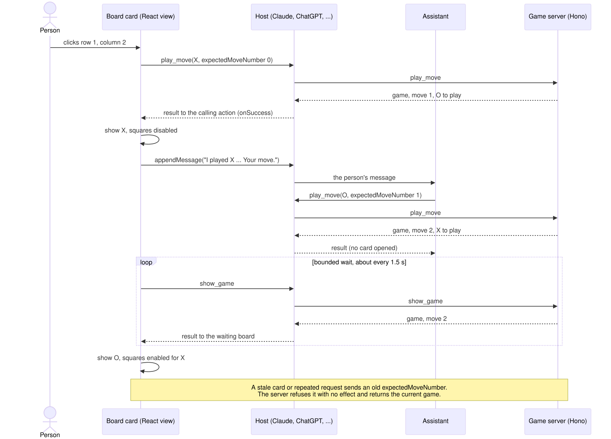

# A permanent, branded Tic Tac Toe application

## Status

- Design: approved by human review on 30 October 2026 at [revision `eb2f0c2cd3cf9216c5b3dbb17d09830283863c05`](https://github.com/MachineWisdomAI/saga-a2ui/blob/eb2f0c2cd3cf9216c5b3dbb17d09830283863c05/blueprints/features/hosted_tic_tac_toe.blueprint.md), including its referenced diagrams. Approval preserves the open upstream attribution/interface and canonical-artwork decisions below; it does not approve those designs or authorize deployment.
- Implementation: Partial. **Blueprint `eb2f0c2cd3cf9216c5b3dbb17d09830283863c05` implemented, for the canonical game source and its shared-credit adoption, at `MachineWisdomAI/saga-a2ui@cc67b817112c33540d51aab34040904323819cc8`** ([PR #354](https://github.com/MachineWisdomAI/saga-a2ui/pull/354), independently approved at its head `aceb33b`). It adopts the shared own-catalog credit that landed in [`9476d80`](https://github.com/MachineWisdomAI/saga-a2ui/commit/9476d8099c4aeff38ecfbe80b2fd6976cd5c1729) ([design](own_catalog_attribution.blueprint.md)), the catalog and layout identifier `https://saga-a2ui.dev/catalogs/tic-tac-toe/board/v1`, and an optional `icons` setting for the game server, with the tutorial following. The hosted Worker application is a separate scope in `MachineWisdomAI/saga-a2ui-examples`: [PR #1](https://github.com/MachineWisdomAI/saga-a2ui-examples/pull/1) is a candidate that pins `cc67b81` and is not landed; its merge commit is recorded after it merges. The existing local game and tutorial remain their own implemented scope. Landed prerequisites: the shared Fetch entry at [`f1fbac0`](https://github.com/MachineWisdomAI/saga-a2ui/commit/f1fbac0882302cbf024100b462e08abd06a5bdc1) and the selected SAGA dragon light/dark theme assets, bundled unchanged as the default ChatGPT plugin branding at [`1660855`](https://github.com/MachineWisdomAI/saga-a2ui/commit/1660855a2bd643a3161d86f49d090c6cb43682e5) ([provenance](../../assets/brand/plugin/README.md)).
- Publish preparation: at `f1fbac0`, the existing `saga publish check` and `prepare` commands, run on the fixture application through the test network seam with its ChatGPT `assets` removed, produced a `ready` ChatGPT package (`package.assets` pass; `plugin.json` references the four dragon files as `composerIcon`, `composerIconDark`, `logo` and `logoDark`, and their bytes are the valid PNG files of the recorded digests). With `claude.connector.icon` pointing at the dragon logo, the Claude connector dossier was also `ready` (`package.images` pass). Neither run needed a code change, so no reusable preparation gap is recorded. This used a fixture endpoint, not the game's: preparing the game's own release input waits for its deployed endpoint, and preparation alone establishes no installation, web distribution or actual connector icon.
- Acceptance: package consumption, deployment, installation and actual-host branding are pending. The hosted application and the host checks remain pending.

## Problem and current behavior

The React tutorial lets a person play X against the assistant's O through four MCP operations. Its Node server keeps up to 200 games in memory with a 30-minute sliding expiry. Its temporary tunnel and process memory do not provide a permanent public demonstration.

The hosted application demonstrates consuming the library and its tooling at one stable URL, with visible saga a2ui identity. The tutorial retains its npm/Vite steps.

## Proposed behavior

A developer adds **`https://examples.saga-ai.dev/tic-tac-toe/mcp`** to Claude or ChatGPT and starts a game without signing in. A click and the assistant's move both reach the same `play_move` operation. The game retains its four operations, stale-move checks, recovery controls and result shapes; each game's state moves into one SQLite-backed Durable Object.

The existing diagram labels the tutorial server as Node. The Worker and game object take that role while preserving the other exchanges. [Editable sequence](../../diagrams/tic-tac-toe-turn-loop.mmd) · [PNG](../../diagrams/tic-tac-toe-turn-loop.png).

The card displays the dragon/brand and **“Built with saga a2ui”**, linking to `https://saga-ai.dev/`. Both hosts must also display the dragon as their actual connector icon. Framework credit comes from a shared SDK capability that supports the React own-catalog application; the game must not copy an application-specific footer or add a FaithfulCard dependency merely for credit.

## Responsibilities and interfaces

| Owner | Responsibility |
| --- | --- |
| SDK | Public stack/operation APIs, [Fetch hosting](fetch_mcp_hosting.blueprint.md), reusable attribution and applicable publish preparation/validation. |
| Examples application | Worker composition, route, Durable Object store, trusted brand configuration, marketplace entry and deployment instructions. |
| Canonical game source | The existing SDK tutorial application remains the source of game rules, contracts and view behavior. The hosted build consumes a pinned public source archive and substitutes its hosting/store composition; it does not maintain a second independently edited rules copy. |
| Cloudflare | HTTPS execution, durable storage and scheduled alarm delivery. No separate database, scheduler or keep-alive service is introduced. |
| Host | Tool invocation, view display, connector presentation and supported installation. A package or metadata field cannot guarantee the icon it displays. |

The examples build pins the game's public source revision and installed SDK versions, then stages the source as a build input. Updating that pin is explicit; there is no runtime fetch, submodule or new shared package. The SDK tutorial remains independently runnable with npm/Vite.

The game source adopts **`https://saga-a2ui.dev/catalogs/tic-tac-toe/board/v1`** as the constant used by layout and catalog. It is never downloaded during rendering. Provisioning the examples route requires no apex migration.

## Failure and recovery

Creating a game persists its state, one expiry timestamp and one cleanup alarm. **Expiry is fixed at 24 hours after creation.** Reads, moves, polling and cold starts do not extend it. The store preserves the atomic expected-move-number check: competing moves cannot both advance the board, and refusals return unchanged current state.

At or after expiry, reads/moves return the existing unavailable-game outcome. Cleanup removes all object storage and metadata without another visitor, is safe to retry and cannot recreate a game. Platform alarm delivery can be late; the timestamp check still prevents further play. Eviction/recreation before expiry reloads stored state. Only `new_game` creates a new identifier. Anyone holding a game's unguessable ID can play either side; no account identity or transcript is retained.

Target Workers Free allowances with SQLite-backed objects. Ordinary platform quota failures remain service failures, not permission to add paid infrastructure. Roll back a Worker version while preserving compatible bindings/storage; do not delete namespaces or restore expired games as routine rollback.

If supported connector configuration fails to produce the dragon icon, retain the specific host result and stop that acceptance claim. Do not introduce a general proxy to make the record appear complete.

## Verification outcomes

Through the existing MCP operation and game-store contracts, verify playable/reopenable games, unchanged refusals, one successful competing move, persistence across object recreation and unavailable results at the fixed deadline. Advance the Workers test clock and deliver its alarm to verify full cleanup without a client revisit and no resurrection.

In each target web host, verify a representative play/reopen/end flow, credit in active/completed/recoverable-error states and actual connector icons on light/dark surfaces. Check the account's current custom-MCP eligibility and record the tested surface. Block catalog-domain network access and verify the board still renders without a catalog fetch.

Reuse publish CLI preparation and canonical assets; verify installation from the examples marketplace in Claude chat. ChatGPT starts with direct URL setup. Keep desktop-only import, directory approval and custom web connection distinct. Add SDK links and a short optional CLI note while preserving npm/Vite steps. These checks remain unexecuted.

## Implementation sequence

Establish the shared Fetch entry, compatible own-catalog attribution and approved theme assets. Qualify applicable existing publish CLI output without making a full directory dossier a prerequisite. Build the persistent game through these dependencies, then check the exact public URL and both hosts before finishing marketplace installation and documentation. Preparing packages does not deploy the service; published package availability must be verified before the hosted build claims registry consumption.

## Open decisions

The own-catalog credit interface is settled by [its design](own_catalog_attribution.blueprint.md): trusted props supplied by application code, with the link opened through the host. The hosted application consumes that output and does not settle it. The canonical geometry is selected: the founder's dragon mark, with the light/dark theme assets noted in Status. Actual connector icon behavior remains a host verification requirement, not an architecture decision already proven.

## References

[Existing tutorial](../../docs/build-tic-tac-toe-with-react.md), [game source](../../examples/tic-tac-toe/README.md), [getting-started tracks](getting_started_tracks.blueprint.md), [host publication](host_publication.blueprint.md) and [Cloudflare cleanup](https://developers.cloudflare.com/durable-objects/best-practices/access-durable-objects-storage/).
