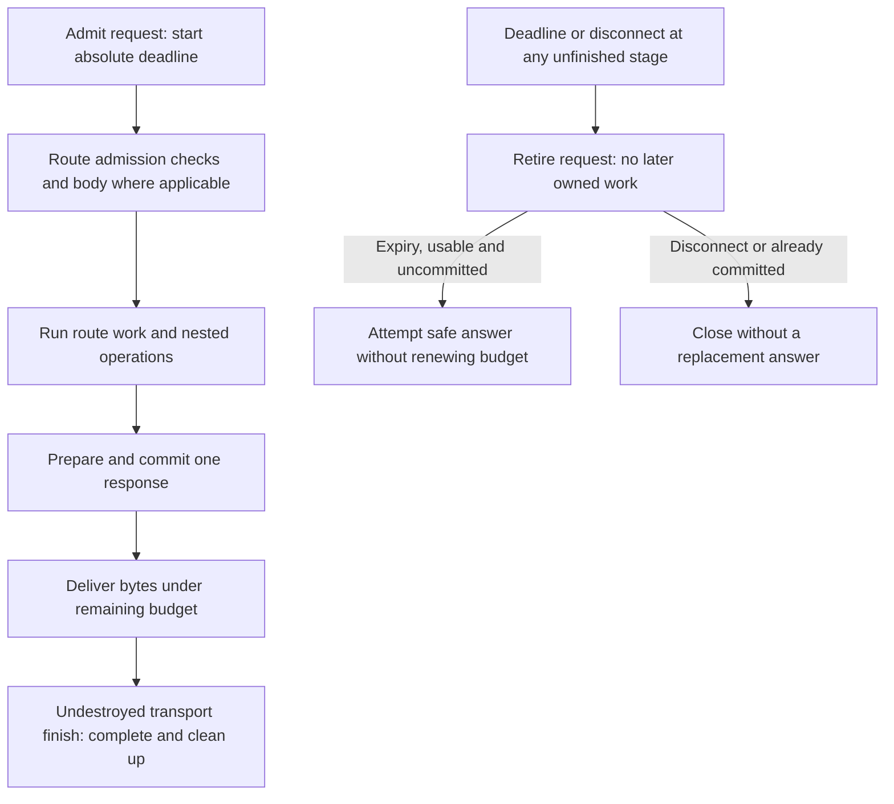
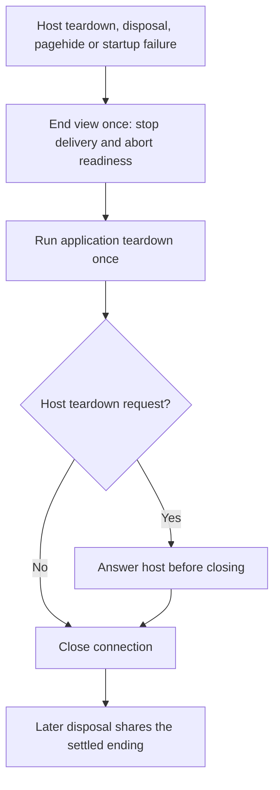

# Request and view lifetimes

## Status

**Approved; implemented in bounded slices.** The original design is [7836c80345cec2aeb474d2eb026a1b9455819ef2](https://github.com/MachineWisdomAI/saga-a2ui/blob/7836c80345cec2aeb474d2eb026a1b9455819ef2/blueprints/features/request_view_lifetimes.blueprint.md). The action-default amendment is `564bcb2a13dd162515a80e7f491d2870990958ab`; the server-budget amendment is `c674060310406b20cf5a985bc23040379bd48812`. This editorial reconciliation changes no approved requirement.

STATE1 teardown and final label loss, STATE2 bounds and unknown-outcome recovery, CORE2 mapping A and leases, CORE3 transport qualification, and bounded VIEW2 installed-public-export qualification have landed. The React protected-player integration also uses this contract. [Lifecycle records](request_view_lifetimes.lifecycle.md#status) retain the exact design, reviewed and landed revisions and separate independent checks from worker-reported checks. [VIEW2's owning record](reusable_lit_adapter.blueprint.md#status) records completion through PR #135 at `c5f4ce8032b65ab53bfdf52d28b2a5ba9bbefc85`; its public exports were tested from local packed artifacts, not thereby installed from npm.

The shipped `src/` files in `@saga-a2ui/core`, `mcp`, `lit` and `react` at npm `0.7.7-rc.1` were checked against this source: all 69 files match, and all four tarballs match their registry SHA-512 integrity. This is source-byte verification, not another installation or host run. The application controller remains repository source rather than an npm export.

Current behavior below was reconciled against SDK source `cdad54747dfbba756464676ac3b1b8c90148a566`. Source, package availability and named-host acceptance are separate claims. The retained ChatGPT/Claude observations establish only their recorded retirement, recovery and private-grant cases. They do not establish audible playback, invisible account changes, forwarded cancellation, rollback, physical-device behavior or Lynx support. The whole feature is not declared finally accepted by this refresh.

## Problem and current behavior

A user who performs an action through an assistant host touches two programs that each decide, separately, when a piece of work stops mattering. The embedded view, a page that talks to the host through the MCP Apps bridge, decides when it stops caring about a question: the user selects another item, the sign-in label changes, a step takes too long, the control is replaced, or the host asks the view to tear down. The application's HTTP listener decides how long it waits on its own dependencies (credential verification, the authorization lookup, protected storage) before it answers. This document asks whether each side stops acting at the moment it decides to, for the two views, the two protected tool endpoints and the protected resource route of [authorized playback](authorized_playback.blueprint.md).

The question is general. Any action with a protected operation, a local effect, or a resource that outlives the step that obtained it has the same lifetimes, and the action binding module gives them one vocabulary. Playback is the example application's most demanding case and is used to ground the inspected source, but it does not define the contract. A non-playback flow, archiving a note, is followed through the same lifetimes below.

The design replaces the rejected [account and session isolation proposal](https://github.com/MachineWisdomAI/saga-a2ui/blob/427257e207b4bb8dbcec8dbf38ea466a98209024/blueprints/features/account_session_isolation.blueprint.md) with a narrower question about ordinary lifecycle correctness, and it preserves the safeguards the code already has: authentication on every protected request, the immutable per-request identity, opaque labels used only for freshness, safe fault distinctions, the read bound and the resource acquisition checks. It adds no live account switching, retained-state expiry, focus or resume revalidation, authentication for the public route, lifecycle framework, action registry or cross-request registry.

The [original source investigation](https://github.com/MachineWisdomAI/saga-a2ui/blob/cdad54747dfbba756464676ac3b1b8c90148a566/blueprints/features/request_view_lifetimes.blueprint.md#problem-and-current-behavior) examined `c3eecaad89fcefc540ee7816a8b41731cb65e9d0`, following CORE1 extraction `6c268cc924886d4f7dfeb1668d83d0e17324f00b`. Its unbounded waits and missing adapters were implementation candidates at that revision. They are not descriptions of today's SDK.

### Terms

This document uses the shared [action vocabulary](../README.md#action-vocabulary), which follows the [action binding module](../modules/action_binding.blueprint.md). The module's [lifetimes table](../modules/action_binding.blueprint.md#lifetimes-and-owners) is the single definition of the following terms, which are used here without being restated.

- *Definition*: the reusable builder product (parameter extraction, prerequisites, handler, hooks, limits, busy policy). It holds no pending flag, timer or resource.
- *Rendered component instance* (or *instance*): one component created and managed by a renderer, accessed directly or through its renderer-owned handle. A template can create many instances; each instance is distinct from the data item it currently displays.
- *Binding*: one definition attached to one event of one instance, with its own observable state.
- *Semantic subject*: the application item the instance shows now, when the application supplies a `subject` reader.
- *Invocation*: one activation of a binding that was not ignored, from the user's event through prerequisites, handler, required hooks and cleanup.
- *Acquired resource*: what an invocation obtained and the application must release, such as a capability a server action issued or a player holding decoded media. Its ownership ends only through release or an explicit transfer to a longer-lived owner. A transfer changes who owns the resource and keeps it alive; a release ends the owned acquisition.
- *Server request*: the request a server action's handler sends. The function that serves it lives on the server and is never referenced from the browser.
- *Discovery* (`watchById`): a setup-time subscription that delivers handles so setup code can bind to them. It is never consulted to route an activation, which reaches its callable through the instance's own event path.

Two kinds of action matter in the examples. A **local action** has a handler that runs in the view. The handler may be synchronous or asynchronous, and it may do asynchronous work of its own, such as the media fetch in the module's local play sketch. It does not receive the runtime's transport-aware `call`. A **server action** has the same shape, and its handler additionally receives `call`, through which it initiates a server request with the invocation's signal and the time left in the work deadline. In both kinds the runtime runs the prerequisites, which may be synchronous or asynchronous, before the handler. The module does not equate local and server actions with A2UI's wire forms, and neither does this document.

In the example application, Play is the action whose handler issues a protected request and then performs client work: it acquires the bytes with the capability the result carried and starts a player. The player is an acquired resource, and Pause and Resume are local actions on it. Archive is a server action in the non-playback flow below. The **read view** (the subscriptions view) shows rows for the signed-in account and is started by the host's tool input, not by an event on a rendered instance. The **action view** (the playback view) offers Play, Pause and Resume on the selected item. The design is written for any view with this shape, and the example's controls are named only where inspected source is described or a mapping is proposed.

Four terms from this feature's pre-module vocabulary keep their meaning because they name application behavior and not the module's concepts. The **sign-in label** is the opaque `viewSession` value carried in tool results. It tells a view whether the data on screen still comes from the sign-in the view started with, and it never grants access, because the server authorizes every call from the verified request. To **pin** the label is to remember the first one a view accepts and compare later results against it. An **opener** is the `toolresult` notification that tells the action view which item is selected, and a **correlated response** is the value returned to a server request the view itself makes. Notifications carry no request id, so an opener can be a delayed copy of an earlier one.

On the server, a request is **committed** once its status line and headers are written. A finite request is **finished** when the transport reports response `finish` or its documented equivalent; producing the application result alone does not end its delivery budget. The **capability** is the grant a server action issues for the protected resource route, and the **proof** is the signed statement a recipient presents with each acquisition.

The pre-module vocabulary's other terms map onto the module's as follows.

| Pre-module term | General term | What changes in meaning |
| --- | --- | --- |
| Server action | Server action | A definition, bound to an instance. It is no longer a bare call |
| Client action | Local action | Sync or async. Omitted limits inherit the configured defaults: 30,000 ms work and 5,000 ms per bounded hook/cleanup step |
| Attempt | Invocation, plus any resource it hands off | An invocation ends at settlement. A started player does not |
| Client continuation | The handler's steps after `call` returns, and the owner's work after a transfer | Handler steps run under the work deadline. The owner's work does not |
| Client-held resource | Acquired resource, owned by the application's resource owner | Held by a token, not by a shared whole-player |
| Resource request | A second server request with its own lifetime | A direct HTTP request to the application's resource route, not proxied by the host |
| Retire | Cancel or become obsolete (invocation), dispose (binding), end or release (resource lease), controller retired state (today's code) | One word covered four owners; the four are now separate |

### What exists today

The application listener starts a request lifetime before authentication and body receipt, passes it through each server factory, and bounds finite delivery through transport finish. The MCP package owns the portable [request lifetime](../../packages/mcp/src/server/lifetime.ts) and [operation scopes](../../packages/mcp/src/server/operation.ts); the application's [listener](../../apps/lit-host/src/mcp/listener.ts) and [response lifetime](../../apps/lit-host/src/mcp/response-lifetime.ts) own HTTP admission, safe answers and stream completion. Each request still gets its own server/transport and frozen verified identity.

The [playback controller](../../apps/lit-host/src/playback/playback-view.ts) implements mapping A: one server action covers recipient-key creation through player start, with the key in request metadata. The [player owner](../../apps/lit-host/src/playback/player-owner.ts) gives each acquisition its own lease. A stale release cannot stop a newer lease. The subscriptions read remains controller-owned; neither read nor playback acquires authority from its opaque sign-in label.

The [view lifetime runner](../../packages/mcp/src/view/run-tool-result-view.ts) owns readiness and once-only teardown for the current playback view. It stops delivery, runs application cleanup, and closes the connection; for a host teardown request it answers before closing. This is newer than the original diagram's low-level bridge sequence. Application controls, consent and acquired resources still need their own cleanup.

The protected resource service retains its ordered capability, proof, replay and current-entitlement checks before storage. Capability expiry and proof age are independent of both request and invocation deadlines. An issued capability is not recalled merely because the issuing view retires. The content owner retains consent revocation on replacement and terminal retirement; this feature supplies no second consent lifetime.

### Candidate gaps

The [dated candidate inventory](request_view_lifetimes.lifecycle.md) is retained in immutable main history. It distinguishes inspected candidates from reproduced failures. Use the lifecycle records and current tests when assessing a remaining defect; do not treat a pre-implementation observation as an unresolved fault.

## Proposed behavior

This section states the approved lifetime contract and its current application mapping. The historical heading is retained for existing links. The action module owns the reusable API and defaults. It gives the server and the view each a small, locally owned lifetime and keeps them independent: ending a client invocation never claims to stop the server, and a server deadline never depends on the view noticing.

### One lifetime per owner

The module's [lifetimes table](../modules/action_binding.blueprint.md#lifetimes-and-owners) defines the lifetimes and who decides each ending. For the Play control the mapping is short.

| Lifetime | Play control | Ends when | Does not imply |
| --- | --- | --- | --- |
| Definition | The play definition | Never | Anything about a binding |
| Instance | The rendered Play control | The renderer destroys or recreates it | Cancellation, unless the adapter disposes its bindings |
| Binding | The play binding on that control | `dispose()`, or the adapter retires the instance, surface or session | That a request already sent has ended |
| Semantic subject | The selected item | `subject()` returns a different value | That the binding is removed. Only an undecided invocation is canceled |
| Invocation | One Play, from the press to settlement | Settlement. Cancellation or the work deadline fixes the outcome and ends the work wait, and the invocation then still runs bounded outcome hooks, releases and finalization | That the server stopped, or that a retained resource ended |
| Acquired resource | The player lease and the capability | Release, expiry, or the media ending. A transfer changes the owner and does not end the resource | That the invocation that obtained it is still running |
| Server request | The play call, and each resource acquisition | The server's own completion, deadline or disconnect | That the view noticed |

The host-triggered read of the subscriptions view is a controller operation, not a row of this table. It is not a module invocation, and the view has no binding's semantic-subject reader. The controller keeps its generation and its timer, and the server request the read sends keeps the independent server lifetime in the last row.

Two points follow and are easy to lose. First, a lease the invocation transferred to the application's owner outlives its invocation, so settlement of Play never means that playback stopped. Second, the server's request lifetime is separate from every client one: a canceled invocation, a disposed binding and a torn-down view each end the client's wait and make no claim about the server. Cancellation is cooperative. It does not recall a request already sent, and it does not undo a remote effect.

### What a view must decide, and what it must not

**Setup finds, activation routes.** An application locates instances at setup, by identifier through discovery or from the adapter's own setup, and binds a definition to each handle. A component identifier is a diagnostic and a discovery key, not an instance key, because a list can render one identifier once per item. Nothing at activation looks a callable up by name.

**`before` is for prerequisites.** A prerequisite is reusable work that may stop the handler: session validity, consent, a durable audit record. It is not spinner preparation. The view's pending presentation is a function of the binding's runtime state: `running` from admission, through the synchronous activation prefix, prerequisites, handler and the required success hook, and `settling` while the outcome hook, releases and `onFinally` (when configured) are active. It needs no separate pending flag of the controller's own and does not run a prerequisite to draw something.

**Gesture-sensitive synchronous preparation belongs to `atActivation`.** Where an API needs its call in the event's own call stack, as `prepare()` unlocking audio does, the action puts it in `atActivation`. The callback is synchronous by type and by rule, and a thenable result ends the invocation as `activation-error`. Work in `atActivation` and `input` cannot be preempted by a timer, so a synchronous callback that blocks the event loop prevents every bound from firing until it returns. The module promises no portable activation property, and a prerequisite that awaits promises nothing about activation.

**Each callback checks its own `current()` after an await, immediately before a synchronous presentation write.** The signal asks work to stop. `scope.active` says whether the outcome has been decided. Only a callback's own `current()` says whether it may still change what the instance shows, and it is false for good once that callback finished, exceeded its budget, or was made obsolete. The handler also stops starting network work or taking a resource when its signal has aborted or `scope.active` is false. A presentation write that cannot be conditioned on `current()` must be idempotent or be done in a prerequisite.

**An obsolete presentation is not a different outcome.** The runtime decides an outcome once and keeps it. When an invocation becomes obsolete after the decision, for example because the selected item changed while `onFailure` awaits, the outcome stays as decided, the hook's signal aborts and its `current()` is false, and no message about the old item appears on the new one. Cleanup and releases still run, and `onFinally`, when configured, receives `obsolete: true`.

**Bounds.** The activation prefix is part of `running` but precedes the work timer. `deadlineMs` starts when the synchronous prefix has finished and covers every prerequisite and the handler. It expires as `failed(timeout)` in the stage that was running: in `prerequisites` the handler never started, and in `running` the effect is unknown. `hookMs` is a separate timer for each of the required success hook, the outcome hook, each release and `onFinally` when configured. These are the runtime's own timers. Neither is a whole-invocation maximum and neither is a universal third timer, and the clocks of the controller's read, the player's single steps, the resource service and the listener stay with their existing owners. Local and server actions may omit explicit limits: each setting resolves independently from a per-action override, then the owning SDK instance's application configuration, then 30,000 ms work or 5,000 ms per bounded hook/cleanup step. Explicit invalid values fail early. The work budget is shared by prerequisites and handler, cannot be extended by progress, and a longer override cannot extend a host, gateway or server deadline. Separate cleanup budgets mean the default profile is not a 35-second whole-invocation maximum.

**Result-stage-aware outcomes.** What a failure may say depends on how far the handler got, which the runtime reports through `stage` and `failure.kind`. A failure before the handler started says the handler's protected request was not sent, although a prerequisite may itself have contacted a session or audit service. A handler that returned shows that the handler returned. The typed result and the operation's contract then establish which effect completed, including local effects, and not that every server request succeeded. Any later failure is the client's required work. A throw, a timeout while running, or a cancellation before a result says only that the client stopped waiting, so the effect is unknown, the message must not invite a retry, and nothing retries automatically.

**Finalization, token-scoped cleanup and transfer.** Finalization always occurs, and `onFinally` runs only when configured. Every resource the invocation holds through its scope is released in reverse order, each within `hookMs`, and a late handler that acquires after the invocation ended has the resource released at once. A resource held through an invocation's scope token survives a successful start only by explicit transfer to the application's owner. The owner's `end(token)` affects only the acquisition it names, is idempotent, and is a no-op for a token the owner has since superseded. Stopping everything the owner holds is the owner's own teardown and never an invocation's operation.

### A non-playback flow: archiving a note

This follows the module's approved archive example through the lifetimes above; the full rules, declarations and renderer columns are in the module. A note list renders an attachable control once per note, so two notes give two instances. Lit and React report the shared component identifier for both. The original Lynx clone mapping is historical design context, not a supported renderer in this walkthrough. Setup binds the archive definition to each instance's own handle and supplies a subject reader that asks that same handle which note it shows now.

The user presses the control on note A. Admission checks that the event belongs to the current installation and that the binding is idle. The synchronous prefix copies A's identifier out of the event. The binding shows `running` from admission, which the application draws as a busy control, and the work deadline starts when the prefix finishes. A session prerequisite, a confirmation prerequisite and a durable audit prerequisite run in that order, each able to refuse, and each counts against the deadline. The handler then calls the server through `call`, which gives the transport the invocation's signal and the time left in the work deadline. The server's own handler, its authorization and its own limits run on the server and are not referenced from the view.

Three things can then happen, and each follows from a rule above and not from the example.

- **The row now shows note B while the confirmation is open.** At the next checkpoint or adapter wake-up the runtime finds the subject changed and decides `canceled(subject-changed)` at stage `prerequisites`. No archive request was sent. The binding stays attached. A press on B first revalidates the old invocation, then applies the busy policy. A mismatch nobody observes cancels nothing yet.
- **The server archives the note, and the required success hook that records it overruns `hookMs`.** The outcome is `failed(success-hook-timeout)` with the result attached, so the failure hook can say the note was archived and the client's required work failed. The old hook's own `current()` is false for good, although binding, instance, installation and subject are unchanged, and the failure hook has its own eligibility and may present. If the row meanwhile shows another note, the failure hook's signal aborts and it writes nothing, the outcome stays `failed`, and `onCanceled` does not run.
- **The control unmounts during the request.** The adapter disposes the binding, the runtime decides `canceled(disposed)` at stage `running`, and the application may say only that the archive status is unknown. The server may still finish and archive the note. Cancellation did not undo it.

At no point does the view assume the server stopped, and at no point does a retry happen automatically.

**Approved historical view diagram.** The invocation and resource ownership model remains applicable. Its final bridge steps—“no view-side close” followed by host-owned closing—describe the original low-level bridge. The current view runner answers host teardown first, then closes the connection itself after application cleanup.

![Historical approved flowchart; its final no-view-side-close and host-closes steps are superseded by the current runner answering teardown then closing itself. One action invocation and its owners. A definition attaches to a binding on one rendered instance. A user event is admitted and runs the activation prefix with no timer. Prerequisites, in order and each synchronous or asynchronous, then the handler run under the work deadline, which starts after the prefix. The handler may do local asynchronous work and may call a server request, which has its own lifetime shown in the server figure. If the handler returns, the required onSuccess hook runs under its own hookMs and may itself decide a failure by error or timeout. A throw, the deadline or cancellation decides the outcome directly. The outcome is decided once. Only after the decision do the outcome hook, the releases of untransferred scope tokens and onFinally, when configured, each run under their own hookMs before settlement. A presenting callback, while it is still active, awaits and then checks its own current() immediately before a synchronous write, and skips the write when it is false. A resource held by a scope token that the application explicitly hands to its resource owner is not released by the scope; a lease the owner retains ends through the owner's own teardown, an application policy that is separate from binding cancellation. A selection change, label loss or ActionBinding.dispose() cancels an undecided invocation and does not close the bridge. Host teardown disposes each binding, triggers the owner's own teardown, and answers the host without a view-side close; the host closes the connection afterwards, and a later idempotent connection.dispose() is a separate step.](../../diagrams/request-view-lifetimes.svg)

Editable sources: [Mermaid](../../diagrams/request-view-lifetimes.mmd) and [Excalidraw](../../diagrams/request-view-lifetimes.excalidraw). Rendered copies: [SVG](../../diagrams/request-view-lifetimes.svg) and [PNG](../../diagrams/request-view-lifetimes.png). The diagram shows no timer that spans a whole invocation. Among resources held through invocation scope tokens, only an explicit handoff to the application's owner keeps one alive after settlement; a server-issued capability has its own service lifetime and is shown in the server figure, not in the local token chain.

### The server request as its own lifetime

The action module names the server request as a lifetime that sits outside the module. A server action's definition holds a function that sends a request, and the function that serves it lives on the server. An invocation that ends, whether it settles, is canceled, or fails by its own deadline, therefore says nothing about whether this request stopped. In the other direction, a server deadline does not decide the invocation's outcome. The invocation's `deadlineMs` over prerequisites and handler, the per-step `hookMs`, and any host timeout belong to the client contract. The application satisfies the whole-playback pending requirement through mapping A below: key creation through start is inside the work interval, and success presentation has its own hook budget. No action is assumed to have a playback continuation, and the module defines no third shared timer. The server request has its own clock, its own owner and its own answers.

This section is about the ordinary request: one POST to a protected tool endpoint, or one GET to the protected resource route. Both are owned today by the application listener, the per-request tool handlers and the media service. The reusable callback, progress and delayed-completion contract for such requests belongs to the reusable connector, CORE3 ([#16](https://github.com/MachineWisdomAI/saga-a2ui/issues/16)), while the defaults, nesting and finite-delivery contract below apply to its reusable SDK boundary. CORE3 still owns the complete transport qualification matrix.

### Configurable server budgets

The SDK supplies an **operation limit of 3,000 ms** and an **end-to-end request limit of 10,000 ms**. These are overridable product defaults, not latency guarantees. They are independent of the action module's client-side work and hook defaults. A server SDK instance and a trusted route may override either field independently. Route `BudgetSettings` resolves each `operationMs`/`requestMs` field as **route override → SDK-instance setting → SDK default**; omitting one inherits it without changing the other. A registered operation can supply `boundMs` for its aggregate handler budget, and nested `OperationRequest.within` work can supply `limitMs`. Neither operation setting replaces or extends the already-admitted request deadline. Resolve and validate configuration before admitting work: reject non-numeric, non-finite, zero or negative values at configuration/registration, never after starting authentication or a handler. No implicit unlimited sentinel is introduced.

An operation is an explicitly owned unit of server work: admission and asynchronous header validation, credential verification, body ingestion/parsing, the complete tool handler including projection, authorization lookup, protected-storage read, or resource acquisition preparation. Synchronous JavaScript cannot be preempted; the gate is checked before and after it. The registered handler has an aggregate operation budget spanning all its nested callbacks. Nested authorization and storage operations may have narrower limits but cannot extend their parent. Authentication and body admission have SDK-instance or adapter operation settings because untrusted request arguments cannot choose their budgets; an operation-specific override takes effect only once the operation is safely identified. Route request settings are chosen from trusted registration before authentication.

**One request lifetime starts before authentication.** At HTTP request admission, before the first credential, admission or body wait, the listener establishes one monotonic absolute deadline. The effective wait for any operation is the minimum of its resolved operation limit, the remaining parent-operation budget (when nested), and the remaining request budget. A sibling may begin its own operation budget only if the original request budget remains. Advancing a stage, receiving progress, retrying a dependency, invoking another callback or revisiting a stage never resets either an enclosing operation deadline or the request deadline. An internal retry remains inside its original operation budget. A separately admitted HTTP request has its own budget; it does not renew an earlier request or imply that repeating an unknown write is safe.

For example, a handler entered with 800 ms remaining gets at most 800 ms even when its configured operation limit is 3,000 ms. Two sequential storage attempts inside that handler share its remaining aggregate budget. Raising an operation limit above the request limit cannot extend the request. The request's budget is independent of client cancellation, action deadlines, capability expiry and proof age.

**Finite JSON and resource responses finish within the request budget.** The terminal owner races disconnect and deadline throughout authentication, body processing, handler/projection, serialization and delivery until the transport reports response `finish` or its documented equivalent. Calling `end` or producing a result does not finish the request. Preparing a response selects it once; it cannot be replaced after commitment. A slow reader cannot hold finite-response delivery beyond the remaining request budget: the adapter closes/destroys that response on expiry, clears its listeners/timers and never writes another status. `finish` means the transport accepted the response, not that the peer consumed every byte. Already buffered bytes cannot be recalled. An adapter may configure a narrower finite-response drain limit, but it cannot extend the enclosing request deadline. This bounds delivery without adding another SDK-wide timeout default.

For a finite response, one admitted request budget covers both work and delivery:

The lower path races every unfinished stage of the upper path. Calling `end` does not win the race: only `finish` while the response is not destroyed completes finite delivery. A resource GET has no person-authentication or incoming-body step; the diagram follows each route’s applicable checks. An expiry answer gets no renewed budget; buffered bytes cannot be recalled. This diagram covers finite responses, not established streams.

**Streaming has a different endpoint.** The request budget bounds admission, authentication and setup through establishment of a streaming response; it is not a blanket ten-second lifetime for a legitimate long-lived stream. Each subsequent finite operation still has its operation bound. The adapter exposes and documents a configurable finite idle/backpressure policy for ongoing streaming and closes stalled streams through transport-supported cleanup. Its policy must be supplied or selected by the adapter before streaming is enabled; absence of a safe finite policy is a configuration failure, not an unlimited fallback. Idle resets require actual transport activity, not an application retry or a progress callback that delivered nothing. CORE3 retains the full SSE/progress and delayed-completion matrix; STATE2 introduces no cross-POST registry. This amendment's completion rule supersedes the earlier server diagram's application-result endpoint for finite responses; the diagram remains the pinned historical design artifact, not evidence that delivery is already bounded.

### Safe terminal outcomes

The owner retains a structured internal cause distinguishing operation timeout, whole-request timeout, caller cancellation/disconnect, authorization refusal and dependency failure, with the failing stage and known/unknown effect where available. Public errors use the applicable HTTP, JSON-RPC or MCP tool envelope; no raw exception, token, private metadata or internal cause string is copied into caller-visible text. An adapter may configure safe mappings without changing those semantic distinctions.

| Expiry before response commitment | Safe reference mapping |
| --- | --- |
| Verifier/admission dependency wait | 500 `server_error`; never 401 merely because the wait expired |
| Body ingestion | 408 `request_timeout`, then close the incomplete request |
| Tool handler, authorization or storage | The tool's existing fixed unavailable `isError` result, or the applicable safe protocol error if no valid tool invocation exists; never claim denied access |
| Protected resource lookup/storage | Existing 503 `unavailable` with its safe headers |

Real invalid credentials and authorization refusals preserve their existing challenges/statuses. A malformed or unclassified request does not receive an invented tool result. Disconnect produces no response. Expiry on a usable uncommitted channel selects at most one safe answer and attempts immediate completion without renewing the exhausted deadline; if delivery cannot complete, close the transport. After commitment, close/end according to the protocol and write no replacement status. Never imply that a timed-out or canceled write was rolled back: preserve a known returned result, otherwise report an unknown effect without automatic retry or a retry invitation. Reference-application UI wording, narrower limits and protocol-safe adapter mappings are implementation choices delegated within these constraints, not new human approval gates.

**No stage begins after the terminal outcome.** Once the gate has decided, a late result is dropped without effect. This applies to every stage the application owns: a late verifier result reaches neither `req.auth` nor a server build; no body is classified; no capability is issued; no storage read starts; and no second response is written. The application checks the gate before each later stage. It does not rely on the callback stopping.

**Racing is the guarantee. Passing a signal asks for cooperation.** The listener stops waiting for each step. A callback that is given the signal is asked to stop its own work, but one that ignores it still cannot hold the request open. The verifier takes only the token string, so the listener can stop waiting for it and cannot stop its work. The application interfaces carry a signal on the authorization lookup, the storage read and the acquisition.

**Each request has its own clock, and no clock is inherited.** The protected server action and each resource acquisition are separate requests with separate lifetimes. Each acquisition starts a new deadline that does not inherit what remains of the action's. The capability keeps its own expiry. The media service checks that expiry and the proof's age only when an acquisition begins, so it is the request deadline that ends a wait on the lookup or the storage read, not the capability. The protected acquisition deadline is therefore separate from the capability and proof lifetime, and neither stands in for the other.

**Cancellation is cooperative and local.** The contract adds no registry, session state or shared table. The listener builds a fresh server and transport for each POST, so a `notifications/cancelled` posted as a separate request is not guaranteed to reach the handler it names. MCP cancellation is optional, and the deadline is the server's own maximum, not a client cancellation. Cancellation never undoes remote effects. It stops waiting and prevents later stages.

**Approved historical server diagram.** Its “Work finishes: one response” endpoint predates the server-budget amendment. In the current contract, producing work or calling `end` does not finish a finite request: the original deadline continues through transport `finish`; established streams use their separate finite idle policy.

![Historical approved server flowchart; the application-work endpoint is superseded by finite transport finish under the original request deadline. The server request lifetime is independent of the client invocation. The client invocation optionally sends a request through call. The transport wait can end when a response arrives, while the handler continues and required success work follows later if it is still eligible. Separately, cancellation or the work deadline while the runtime is awaiting the request ends its wait and starts no later success hook; handler code already running may go on, which does not prove the server stopped, and remote effects already made are not undone. The listener starts its own deadline, signal and terminal gate before any stage. A protected POST runs the credential verifier and body before dependent tool work; a resource GET checks capability, proof, replay and current entitlement before storage, with no person-authentication or body step. In both, each stage checks the gate. The first of work finishing, server deadline expiry or caller disconnect reaches the gate and decides one response, one safe answer, or no response. Late results are dropped and no later stage starts. A capability issued by an earlier request keeps its own expiry, and an acquisition with it is a new request with a new deadline, new checks and a fresh proof.](../../diagrams/request-view-lifetimes-server-request.svg)

Editable sources: [Mermaid](../../diagrams/request-view-lifetimes-server-request.mmd) and [Excalidraw](../../diagrams/request-view-lifetimes-server-request.excalidraw). Rendered copies: [SVG](../../diagrams/request-view-lifetimes-server-request.svg) and [PNG](../../diagrams/request-view-lifetimes-server-request.png). It carries no whole-invocation timer.

**A server request, step by step.** The example is a protected server action whose authorization lookup stalls, followed by the acquisition it would have led to. The client side of this flow is the invocation described above and is only referred to here.

1. The listener accepts a POST to the protected endpoint. The request lifetime begins before authentication, and the verifier answers within the deadline. The authorization is frozen and the body is read and classified.
2. The handler waits on the authorization lookup. The caller retires its invocation, and in this example nothing forwards a cancellation to the server (whether a host forwards one is unknown). The request is still waiting.
3. The deadline expires. Nothing is committed and the connection is open, so the gate records the expiry. The handler stops waiting and returns the tool's fixed unavailable failure, and the SDK transport writes it. No capability is issued. The expired budget is not renewed to deliver this error; if immediate delivery cannot finish, the transport is closed. Owned timer/listeners are removed at terminal cleanup.
4. The lookup answers later, permitted or denied. The answer is ignored and starts no further stage, so no capability is issued and no grant changes.
5. Separately, if a capability had already been issued by an earlier request, it is not retracted. It expires on its own clock. An acquisition made with it is a new request with a new deadline, new checks and a fresh proof.

If the caller closes the connection at step 2 instead, the gate records a disconnect, the handler stops waiting, nothing is written and the same cleanup runs.

### Playback on the module: one proposed mapping

The application implements **Option A**, selected and qualified by CORE2. The historical heading and comparison below preserve the design rationale; Option B is an alternative considered, not a second runtime or an outstanding implementation choice. The module supplies the primitives; the application owns this arrangement.

**The stages.** Playback has these stages after the user's press: `prepare()` inside the event, creating a recipient key, the host call to the play tool, validating the grant, signing a proof, the resource request, reading the body, decoding and starting the player, and presenting `playing`.

**Option A, one invocation.** The activation prefix holds `input` (the selected item) and `atActivation`, which begins a lease in the player owner and takes it into the scope; the owner's `begin()` ends the previous lease's audio and prepares the player. Key creation and the host-capability check are prerequisites, so that a failure of either is a prerequisite-stage failure and the host call never starts. The handler calls `call` for the play tool, validates the grant with the existing scheme, item, path and label checks, signs the proof, acquires the bytes, starts the player through the owner with the lease, and, on `started`, transfers the lease to the owner with no `await` between the start and the transfer. A blocked start returns a gesture-needed result without a transfer, and the scope still releases the lease.

**Option B, split invocations.** The play invocation ends at the validated grant, and a later controller step, with a bound owned by the application, performs the acquisition and the start. Option A makes the host call and the resource request two server requests inside one invocation. Option B makes them separate invocations or controller steps, and that difference decides which stages one budget can cover. Several requests inside one invocation are distinct from controller work outside it, and a binding's lack of a public `invoke()` does not prohibit such controller work.

| | Option A: one invocation | Option B: split under an application bound |
| --- | --- | --- |
| Where the stages sit | Key creation in prerequisites, everything from the host call to the start in one handler | Key and host call in the first invocation. Acquisition and start outside it, in controller code |
| Bound over the stages | The work deadline covers key creation through start. The success hook is under `hookMs` | The first invocation has its own deadline. The second needs a controller-owned maximum, which is the timer the module declined to add to the runtime |
| What cancels the later stages | The same cancellation as the earlier ones: a new selection, disposal, replacement | The runtime no longer sees them after the first invocation settles, so application continuation code keeps generation checks and aborts for them |
| Busy policy | `ignore` or `replace` covers the whole sequence until settlement | The binding is `idle` while acquisition is pending. A second press is not ignored by the runtime |
| Pending presentation | A function of the binding's `running` phase | Two sources of truth: binding state, then a controller flag |
| Lease ownership | One scope owns it from `atActivation` to a transfer at start | The lease must transfer to the controller before the first invocation settles, so ownership passes while acquisition has not begun |
| What the approved module says | The play sketch puts the fetch and the start in one handler | Open decision 5 and the corrections by owner retain this path: if the stages stay split, the controller keeps its own bound and the runtime provides none. A binding has no public `invoke()`, so the continuation is application code and not a module feature |

**Why Option A.** It gives selection change, disposal and replacement one way to end the pending sequence and release its lease. Option B would transfer ownership before acquisition, return the binding to `idle` while acquisition remained pending, and need a separate application generation, abort and timer. In the implemented controller, all asynchronous stages from key creation through player start fit in the work interval. The success hook presents the result under `hookMs`; there is no third shared timer.

**What each budget bounds under Option A.**

| Phase the user sees | Binding phase | Bounded by |
| --- | --- | --- |
| The press, `prepare()`, and the extraction of the selected item | `running`, the activation prefix, before the work timer starts | No timer. A timer cannot interrupt synchronous code, so only the callbacks finishing bounds it |
| Creating the key | `running`, stage `prerequisites`, after the prefix | The work deadline. A timeout here means the handler never started |
| The host call, proof signing, the resource request, the body read | `running`, stage `running` | The work deadline, and the runtime-built `call` timeout, which is the time left in it. A progress notification cannot extend the deadline |
| Decoding and starting the player | `running`, stage `running` | The work deadline. The player's own 1,500 ms limits on the clock check remain narrower safeguards on single steps |
| Presenting `playing` or `gesture-needed` | `running`, in the required success hook | `hookMs` |
| Presenting a failure, ending the lease, final reporting | `settling` | `hookMs` for the outcome hook, `hookMs` for each release and `hookMs` for `onFinally` |

After the synchronous prefix, `running` can consume the work budget plus the required success hook's budget. Settlement can additionally consume one hook budget per outcome hook, release and configured finalizer. Therefore 30,000/5,000 ms defaults are not a 35-second whole-invocation maximum. Synchronous code can delay timer delivery; no timer preempts JavaScript.

**Resolved mapping details.** `call` accepts a metadata option; the recipient key stays outside episode arguments. The player owner has token-scoped `end`, rejects superseded starts, and remembers an early audio end through `hasEnded`. Pause and Resume begin the player call synchronously in `atActivation`, returning an object that holds the promise; the local handler then awaits it. These are application mechanisms, not an adapter guarantee that asynchronous handlers preserve a user gesture.

The [pre-migration controller bound](request_view_lifetimes.lifecycle.md#status) remains historical implementation evidence. The current path uses action work/hook bounds and per-acquisition leases instead of that controller timer.

**Failure mapping under Option A.** Binding phase and outcome stage are distinct. The binding remains `running` during required success work. If that hook throws or times out, the failed outcome has `stage: running` and `failure.kind: success-hook-error` or `success-hook-timeout`, with the handler result attached. `completing` identifies cancellation after the handler returned; it is not the stage of a failed success hook.

The mapping below separates the application outcome from the operation's effect. Safe wording within this contract is delegated to the implementation team.

| Condition | Stage and kind | Presentation | What the application may say |
| --- | --- | --- | --- |
| `prepare()` throws | `activation-error` | `unsupported` | Nothing protected was requested. `atActivation` may have had effects, such as an earlier lease ending |
| Host lacks server tools, or key creation fails | `prerequisites`, `refused` or `prerequisite-error` | `unsupported` | The protected play request was not sent |
| The host call rejects | `running`, `handler-error` | Not `sign-in-required` until a host is shown to distinguish a refusal. The nearest existing state is `unavailable` | Effect unknown. A capability may have been issued |
| The tool answers with an error | `running`, `handler-error` with the handler's typed cause | `denied`, `unsupported` or `unavailable`, by the existing text mapping | The typed error and the operation's contract establish what completed. At the pinned source the play handler issues the capability before it parses the projection and labels the view session ([`playback-server.ts` lines 97 to 123](https://github.com/MachineWisdomAI/saga-a2ui/blob/c3eecaad89fcefc540ee7816a8b41731cb65e9d0/apps/lit-host/src/playback/playback-server.ts#L97-L123)), so an arbitrary tool error does not show that nothing was issued. Precise early refusals before the issue step do. Messages stay fixed and safe |
| The grant fails validation | `running`, `handler-error` with a typed cause | `session-changed` if the label differs, otherwise `unavailable` | The malformed grant does not show whether a capability was issued. No resource request was made |
| The media service says no (403) | `running`, `handler-error` | `expired` | The body was not read |
| Another acquisition failure | `running`, `handler-error` | `media-failed` | |
| The bytes arrive and starting the player fails | `running`, `handler-error` if the handler throws | `media-failed`, a safe presentation distinct from a server denial | Acquiring the bytes succeeded, but the player did not start. No successful handler result exists to report, so no effect is attributed from a result |
| The browser withholds audio | `running`, returned without a transfer | `gesture-needed` | Nothing is playing. The scope releases the lease. A gesture-needed result is never reported as playing |
| The work deadline expires | `prerequisites` or `running`, `timeout` | `unavailable`; no retry invitation while a sent request has no known result | Reference-application presentation is delegated within the safe effect/recovery contract |
| The success hook fails after a transferred start | `running`, `success-hook-error` or `success-hook-timeout`, result `playing` | The audio keeps playing under the reference application's chosen policy. An application that prefers silence ends exactly that lease in the failure hook | The handler returned, and the typed result shows which effect completed. The client's required work failed |
| Cancellation (`replaced`, `subject-changed`, `disposed`) | By stage | No failure hook. Scope cleanup releases an untransferred lease; the application owns teardown of a transferred lease | Effect unknown if the request was sent |

Short audio that ends before start is confirmed presents `ended`, not `playing`. This information need not be added to the `started`/`blocked` return union. The current owner remembers this with `hasEnded(lease)`, which the success presentation checks before choosing `playing`.

**Pause and Resume.** They are local actions whose asynchronous work acts on the player's current lease. They have a busy policy and the resolved work budget, optionally overridden for the application; the player's own 1,500 ms limits remain narrower single-step safeguards. Pause and Resume act only on the lease the owner currently holds, so a lease the owner has since superseded makes them no-ops. A control that stays disabled once playback has begun is application state and not a binding's busy policy, because the binding settles when Play does.

**What the label and selection do.** A new opener for item B, a loss of the label, host teardown and disposal each end the lease through the owner's own teardown, because the module never calls whole-owner `stop` from an invocation. A new opener also changes the subject, which cancels an undecided Play invocation at its next checkpoint, and the lease the owner ended makes a late `start` reject.

### The read view stays controller-owned

The read is started by the host's `toolinput`, not by an event on a rendered instance, so it is not an instance-bound action, and this feature does not make it one. The controller keeps its generation, its timer and its correlated-recovery rule. `retry` and `select` are user controls and could later adopt the module as a bound server action and a bound local action. That would be a separate decision with its own conflict to resolve: an invocation's result and the controller's read generation would both claim to settle the same state. No such change is proposed here. The read view registers `onTeardown` with the same view runner: it marks itself ended, retires its reads and drops private state before the runner closes the connection. If the host tears the view down while a filtered read is in flight, nothing is presented when that read's answer arrives or its timer fires, `retry()` and `select()` do nothing, and later disposal is idempotent.

### Teardown, disposal and four things called dispose

The current view runner orders teardown as follows. Application cleanup retires bindings, leases and consent; it does not prove that remote work stopped.

Cleanup proceeds even if the application teardown callback throws. A host request is answered before the runner closes; other endings require no host answer.

Keep four owners distinct:

1. The low-level bridge stops notification delivery on teardown; its connection disposal is idempotent.
2. The current view runner stops delivery and readiness, invokes application teardown once, removes listeners and closes. It answers a host teardown request before closing. Startup failure, explicit disposal and `pagehide` also end it.
3. `ActionBinding.dispose()` ends one binding, cancels an undecided invocation and detaches the callable. It does not release a resource already transferred to an application owner.
4. The playback controller's teardown marks the view ended, disposes bindings, ends the player's retained lease and retires consent. Final label loss separately clears the selection and prevents later openers from reviving the view.

A retired attempt cannot alter a newer lease. Unsubscribing setup-time discovery does not dispose installed bindings. The approved view diagram retains its original low-level bridge sequencing; use the runner sequence above for the current playback integration.

### What retires an instance depends on the renderer

The runtime does not flatten every renderer into a DOM instance. Lit and React have implemented attachment/lifecycle slices described by the [action module](../modules/action_binding.blueprint.md#status), with bounded installed Lit qualification in [VIEW2](reusable_lit_adapter.blueprint.md#status). The React protected player uses the application's React runtime plus core and MCP; it does not use the optional `@saga-a2ui/react` A2UI renderer.

- **Lit.** Catalog handles, instance retirement and surface/session cleanup belong to the adapter. Type or data-path changes, disconnect and list removal must retire affected bindings without affecting another view.
- **React.** A committed boundary's setup/cleanup owns the instance; a discarded render opens none. Retained source and qualification revisions establish only the recorded supported runtime, not every React version.
- **Lynx.** The design's catalog handle and effect-cleanup mapping remains unqualified here. Native node removal can precede background cleanup, leaving an interval in which `current()` may still be true. A proposed presentation target must tolerate retirement, for example item-keyed state rather than a stale native handle. Measuring this interval does not close it. No result of this feature establishes Lynx support.

Host teardown arrives through the bridge. The application/adapter still has to dispose its bindings; a signal from the host does not itself prove that cleanup ran.

### Recovery where the host gives no correlation

The read view keeps its existing recovery: unsolicited results are accepted before any loss, and after a loss only a correlated read recovers the view. The action view has no equivalent, because an opener has no request id and the inspected source defines no safe read that returns the opened item. The host's supported initial bootstrap stays as it is, and this proposal does not invent a correlation key, require one from the host or add a read on every mount.

For the action view the proposal was conservative and was a decision for the approver, who selected it on 2026-10-19. Once the view has presented `session-changed` from an opener or a grant, the loss is final for that view instance. It shows no selected item on either path, ignores every later opener whatever its label, and keeps Play unavailable. Recovery requires a new view that accepts a fresh authenticated opener and pins its label; the retired instance cannot recover. Both old-label and new-label openers are ignored after the loss. Under the module this means the application ends the lease, disposes the Play binding and, because the label is application meaning, owns that decision. The shared runtime only carries the refusal of a prerequisite. A reused retired view stays on `session-changed`. Retained host observations establish recovery through fresh authenticated openers, but reload alone may replay an old opener and is not a recovery guarantee.

One limit has no proposed repair. While the label stays the same the view takes the last opener delivered, so a delayed copy of an earlier same-label opener can replace a later selection, and without a request id the view cannot detect it. The subject reader cannot help, because the stale opener is itself what sets the subject. A press then asks for whichever item the view shows, the server still authorizes that request on its own, and the view refuses a grant naming another item or label, so the limit is not an authorization bypass. A host-supplied correlation key or a read that returns the opened item would remove it, and these are examples a future design might evaluate, not the only possible repairs. Neither has been tried in a real host.

## Responsibilities and interfaces

The owners below correspond to the lifetimes in the [diagram above](#proposed-behavior). The shared action runtime and the renderer adapter are the module's; the rest are the example application's.

| Owner | Holds | Responsibility |
| --- | --- | --- |
| Definition author (application) | Parameters, prerequisites, handler, hooks, limits, busy policy | Writes the play definition under the mapping above; may override either default independently through per-action or SDK-instance configuration |
| Renderer adapter | Instance identity, liveness reader, identity-guarded attachment and retirement | Disposes a binding when its instance, surface or session ends, and on host teardown. Implemented slices are recorded for Lit and React; Lynx remains unqualified |
| Shared action runtime | Admission, ordering, outcome, per-callback eligibility, its own work and hook timers, token release | Runs admission, callbacks, work/hook timers and token cleanup under the module contract; supplies no whole-invocation timer. The read, player-step, resource-service and listener clocks stay with their owners |
| Application resource owner (the controllers, the player owner, the media service) | Sign-in label, pin, selected item, grant validation, the lease and capability, whole-owner teardown | Token-scoped `end`; teardown ends the retained lease; final label loss; the read view's teardown registration |
| Read view controller | Pin, rows, selection, read generation, read timer | Runs `onTeardown`; releases reads and private state. No change to correlated recovery or `readBoundMs` |
| Bridge | Delivery and closing | Stops delivery and sequences connection cleanup; binding disposal and application retirement remain separate duties |
| Content view and consent owner | Consent revocation and retirement, obsolete description callbacks | Revokes consent on result replacement and retires it on teardown/disposal; ignores obsolete description callbacks |
| Host | Notification delivery and proxying of server requests | Delivers notifications and proxies requests under its own protocol; cancellation forwarding, rejection details and teardown order require named-host observations |
| Listener | Deadline values, request lifetime, terminal gate, its own answers (413, authentication refusals, resource-route answers) | Starts the lifetime at acceptance; races verifier/body waits and supplies the body-timeout answer |
| Tool handlers and media service | Fixed failure sentences, per-request server factory, capability issue, ordered acquisition checks | Receive the lifetime. Race authorization and storage waits. Check the gate before each later stage, including before issue and before storage. Preserve every acquisition check and its order |
| Application callbacks | Verifier, read, authorization lookup, storage read | Lookup, read and storage accept a signal. The verifier does not |
| Connector | `registerProtectedOperation`, request/operation scopes, the combined `OperationRequest.signal`, progress and the shared view runner | Preserve the CORE1 slice. CORE3 owns and qualifies the reusable deadline, callback, progress and JSON/SSE completion contract |

The reusable SDK supplies the selected defaults, override resolution and cause semantics; application adapters select safe protocol mappings and may override the limits. STATE2 ([#13](https://github.com/MachineWisdomAI/saga-a2ui/issues/13)) keeps the obligation to bound and cancel the waits of this application's listener, handlers and resource service. Neither STATE2 nor the connector defers its semantics to the other. Authentication stays in the application, outside the connector, still runs on every protected request, and now runs inside the deadline; a verifier result that arrives after the request ended is dropped before any identity snapshot is made.

**The two kinds of server request.** The play call and each resource acquisition are separate server requests with separate lifetimes. The capability the play call issues lives by its own clock after that request finishes, and an acquisition starts its own deadline, which does not inherit what remains of the call's. The client's `deadlineMs` never stands in for either one, and an invocation's expiry or cancellation does not claim that the server stopped. A server request ends by its own completion, its own deadline, or the caller's disconnect.

**Current interface ownership.** The action builder/runtime and Lit/React attachment slices exist. Playback's application-owned resource wrapper implements leases. The MCP operation context receives the listener's `RequestLifetime` through the per-request server factory; the operation scope combines its budget with the incoming MCP request signal. `OperationRequest.signal` is the resulting scope signal, and public `OperationRequest.within(stage, work, { limitMs })` runs nested work inside the remaining aggregate budget. The internal bounded scope uses `run`; it is not the operation callback API. The listener-signal question from the original investigation is resolved, not a proposed additional connector interface.

The application still owns authentication, protocol-safe refusal/unavailable answers, capability issue, lookup and storage callbacks. Those callbacks cooperate with the supplied signal and gate; ignoring the signal cannot prolong the owner's wait. Package exports and supported installation are documented in the [public installation guide](../../docs/public-install.md), separate from the original private extraction history.

### Rationale and tradeoffs

One deadline for the whole request is the smallest design that answers how long a caller can wait, because per-stage budgets would have to be summed to answer it. The tradeoff is that a slow verifier uses time the handler could have used. The read keeps its tighter `readBoundMs` inside the request deadline. Racing each wait is the guarantee, and passing the signal to a callback only asks for cooperative cleanup, because a callback that ignores it still cannot hold the request open.

Keeping the lifetimes separate is what lets each stay small. The module's runtime owns one invocation's work and hook timers, the listener owns the server request's deadline, and the application's resource owner owns whatever outlives an invocation. None of the three depends on another noticing. The cost is that the application must name the owner of each resource explicitly and that no single timer answers how long a user may wait across all of them, which is why the application must account for every stage. Mapping A places the current playback stages in the work interval and success presentation in its hook budget.

## Failure and recovery

Cancellation is cooperative. The contract bounds the waiting, guards each stage the application owns so it does not start, and asks callbacks to stop. JavaScript cannot preempt running code, so a callback that ignores its signal keeps running after the runtime stopped waiting and may still write if it never checks `current()`, and a synchronous callback that blocks the event loop prevents any timer from firing until it returns. A canceled or expired invocation leaves the server free to finish. Bytes already buffered, capabilities already issued and effects already made are not recalled. Whether the page stays visible after teardown is host behavior.

The module's [error categories and safe presentation](../modules/action_binding.blueprint.md#error-categories-and-safe-presentation) preserve inspectable causes without automatically showing raw server details, distinguish authentication from permission denial only with supporting evidence, and retain unknown/internal fallback. Timeout and cancellation prove no rollback. A returned result establishing write success remains known success if a later hook fails; a write without an established result remains uncertain. Application presentation and HTTP policy remain separate.

HTTP 408 concerns an incomplete incoming request ([RFC 9110 §15.5.9](https://www.rfc-editor.org/rfc/rfc9110.html#section-15.5.9)); 504 concerns a gateway's upstream wait ([§15.6.5](https://www.rfc-editor.org/rfc/rfc9110.html#section-15.6.5)). A frontend timeout alone establishes neither. The approved server-budget amendment selects the reference mappings above.

### On the server

| Trigger | What the caller sees | Cleanup and recovery | Residual limit |
| --- | --- | --- | --- |
| Deadline expires before commit | The stage's existing safe failure | Waiting stops, timer and listeners removed, transport and server closed. Recovery is a fresh request | A callback that ignores the signal still runs. Its result is ignored |
| Caller disconnects before commit | Nothing is written | Same cleanup | Same as above |
| Deadline or disconnect after commit | A truncated or ended response, no new status | Response ended or closed | Written or buffered bytes stay. The JSON path normally commits near completion, and finite delivery remains bounded until transport finish |
| Result and deadline arrive together, or a result arrives late | At most one response | A result selects its response once but delivery remains timed through transport finish; deadline/disconnect wins if delivery is still pending. A close after transport finish is not a cancellation. A late result starts no storage read, issues no capability and writes no second response | See the residues below |
| Body never completes | 408 `request_timeout` before commitment, then the connection closed | The request is destroyed as on the 413 path | A slow body takes time from the whole-request deadline, so the handler gets less |
| Verifier never settles | 500 `server_error`, not 401 | No body read and no server built. A late valid identity is dropped | The verifier's own work cannot be stopped |
| Slow reader after the application result is ready | Finite delivery remains under the request deadline | Close/destroy on expiry before transport finish; no replacement status | Bytes already buffered are not recalled; ongoing streams use the adapter’s separate finite idle/backpressure policy |

Three server-side residues remain.

- A capability already issued is not retracted. If the connection closes between issue and the response write, the capability, which is bound to the recipient key, goes unused and expires on its own clock.
- A proof identifier recorded before the authorization lookup is not un-recorded, so that proof is spent.
- A late `denied` answer from a lookup that was in flight when the request ended does not delete the grant. The grant stays until its time limit. Every later acquisition asks the lookup again, so a revoked authorization still refuses new bytes. A denial that arrives before the terminal outcome still deletes the grant, as today. The service checks its operation scope before using the lookup result; a retired operation starts no later grant deletion or storage work.

Nothing here lets a client's retirement stand in for the server stopping. The invocation may end locally, the server request still ends by completion or by its own deadline, and a capability may outlive both.

### In the views

| Trigger | What the user sees | Cleanup and recovery | Residual limit |
| --- | --- | --- | --- |
| Host teardown with an invocation pending | Nothing from then on | Bindings disposed; undecided invocation canceled `disposed`; owner ends the retained lease; bridge closes later, once | The server's request ends by its own completion or deadline. Whether the page stays visible is host behavior |
| Host teardown with the read in flight | Nothing presented | Read view registers `onTeardown`, retires reads, drops private state | An in-flight proxied call may or may not settle at close |
| Label loss from an opener or a grant | `session-changed`, no selection | Lease ended, binding disposed, later openers ignored | The retired instance cannot recover; a new view needs a fresh authenticated opener. Reload alone may replay the old opener |
| Delayed copy of a same-label opener | The stale item replaces the later one | The server authorizes the request. The view refuses a mismatched grant | No request id to detect it |
| A late `start` settles after a newer lease began | The newer playback continues | `end(token)` for the stale lease is a no-op for a superseded token | Whether the real player can produce the ordering is unobserved |
| The host call stalls past the work deadline | `unavailable`, not a sign-in message | `failed(timeout)` in the running stage; the lease ends and the signal aborts; an unknown remote effect offers no in-card retry | Effect unknown. A local abort does not prove the host forwarded cancellation |
| Key creation stalls past the deadline | `unavailable` | `failed(timeout)` at stage `prerequisites`; nothing was sent | Key creation cannot be canceled. The runtime stops waiting for it |
| A synchronous callback blocks | Nothing, until it returns | None possible | No timer fires in the interval |
| The required success hook fails or overruns after the start | The reference application keeps audio playing and adds no failure presentation for this branch | An adopter that prefers silence can end exactly the transferred lease in its failure hook | The success policy is the author's |
| A late handler acquires after the invocation ended | Nothing | Token released at once; call rejects; no hook runs | A resource returned inside a dropped result is outside this protection, so the handler hands every resource to the scope before it returns |

## Verification outcomes

### Server-budget amendment checks

These are the contract checks. Historical execution and review evidence belongs to the lifecycle records; this documentation refresh establishes no new runtime result:

- Omitted configuration resolves to 3,000/10,000 ms; each route budget field overrides only its matching SDK-instance field; an operation `boundMs` or nested `limitMs` cannot extend the admitted request deadline. Two SDK instances and concurrent requests do not share timers or configuration mutation. Invalid settings fail before callbacks run.
- Delayed authentication and body ingestion consume the original request budget. A handler entered near expiry receives only the remainder. Nested lookup/storage waits and retries cannot exceed the handler aggregate cap; progress and repeated stages cannot reset it.
- An uncooperative callback is raced, its late result is ignored, and no later protected stage begins. Concurrent unrelated requests continue normally. Existing capability/proof residual rules remain unchanged.
- A finite JSON/resource result that is ready before expiry but whose delivery stalls is closed by the original deadline; `end` alone is not completion. Successful `finish` clears the timer; finish/deadline/disconnect races produce one terminal decision and no second status.
- Each pre-commit stage uses the safe protocol envelope; committed responses cannot be replaced. Timeout/cancellation and auth refusal retain distinct causes. A possibly completed write remains unknown rather than becoming retryable.
- A configured streaming response can continue beyond ten seconds after setup, but stalls obey the adapter’s finite idle/backpressure policy. A setup stall remains under the request budget; the absence of a safe streaming policy fails configuration. Keep these cases distinct from CORE3’s complete SSE/progress matrix.

The tables below retain the verification obligations, including the original candidate probes. Completed scoped runs are recorded in the lifecycle companion; a table row alone is not proof that a test ran. The module's own matrix covers the shared runtime outcomes (outcome decision, per-callback eligibility, late settlement, hook budgets, busy policy, attachment identity and retirement), and the tables here add only what the server request and the views contribute. Server checks use the real listener, handlers and media service with a fake verifier, backend, store and clock. They show JSON-path behavior only, and they do not qualify a streamed response or cross-POST cancellation. They supply the in-process evidence under STATE2. Controller checks use a fake `App`, a fake player and fake timers, with teardown invoked through `app.onteardown`. A check asserts what a user could observe and never that a server stopped. Where a check says that no request was made, it names which request or resource acquisition is counted. The protected play request and the resource acquisition are counted separately from the requests a prerequisite may issue to a session or audit service. A proof-signing path may still call `fetch` with an already aborted signal, so invoking `fetch` is distinguished from an actual network acquisition. The view state names (`pending`, `playing`, `ready`, `unavailable`, `session-changed`, `ended`) are the example's observable states; an adopter's view substitutes its own.

### Planned checks: server

| Condition | Expected observable result | Boundary |
| --- | --- | --- |
| The verifier never settles; or headers arrive and the body stalls | 500 `server_error`, not 401, with no body read or server built; or the request-timeout answer and a closed connection. No tool runs, and a late valid identity is dropped | Listener, fake verifier and clock, raw socket client |
| Protected server action: the lookup never settles, answers after the deadline, or the connection closes after it answers | One response with the fixed unavailable sentence, no capability and no grant change from the late answer. A close before issue leaves no capability and no response | Handlers with a spy media service, plus one listener-level run |
| Resource route: the lookup or storage read never settles, or the deadline passes during the lookup | 503 `unavailable` with the existing headers, no storage read after the deadline, late bytes not written. A late `denied` leaves the grant but the next acquisition is refused, while a `denied` before the deadline still removes it | Media service or listener, fake store that counts reads |
| A request completes before its deadline; a result and the deadline in the same tick; a result after the response closed; a caller disconnect; a separately posted `notifications/cancelled` | Today's response, one write, one terminal outcome, no pending timer, no escaping error. Expiry writes one answer and a disconnect none. The disconnect and cancellation cases record what the pinned runtime and SDK actually do | Fake timers with existing tests, the listener with the pinned SDK, a raw socket client, two clients |
| A request already aborted when the handler would start | Records whether the handler starts. Settles the pre-aborted candidate | Connector test with a pre-aborted signal, reproduction first |
| An early disconnect during the body read | Records whether the body reader settles, and that no server is built | Raw socket client that drops mid-body |
| A stalled body or verifier, and an immediate acquisition on a new connection | The second request is unaffected by the first | Two clients on the listener |

### Preserved behavior

These preserved-behavior checks remain regression obligations for subsequent lifetime changes; the lifecycle records identify completed runs.

| Condition | Expected observable result | Boundary |
| --- | --- | --- |
| An acquisition with a missing or repeated capability or proof header, an unknown capability or one for another episode, an expired capability, a proof that is too old or dated ahead, signed by another key, naming another method or URL or another capability, or reusing an identifier; a lookup that denies | A refusal that names no check, no storage read, and for a denial the grant removed. Order of checks preserved | Media service |
| A lookup or storage read that throws | 503 `unavailable`, not a refusal, and no grant deleted | Media service and listener |
| A credential refused, expired, missing its scope, naming no account, or a verifier that throws a non-credential fault | 401, 401, 403, 403 and 500 `server_error` respectively, with the challenge where one applies. The handler never runs | Listener |
| Identity: the verified request context only | The handler sees only the identity the transport verified for that request. Concurrent principals stay apart. A forged account in the arguments is ignored | Connector (`operation.test.ts`: "gives the handler only the identity the transport verified for that request", "keeps concurrent principals apart", "ignores an account forged in the arguments") |
| The handler outlasts its bound; progress after finish | The fixed unavailable text and a late record not returned. Progress reported after finish is dropped | Connector ("returns the unavailable text when the handler outlasts its bound, and a late record is not returned", "drops progress reported after the operation has finished") |
| A grant naming another item or label, another scheme or path; a redirect | `unavailable` or `session-changed` per the mapping; no resource acquisition is made; the redirect fails | Action view controller (regression) |
| An image result is replaced, content changes, or the view is torn down | Consent revokes or retires as today | Content view (regression; the browser spec for Hide images was read and not run) |

### Planned checks: views and the action runtime

| Condition | Expected observable result | Boundary to exercise |
| --- | --- | --- |
| Read view: host teardown with a read in flight, then rows, a rejection, or the bound; then `retry()`, `select()` and `dispose()` | No `show` and no `callServerTool` after teardown. The connection closes once. A second view on a separate `App` is unaffected | Read view controller |
| Read view regression: an unsolicited positive result after a loss, then a correlated read started after it | The unsolicited result is ignored. The correlated read recovers the view | Read view controller |
| Action view: teardown with an invocation pending, then the late host result, bytes, `start`; then Play, Pause, Resume, an end event and `dispose()` | Binding disposed; no presentation, no `prepare`, no new `start`, no client action reaching the lease; the lease is ended; the connection closes once. No further play request and no further resource acquisition is made after teardown. Idempotent cleanup by a later `dispose()` is permitted | Action view controller and its implemented adapter boundary |
| Retirement during proof signing | The resource request receives an aborted signal and no resource acquisition reaches the network, whether or not `fetch` is invoked with the aborted signal | Action view controller with a fake network counting acquisitions |
| A late `start` for lease 1 settles after lease 2 is playing | Lease 2 keeps playing and nothing from lease 1 is presented, restarted or stopped | Owner wrapper with a fake player, then a built page with the real player |
| An opener or a grant under another label, then an opener under the pinned label; an unreadable opener after the loss | Stays `session-changed`, no selection, and no play request is sent. A same-label opener for another item before any loss still moves to `ready` | Action view controller (decided 2026-10-19; covered by the controller and built-page tests added for #105, landed as `dc968ab54a9f3793bb3841c1c3242b4e1ffe3182`) |
| A malformed opener after a valid selection, then a Play press | Retained selection after a malformed opener remains a source-inspection candidate, not a reproduced defect or an approved new repair; reproduce against current source before changing it | Action view controller |
| The host call rejects with a refusal, a timeout or an abort | None of them is presented as sign-in-required unless the host's error distinguishes a refusal. The outcome follows the mapping chosen | Fake host with each rejection; then each named host |
| A stall in each of key creation, the host call, signing, acquisition, the body read, decoding and start | `failed(timeout)` at the stage that was running; no later stage starts; the lease ends; safe recovery depends on whether the request outcome is known; pending is shown for no longer than the budgets above allow | Action runtime with fake timers and a gated clock |
| A deadline that expires with the handler still pending, then a success hook that outlasts `hookMs` | The first decides `failed(timeout)` alone. The second decides `failed(success-hook-timeout)` with the result. The old hook's `current()` is false | Action runtime |
| The start returns `blocked`, or audio ends before the start is confirmed | `gesture-needed` with no transfer and no lease left; `ended`, not `playing` | Owner and action runtime |
| The success hook throws after a started and transferred lease; after a blocked start | Playing, with the view's failure reported; nothing reported as playing | Action runtime |
| A second Play while one is running; while audio plays or is paused | Ignored by the busy policy while running; blocked by application state afterwards | Binding and owner |
| Pause and Resume on a superseded lease; with a stalled player call | No effect on the newer lease; the bound ends the wait | Owner wrapper |

### Observed evidence, and what it does not show

The [lifecycle records](request_view_lifetimes.lifecycle.md#status) distinguish source tests, raw-socket transport checks, built-browser cases, locally installed artifacts and named-host observations. The [original inspected disconnect test](https://github.com/MachineWisdomAI/saga-a2ui/blob/cdad54747dfbba756464676ac3b1b8c90148a566/blueprints/features/request_view_lifetimes.blueprint.md#observed-evidence-and-what-it-does-not-show) established only its narrow JSON test-host assertions; later CORE3 evidence must not be retroactively attributed to that inspection.

### Local listener, browser and renderer-runtime checks

These remain verification categories, not a claim that all are still pending. Scoped completed runs are in the lifecycle records. They can be answered without a named assistant host. The first group needs the real listener and the planned raw-socket checks:

- whether the pinned Node runtime reports an early disconnect to the body reader, and what the reader then does;
- the values of Node's default header and request timeouts, which the listener neither sets nor relies on. They are connection-level backstops, not an application deadline.

The second group needs a built page with the real `App` and bridge, or a renderer runtime. It covers the integrated ordering of teardown, a late `start` for one lease after a newer lease began, and reversed selections; two views open at once, where tearing down one leaves the other unchanged; whether pending and recovery controls stay reachable and announced at narrow widths, at zoom and with long titles; the renderer version actually used by the affected consumer; and, on a Lynx device, the interval between native removal and effect cleanup with the other runtime conditions the module lists. No result of this feature applies to a Lynx renderer.

### Required actual-host and integrated acceptance

In-process and local checks do not close the following. They need the real listener behind a named assistant host (ChatGPT web, Claude web) and are owned separately from this proposal, from SSE qualification and from final signoff.

- The host's sequence at teardown: whether the page is removed, whether an in-flight proxied call settles or rejects at close, whether a `toolresult` can arrive after teardown, and whether closing or replacing a view closes the connection of an in-flight request.
- Whether the host creates a new view for a later tool call or reuses one; whether its forwarding of a server request can hang while the server is healthy; whether it forwards an aborted `App.callServerTool` or sends `notifications/cancelled`; and what error a rejected call carries (a timeout, an abort and a refusal distinguishably or not).
- What the host does when it receives the fixed unavailable failure, 503, 500 or the request-timeout answer, and how it handles the server's responses beyond those failures and closes.
- Whether the host enforces the declared connect policy on the built playback page.

## Implementation sequence

The original sequence and prerequisites remain in [main history](https://github.com/MachineWisdomAI/saga-a2ui/blob/cdad54747dfbba756464676ac3b1b8c90148a566/blueprints/features/request_view_lifetimes.blueprint.md#implementation-sequence). The delivered sequence was STATE1 teardown/label retirement, STATE2 independent bounds and unknown-outcome recovery, CORE2 action mapping and leases, then scoped connector/installed-adapter qualification. The [lifecycle records](request_view_lifetimes.lifecycle.md#status) identify the approved revisions, exact reviewed candidates and landed code. Reuse unchanged evidence only within its recorded scope. New changes need affected-boundary verification, not a replay of the historical task list.

## Open decisions

The placement of playback work, recipient metadata, listener signal propagation, lease ownership, synchronous Pause/Resume and early `ended` handling are implemented choices described above. Label loss is final for the view; fresh authenticated openers recovered the tested ChatGPT/Claude sequences, while reload alone was not reliable. The application keeps transferred audio playing if required success presentation fails; another adopter can explicitly end its own lease without changing the shared runtime.

Remaining limits are evidence gaps, not permission to infer a stronger guarantee:

- Same-label delayed openers have no correlation key and can replace a later selection. The server still authorizes the selected item independently.
- Invisible account switching, every host view-reuse path and cancellation forwarding are not established. Ending a view never proves server cancellation or rollback.
- The retained host observations used loopback media and do not qualify audible playback, physical devices or Alexa in-card interaction.
- Lynx retirement timing and presentation safety remain unqualified. Other player implementations require their own end/cleanup contract checks.
- Public-proxy slow-reader behavior is not established by the local raw-socket tests. Every adapter still owns its finite-delivery and streaming idle policy.

No material design decision is added by this editorial refresh. Any change to these contracts follows the Blueprint approval lifecycle.

## References

- [Action binding](../modules/action_binding.blueprint.md), the approved module this feature applies: its [lifetimes and owners](../modules/action_binding.blueprint.md#lifetimes-and-owners) and [open decisions](../modules/action_binding.blueprint.md#open-decisions).
- [Action vocabulary](../README.md#action-vocabulary) shared by the Blueprints, and A2UI's [actions concept](https://a2ui.org/concepts/actions/), which distinguishes agent-dispatched events from renderer-executed functions, checked 2026-10-17.
- MCP specification: [cancellation](https://modelcontextprotocol.io/specification/2025-06-18/basic/utilities/cancellation) and [lifecycle timeouts](https://modelcontextprotocol.io/specification/2025-06-18/basic/lifecycle#timeouts), checked 2026-10-16.
- Historical application investigation at commit [`c3eecaad89fcefc540ee7816a8b41731cb65e9d0`](https://github.com/MachineWisdomAI/saga-a2ui/tree/c3eecaad89fcefc540ee7816a8b41731cb65e9d0) under `apps/lit-host/src`: `mcp/listener.ts`, `mcp/request-auth.ts`, `mcp/subscriptions-server.ts`, `mcp/view.ts`, `mcp/subscriptions-view.ts`, `playback/playback-server.ts`, `playback/media-service.ts`, `playback/playback-view.ts`, `playback/web-audio-player.ts`, `content/image-consent.ts`, `lit/description.ts` and `view-main.ts`.
- CORE1 extraction at [`6c268cc924886d4f7dfeb1668d83d0e17324f00b`](https://github.com/MachineWisdomAI/saga-a2ui/commit/6c268cc924886d4f7dfeb1668d83d0e17324f00b), [PR #75](https://github.com/MachineWisdomAI/saga-a2ui/pull/75): [bounded operation handling](../../packages/mcp/src/server/operation.ts), [shared view bridge](../../packages/mcp/src/view/index.ts), and the [connector's partial implementation and remaining scope](reusable_mcp_connector.blueprint.md#status). Its preparation evidence does not establish this feature's lifetime changes.
- VIEW1 preparation at [`c3eecaad89fcefc540ee7816a8b41731cb65e9d0`](https://github.com/MachineWisdomAI/saga-a2ui/commit/c3eecaad89fcefc540ee7816a8b41731cb65e9d0), [PR #76](https://github.com/MachineWisdomAI/saga-a2ui/pull/76): [core protocol/session](../../packages/core/src/protocols/a2ui/v0_9/), [Lit surface lifecycle](../../packages/lit/src/a2ui/app-element.ts), and the [adapter's approved baseline, partial implementation and remaining scope](reusable_lit_adapter.blueprint.md#status). Its preparation evidence does not establish this feature's lifetime changes.
- Pinned dependency contracts inspected from the packages resolved by [the lockfile](../../package-lock.json): `@modelcontextprotocol/ext-apps` 2.0.3 `App.callServerTool` declaration/implementation and `@modelcontextprotocol/client` 2.3.1 `RequestOptions`/`Protocol` timeout implementation. These establish the signal option and progress-reset request timeout; they do not prove host-to-server cancellation routing.
- [Reusable connector Blueprint](reusable_mcp_connector.blueprint.md) and CORE3 ([#16](https://github.com/MachineWisdomAI/saga-a2ui/issues/16)), which own progress, delayed JSON and SSE completion, and the reusable callback cancellation and deadline contract.
- Implementation issues: BROWSE2 [#9](https://github.com/MachineWisdomAI/saga-a2ui/issues/9), PLAY1 [#10](https://github.com/MachineWisdomAI/saga-a2ui/issues/10), PLAY2 [#11](https://github.com/MachineWisdomAI/saga-a2ui/issues/11), STATE1 [#12](https://github.com/MachineWisdomAI/saga-a2ui/issues/12) and STATE2 [#13](https://github.com/MachineWisdomAI/saga-a2ui/issues/13).
