# Request and view lifetimes

## Status

Design approved; implementation partial. STATE1, STATE2, CORE2, CORE3 and the React protected player are accepted for their scopes. VIEW2 installed-public-export qualification is also complete for its adapter scope ([Lit adapter record](reusable_lit_adapter.blueprint.md#status), [PR #135](https://github.com/MachineWisdomAI/saga-a2ui/pull/135)). Its server test processes used workspace exports; it does not establish installed-server or destination qualification. Broader connector work and the remaining open decisions below stay with their owners.

**Design**

| Design revision | Decision |
| --- | --- |
| [`7836c80345cec2aeb474d2eb026a1b9455819ef2`](https://github.com/MachineWisdomAI/saga-a2ui/blob/7836c80345cec2aeb474d2eb026a1b9455819ef2/blueprints/features/request_view_lifetimes.blueprint.md) | Approved by the human owner on 2026-10-17 in [PR #69](https://github.com/MachineWisdomAI/saga-a2ui/pull/69), with the reviewed [view-lifetime diagram](https://github.com/MachineWisdomAI/saga-a2ui/blob/7836c80345cec2aeb474d2eb026a1b9455819ef2/diagrams/request-view-lifetimes.svg) and [server-request diagram](https://github.com/MachineWisdomAI/saga-a2ui/blob/7836c80345cec2aeb474d2eb026a1b9455819ef2/diagrams/request-view-lifetimes-server-request.svg) and their editable sources and PNGs at that revision. It covers this feature and its related terminology and lifetime amendments. Open decisions stay open; approval supplies no runtime or host evidence. |
| [`564bcb2a13dd162515a80e7f491d2870990958ab`](https://github.com/MachineWisdomAI/saga-a2ui/blob/564bcb2a13dd162515a80e7f491d2870990958ab/blueprints/features/request_view_lifetimes.blueprint.md) | Action-default amendment (30,000 ms work; 5,000 ms per hook or cleanup step; per-action, then SDK-instance, then SDK-default resolution). The owner approved the requirements before authoring; this revision mapping is the coordinator's attestation, not a claim that the owner reviewed this Git commit. |
| [`c674060310406b20cf5a985bc23040379bd48812`](https://github.com/MachineWisdomAI/saga-a2ui/blob/c674060310406b20cf5a985bc23040379bd48812/blueprints/features/request_view_lifetimes.blueprint.md) | Server timing amendment authorized by the human owner on 2026-10-19: 3,000 ms operations, 10,000 ms end-to-end requests, independent overrides, bounded finite-response delivery and a distinct streaming policy. Reference-application settings are delegated within it. Documentation review does not establish implementation. |
| [`a60acdaf002b8fcca57bcdbd88e30e9c96acfda8`](https://github.com/MachineWisdomAI/saga-a2ui/blob/a60acdaf002b8fcca57bcdbd88e30e9c96acfda8/blueprints/modules/action_binding.blueprint.md) | Foundation: the [action binding module](../modules/action_binding.blueprint.md), merged as `8b5daf04478593271831d08a9e11c7c2bff0f566` in [PR #73](https://github.com/MachineWisdomAI/saga-a2ui/pull/73). It defines action, binding, invocation, prerequisite, hook, outcome, acquired resource and limit. |
| [`d62c2232ecd8e100d90fe9dbffa072f6cd3dd4a7`](https://github.com/MachineWisdomAI/saga-a2ui/blob/d62c2232ecd8e100d90fe9dbffa072f6cd3dd4a7/blueprints/features/request_view_lifetimes.blueprint.md) | Initial proposal; historical draft. |

The human owner also decided on 2026-10-19 that losing the pinned sign-in label is final for a view instance: later openers are ignored and Play, Pause and Resume cannot reactivate it; recovery is a new view or a reload. This resolves only that choice and is not a new design revision ([#105](https://github.com/MachineWisdomAI/saga-a2ui/issues/105)).

**Implementation**

| Scope | Design implemented | Landed code | PR / issue | Review and checks | Limits and what it does not show |
| --- | --- | --- | --- | --- | --- |
| STATE1: teardown retirement and late-player cleanup | [`7836c80345cec2aeb474d2eb026a1b9455819ef2`](https://github.com/MachineWisdomAI/saga-a2ui/blob/7836c80345cec2aeb474d2eb026a1b9455819ef2/blueprints/features/request_view_lifetimes.blueprint.md) | [`b84276d6efa90379436cf92ee9f3311327be8ebd`](https://github.com/MachineWisdomAI/saga-a2ui/commit/b84276d6efa90379436cf92ee9f3311327be8ebd) | [#84](https://github.com/MachineWisdomAI/saga-a2ui/pull/84) | [review 5561164021](https://github.com/MachineWisdomAI/saga-a2ui/pull/84#pullrequestreview-5561164021) [CI 39090874952](https://github.com/MachineWisdomAI/saga-a2ui/actions/runs/39090874952) | Whole-player interface kept; per-acquisition leases and the action module not part of this slice. No installation, deployment or named-host behavior shown. |
| Label loss final per view instance (decision 2026-10-19) | [`7836c80345cec2aeb474d2eb026a1b9455819ef2`](https://github.com/MachineWisdomAI/saga-a2ui/blob/7836c80345cec2aeb474d2eb026a1b9455819ef2/blueprints/features/request_view_lifetimes.blueprint.md) | [`dc968ab54a9f3793bb3841c1c3242b4e1ffe3182`](https://github.com/MachineWisdomAI/saga-a2ui/commit/dc968ab54a9f3793bb3841c1c3242b4e1ffe3182) | [#106](https://github.com/MachineWisdomAI/saga-a2ui/pull/106) [#105](https://github.com/MachineWisdomAI/saga-a2ui/issues/105) | [review 5572050139](https://github.com/MachineWisdomAI/saga-a2ui/pull/106#pullrequestreview-5572050139) [CI 39256789107](https://github.com/MachineWisdomAI/saga-a2ui/actions/runs/39256789107) reviewed head `05dcc7e9159d760f370a8992e9e9c368c2d9bb72` | Changes the playback controller and the retired-state message of Play only. Adds no action runtime, registry, mandatory read on mount or host correlation field. |
| Action defaults, 30,000 ms work and 5,000 ms per hook step (#110) | [`564bcb2a13dd162515a80e7f491d2870990958ab`](https://github.com/MachineWisdomAI/saga-a2ui/blob/564bcb2a13dd162515a80e7f491d2870990958ab/blueprints/features/request_view_lifetimes.blueprint.md) | [`c45992d61426b9707f199b57fa567e4222d29306`](https://github.com/MachineWisdomAI/saga-a2ui/commit/c45992d61426b9707f199b57fa567e4222d29306) | [#113](https://github.com/MachineWisdomAI/saga-a2ui/pull/113) [#110](https://github.com/MachineWisdomAI/saga-a2ui/issues/110) | — | Action-default scope only. Review and CI are recorded in the [action binding Status](../modules/action_binding.blueprint.md#status). |
| Server and controller budgets (#112) | [`c674060310406b20cf5a985bc23040379bd48812`](https://github.com/MachineWisdomAI/saga-a2ui/blob/c674060310406b20cf5a985bc23040379bd48812/blueprints/features/request_view_lifetimes.blueprint.md) | [`ce52c3bcd2aa81d84d8a8ae7b3790044d8523631`](https://github.com/MachineWisdomAI/saga-a2ui/commit/ce52c3bcd2aa81d84d8a8ae7b3790044d8523631) | [#115](https://github.com/MachineWisdomAI/saga-a2ui/pull/115) [#112](https://github.com/MachineWisdomAI/saga-a2ui/issues/112) | [review 5575081741](https://github.com/MachineWisdomAI/saga-a2ui/pull/115#pullrequestreview-5575081741) [CI 39290684980](https://github.com/MachineWisdomAI/saga-a2ui/actions/runs/39290684980) reviewed head `cb663aeccf20dea9de4a715e1997f7c7da196c5e` | Source and local browser checks only. The reviewer reused unchanged evidence; the worker's 469 targeted tests and 224 Chromium cases are separate worker reports. |
| Safe unknown-outcome recovery (#122) | [`c674060310406b20cf5a985bc23040379bd48812`](https://github.com/MachineWisdomAI/saga-a2ui/blob/c674060310406b20cf5a985bc23040379bd48812/blueprints/features/request_view_lifetimes.blueprint.md) | [`5df6a2328fdd5cf6055b179233b69eaa5a8d0b5a`](https://github.com/MachineWisdomAI/saga-a2ui/commit/5df6a2328fdd5cf6055b179233b69eaa5a8d0b5a) | [#124](https://github.com/MachineWisdomAI/saga-a2ui/pull/124) [#122](https://github.com/MachineWisdomAI/saga-a2ui/issues/122) | [review 5575509089](https://github.com/MachineWisdomAI/saga-a2ui/pull/124#pullrequestreview-5575509089) [CI 39296577121](https://github.com/MachineWisdomAI/saga-a2ui/actions/runs/39296577121) reviewed head `ef8ffc02a5bec9a3d4212e559a06a4e56d8f38ca` | A generic resolved error or invalid grant stays an unknown outcome without a retry invitation. |
| CORE2: mapping A and player leases (#15) | [`7836c80345cec2aeb474d2eb026a1b9455819ef2`](https://github.com/MachineWisdomAI/saga-a2ui/blob/7836c80345cec2aeb474d2eb026a1b9455819ef2/blueprints/features/request_view_lifetimes.blueprint.md) | [`8eb46792205fd0866067cd3aeaf29d8b47ed8257`](https://github.com/MachineWisdomAI/saga-a2ui/commit/8eb46792205fd0866067cd3aeaf29d8b47ed8257) | [#133](https://github.com/MachineWisdomAI/saga-a2ui/pull/133) [#15](https://github.com/MachineWisdomAI/saga-a2ui/issues/15) | — | Review, checks and host acceptance are recorded in the [connector Status](reusable_mcp_connector.blueprint.md#status). The design pairing is the one the connector lifecycle record gives. |
| CORE3: consumer request path (#16) | [`7836c80345cec2aeb474d2eb026a1b9455819ef2`](https://github.com/MachineWisdomAI/saga-a2ui/blob/7836c80345cec2aeb474d2eb026a1b9455819ef2/blueprints/features/request_view_lifetimes.blueprint.md) [`c674060310406b20cf5a985bc23040379bd48812`](https://github.com/MachineWisdomAI/saga-a2ui/blob/c674060310406b20cf5a985bc23040379bd48812/blueprints/features/request_view_lifetimes.blueprint.md) | [`aa1abfb951aa8c811c634acd8ba471f413022bf6`](https://github.com/MachineWisdomAI/saga-a2ui/commit/aa1abfb951aa8c811c634acd8ba471f413022bf6) | [#140](https://github.com/MachineWisdomAI/saga-a2ui/pull/140) [#16](https://github.com/MachineWisdomAI/saga-a2ui/issues/16) | — | Details in the [connector Status](reusable_mcp_connector.blueprint.md#status). The design pairing is the one the connector lifecycle record gives. |
| ACT7 audit: two simultaneous live views (test fixture only) | Not recorded. | [`a704da4d2b76204a8b15dd0cb89ecfacc5ad101a`](https://github.com/MachineWisdomAI/saga-a2ui/commit/a704da4d2b76204a8b15dd0cb89ecfacc5ad101a) | [#145](https://github.com/MachineWisdomAI/saga-a2ui/pull/145) | — | Local Chromium evidence. How ChatGPT or Claude isolate their own views is not observed. Design revision implemented is not named in this entry; the module Status records the audited design. |
| React protected-player lifetime integration | [`7836c80345cec2aeb474d2eb026a1b9455819ef2`](https://github.com/MachineWisdomAI/saga-a2ui/blob/7836c80345cec2aeb474d2eb026a1b9455819ef2/blueprints/features/request_view_lifetimes.blueprint.md) [`c674060310406b20cf5a985bc23040379bd48812`](https://github.com/MachineWisdomAI/saga-a2ui/blob/c674060310406b20cf5a985bc23040379bd48812/blueprints/features/request_view_lifetimes.blueprint.md) | [`4d40761d14c563cb3b48648266594b1d70d8e918`](https://github.com/MachineWisdomAI/saga-a2ui/commit/4d40761d14c563cb3b48648266594b1d70d8e918) | [#172](https://github.com/MachineWisdomAI/saga-a2ui/pull/172) | — | ChatGPT was reloaded while Play waited; the old request still completed. No forwarded cancellation, remote rollback or invisible host cleanup is inferred. Combined-card and audible-audio acceptance are separate. |

**Actual-host observations**

| Scope | Design implemented | Landed code | PR / issue | Review and checks | Limits and what it does not show |
| --- | --- | --- | --- | --- | --- |
| STATE1 actual-host verification (#12), reviewed source `05dcc7e9159d760f370a8992e9e9c368c2d9bb72` | Not recorded. | — | [#12](https://github.com/MachineWisdomAI/saga-a2ui/issues/12) | [receipt 6269108128](https://github.com/MachineWisdomAI/saga-a2ui/issues/12#issuecomment-6269108128) [receipt 6269306962](https://github.com/MachineWisdomAI/saga-a2ui/issues/12#issuecomment-6269306962) [receipt 6269564301](https://github.com/MachineWisdomAI/saga-a2ui/issues/12#issuecomment-6269564301) [receipt 6269808898](https://github.com/MachineWisdomAI/saga-a2ui/issues/12#issuecomment-6269808898) reviewed source `05dcc7e9159d760f370a8992e9e9c368c2d9bb72` | ChatGPT web and Claude web retired playback after a synthetic label change and accepted a fresh opener. Reload alone is not a demonstrated recovery. No incoming abort or MCP cancellation was seen; `ui/resource-teardown` delivery, late result receipt by the removed frame, invisible account change and audio are not shown. |
| STATE2 host observations (#13), reviewed source `cb663aeccf20dea9de4a715e1997f7c7da196c5e` | Not recorded. | — | [#13](https://github.com/MachineWisdomAI/saga-a2ui/issues/13) | [receipt 6273222174](https://github.com/MachineWisdomAI/saga-a2ui/issues/13#issuecomment-6273222174) reviewed source `cb663aeccf20dea9de4a715e1997f7c7da196c5e` | Both hosts stayed pending after the 3-second server budget; late callbacks did not restore the UI. Claude's generic tool error incorrectly offered Try again, which led to #122 and is not accepted recovery evidence. |
| STATE2 follow-up, Claude, reviewed source `ef8ffc02a5bec9a3d4212e559a06a4e56d8f38ca` | Not recorded. | — | [#13](https://github.com/MachineWisdomAI/saga-a2ui/issues/13) | [receipt 6273771247](https://github.com/MachineWisdomAI/saga-a2ui/issues/13#issuecomment-6273771247) reviewed source `ef8ffc02a5bec9a3d4212e559a06a4e56d8f38ca` SHA256 `eb55255484587e2c37671f2349b7af24ef0015305552f8a37bd44ff38190dcfd` | Repaired resolved-error path: one Play produced "Playback could not be confirmed" without Play or Try again; the late callback changed nothing. |

**STATE2 acceptance (#13): complete for that scope.** It combines the #110 action defaults, #112 server/controller delivery, #122 safe recovery, their independent reviews and required checks, retained built-workflow evidence and the host observations above. It shows finite waits, retired late continuations and stage-appropriate recovery. It does not show loopback audio, invisible identity change, forwarded cancellation, remote rollback, public-proxy slow-reader behavior or physical-device acceptance, and it does not mark the whole feature implemented.

**Acceptance still open.** Broader connector work, per-feature host acceptance outside the recorded scopes, and the listed open decisions. VIEW2 completed its installed-public-export adapter checks; destination installation, deployment, publication and final acceptance of the whole feature are not established by that qualification or the records above.

**Relationship.** Narrower approved successor to the rejected [account/session design](account_session_isolation.blueprint.md) and a lifetime amendment to [authorized playback](authorized_playback.blueprint.md) and [content safety](content_safety_levels.blueprint.md). Rejected machinery stays rejected.

Pre-cleanup narrative, including verification counts and chronology: [request_view_lifetimes Status at the cleanup baseline](https://github.com/MachineWisdomAI/saga-a2ui/blob/2405c5d28f02a5b8d5fb70ed7a929e676cf78d43/blueprints/features/request_view_lifetimes.blueprint.md).

## Problem and current behavior

When a user changes selection or closes a view during Play, the old invocation must stop presenting and release its player lease. The server request has a separate deadline: closing the view neither cancels that request reliably nor undoes its effects. The same distinction applies to archiving a note.

This design gives each owner a local lifetime: action invocation, view, retained resource and server request. Authentication and authorization still run on every protected request. It adds no account switching, retained-state expiry, focus revalidation, public-route authentication or cross-request registry. It replaces the rejected [account/session proposal at its rejected revision](https://github.com/MachineWisdomAI/saga-a2ui/blob/427257e207b4bb8dbcec8dbf38ea466a98209024/blueprints/features/account_session_isolation.blueprint.md).

The accepted scopes are in [Status](#status); the whole feature remains partial. Current source descriptions use `2405c5d28f02a5b8d5fb70ed7a929e676cf78d43`. The [baseline document](https://github.com/MachineWisdomAI/saga-a2ui/blob/2405c5d28f02a5b8d5fb70ed7a929e676cf78d43/blueprints/features/request_view_lifetimes.blueprint.md) retains the full approved contract, verification matrices and design-time inspection at `c3eecaad89fcefc540ee7816a8b41731cb65e9d0`; this shorter account does not supersede those requirements.

### Terms

The [action vocabulary](../README.md#action-vocabulary) distinguishes a reusable definition, its binding to one rendered instance, one invocation, and an acquired resource. A local action runs in the view; a server action also receives `call`, carrying its signal and remaining work budget. Neither is an A2UI wire form.

The application owns the selected item, the player lease and the opaque sign-in label (`viewSession`). Pinning that label detects a change in presented identity; it never authorizes a request. An opener is an uncorrelated host `toolresult` selecting an item. A correlated response answers a request the view made itself. A capability authorizes a resource acquisition only with the recipient's proof and the server's current checks.

A response is committed when headers are written and finished when the transport reports `finish` or its equivalent. Finishing the handler is not finishing delivery.

### What exists today

- `apps/lit-host/src/mcp/listener.ts` starts a `RequestLifetime` before authentication and binds response completion to it. `response-lifetime.ts` bounds finite delivery and applies a finite streaming idle policy (30,000 ms by default when enabled).
- `packages/mcp/src/server/lifetime.ts` supplies operation/request budgets; `operation.ts` passes the bounded `OperationRequest.signal`, nested `within` and progress reporting to handlers. Playback passes that lifetime into authorization, storage and acquisition.
- `runToolResultView` owns readiness, held results, teardown callbacks and connection close. The subscriptions controller retains its own read generation, timer and correlated recovery. Play uses one action invocation and an acquisition-specific player lease.
- Public content views retain their independent image-consent revocation and teardown behavior. This feature adds no second consent lifetime.

These are source observations, not new runs. Historical reviews, checks and host observations remain bounded by Status.

### Candidate gaps

The [design-time candidate inventory](https://github.com/MachineWisdomAI/saga-a2ui/blob/2405c5d28f02a5b8d5fb70ed7a929e676cf78d43/blueprints/features/request_view_lifetimes.blueprint.md#candidate-gaps) records suspected faults, not reproduced exposure. Server budgets, teardown, final label loss, player leases and safe unknown-outcome recovery are accounted for in [Status](#status). Every opener now ends an undecided Play; no separate reproduction or acceptance of the malformed-opener candidate is recorded. Remaining questions concern early body disconnects, real-player ordering and host behavior, listed under [Open decisions](#open-decisions). The protected-request scope does not qualify the public `/mcp` route.

## Proposed behavior

This is the approved contract. [Status](#status) records which scopes are implemented and accepted; choices that were made or remain open are listed under Open decisions. The design uses the module's contract as written, adds no exported name and gives no deadline value beyond the defaults below. It gives server and view each a small, locally owned lifetime and keeps them independent: ending a client invocation never claims to stop the server, and a server deadline never depends on the view noticing.

### One lifetime per owner

| Lifetime | Play control | Ends when | Does not imply |
| --- | --- | --- | --- |
| Definition | The play definition | Never | Anything about a binding |
| Instance | The rendered Play control | The renderer destroys or recreates it | Cancellation, unless the adapter disposes its bindings |
| Binding | The play binding on that control | `dispose()`, or the adapter retires the instance, surface or session | That a request already sent has ended |
| Semantic subject | The selected item | `subject()` returns a different value | That the binding is removed; only an undecided invocation is canceled |
| Invocation | One Play, press to settlement | Settlement. Cancellation or the work deadline fixes the outcome and ends the work wait; bounded outcome hooks, releases and finalization still run | That the server stopped, or a retained resource ended |
| Acquired resource | The player lease and the capability | Release, expiry or the media ending. A transfer changes owner and does not end it | That the invocation that obtained it is still running |
| Server request | The play call and each resource acquisition | The server's own completion, deadline or disconnect | That the view noticed |

The host-triggered read of the subscriptions view is a controller operation, not an invocation or instance-bound action; the controller keeps its generation and timer, and the read's server request keeps the independent server lifetime. A lease the invocation transferred to the application's owner outlives the invocation, so settlement of Play never means playback stopped. A canceled invocation, a disposed binding and a torn-down view each end the client's wait and say nothing about the server; cancellation is cooperative and neither recalls a sent request nor undoes a remote effect.

### What a view must decide, and what it must not

Setup discovers instances and binds definitions directly; an activation never looks up a callable by name. `input` and `atActivation` run synchronously inside the event turn, allowing gesture-sensitive work such as audio preparation. A blocking callback cannot be preempted by timers.

After that prefix, prerequisites and the handler share `deadlineMs` (default 30,000 ms). Each success/outcome hook, release and finalizer has its own `hookMs` (default 5,000 ms). Each field resolves from action override, then instance setting, then default; invalid settings fail early. These are independent bounds, not a 35-second invocation maximum. Progress cannot extend them.

After an await, a callback checks its own `current()` immediately before presenting. Eligibility depends on the callback, binding, live instance and captured subject. A later subject change makes an already-decided outcome obsolete rather than changing it; cleanup still runs and finalization receives that obsolescence.

Before the handler starts, a failure establishes that its protected request was not sent, though prerequisites may have sent other requests. After a possibly sent request, timeout or cancellation establishes no rollback and must not invite blind retry. A validated returned result can establish a completed effect even when a later hook fails.

The invocation scope releases untransferred resources in reverse order, each within its cleanup budget. A late acquisition is released immediately. Explicit transfer gives a resource to a longer-lived application owner. That owner's token-scoped `end` is idempotent and cannot end a newer acquisition; whole-owner teardown belongs to the application.

### A non-playback flow: archiving a note

A list binds one Archive definition to each row with a subject reader for its current note. The press snapshots the note ID, then runs session, confirmation and audit prerequisites before the protected request. If the row changes while confirmation waits, the runtime cancels the invocation at its next checkpoint and sends no Archive request. If the row unmounts after the request was sent, its status is unknown: the server can still archive it. If the server confirms but a success hook times out, the effect remains known while the client's follow-up failed. The [action guide](../../docs/actions.md) traces the runnable example.

The [Mermaid](../../diagrams/request-view-lifetimes.mmd), [Excalidraw](../../diagrams/request-view-lifetimes.excalidraw), [SVG](../../diagrams/request-view-lifetimes.svg) and [PNG](../../diagrams/request-view-lifetimes.png) are retained design artifacts. The runner calls application teardown, answers the host, then closes its connection; view retirement proves no server cancellation.

### The server request as its own lifetime

A protected tool POST and each resource GET have separate request lifetimes. The listener owns admission and transport completion; handlers and media services own their protected work. A capability's expiry and a proof's age are independent of request deadlines.

#### Configurable server budgets

Defaults are 3,000 ms per operation and 10,000 ms per request, not latency guarantees. Trusted per-operation/route settings override SDK-instance settings field by field, then defaults apply. Non-finite, non-positive and non-numeric values fail before work is admitted. Authentication and admission cannot take limits from untrusted arguments.

The request starts before authentication. Every operation receives the minimum of its own limit, its parent's remaining time and the request's remaining time. A handler's nested authorization/storage work shares its aggregate budget. Progress, retries and stage changes never reset a parent deadline. Synchronous work checks the gate before and after running because JavaScript cannot preempt it.

Finite delivery remains bounded until transport `finish`, not merely handler return or `end()`. On expiry, close or destroy the response; after commitment never write a replacement status. `finish` proves transport acceptance, not receipt by the peer. Buffered bytes cannot be recalled.

Streaming setup remains under the request deadline. An established stream instead requires the adapter's finite idle/backpressure policy; only real transport activity renews idle time. A supplied finite default is valid, an unlimited fallback is not. CORE3 owns the complete JSON/SSE matrix.

| Expiry stage before commitment | Reference response |
| --- | --- |
| Verifier or admission wait | 500 `server_error`, never invalid credentials solely because a wait expired |
| Incomplete body | 408 `request_timeout`, then close |
| Tool handler, authorization or storage | Fixed unavailable tool result, or protocol error when no valid invocation exists |
| Protected resource lookup or storage | 503 `unavailable` with safe headers |

Timeout, cancellation, authorization refusal and dependency failure retain distinct internal causes. Public envelopes expose no raw exception, credential or private metadata. A disconnected caller gets no response. An exhausted deadline is not renewed to deliver an error; if immediate completion cannot finish, close the transport.

Once a request ends, a late verifier cannot install identity, a late lookup cannot issue a capability, and no later storage read or second response may start. Racing waits is the guarantee; abort signals only request cooperation. The token-only verifier may keep working after the listener stops waiting. Separate POSTs have fresh server/transport instances, so a separately posted MCP cancellation is not guaranteed to reach earlier work.

Capabilities already issued expire normally. A proof recorded before a timed-out lookup stays spent. A late denial does not delete a grant after its request ended; each subsequent acquisition still rechecks authorization. The [full server contract](https://github.com/MachineWisdomAI/saga-a2ui/blob/2405c5d28f02a5b8d5fb70ed7a929e676cf78d43/blueprints/features/request_view_lifetimes.blueprint.md#the-server-request-as-its-own-lifetime) preserves stage order, safe headers and terminal-race requirements.

Retained diagram sources: [Mermaid](../../diagrams/request-view-lifetimes-server-request.mmd), [Excalidraw](../../diagrams/request-view-lifetimes-server-request.excalidraw), [SVG](../../diagrams/request-view-lifetimes-server-request.svg), [PNG](../../diagrams/request-view-lifetimes-server-request.png). The historical application-result endpoint does not replace the finite-delivery requirement above.

### Playback on the module: mapping A

CORE2 implements one invocation from Play through confirmed start. Its synchronous prefix selects the item, opens a lease and prepares audio. Prerequisites verify host support and create the recipient key. The handler calls the Play tool, validates scheme/item/path/label, signs the proof, acquires and reads media, decodes and starts it. On confirmed start it transfers the lease without another await. A blocked start returns `gesture-needed` and releases its lease; audio that already ended is reported as `ended`.

The work deadline covers key creation through start. Presentation runs under the hook budget; playback after transfer belongs to the player owner. Narrower player limits remain. The transport forwards the recipient key in `_meta`, beside arguments, and disables timeout extension from progress.

This mapping keeps busy state, cancellation and cleanup under one owner. The rejected split-invocation option would have left the binding idle while acquisition ran and required an early transfer plus a controller deadline. A future split flow must supply that application bound.

A changed selection, final label loss, teardown or disposal ends the owner's lease; the subject change cancels any undecided invocation at its next checkpoint. Every opener, including a malformed one, changes selection identity. Pause and Resume are local actions operating on the current lease, with gesture-sensitive calls inside activation.

The [detailed mapping and failure table](https://github.com/MachineWisdomAI/saga-a2ui/blob/2405c5d28f02a5b8d5fb70ed7a929e676cf78d43/blueprints/features/request_view_lifetimes.blueprint.md#playback-on-the-module-one-proposed-mapping) retain stage-specific requirements. Apply the accepted unknown-effect correction: once Play may have reached the server, an uncertain outcome offers no retry and requires a fresh opener. A typed early refusal, media denial, blocked start and confirmed playback remain distinct. Host audio and cancellation behavior require separate observations.

### The read view stays controller-owned

Subscriptions reads start from host input, not a rendered control. Their controller owns the generation, timer and recovery rule: after label loss, only a correlated read started after the loss recovers. Teardown retires reads and private state, then the runner closes the connection. Migrating retry/select to actions would be a separate decision.

### Teardown, disposal and four things called dispose

The runner's `ended` phase stops delivery and drops held input/results. It calls application teardown once, answers host teardown before closing the connection, and makes later `dispose()` calls harmless. Application teardown disposes bindings and ends retained leases. Binding disposal cancels undecided work but does not reclaim a transferred resource; unsubscribing discovery alone leaves bindings installed. A retired playback controller cannot restart.

### What retires an instance depends on the renderer

Lit element retirement and React committed layout-effect cleanup end their instances and bindings; discarded React renders open none. Their qualification, including upstream-version differences, belongs to the [action module](../modules/action_binding.blueprint.md#status). Lynx delivery is retired; native-removal timing remains unqualified history.

### Recovery where the host gives no correlation

Playback label loss is final for that view: clear selection, end leases, dispose controls and ignore later openers. Recovery needs a new view or reload; host reuse can leave the retired view visible. An uncorrelated same-label opener can still replace a newer selection. The server reauthorizes the selected item, so this is a freshness limitation, not authorization. Correlation keys or a read returning the opened item require a future design.

## Responsibilities and interfaces

| Owner | Responsibility |
| --- | --- |
| Application | Parameters, domain authorization, prerequisites, safe presentation, semantic subject, label and selected item |
| Action runtime | Admission, callback order and eligibility, one outcome, work/hook limits and untransferred resource release |
| Renderer adapter | Instance identity, liveness and disposal when the instance or surface ends |
| Player/resource owner | Acquisition-specific tokens, transfer, idempotent release and application teardown |
| View runner | Readiness, delivered input/results, one teardown callback and connection close |
| Subscriptions controller | Read generation, timer, private state and correlated recovery |
| Listener/connector | Admission lifetime, bounded identity/body/handler work, safe protocol response and transport completion |
| Host | Delivery and proxy behavior; forwarding cancellation or teardown remains separately observed |

The adapter passes `RequestLifetime` through the per-request server factory. Handlers receive `OperationRequest.signal`, nested `within` and progress reporting. Lookup, read and storage callbacks accept a signal; the verifier accepts only its credential. The reusable connector owns these interfaces; application adapters choose safe protocol mappings within the contract. No new action registry, cross-request table or exported lifetime framework is introduced.

### Rationale and tradeoffs

Independent lifetimes let each owner stop waiting without relying on another program noticing. One aggregate request budget prevents stages from extending the request indefinitely, but slow authentication consumes time available to handlers. Resources that outlive invocations require explicit ownership; there is no universal timer or rollback guarantee.

## Failure and recovery

Cancellation stops waiting and blocks later owned stages; uncooperative or synchronous callbacks may continue. A validated result can establish an effect despite a later hook failure. Without such a result, a possibly sent write stays unknown and must not invite blind retry. Neither buffered bytes nor issued capabilities are recalled.

### On the server

Before commitment, choose one safe stage-specific failure; after commitment, close without a replacement status. A disconnect writes nothing. Late callbacks cannot install identity, issue a capability, read storage or write again. The [full failure matrix](https://github.com/MachineWisdomAI/saga-a2ui/blob/2405c5d28f02a5b8d5fb70ed7a929e676cf78d43/blueprints/features/request_view_lifetimes.blueprint.md#on-the-server) retains verifier/body/dependency cases and capability/proof residuals. Finite delivery and stream idle bounds remain separate.

### In the views

Teardown ends bindings and leases, prevents later presentation and closes the connection once. Label loss is terminal for the playback view; delayed same-label openers remain undetectable. A stale lease's cleanup cannot stop a newer player. A host-call timeout leaves Play's effect unknown and requires a new opener; key-creation timeout establishes that Play was not sent. Late scope acquisitions are released immediately. A success-hook failure after transfer does not automatically reclaim the player's lease; the application owns that policy. The [view matrix](https://github.com/MachineWisdomAI/saga-a2ui/blob/2405c5d28f02a5b8d5fb70ed7a929e676cf78d43/blueprints/features/request_view_lifetimes.blueprint.md#in-the-views) retains the detailed cases, subject to the accepted safe-recovery correction above.

## Verification outcomes

The matrices below remain requirements, not claims of new runs. [Status](#status) owns actual acceptance. Source and local fixtures do not establish host behavior.

### Server-budget amendment checks

Check default/override validation, independent concurrent requests, nested budgets, uncooperative callbacks, finite-delivery races, safe failure envelopes and the separate streaming idle policy. No stage, progress or retry may renew its parent deadline.

### Checks: server

The [server matrix](https://github.com/MachineWisdomAI/saga-a2ui/blob/2405c5d28f02a5b8d5fb70ed7a929e676cf78d43/blueprints/features/request_view_lifetimes.blueprint.md#checks-server) covers stalled authentication/body/lookup/storage, deadline/disconnect races, pre-aborted admission and an unaffected second request. Exercise the real listener and transport alongside fake clocks.

### Preserved behavior

The [preserved matrix](https://github.com/MachineWisdomAI/saga-a2ui/blob/2405c5d28f02a5b8d5fb70ed7a929e676cf78d43/blueprints/features/request_view_lifetimes.blueprint.md#preserved-behavior) retains capability/proof/entitlement order, safe errors, verified identity, bounded handlers, dropped late progress, grant checks, redirect refusal and consent revocation.

### Checks: views and the action runtime

The [view matrix](https://github.com/MachineWisdomAI/saga-a2ui/blob/2405c5d28f02a5b8d5fb70ed7a929e676cf78d43/blueprints/features/request_view_lifetimes.blueprint.md#checks-views-and-the-action-runtime) retains teardown, recovery, retirement, player ordering, pending-stage deadlines, hooks and lease cases. Key creation times out in `prerequisites`; timeout after possibly sent Play leaves the effect unknown, with no blind retry.

### Observed evidence at the design baseline, and what it does not show

The [original inspection](https://github.com/MachineWisdomAI/saga-a2ui/blob/2405c5d28f02a5b8d5fb70ed7a929e676cf78d43/blueprints/features/request_view_lifetimes.blueprint.md#observed-evidence-at-the-design-baseline-and-what-it-does-not-show) read one disconnect test and image-consent assertions, not every cited test. CORE3 owns later JSON/SSE and cancellation qualification. Host teardown, reuse, stalled forwarding, error envelopes and policy enforcement need actual-host observations; the bounded receipts in Status establish only their named cases.

## Implementation sequence

[Status](#status) records the accepted design-to-code pairs. STATE1 owns view cleanup; STATE2 owns application waits and safe recovery; CORE2 implements mapping A and leases; CORE3 owns reusable request, progress and transport behavior. Connector, packaging, renderer and host acceptance remain separate scopes. The [original dependency sequence](https://github.com/MachineWisdomAI/saga-a2ui/blob/2405c5d28f02a5b8d5fb70ed7a929e676cf78d43/blueprints/features/request_view_lifetimes.blueprint.md#implementation-sequence) retains delivery history, including CORE1/VIEW1 preparation and PLAY1/PLAY2 predecessors. Before any remaining repair, reproduce the candidate and run the affected preserved-behavior checks.

## Open decisions

**Accepted choices.** Mapping A, final label loss and recovery through a new view, the 30,000/5,000 ms action defaults, the 3,000/10,000 ms server defaults and finite-delivery/stream-policy split are decided for the scopes in Status. Safe reference-application presentation is delegated; a new safe presentation state is not itself an approval gate. Metadata forwarding, request-signal propagation, lease tokens and synchronous Resume are implemented.

**Unresolved choice.** The record does not decide whether failure of the success hook should keep transferred audio playing or explicitly end that lease. The module sketch keeps it playing; this cleanup chooses neither policy.

**Missing evidence.** These are verification questions, not new approval gates:

- Real-player ordering when an old `start` settles after a newer lease; whether other player implementations clear end callbacks on release.
- Host error distinctions, teardown, view reuse, stalled forwarding, cancellation and response-close behavior beyond the bounded observations in Status.
- A separately recorded check placing every playback pending stage inside the work interval and success presentation inside the hook budget.
- Pinned Node early-body disconnect behavior and assertions behind safeguards cited only by test title.
- React 0.13.0 versus design-time 0.14.0 timing, owned by the action module qualification; qualified JSON/SSE and stateless cancellation behavior, owned by CORE3.
- Historical Lynx native-removal/cleanup timing has no scheduled owner because Lynx delivery is retired.

No observation here establishes invisible account switching, remote rollback or general named-host acceptance.

## References

- [Action binding](../modules/action_binding.blueprint.md), the approved module this feature applies: [lifetimes and owners](../modules/action_binding.blueprint.md#lifetimes-and-owners), [open decisions](../modules/action_binding.blueprint.md#open-decisions).
- [Action vocabulary](../README.md#action-vocabulary); A2UI's [actions concept](https://a2ui.org/concepts/actions/), checked 2026-10-17.
- MCP specification: [cancellation](https://modelcontextprotocol.io/specification/2025-06-18/basic/utilities/cancellation) and [lifecycle timeouts](https://modelcontextprotocol.io/specification/2025-06-18/basic/lifecycle#timeouts), checked 2026-10-16.
- Design-time application source, reconciled at [`c3eecaad89fcefc540ee7816a8b41731cb65e9d0`](https://github.com/MachineWisdomAI/saga-a2ui/tree/c3eecaad89fcefc540ee7816a8b41731cb65e9d0) (historical baseline) under `apps/lit-host/src`: `mcp/listener.ts`, `mcp/request-auth.ts`, `mcp/subscriptions-server.ts`, `mcp/view.ts`, `mcp/subscriptions-view.ts`, `playback/playback-server.ts`, `playback/media-service.ts`, `playback/playback-view.ts`, `playback/web-audio-player.ts`, `content/image-consent.ts`, `lit/description.ts`, `view-main.ts`.
- Code described in "What exists today", at the cleanup baseline [`2405c5d28f02a5b8d5fb70ed7a929e676cf78d43`](https://github.com/MachineWisdomAI/saga-a2ui/tree/2405c5d28f02a5b8d5fb70ed7a929e676cf78d43): `packages/mcp/src/server/lifetime.ts`, `packages/mcp/src/server/operation.ts`, `packages/mcp/src/view/run-tool-result-view.ts`, `apps/lit-host/src/mcp/listener.ts`, `apps/lit-host/src/mcp/response-lifetime.ts`, `apps/lit-host/src/mcp/subscriptions-view.ts`, `apps/lit-host/src/playback/playback-server.ts`, `apps/lit-host/src/playback/playback-view.ts`, `apps/lit-host/src/playback/player-owner.ts`.
- CORE1 extraction at [`6c268cc924886d4f7dfeb1668d83d0e17324f00b`](https://github.com/MachineWisdomAI/saga-a2ui/commit/6c268cc924886d4f7dfeb1668d83d0e17324f00b), [PR #75](https://github.com/MachineWisdomAI/saga-a2ui/pull/75): [bounded operation handling](../../packages/mcp/src/server/operation.ts), [shared view bridge](../../packages/mcp/src/view/index.ts), [connector Status](reusable_mcp_connector.blueprint.md#status).
- VIEW1 preparation at [`c3eecaad89fcefc540ee7816a8b41731cb65e9d0`](https://github.com/MachineWisdomAI/saga-a2ui/commit/c3eecaad89fcefc540ee7816a8b41731cb65e9d0), [PR #76](https://github.com/MachineWisdomAI/saga-a2ui/pull/76): [core protocol and session](../../packages/core/src/protocols/a2ui/v0_9/), [Lit surface lifecycle](../../packages/lit/src/a2ui/app-element.ts), [adapter Status](reusable_lit_adapter.blueprint.md#status).
- Pinned dependency contracts from the [lockfile](../../package-lock.json): `@modelcontextprotocol/ext-apps` 2.0.3 `App.callServerTool` and `@modelcontextprotocol/client` 2.3.1 `RequestOptions`/`Protocol` timeout. They establish the signal option and progress-reset timeout; they do not prove host-to-server cancellation routing.
- [Reusable connector](reusable_mcp_connector.blueprint.md) and CORE3 ([#16](https://github.com/MachineWisdomAI/saga-a2ui/issues/16)).
- Issues: BROWSE2 [#9](https://github.com/MachineWisdomAI/saga-a2ui/issues/9), PLAY1 [#10](https://github.com/MachineWisdomAI/saga-a2ui/issues/10), PLAY2 [#11](https://github.com/MachineWisdomAI/saga-a2ui/issues/11), STATE1 [#12](https://github.com/MachineWisdomAI/saga-a2ui/issues/12), STATE2 [#13](https://github.com/MachineWisdomAI/saga-a2ui/issues/13).
