# Retained view resources

A deployment that changes a view's HTML changes the view's URI, and a chat host that still holds the old URI then asks a server that no longer has the old bytes. This Blueprint proposes that the SAGA SDK keep the exact bytes and declared metadata of earlier views readable at their original URIs, while tools and results continue to link only the current view. The mechanism belongs to the generic MCP delivery package. It is not a fix specific to Ansari or to FaithfulCard. Ansari is the adopting consumer.

<!-- Maintenance: follow the lifecycle rules in ../README.md#lifecycle-and-revision-records. Add implementation records only when code lands. -->

## Status

- Design: draft awaiting human approval.
- Implementation: not started.
- Acceptance: pending.

Every function, type, field and subpath named below as new is a proposal. None exists in the source snapshot [`a5cf9d0`](https://github.com/MachineWisdomAI/saga-a2ui/tree/a5cf9d068cf009d997d636cd6c4d5105d610f2da) that this reading is based on. Naming the snapshot does not approve the design.

## Problem and current behavior

### How a view is served today

Each operation declares exactly one `OperationView`: a `uri`, a `title`, the `html` served verbatim, and a `csp` ([`operation.ts`](../../packages/mcp/src/server/operation.ts)). `operationViewFromHtml` builds the view from final HTML and derives the URI with `viewUriForHtml`. That function inserts the first 32 hex digits of the SHA-256 of the UTF-8 bytes before `.html`, giving `ui://views/<name>.<fingerprint>.html` ([`operation-view.ts`](../../packages/mcp/src/server/operation-view.ts), [`view-identity.ts`](../../packages/mcp/src/server/view-identity.ts)). The filename gives the readable part of the path and is not hashed. Unchanged bytes keep their URI and any changed byte produces a new one. The function documents its limits: the URI identifies only the bytes supplied, it does not authenticate the document, and it does not cover the declared CSP. The CSP is the only metadata a view declares today. `OperationView` has no permission or domain field, and this design does not claim one exists.

Registration does two things with that view. The tool is registered with `_meta.ui.resourceUri` set to the view URI, and every result, success or safe failure, is relinked to the same URI. The view is also registered as a resource whose read handler returns the HTML. A successful read returns `uri`, `mimeType`, `text` and the CSP in the content's `_meta.ui.csp`; the title belongs to the resource declaration and listing, not to the read answer. Before registering, `assertConfigured` checks only shape: a non-empty URI and title, a string `html` and a `csp`. It does not check that the URI matches the HTML, so a caller can supply any URI directly.

### Where it fails

A URI that changes with the HTML is intended cache-busting. What nothing keeps is the old document. A deployment replaces the process or Worker, the old URI stops being registered, and a host that remembers the old URI and calls `resources/read` for it reaches a server that has never heard of it.

A [public issue comment](https://github.com/iaser-ai/ansari/issues/335#issuecomment-6523633269) records observations that fit that gap without establishing a rule:

- A cached discovery requested an old resource immediately after a deployment, and the old bytes were unavailable.
- Claude requested stale URIs at +31, +41 and +95 seconds, with successes at +59 and +152 seconds in different runs.
- ChatGPT requested a two-day-old URI and appeared to reuse cached HTML despite failed reads.

What makes a host refresh is unknown. These runs do not show a universal timeout or a requirement that users refresh by hand, and the design depends on neither claim. They do support keeping old bytes readable.

### Current exports and runtime

`@saga-a2ui/mcp/server` exports, among others, `OperationConfigurationError`, `registerPublicOperation`, `registerProtectedOperation`, `operationViewFromHtml`, `viewUriForHtml` and the `OperationView` type. Both stack `/server` entries ([Lit](../../packages/lit-mcp-stack/src/server/index.ts), [React](../../packages/react-mcp-stack/src/server/index.ts)) re-export the same shorter list: `attachRequestLifetime`, `createServerBudgets`, `operationViewFromHtml`, `registerPublicOperation`, `viewUriForHtml`, and the types `OperationView` and `RequestLifetime`. They do not re-export `registerProtectedOperation` or `OperationConfigurationError`, so a stack-only import path cannot reach protected registration.

`view-identity.ts` imports `node:crypto` and uses `Buffer`, and the package README describes the stack `/server` entry as Node-only. The snapshot supports Node only. Whether `@modelcontextprotocol/server` and the ext-apps server helpers run on Workers is not shown in the source, so there is no Workers support to claim.

## Proposed behavior

### Before and after

The application keeps the exact artifact of every view it wants old hosts to be able to read. An artifact is a small serializable record built from a view: filename, URI, title, CSP and exact HTML. The flow has four phases, shown below.



1. **Assembly** (build time, Node). The SDK validates the current artifact and the previous manifest, applies the application's withdrawals and limits, and returns the manifest the application should store.
2. **Preparation** (start time, Node or Workers). The application loads the complete stored manifest from its own storage. The SDK re-verifies it once, as a whole, and returns an immutable prepared set.
3. **Registration** (server construction). The operation declaration carries the current view and the prepared set. The SDK checks them against each other and against what it has already registered on that server, then registers the tool, the current resource and each retained resource.
4. **Read.** `resources/read` serves the exact stored HTML and metadata at each retained URI. The current view stays the only view that tools and results name.

For a host holding an old URI after a deployment:

- Before: `resources/read` for the old URI fails, because the new process never learned of it.
- After: it returns the old HTML and the CSP it was built with, if the application still holds the artifact. Otherwise it fails with `-32602` (invalid params), as for any URI the server has never declared.

A result produced by the new deployment names the new URI. A card rendered from old HTML is not upgraded: hosts that re-read the discovered tool see the new URI, and hosts that keep the old one keep the old document. Retention preserves bytes. It does not make an old document compatible with the new server (see [Old cards, new results and actions](#old-cards-new-results-and-actions)).

The design never serves current HTML at an old URI and never serves old metadata for new HTML. A request that cannot be served truthfully fails rather than falling back to a newer document, so the bytes behind a URI never change. The hash proves the bytes only. The SDK preserves the metadata it was given and rejects conflicting declarations. It does not authenticate who built an artifact or that its metadata matches what an earlier deployment declared.

### Why HTTP ETags do not replace fingerprinted retained resources

An ETag looks like the obvious fix for stale views: let the host revalidate instead of guessing. It does not fit this failure, for four reasons.

1. The read is not an HTTP resource fetch. `resources/read` is an MCP JSON-RPC request. Over Streamable HTTP it travels as a POST to the single MCP endpoint, not as a GET of the `ui://` URI ([MCP transports, 2025-11-25](https://modelcontextprotocol.io/specification/2025-11-25/basic/transports)). A `ui://` URI is not an HTTP address a host can send `If-None-Match` to.
2. Conditional semantics give no revalidation here. Under [RFC 9110 section 13.1.2](https://www.rfc-editor.org/rfc/rfc9110.html#section-13.1.2), a matching `If-None-Match` yields 304 only for GET and HEAD; for other methods the result is 412. A conditional POST to the MCP endpoint that matched would produce 412, not a 304 and not a JSON-RPC resource response.
3. ETag validation is not a per-resource MCP contract. The MCP Apps draft ([ext-apps specification](https://github.com/modelcontextprotocol/ext-apps/blob/main/specification/draft/apps.mdx)) does not establish validator negotiation between host and server for `ui://` resources, and no supported host is shown to perform one. An ETag on the endpoint would not make a host refresh its cached tool definition or HTML.
4. A validator cannot restore what is gone. The observed failure is a host asking for an old URI whose bytes no longer exist. A validator answers whether something changed; it cannot return bytes the server discarded. Retention can.

ETags remain useful for separately fetched HTTPS assets and for a future protocol that explicitly defines per-resource validators. Neither is the failure observed here. This is an argument about fit, not a claim about any host's cache behavior beyond the observations above.

### Behavior rules

**Resource list.** The proposed contract is that `resources/list` shows the current views of the server's operations and nothing retained-only. Retained views are readable but not listed, because listing them would add a same-titled entry on every deployment and a host that discovers by list could pin an older view. The listing is a server-wide union: every URI that is the current view of at least one operation registered through the SDK on that server, independent of registration order. Each operation still links its own current view from its own tool and results, and a URI retained by operation A may be current for operation B. It is then listed, whichever registered first. When an identical declaration is deduplicated, a later declaration can raise a resource from retained-only to listed, never lower it. The source snapshot shows only `registerAppResource`, which registers a listed resource, so whether the upstream library supports a readable but unlisted resource is a feasibility question (Q1). If no mechanism exists, the design does not fall back to listing old views; the choice returns to a human.

**Unknown or withdrawn URI.** A URI that is neither current nor retained returns `-32602`. A read does not distinguish a withdrawn URI from an unknown one, and the SDK keeps no external or global revocation store. Whether the upstream library already returns that code for an undeclared `ui://` resource is not shown in the source (Q2); if it does not, the SDK supplies it.

**Selection on a read.** If the URI is the current view's, serve its HTML and CSP. If it is a retained artifact's, serve that artifact's own HTML and CSP with the declared `mimeType`, merging nothing from the current view. Otherwise answer `-32602`.

**Public and protected operations.** Retention applies to both. The existing resource handler adds no operation-specific identity check, because the document is static, and a protected operation serves its current view the same way. Retained views follow the same rule. The MCP endpoint's own transport authentication still applies to every read. Authorization of calls stays in each protected operation's identity resolver and handler. Retained HTML must contain no user secrets and nothing that was safe only because it was obscure, since any client the endpoint admits can read it.

**Metadata-only change with unchanged HTML.** The URI hashes HTML only, so a CSP or title change with identical bytes yields the same URI and a different declaration. That is a conflict, not an update: the old artifact and the new view cannot both own that URI, and a host that cached the first could keep its permission set when the second is served. The proposal keeps `viewUriForHtml` and the existing URIs unchanged, which avoids any migration, and rejects the conflict with a diagnostic telling the author to change the HTML, for example with a build stamp, so the URI changes. Hashing metadata into the identity is possible: a versioned, metadata-aware URI form could coexist with old URIs. It is deferred for the contract complexity of supporting a second shape, not because it is impossible. Changing CSP alone therefore requires a new HTML URI under this policy. The conflict check can only see history that was supplied; if the previous manifest was lost or trimmed, a metadata-only change to an older view cannot be detected.

**Withdrawal.** An application withdraws a view by naming its URI at assembly. Later reads return `-32602`. Withdrawal changes only what the server answers from then on and cannot revoke bytes a host has already cached. Anything that must stop working at retirement has to stop on the server through result gating and action authorization.

### Old cards, new results and actions

A view that a host still holds, or that a retained URI makes loadable again, is exact old code. It may receive results from the current server and invoke the current server's actions. The server cannot retrofit an old client, and this design does not claim to. Retention does not guarantee that an old card remains usable. A defined safe failure, such as an old card's own unusable-result state, can be required only of known, qualified clients. Arbitrary old clients that do not implement it may misrender or fail, so acceptance must assess which clients are in the qualified set rather than assume it.

The existing division of responsibility carries over. The connector delivers a result and invokes an action. The application's `result` reader decides whether a result is usable, and the application's operation authorizes every call independently of any client display. Which result and action shapes an old card handles belongs to the application's schemas, such as FaithfulCard's, not to retention. An adopting application keeps its schemas compatible with its retained views for as long as it retains them, or accepts that older views may fail on newer results. Server authorization remains authoritative: an old card holds no permission a new card lacks, and a retained document widens none.

## Responsibilities and interfaces

### Ownership

| Owner | Responsibility |
| --- | --- |
| Application | Credentials, storage bindings and deploy configuration. Loading the complete selected manifest and storing the one the build returns, atomically and without replacing an existing record. Retention limits and the durable list of withdrawn URIs. Shipping the selected set with every deploy and rollback. Compatibility of its own result and action schemas with its retained views. Diagnostics for storage failures. |
| `@saga-a2ui/mcp` | The artifact and manifest contract. The single filename and URI rule. Identity and conflict validation. Assembly under the application's limits and withdrawals. Registration and selection of the current view. `-32602` for undeclared URIs. Behavior independent of any consumer. |
| Stacks (`lit-mcp-stack`, `react-mcp-stack`) | Re-export the same names through matching subpaths. No logic of their own. |
| FaithfulCard and components | None. |

This follows the ownership split in [CODING_STANDARDS.md](../../CODING_STANDARDS.md): the delivery package owns resource identity, and the application owns storage and authoritative effects. The lifecycle is a small explicit contract (assemble, store, load, register), not a deployment platform. The SDK never reads or writes storage and defines no storage interface; the application hands it a manifest value and keeps the one it returns. The mechanism knows an HTML document, a title, a filename and CSP arrays. It asks no consumer to attach a raw bridge listener or to reproduce routing or hash logic.

### Proposed interfaces

```ts
/** Serializable record of one served view. */
interface ViewArtifact {
  readonly format: 1;
  readonly filename: string;
  readonly uri: string;        // must equal the identity of html under filename
  readonly title: string;
  readonly html: string;
  readonly csp: ViewCsp;       // the only metadata OperationView declares today
}

/** Artifacts in promotion order, newest promotion first; the first is the current view. */
interface ViewManifest {
  readonly format: 1;
  readonly artifacts: readonly ViewArtifact[];
  readonly withdrawn: readonly string[];   // URIs only, no HTML
}

interface RetentionLimits {    // chosen by the application, applied by the SDK
  readonly maxVersions?: number;  // counts the current view
  readonly maxBytes?: number;     // sum of UTF-8 byte length of html
}

// Build time, Node. Apply after every build, inlining and stamping step.
function viewArtifactOf(view: OperationView, filename: string): ViewArtifact;

// Build time, Node. Validates, applies withdrawals and limits, returns the manifest to store.
function assembleViewManifest(input: {
  current: ViewArtifact;
  previous?: ViewManifest;
  limits: RetentionLimits;
  withdrawn?: readonly string[];
}): ViewManifest;

// Server start, Node or Workers (to qualify). Re-verifies everything; asynchronous.
function prepareViewSet(manifest: ViewManifest): Promise<ViewSet>;   // opaque, immutable
```

`filename` is stored beside `uri`, so no consumer reconstructs a filename from a URI. `html` is the same UTF-8 text the connector serves and `viewUriForHtml` hashes.

One optional field is added to the existing declaration:

```ts
interface Declaration<...> {
  readonly view: OperationView;     // unchanged: the one current view
  readonly views?: ViewSet;         // new, optional
}
```

`registerPublicOperation` and `registerProtectedOperation` keep their signatures and meaning. The change is additive and needs no migration. `linkedToView` and the tool `_meta` read `declaration.view.uri` only, so a retained artifact never appears in a tool definition or result. Registration accepts only a `ViewSet` that `prepareViewSet` produced, so current and retained views are validated as one unit, and registration stays synchronous as it is today. Preparation is asynchronous only because a platform digest may be.

### Validity rules and where each runs

A **valid artifact** has a known `format` (an artifact from a newer format than the running SDK knows is invalid, so a rolled-back SDK refuses rather than misreads), a title and CSP of the expected shape, a filename valid under the existing filename rule, and a URI equal to the identity of its HTML under that filename.

A **valid manifest** has a non-empty ordered `artifacts` list whose first entry is the current view; only supported formats; every artifact valid; no artifact whose URI is in `withdrawn`; and no two entries with the same URI unless title, HTML, CSP and filename are all identical. A duplicate URI with any difference is a conflict.

These rules run at different boundaries, because a pure build function cannot see a server's registrations:

| Boundary | What it checks | Failure |
| --- | --- | --- |
| Assembly | The current artifact and previous manifest are valid; the current URI is not withdrawn; supplied history has no conflicting duplicates; limits are valid. | Throws; nothing is produced. The build fails. |
| Preparation | The finished manifest is a valid manifest, re-verified from the bytes. Applies no limits or withdrawals of its own. | Throws before any server exists. |
| Registration preflight | `declaration.view` is identical to the set's current artifact; every URI is consistent with the SDK's per-server table of what it has registered. | Throws `OperationConfigurationError` with no mutation. |

Violations name the URI and the differing field, never the values. On the new retained path, a digest failure such as an unpaired surrogate in the HTML is reported as `OperationConfigurationError` naming the artifact. The existing `viewUriForHtml` keeps throwing `RangeError` exactly as it does today.

**How `assembleViewManifest` selects.**

1. The current artifact is validated first. A current artifact with an unverified identity is never accepted.
2. The withdrawn set is the previous manifest's `withdrawn` plus the `withdrawn` input. If the current URI is in it, assembly throws: the current view cannot be withdrawn, and a withdrawn artifact cannot be brought back by rebuilding the same HTML. Withdrawal is monotonic over the history supplied, and the API offers no way to reinstate a withdrawn URI. A new HTML change gives a new URI and needs no removal of the old withdrawn one.
3. The current artifact is placed first. If an identical artifact exists in the previous manifest, the older copy is dropped, so a rolled-back version is promoted to the front.
4. The previous artifacts follow in stored order, skipping withdrawn URIs and identical duplicates. This deduplication applies to resources, not to tool names.
5. Entries are trimmed from the end until the limits hold. The stored order records recency of last promotion, not creation age, so trimming removes the least recently promoted entries. The current artifact is never trimmed; if it alone exceeds a limit, assembly throws.

Each limit present must be a positive safe integer; zero, negative, fractional, non-finite or non-numeric values throw. `maxVersions` counts the current view, so `1` means no retention. `maxBytes` sums the UTF-8 byte length of `html` fields only. It is not a memory cap, since titles, CSP and the loaded set's in-memory size are not counted. An absent limit leaves that dimension unbounded, and with both absent the whole previous set is kept, which the application must choose deliberately. The SDK sets no default count and has no age policy, because the evidence offers one data point, a two-day-old request, and no bound. There is no independent runtime selection API.

**Registration with `views`.** The current view is held to the full validation rule, and `declaration.view` must be identical (URI, title, HTML, CSP) to the set's current artifact. There is no state in which retention is enabled and the current identity is unvalidated.

A declaration without `views` keeps today's behavior exactly, including the lack of an identity check, so a caller whose hand-built view was never hash-verified keeps working. The SDK records that view in its per-server table, so a later declaration with `views` that reuses the URI with different metadata is rejected, whichever came first. Two legacy declarations that clash keep whatever behavior they have today. Conflict detection covers registrations the SDK manages. It does not inspect resources the application registered directly on the upstream `McpServer`, and a mixed legacy and prepared call cannot override a managed retained binding.

A public and a protected operation may declare the same view, and several operations may carry the same retained set. Resource registration is idempotent per server for identical declarations, and a second declaration of a URI with any difference throws. This applies to resources only. Tool registration is unchanged, and duplicate tool names remain an upstream matter.

### Withdrawal durability

The manifest carries withdrawn URIs forward, so a chain of builds that passes each output as the next `previous` remembers them. A stale manifest from before a withdrawal would not carry them, so the application is the durable owner of withdrawal policy. It keeps its list in its own source or configuration and passes it as `withdrawn` on every build. Omitting an artifact makes its URI unreadable but is not a durable withdrawal; the explicit list prevents reintroduction through supplied history.

### Storage, deploy and rollback

The application stores the manifest the build returns, ships the whole selected set with the deploy, and supplies it as `previous` on the next build. A build that went live without its own artifact in the set would reproduce the original failure for its successor. The SDK supplies the artifact builder and the preparation step. It does not run the pipeline.

Loading is eager at construction. Nothing is read from storage while serving a request, so there is no store error at request time and no per-request storage budget to define. Loading on demand would put a storage read inside `resources/read` and need a known-URI list and a bounded read path; it is not proposed. The prepared set is plain immutable data, so a stateless listener that creates a server per POST builds it once and reuses it.

**Rollback.** An older bundle cannot know bytes produced after it, so rolling back means redeploying the older code together with the currently selected retained set, including artifacts newer than that code. The rollback build supplies the older HTML as the current view and the stored manifest as `previous`, and assembly promotes the older artifact to the front. If the pipeline ships only what the old release contained, the newer URIs become unreadable in the rolled-back server. After rollback the older view is linked, and the newer artifact remains readable but unlinked. The content built just before the rolled-back version stays near the front of the order and is not the first trim candidate.

### Stack and runtime coverage

`@saga-a2ui/mcp/server` exports `viewArtifactOf`, `assembleViewManifest`, `prepareViewSet`, and the types `ViewArtifact`, `ViewManifest`, `RetentionLimits` and `ViewSet`. Both stack `/server` entries re-export the same names. The proposal also adds `registerProtectedOperation` and `OperationConfigurationError` to both stack entries, so that protected-operation applications and the new error need no import from outside the stack. The two re-export lists are identical today, so parity needs a test, not a convention. Browser entries gain nothing, since none imports `/server`, and renderer choice does not change the server contract.

The proposed path to Workers is a runtime-neutral subpath of `@saga-a2ui/mcp`, with a matching subpath on each stack. It exports public and protected registration, `prepareViewSet`, the types and `OperationConfigurationError`, and imports nothing from `node:`. `/server` stays the Node superset that also exports the build APIs (`viewUriForHtml`, `operationViewFromHtml`, `viewArtifactOf`, `assembleViewManifest`), so no existing import breaks. The subpath name is an implementation detail, and upstream compatibility of the MCP server libraries with Workers is a prerequisite to qualify (Q4), not a fact.

Filename validation and URI formatting live in one pure module with no crypto. `viewUriForHtml` and the neutral runtime verification both call it and differ only in the digest: `createHash` in Node, `crypto.subtle.digest` with `TextEncoder` on the runtime path. The unpaired-surrogate rejection is reproduced in the neutral path, and the two digest paths are tested against shared vectors rather than assumed equal. Until a recorded run of the same scenario exists in both runtimes, Workers is a target, not a supported runtime.

## Failure and recovery

Preparation is strict. If any selected artifact is unparseable, of unknown format or fails the identity rule, preparation fails and no server is created. There is no silent partial set and no fallback to current-only. The error names the artifact and the rule it broke, with no storage detail or content values. An application that wants a smaller set chooses it explicitly by selecting fewer artifacts and preparing again; that is retention policy and belongs to the application. This trades availability for truthfulness: a deployment with a damaged retained set stops at the pipeline or at start, where an operator sees it, instead of failing for a user later.

Registration runs in two phases. In the first the SDK validates every declaration, the set and the per-server table, and mutates nothing. In the second it makes the upstream registrations (the tool, the current resource, each retained resource) and records each in the table only after it succeeds. Every failure the SDK can detect itself happens in the first phase. The `McpServer` belongs to the application and the snapshot shows no unregister operation, so if an upstream call fails in the second phase (a tool-name collision, or a clash with a resource registered directly on the server), earlier registrations cannot be rolled back. The contract is that such a failure aborts startup and the application discards that server instance. The SDK does not promise rollback.

| Condition | Result | Reason |
| --- | --- | --- |
| URI unknown, withdrawn, dropped by limits or omitted | `-32602`, identical in each case | A read cannot tell them apart. |
| Storage unavailable, or an expected record missing, truncated or unreadable at load | The application's loader fails the build or startup. It does not call preparation, and no empty or partial history is substituted. | The SDK has no storage API and cannot see this. It cannot detect an intentionally omitted valid artifact either, because it sees only a smaller valid set. |
| Manifest entry malformed, missing HTML or metadata, of unknown or newer format, or with HTML that does not match its URI | `prepareViewSet` fails before traffic, naming the artifact and rule. | No partial set. The application may select a smaller set and retry. |
| Same URI with different title, HTML, CSP or filename | `OperationConfigurationError` naming URI and field, from assembly (against supplied history), preparation (within the manifest) or registration preflight (against the per-server table) | Conflicting declarations are never served. On first adoption only internal consistency can be checked. |
| Current URI named in `withdrawn` | Assembly throws. | The current view cannot be withdrawn. |
| Invalid limit, or current artifact alone exceeds `maxBytes` | Assembly throws; nothing is produced. | Limits are positive safe integers, and the current view is never trimmed or dropped. |
| `declaration.view` differs from the set's current artifact | Registration preflight throws. | Retention never runs with an unvalidated current identity. |
| Current view supplied as a raw `OperationView` without `views` | Unchanged behavior, including shape-only checks. | Legacy calls are preserved. |
| Unexpected upstream error while committing registration | The failure reaches the caller, and the application discards the fresh server before traffic. | Preflight mutates nothing, and there is no upstream rollback guarantee. |

**Recovering earlier bytes.** The SDK retains only what an application publishes. For URIs hosts hold from before adoption there are two routes. If the application still has the exact artifacts, it can load them into the set, and the identity rule confirms they reproduce their URIs. Otherwise it can rebuild the exact final HTML deterministically, since the same HTML and filename always give the same URI. A naive rebuild may not reproduce the bytes, because release stamping or inlined SDK bundles change them. If neither route yields the exact bytes, that URI stays at `-32602`.

**Retirement.** Removing an artifact affects future reads only. It cannot revoke bytes a host has cached, and a host may keep rendering an old view.

## Verification outcomes

Every check below is proposed. None has been written or run.

### Evidence layers

Qualification is reported in three layers, which answer different questions:

1. **SDK qualification.** Generic automated tests, given a manifest the test supplies. They establish that for a given deployment history the server answers `resources/read` with these bytes and this metadata, links this view, lists these resources and rejects these inputs. They say nothing about what a chat host does with the answers.
2. **Adopting-application qualification.** Ansari's loader, deploy pipeline and compatibility checks for its known result versions. The SDK cannot see storage or history the application silently left out.
3. **Host qualification.** Empirical trials against real chat hosts. A host trial can reveal an SDK defect, which then becomes a structural check. A passing structural check does not replace a host trial, and a host that behaves oddly in one run is not by itself a defect in the SDK contract.

The SDK checks use the public seam that `packages/mcp/src/server/operation.test.ts` uses today: a server built with the public registration functions, served by the Streamable HTTP test host and called by a real MCP client. They use a throwaway domain with their own test views whose HTML and metadata all differ, so a mix-up cannot go unnoticed. They import no `FaithfulCard` code, build views and manifests through the delivered functions alone, and assert public behavior only. The fixture delivers views and is not a maintained versioned application. No second application is added. HTML is compared byte for byte; structured metadata is compared semantically; the title is list and registration metadata, so read checks do not assert it.

### Outcome matrix

Outcomes are grouped by the boundary at which they are observed.

**At assembly (build time, Node)**

| Outcome | Condition | Observable result |
| --- | --- | --- |
| Bounded selection | More candidate artifacts than the limits allow | The manifest holds exactly the artifacts the stated policy selects, deterministically by promotion order, not arrival order. An unselected URI later fails with `-32602`. |
| Limit validation and oversized current view | A limit that is zero, negative, non-integer, `NaN` or infinite; or current HTML alone exceeding `maxBytes` | Assembly throws and nothing is produced. The view is not truncated or silently dropped. |
| Explicit withdrawal | The application names a retained view in `withdrawn` | The manifest excludes it and later reads fail with `-32602`, while an unnamed view stays readable. Withdrawal is never inferred from absence. Reintroducing the URI through supplied history is refused, and naming the current URI throws. The check does not claim host-cached bytes disappear. |
| Promotion and rollback | A rollback build whose current view is an earlier artifact, with a previous manifest holding newer artifacts | The earlier view is current and linked again. The newer view stays readable at its own URI with unchanged bytes if limits retain it. No bytes change under any URI. The check assembles and prepares a new deployment rather than restarting the original bundle. |
| Conflicts against history | The same HTML and URI with different declared metadata such as CSP, or reuse of an identity with different HTML | The build fails naming the URI and field. |

**At preparation (start time, both runtimes)**

| Outcome | Condition | Observable result |
| --- | --- | --- |
| Integrity | A declared identity that does not match its HTML, a missing field, a corrupt or inconsistent entry, an unknown or newer format, or a withdrawn URI present as an artifact | Preparation fails as a whole with a configuration error. Nothing from the failed set is registered, and a secret-looking marker placed in an entry appears in no client-visible text, following the existing canary pattern. |
| Explicit smaller set | After a failed preparation the application selects fewer artifacts | The second preparation succeeds and serves exactly the smaller set. Nothing degraded automatically on the first attempt. |
| Immutability | The test mutates the original manifest, an entry and the HTML buffer where the language allows, after preparation | Every URI still serves its original bytes and metadata. Nothing in the delivered interface can add, replace or remove a view after preparation. Type-level read-only wording is not accepted as evidence. |

**At registration**

| Outcome | Condition | Observable result |
| --- | --- | --- |
| Current view mismatch | `declaration.view` differs from the set's current artifact | Registration is refused. |
| Duplicates | The same view registered twice with identical HTML and metadata; separately, a second registration of a URI with different HTML or metadata | Identical duplicates leave one resource registration serving unchanged bytes. A conflicting duplicate is refused before anything is served. |
| Mixed legacy and prepared | A legacy declaration and a prepared one that reuse a URI with different metadata, in either order | The managed conflict is refused. Legacy behavior outside managed conflicts is unchanged. |
| Unexpected upstream failure | Preflight passes and the upstream library throws while a resource is registered, simulated at the library boundary | The failure surfaces to the caller, and no client can connect to the discarded server. No transactional-rollback claim is made. |

**At read and discovery (Node HTTP seam)**

| Outcome | Condition | Observable result |
| --- | --- | --- |
| Exact bytes and metadata | A prepared set with a current view and two retained views | `resources/read` of each URI returns that view's exact HTML, the MCP-app MIME type and that view's own CSP, with nothing from another view. |
| Only the current view is linked | The same server | `tools/list` carries `_meta.ui.resourceUri` equal to the current URI, and every successful and safe-failure `tools/call` result carries the same link over both the single-JSON and server-sent-event encodings. No retained URI appears in any descriptor's resource link or result `_meta`. Domain data a tool returns is not constrained. |
| Listing | The same server | `resources/list` returns exactly the current view and no retained view. This depends on Q1; if upstream cannot do it, the check changes with the design and is not relaxed to current plus retained. |
| Unknown URI | A never-registered `ui://` URI; one differing from a registered URI in a single character; one that belonged to an earlier set but is absent now | Each read fails with JSON-RPC `-32602` and none returns the current view's HTML. |
| No silent substitution | An old URI read after a newer view became current | The answer is the old view's exact bytes, or `-32602` when the set lacks it, never the current view's bytes. |
| Many operations | Several operations, each with its own current and retained views | Each links its own current view and all views read exactly. A URI retained by A and current for B is listed once and readable in both registration orders; a URI that is only retained is not listed. |
| Old-view delivery | An old URI is read | The old HTML and metadata are served exactly. This establishes delivery only. It cannot show that an old card parses a new result, that retention rewrites result contracts, or that an arbitrary historical client can be repaired. |

**Cross-cutting boundaries**

- No provenance claim. A matching identity shows that bytes match their identity, not who produced them or that they were reviewed.
- Independence from FaithfulCard. The set runs against a server that registers only operations with their own test views, and a dependency-direction check, in the style of `exports.test.ts`, confirms the generic retention modules do not import the card entries while the card entries on both stacks can adopt the same registration.
- No ETag check is treated as evidence about `resources/read`.

### Both stacks, packed installation, Node and Workers

- **Export lists.** The `./server` lists on both stacks are asserted by their `exports.test.ts` files ([Lit](../../packages/lit-mcp-stack/src/exports.test.ts), [React](../../packages/react-mcp-stack/src/exports.test.ts)). They are updated deliberately to add what the design exports, with identical names. Adding names is additive. Removing or renaming a name is breaking and needs a versioned migration. A name present in only one stack is a failure.
- **Graph boundaries.** The existing bundle-graph checks still pass: the server entry reaches the operation and view-identity modules and no component, Lit or React module, and browser entries reach no `packages/mcp/src/server/` module.
- **No consumer plumbing.** The test application computes no content hash, builds no URI by hand, attaches no raw bridge listener and imports no private module, verified from its source and import-boundary checks.
- **Packed installation.** The SDK packages are packed as tarballs and installed into a fresh application directory the way a consumer installs them, following the [candidate update and rollback](../../docs/candidate-update-and-rollback.md) process. The outcomes above run against the installed copy through its published subpath exports. Installed-tree checks live in [`scripts/check-react-pnpm.ts`](../../scripts/check-react-pnpm.ts) and the `candidate:verify` script.
- **Node.** The seam tests run on Node against the real Streamable HTTP test host, and existing Node build APIs and tests are unchanged.
- **Workers.** The runtime-neutral subpath, exposed through both stacks and installed from the packed tarballs, runs under a Workers runtime with a test-supplied manifest and no filesystem. The run covers at least current plus two retained reads, current-only listing, unknown-URI `-32602`, mismatch refusal, failure of a malformed manifest, and identity vectors matching Node. The snapshot shows no Workers harness, so this is new test infrastructure. The application owns credentials, storage bindings and deploy configuration there.

There is no second-consumer requirement. Ansari is the adopting consumer, the generic tests stand for the SDK, and adoption is verified as part of that application's work.

### Adopting-application checks

The SDK takes manifest values and has no storage API, so it can reject a malformed or visibly incomplete manifest but not history the application silently left out. The adopting application therefore carries two acceptance checks of its own:

- Ansari's loading-failure qualification: its loader fails the build or startup when an expected artifact is missing or unreadable, and the failure leaks no storage detail.
- Known-version compatibility: Ansari's and FaithfulCard's real result versions are checked so that an older card receiving a newer result either parses it or fails visibly. This does not show that retention repairs an arbitrary historical client.

### Host trials

Host trials are empirical and separate from the structural checks.

**Claude.** Three card-changing deployments. After each, the trial opens a fresh Claude conversation at about +30 seconds and another at about +60 seconds, six new conversations in total, none reused. Each entry records two things separately: the rendered build identifier shown by the card, and the resource the host actually read (the old URI, the current URI or neither), taken from the server's request log and not inferred from the display. Reloading an older existing conversation after each deployment covers the observed stale-cache case. It is recorded as its own entries and does not replace the new-conversation trials.

**ChatGPT.** Whether ChatGPT refreshes its cached discovery, and what triggers it, is unknown. A refresh investigation is separate from the Claude schedule, and each entry records the rendered build identifier.

**Recording and reading.** Every attempt is recorded, including failures and repeats: host and version, date, deployed build, URI requested, what the host requested and when, what the server returned, the rendered build identifier and any error text. The result is a report of what each host did. It does not establish a freshness guarantee, a universal timeout or a need for manual refresh, and the refresh trigger stays unknown unless the trials expose one. A planned trial is not an observed success. Acceptance of this feature stays pending until a human reviewer decides what host evidence is enough.

### Limits

- The server cannot retrofit old clients and cannot revoke bytes a host has cached. These checks cover resource serving, not application action semantics.
- No guarantee that any host refreshes within a fixed time, and no claim that a user must refresh manually.
- Existing public APIs stay compatible; additive exports are checked by the export-list tests, and anything breaking needs a versioned migration.

## Implementation sequence

A proposed order, not a schedule; implementation has not started. Steps one to four can be reviewed without any host trial.

1. **Feasibility.** Settle with minimal probes whether the MCP server library can register a readable resource that `resources/list` does not return and later raise it to listed (Q1, Q2, Q3), and whether the runtime-neutral subpath loads under Workers without a filesystem or Node-only module (Q4). If either fails, revisit the design before any later step.
2. **Core contract.** Define the manifest format, `viewArtifactOf`, `assembleViewManifest`, `prepareViewSet` and the optional `views` field, reusing the content-derived identity. Land the assembly, preparation, registration and read outcomes through the Node HTTP seam with a throwaway domain.
3. **Stacks.** Add the same names to both stacks' `./server` entries, including `registerProtectedOperation` and `OperationConfigurationError`, update both export-list tests, expose the runtime-neutral subpath through both, and confirm graph boundaries.
4. **Packed installation and Workers.** Run the outcomes against packed tarballs for both stacks on Node, and stand up the Workers run. This step carries new test infrastructure and is the likeliest to expose runtime differences.
5. **Adoption by Ansari.** The application writes its loader and deploy step against the manifest contract, chooses its retention policy and withdrawal list, and adds its loading-failure and known-version compatibility checks.
6. **Host trials.** Run the host schedule against the adopted deployment. This is the first point at which host evidence exists. It is outside the SDK's pass criteria and cannot complete acceptance by its own authority.

## Open decisions

The body above states the proposed policy once. Approving this Blueprint approves that policy. The choices below are the ones the design leaves for a human.

1. **Host evidence for acceptance.** Which hosts and how many runs count as enough. No structural check resolves it.
2. **Fallback if the listing contract cannot be built (Q1).** The design refuses to list old views automatically. If upstream cannot register a readable unlisted resource, a human chooses between listing retained views, accepting a different mechanism, or not proceeding.
3. **Fallback if Workers cannot qualify (Q4).** Whether to ship Node-only with Workers deferred, or hold the feature until Workers qualifies. The request is for both.
4. **Synchronous preparation.** Whether to also offer a synchronous Node form of `prepareViewSet`. The source does not settle this public API choice, and the proposal offers only the asynchronous form.
5. **Retention guidance.** Whether documentation cites the two-day-old request as one data point or gives no recommendation. The proposal is to cite it, set no SDK default or minimum, and leave the number to the application. A human should confirm that no SDK-imposed minimum is acceptable.
6. **Metadata-aware identity.** The proposal defers a versioned URI covering metadata, and revisits it when a real CSP-only change blocks an adopter. A human may prefer to decide that now. Wider UI metadata such as permissions or domains is outside the present `OperationView`; supporting it would extend the artifact `format` and the conflict rule, and is not proposed.

Feasibility questions decide whether the proposal can be built as written, not what it should be:

- **Q1.** The upstream library can register a readable but unlisted resource, and listing visibility can be raised when a later declaration makes the same URI current.
- **Q2.** An undeclared `ui://` read returns `-32602`, or the SDK can supply it.
- **Q3.** Registering one URI twice upstream behaves in a way the per-server table can guard, or the SDK avoids the second call.
- **Q4.** The MCP server libraries run on Workers, and the digest paths match the shared vectors.

## References

Related Blueprints:

- [Reusable MCP connector](reusable_mcp_connector.blueprint.md): the connector seam and registration this feature extends.
- [Request and view lifetimes](request_view_lifetimes.blueprint.md): how a view's lifetime relates to what a host still holds.
- [Blueprint lifecycle and revision records](../README.md#lifecycle-and-revision-records)

Source at snapshot `a5cf9d068cf009d997d636cd6c4d5105d610f2da`:

- [`packages/mcp/src/server/operation.ts`](../../packages/mcp/src/server/operation.ts) and its test, [`operation.test.ts`](../../packages/mcp/src/server/operation.test.ts)
- [`packages/mcp/src/server/operation-view.ts`](../../packages/mcp/src/server/operation-view.ts)
- [`packages/mcp/src/server/view-identity.ts`](../../packages/mcp/src/server/view-identity.ts)
- Stack server entries: [Lit](../../packages/lit-mcp-stack/src/server/index.ts), [React](../../packages/react-mcp-stack/src/server/index.ts)
- Stack export tests: [Lit](../../packages/lit-mcp-stack/src/exports.test.ts), [React](../../packages/react-mcp-stack/src/exports.test.ts)
- [`scripts/check-react-pnpm.ts`](../../scripts/check-react-pnpm.ts) and the `candidate:verify` script
- [Candidate update and rollback](../../docs/candidate-update-and-rollback.md)
- [Coding standards](../../CODING_STANDARDS.md)

External:

- [Public report of the observed failure](https://github.com/iaser-ai/ansari/issues/335#issuecomment-6523633269)
- [MCP transports, 2025-11-25](https://modelcontextprotocol.io/specification/2025-11-25/basic/transports)
- [MCP Apps extension specification (draft)](https://github.com/modelcontextprotocol/ext-apps/blob/main/specification/draft/apps.mdx)
- [RFC 9110 section 13.1.2, If-None-Match](https://www.rfc-editor.org/rfc/rfc9110.html#section-13.1.2)
