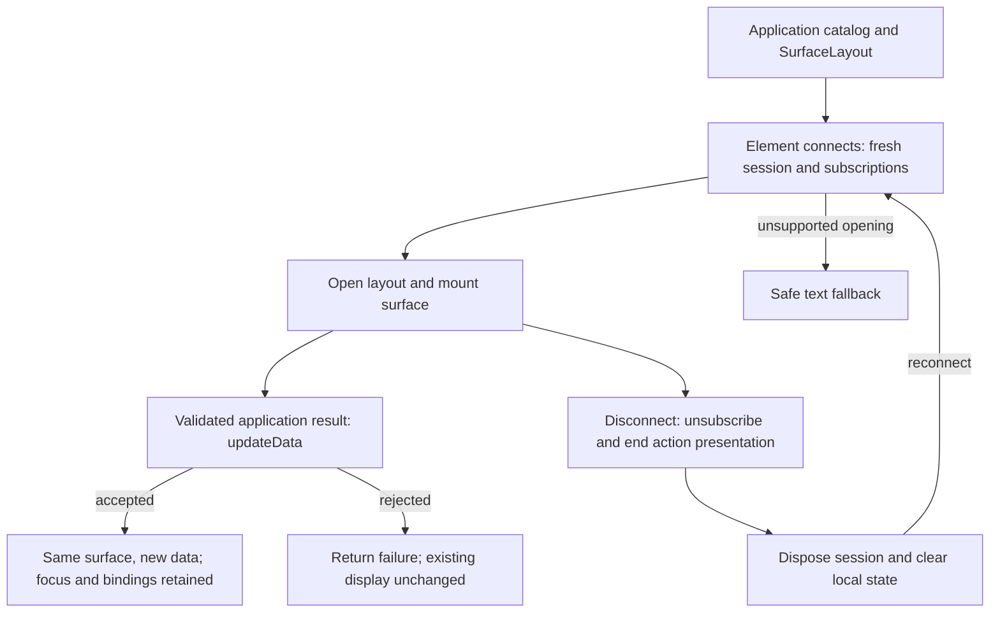

# Reusable Lit adapter

## Status

**Approved; the scoped VIEW1, VIEW2, CARD1/CARD2 and PACK1/PACK2 deliveries are implemented.** The baseline design is `6785ae1d8205a45e668f478ea303fbdd7e474663`; the lifetime amendment and later view-composition amendments retain their distinct design, review and implementation identities in the [lifecycle records](reusable_lit_adapter.lifecycle.md#status). This refresh changes no design approval or acceptance decision.

`@saga-a2ui/lit` is published at `0.7.7-rc.1`. Its 16 shipped source files match source baseline `cdad54747dfbba756464676ac3b1b8c90148a566`, with registry tarball integrity verified. This establishes source/package identity, not a new installation or host run. The historical candidate, browser and named-host observations remain bounded to their exact artifacts; audio success, invisible account changes, remote rollback and destination adoption do not follow from them.

The current public construction API takes `catalog` and `layout` and creates its default session. `initialInput`, a separate `surfaceId` and required `createSession` are no longer the consumer contract. `updateData` preserves mounted identity and returns a structured rejection without clearing existing data. Raw `ingest` is protected for advanced subclasses, not a public consumer API.

## Problem and current behavior

A Lit application should be able to use SAGA's validated A2UI processing and view lifecycle while retaining its own components. At the original inspected revision, `31759fabb596f7d59921eb3f85095bc2a3aba73b`, the synthetic app kept a decoder, message visitor and mutable processor session under `apps/lit-host/src/protocols/a2ui/v0_9`, while `src/lit` supplied its concrete elements. No reusable core or Lit package existed then. VIEW1 has since moved the protocol code to `packages/core/src/protocols/a2ui/v0_9` and the surface lifecycle to `packages/lit/src/a2ui/app-element.ts`; the application composes those packages with the public MCP bridge and retains its catalogs and domain behavior. The extraction and subsequent qualification are recorded in the lifecycle companion.

The protocol implementation delegates supported schema and state validation to upstream A2UI. It accepts unchecked input, returns validated message cases, and visits each case to update a processor session. The view subscribes to surface creation/deletion and disposes its session on disconnect. These responsibilities now belong to core and Lit respectively. The original demo heading and test hook, episode schema and synthetic catalog were application details, not reasons to put those concepts in the SDK.

The implemented design supplies `@saga-a2ui/core` and `@saga-a2ui/lit` with working own-catalog consumers. It preserves the example's complete read, content and protected action (Play) workflow (see the [action vocabulary](../README.md#action-vocabulary)), qualified under the approved [request and view lifetime verification](request_view_lifetimes.blueprint.md#verification-outcomes). An independently authored answer catalog supplied the second preparation consumer; neither consumer is required to adopt SAGA's optional FaithfulCard.

## Proposed behavior

The approved design is implemented through the current seams below. This section does not propose a new API.

The application supplies its catalog and a typed `SurfaceLayout` to `createA2uiAppElement`. On connection, the element creates a fresh core session with the SDK decoder, subscribes to surface creation/deletion, and opens the layout. The application does not write A2UI messages or choose a decoder for ordinary use. An optional advanced `createSession(catalog)` can wrap or replace the session; the element still owns and disposes it.

For example, an application's catalog can contain an Answer component whose `question` and `answer` properties bind to fields of a layout's data. The layout opens with a waiting answer. After the application validates a delivered result, `element.updateData({ question: 'Why is the sky blue?', answer: 'Air scatters shorter wavelengths more strongly.' })` replaces that data in place: the same surface and controls remain mounted, retaining focus and action bindings. The exact object must satisfy the layout's schema; a missing field, unknown field or unwanted coercion is refused with `{ ok: false, failure: { kind, message } }`. The prior data and fallback state remain unchanged. Applications must handle that result: if old content must not remain visible after an authorization or result-validation failure, the application's result controller retires or replaces its presentation. Rejected data alone does not detect account loss.

Opening a layout the session cannot support instead shows the safe text fallback. The advanced protected `ingest` path also shows a fallback on rejection; messages applied before a later processor rejection are not rolled back. A later accepted input clears that fallback. These are separate paths from a rejected public `updateData` call.

On disconnect, the element unsubscribes, ends its action presentation, disposes the session and clears its local surface/failure state. Reconnection opens a fresh session from the layout's initial data. It does not restore private state from the retired session or repeat a backend request by itself. An application's MCP stack or result controller separately owns delivery and decides which result is current.

The diagram above shows the current public update contract. **Historical extraction diagram below:** its decoder-to-fallback path describes raw protocol ingestion, not public `updateData` rejection. Application-controlled session construction and the Lynx investigation box belong to the original extraction context. The asset is retained to explain the separation of protocol, delivery and rendering owners.

[Editable Mermaid](../../diagrams/reusable-lit-adapter.mmd) · [Editable Excalidraw](../../diagrams/reusable-lit-adapter.excalidraw) · [PNG](../../diagrams/reusable-lit-adapter.png)

## Responsibilities and interfaces

Core owns renderer-independent contracts and processing. A2UI knowledge stays under a named protocol/version module. Its decoder treats input as `unknown`, uses upstream schemas, preserves supported fields and returns typed cases or an explicit failure. Its visitor handles every supported case; renderer code does not inspect raw wire tags again. Mutable session state remains separate from immutable validated values.

Lit owns mounting, binding integration, events, accessibility and disposal. Its interface accepts the application's catalog and explicit integrations rather than discovering them through a registry. The application chooses its renderer, host and trusted content policy independently. Upstream custom-element/catalog registration stays at the Lit integration seam; application catalog registration is explicit through `defineElements`. Importing the Lit adapter does load upstream's `a2ui-surface` element; this is not automatic registration of the application's own catalog.

Within one `CustomElementRegistry`, catalog registration may reuse an existing definition only when both tag and constructor match. A tag already bound to a different constructor must fail explicitly, preserving the first definition; the adapter must not silently use the existing component. Distinct implementations need distinct tag names.

In the [action binding](../modules/action_binding.blueprint.md) module's terms, the adapter owns the instance lifecycle and nothing about server authorization. The optional `createLitActions` integration creates one core instance host per presentation and closes it on surface deletion/replacement, disconnect or setup failure. `ActionButtonElement` identifies a live instance by its element, component model and data path; connection, model identity and current context checks reject a retired control. Mount lookup also checks the actual owning surface element. Detachment removes only the host still owned by that presentation. These are concrete identity/retirement guards, not a general queued-event epoch guarantee. Undecided invocations are then canceled as disposed, and a decided outcome stays as decided. The shared action runtime, not the adapter, decides outcomes and owns the module's work-deadline and per-step hook timers. Independent listener deadlines, current controller read bounds and any application-owned spanning bound that is still required keep their existing owners, and adapter retirement stays separate from server requests and from application resources. The adapter does not decide whether the server will honor a request: a successful decode, a bound callable and a client-side prerequisite authorize nothing, and the application server remains authoritative for protected work. Upstream A2UI action forms are wire semantics, and the adapter states how one reaches a bound callable without implying where that callable's work executes. This is the current optional Lit action integration. Other renderers have their own retirement rules; this contract establishes no Lynx support.

| Owner | Required behavior |
| --- | --- |
| `@saga-a2ui/core` | Validate supported A2UI input and apply typed message cases; import no MCP, renderer or DOM runtime. |
| `@saga-a2ui/lit` | Connect validated surface state to Lit, expose clear mount/update/dispose ownership, and release subscriptions exactly once. |
| `@saga-a2ui/mcp` | Deliver host results and lifecycle events through its public view contract; perform no protocol interpretation or renderer selection. |
| Consumer application | Supply catalog, content rules, host-theme/resource hooks, local and server action definitions, prerequisites and handlers, and composition; retain domain authorization and protected-resource decisions. |

The own-catalog import must not require `@saga-a2ui/components`, FaithfulCard or a Markdown parser. A consumer such as Ansari may use its own Markdown parser and branded component; that does not make those dependencies requirements of core or Lit.

The session must distinguish schema validity, component support, reference integrity and state-dependent update validity. A successful decode does not authorize a server action. Preserve valid partial updates, supported action data, state and attribution; unsupported essential behavior requires an explicit failure. The current session can apply earlier messages before a later processor rejection. The advanced protected ingestion path shows a text fallback on that rejection; it does not claim atomic state rollback. Public layout data updates use the narrower identity-preserving contract described above.

The bounded Lynx Web dependency/sandbox investigation completed the extraction gate: the upstream default module Worker path failed cross-origin in the observed ChatGPT and Claude runs. That finding informed the neutral boundaries without requiring a Lynx implementation. It neither rules out every alternate packaging path nor establishes Lynx renderer acceptance. Its exact original record remains in the lifecycle companion.

## Failure and recovery

| Trigger | Visible result and cleanup |
| --- | --- |
| Unsupported layout opening or rejected advanced protocol input | The element shows a safe text fallback; this is not transactional rollback of already processed messages. Application components remain responsible for safely rendering their own content. |
| Public `updateData` rejects invalid data or has no live session | It returns a structured failure and changes neither data nor fallback. The application decides whether to keep or retire its current presentation. |
| A valid result replaces an earlier answer or item | An in-place update preserves the surface and bindings. Replacing or removing a presentation ends its action host; the application separately releases resources it owns. |
| A result arrives during connection | The MCP view runner, when used, buffers early delivery until ready. The Lit element itself owns no host-result queue or backend retry. |
| Results arrive out of order after selection/account changes | Application correlation and authentication controllers choose the current result; the adapter retires disconnected sessions and stale controls. It does not infer selection or identity from arbitrary data. |
| Authentication is lost or a new sign-in is observed | Private content clears immediately when observable; the application owns that clearing and resource/request cleanup under the approved lifetime contract. An invisible host account change is not claimed to be immediately detectable. |
| A callback fails, processing exceeds a configured bound, or the view disconnects | Action setup failure shows the safe fallback; later discovery callback errors go to `onSetupError`. Disconnect retires owned listeners/sessions. Action runtime limits do not preempt synchronous rendering; application-owned cleanup remains explicit. The [connector's failure contract](reusable_mcp_connector.blueprint.md#failure-and-recovery) covers the bounded request. |
| Standard and Strict instances share one page | Trusted policy and callbacks remain instance-owned; changing one instance cannot permit another instance's links or images. |

For the optional FaithfulCard, host navigation uses only a supported advertised capability. When unavailable, supplied links remain readable and inert. Image requests obey trusted exact-host configuration and the host's Content Security Policy (CSP). Content cannot change the policy; an authored protected server action retains separate server authorization and resource rules under both content levels.

## Verification outcomes

These are the retained qualification requirements. Completed runs and exact artifact identities are in the lifecycle record; the table is not a claim of new tests or universal host coverage. Application-level cases require the relevant application controllers as well as the adapter.

| Condition | Observable result |
| --- | --- |
| Core is exercised without a DOM or renderer | Valid envelopes, message cases, field preservation and partial updates work; malformed, unsupported and state-invalid input returns explicit failure. |
| The synthetic app uses installed public core/Lit exports | The read, content and protected server action retain their authorization, policy, disclosure and visible behavior with the application's catalog. |
| Two independent catalogs and policy instances are mounted | Neither catalog, data, callbacks nor policy configuration changes the other instance. |
| Two catalogs register the same tag in one `CustomElementRegistry` | Different constructors fail explicitly without changing the first definition; repeating the exact same tag and constructor is harmless. |
| Early/repeated results, reversed selections, account changes and cancellation occur | Each accepted result renders once; no duplicate operations or listeners, and no restoration of stale private data or work from a retired invocation. |
| A mounted view is disposed and then reconnected | Old subscriptions and sessions are released; late results are ignored; the new instance starts fresh. |
| The built resource loads under declared CSP | Bindings, actual host-navigation callbacks, allowed/blocked image requests, keyboard interaction and narrow layouts behave as required. |
| Server and browser entry points are independently imported | Core has no renderer/MCP/DOM dependency; the browser artifact contains no server module or credentials. |
| An own-catalog consumer installs packed artifacts | It uses public exports without optional FaithfulCard/components/parser dependencies, workspace aliases or copied SDK code. |

VIEW2, CORE3 and the packaging join have their scoped completion records in the lifecycle companion. Changes must preserve that complete qualification rather than testing only the first consumer. Browser evidence proves the built adapter behavior; a new host-facing claim needs appropriate actual-host observations. Missing observations remain explicit limits.

## Implementation sequence

The completed extraction, passive and protected composition, VIEW2 lifetime and PACK1/PACK2 candidate deliveries retain their original order and acceptance limits in the [lifecycle companion](reusable_lit_adapter.lifecycle.md#implementation-sequence). The sequencing amendment permitted preparation to overlap; it did not approve the then-draft action or lifetime designs. Later design approvals remain separate records.

Further changes migrate owned consumers together and follow the version policy. Published package availability does not itself establish destination adoption, an audible media result or a new host run.

## Open decisions

The original investigation questions are retained in the [lifecycle companion](reusable_lit_adapter.lifecycle.md#original-open-decisions). The current package pins `@a2ui/lit` and `@a2ui/web_core` at `0.13.0` with Lit `^3.3.3`; it supplies the default session, structured update failure and explicit ownership described here. This is not a claim about the current dependencies or adoption status of an external application. Package versions alone do not establish wire incompatibility.

The main Lit entry needs no components or Markdown parser. Optional `/faithful-card` uses the components package's trusted content-policy and rendering contract; `/actions` supplies the action attachment seam. Application server authorization remains separate from both. Custom-element tag conflicts fail explicitly, so applications integrating different constructors must assign distinct tags.

Remaining qualification is tied to a changed claim: new hosts, custom catalogs, destination integration and new rendering/resource policies need their own evidence. The completed bounded Lynx investigation is not an open extraction prerequisite, and this Blueprint adds no speculative renderer extension.

## References

- Current sources: [element and session lifecycle](../../packages/lit/src/a2ui/app-element.ts), [layout authoring](../../packages/core/src/protocols/a2ui/v0_9/surface-layout.ts), [catalog registration](../../packages/lit/src/element-registration.ts), [per-presentation action host](../../packages/lit/src/actions/lit-actions.ts), and [control instance identity](../../packages/lit/src/actions/action-button.ts).

- [Coding standards](../../CODING_STANDARDS.md), [package direction](../../packages/README.md), and [reusable MCP connector](reusable_mcp_connector.blueprint.md).
- [A2UI decoder](https://github.com/MachineWisdomAI/saga-a2ui/blob/31759fabb596f7d59921eb3f85095bc2a3aba73b/apps/lit-host/src/protocols/a2ui/v0_9/decoder.ts), [validated messages](https://github.com/MachineWisdomAI/saga-a2ui/blob/31759fabb596f7d59921eb3f85095bc2a3aba73b/apps/lit-host/src/protocols/a2ui/v0_9/message.ts), [processor session](https://github.com/MachineWisdomAI/saga-a2ui/blob/31759fabb596f7d59921eb3f85095bc2a3aba73b/apps/lit-host/src/protocols/a2ui/v0_9/session.ts), [Lit lifecycle](https://github.com/MachineWisdomAI/saga-a2ui/blob/31759fabb596f7d59921eb3f85095bc2a3aba73b/apps/lit-host/src/lit/saga-app.ts), and [catalog integration](https://github.com/MachineWisdomAI/saga-a2ui/blob/31759fabb596f7d59921eb3f85095bc2a3aba73b/apps/lit-host/src/lit/integration.ts), inspected at `31759fabb596f7d59921eb3f85095bc2a3aba73b` (linked at that revision; VIEW1 moved the decoder, messages and session to [`packages/core`](../../packages/core/src/protocols/a2ui/v0_9/) and the Lit lifecycle to [`packages/lit`](../../packages/lit/src/a2ui/app-element.ts)).
- [Authorized playback](authorized_playback.blueprint.md), [request and view lifetimes](request_view_lifetimes.blueprint.md), [action binding](../modules/action_binding.blueprint.md), [content safety](content_safety_levels.blueprint.md), and [Ansari adoption](ansari_adoption.blueprint.md).
