# Reusable Lit adapter

## Status

**Approved and implemented for the Lit adapter and its qualified consumers.** The original design is [`6785ae1d8205a45e668f478ea303fbdd7e474663`](https://github.com/MachineWisdomAI/saga-a2ui/blob/6785ae1d8205a45e668f478ea303fbdd7e474663/blueprints/features/reusable_lit_adapter.blueprint.md), with the approved [request/view lifetime amendment](https://github.com/MachineWisdomAI/saga-a2ui/blob/7836c80345cec2aeb474d2eb026a1b9455819ef2/blueprints/features/reusable_lit_adapter.blueprint.md). The later [view-composition design](view_composition.blueprint.md#status), revision `7a78e7eae99285174a11c62d43c1f0035658ec96`, replaces consumer-created sessions and raw ingestion with a typed layout, a default SDK session and in-place data updates.

That amendment is implemented at `MachineWisdomAI/saga-a2ui@6b2aabf8a73e47347f70ade99d7584227c6e943b` ([PR #238 and independent review](https://github.com/MachineWisdomAI/saga-a2ui/pull/238#pullrequestreview-5617059507)); its reviewed head is `cfdf45a1cf048d2034b6d445d13fbb39800b41fe`. Lit and its MCP stack are published in the seven-package [`0.7.7-rc.1` release](https://github.com/MachineWisdomAI/saga-a2ui/releases/tag/v0.7.7-rc.1). Package publication does not extend the bounded ChatGPT/Claude observations to every consumer or establish full React or Lynx parity. [Earlier design-to-code records](#design-and-delivery-history) retain the installed-consumer, playback, card and rollback evidence and their limits.

## Problem and current behavior

A Lit application needs to render validated A2UI data with its own components while keeping focus, action bindings and cleanup correct. Before extraction, the demonstration owned its decoder, message visitor and mutable processor session beside its concrete elements. Core now owns the protocol implementation, and Lit owns the surface's mount and subscription lifetime. The application's catalog, note or episode schema, and business actions remain application code.

The distinction matters when a result changes a title. Updating the title should preserve the mounted Archive button and its pending state. Replacing the selected note is a different event: the application and action subject reader must prevent an old operation from writing into the new note's presentation. Rendering validates and displays values; it does not choose a domain identity or authorize a server operation.

## Proposed behavior

The approved design is implemented through two levels. An MCP application normally calls `startA2uiView` from `@saga-a2ui/lit-mcp-stack`; that stack supplies delivery, readiness ordering and teardown. The lower-level Lit adapter, `createA2uiAppElement({catalog, layout, actions?})`, owns one typed surface. It creates its default core session from the supplied catalog and layout on every connection. An advanced session factory is optional; an ordinary consumer supplies no decoder or wire messages.

For example, the [Node starter](../../templates/lit-node/src/view.ts) supplies its catalog and headline layout to `startA2uiView`. When a delivered status result passes the application's result reader, the application calls `surface.update({headline: ...})`. The layout validates the value, and the adapter applies it to the existing surface. Its Clear control keeps focus and the binding attached to that rendered instance. Calling `view.dispose()` ends the presentation and connection. A later start creates fresh owned state.

Two failure paths deliberately differ. If the initial layout cannot open—perhaps its root component is absent from the catalog—the adapter renders a safe fallback. If `updateData(data)` rejects invalid data, disconnected input or a disposed session, it returns `{ok: false, failure: {kind, message}}` and changes nothing. The application must interpret that refusal; it must not present an old answer as the new successful result. The card-app stack has a separate content contract: it clears the previous card when its result reader or `present` rejects.

[Editable Mermaid](../../diagrams/reusable-lit-adapter.mmd) · [Editable Excalidraw](../../diagrams/reusable-lit-adapter.excalidraw) · [PNG](../../diagrams/reusable-lit-adapter.png)

The diagram separates domain interpretation from protocol work. An MCP tool result reaches the application's reader first; the SDK constructs and validates the surface update. Closing the view retires action bindings before releasing the session and connection, so a late result cannot revive a disconnected surface.

## Responsibilities and interfaces

Core owns renderer-independent contracts and processing. A2UI knowledge stays under a named protocol/version module. Its decoder treats input as `unknown`, uses upstream schemas, preserves supported fields and returns typed cases or an explicit failure. Its visitor handles every supported case; renderer code does not inspect raw wire tags again. Mutable session state remains separate from immutable validated values.

Lit owns mounting, binding integration, events, accessibility and disposal. Its interface accepts the application's catalog and explicit integrations rather than discovering them through a registry. The application chooses its renderer, host and trusted content policy independently. Upstream custom-element/catalog registration stays at the Lit integration seam; importing SAGA does not configure an application globally.

Within one `CustomElementRegistry`, catalog registration may reuse an existing definition only when both tag and constructor match. A tag already bound to a different constructor must fail explicitly, preserving the first definition; the adapter must not silently use the existing component. Distinct implementations need distinct tag names.

In the [action binding](../modules/action_binding.blueprint.md) module's terms, the adapter owns the instance lifecycle and nothing about server authorization. It creates and retires instances, stamps each admitted event with its installation epoch so a stale event is ignored, answers whether an instance is still the live one, detaches only the installation its own binding made, and calls `dispose()` on its bindings when the surface is deleted, the host disconnects or setup fails. Undecided invocations are then canceled as disposed, and a decided outcome stays as decided.

The shared action runtime decides outcomes and owns the module's work-deadline and per-step hook timers. Independent listener deadlines, current controller read bounds and any application-owned spanning bound keep their existing owners. Adapter retirement stays separate from server requests and application resources. A successful decode, a bound callable and a client-side prerequisite authorize nothing; the application server remains authoritative for protected work. Upstream A2UI action forms are wire semantics, and the adapter explains how one reaches a bound callable without implying where its work executes. This is the implemented Lit action seam. React has its own retirement integration; the historical Lynx investigation supplies no supported adapter or lifecycle guarantee.

| Owner | Required behavior |
| --- | --- |
| `@saga-a2ui/core` | Validate supported A2UI input and apply typed message cases; import no MCP, renderer or DOM runtime. |
| `@saga-a2ui/lit` | Connect validated surface state to Lit, expose clear mount/update/dispose ownership, and release subscriptions exactly once. |
| `@saga-a2ui/mcp` | Deliver host results and lifecycle events through its public view contract; perform no protocol interpretation or renderer selection. |
| Consumer application | Supply catalog, content rules, host-theme/resource hooks, local and server action definitions, prerequisites and handlers, and composition; retain domain authorization and protected-resource decisions. |

The lower-level Lit own-catalog entry does not require `@saga-a2ui/components`, FaithfulCard or a Markdown parser. An application may supply its own parser and branded component. The stack package installs components to support its separate card entry, but its own-catalog browser graph excludes that code. Installed dependencies and code included in a browser bundle are different checks.

The core session distinguishes schema validity, component support, reference integrity and state-dependent update validity. A successful decode does not authorize a server action. Supported partial updates and their data are preserved. A low-level batch may apply earlier messages before a later processor rejection; that is not an atomic rollback contract. The ordinary typed update path validates its data before applying it and reports rejection without changing the current view. [Adapter tests](../../packages/lit/src/a2ui/app-element.test.ts) cover these public lifecycle and update behaviors.

The early Lynx Web investigation found that the default upstream module Worker path failed cross-origin in the two observed web hosts. It completed a bounded investigation, not Lynx implementation or host acceptance. Neutral contracts retain their own ownership; no supported Lynx consumer or delivery path is promised here.

## Failure and recovery

| Trigger | Visible result and cleanup |
| --- | --- |
| Initial layout cannot open or action integration cannot start | The adapter shows its safe fallback and does not expose an invalid surface. Application-owned components remain responsible for safely rendering their own content. |
| A typed data update is rejected | Return a structured failure and leave the prior surface, data and fallback state unchanged. The application decides how to show the refusal; a card-app result rejection instead clears its stale card. |
| A valid result replaces an earlier answer or item | Only the current result is visible; old bindings and resources do not persist as another active view. |
| A result arrives during connection | It is handled once after the owning view is ready; initialization does not repeat the business request. |
| Results arrive out of order after selection/account changes | The current request/session generation wins; retired data and work started by a retired invocation (in the playback example, the player Play's client work started) cannot be restored. |
| Authentication is lost or a new sign-in is observed | Private content clears immediately when observable; cleanup of acquired resources and requests follows the approved lifetime contract. An invisible host account change is not claimed to be immediately detectable. |
| A callback fails, processing exceeds a configured bound, or the view disconnects | Safe failure or teardown retires work and releases owned listeners/sessions. Application-owned cleanup remains explicit. The [connector's failure contract](reusable_mcp_connector.blueprint.md#failure-and-recovery) covers the bounded request. |
| Standard and Strict instances share one page | Trusted policy and callbacks remain instance-owned; changing one instance cannot permit another instance's links or images. |

Host navigation uses only a supported advertised capability. When unavailable, supplied links remain readable and inert. Image requests obey trusted exact-host configuration and the host's Content Security Policy (CSP). Content cannot change the policy; an authored protected server action retains separate server authorization and resource rules under both content levels.

## Verification outcomes

| Condition | Observable result |
| --- | --- |
| Core is exercised without a DOM or renderer | Valid envelopes, message cases, field preservation and partial updates work; malformed, unsupported and state-invalid input returns explicit failure. |
| The synthetic app uses installed public core/Lit exports | The read, content and protected server action retain their authorization, policy, disclosure and visible behavior with the application's catalog. |
| Two independent catalogs and policy instances are mounted | Neither catalog, data, callbacks nor policy configuration changes the other instance. |
| Two catalogs register the same tag in one `CustomElementRegistry` | Different constructors fail explicitly without changing the first definition; repeating the exact same tag and constructor is harmless. |
| Early/repeated results, reversed selections, account changes and cancellation occur | Each accepted result renders once; no duplicate operations or listeners, and no restoration of stale private data or work from a retired invocation. |
| A mounted view is disposed and then reconnected | Old subscriptions and sessions are released; late results are ignored; the new instance starts fresh. |
| The built resource loads under declared CSP | Bindings, actual host-navigation callbacks, allowed/blocked image requests, keyboard interaction and narrow layouts behave as required. |
| Server and browser entry points are independently imported | Core has no renderer/MCP/DOM dependency; the browser artifact contains no server module or credentials. |
| An own-catalog consumer installs packed artifacts | It uses public exports without optional FaithfulCard/components/parser dependencies, workspace aliases or copied SDK code. |

Run the full VIEW2 lifecycle matrix and the complete connector CORE3 checks before claiming the joined SDK ready for packaging/release. Browser evidence proves the built adapter behavior; independent actual-host runs remain required for host claims and must run promptly on integrated candidates. A pending maintainer acceptance decision does not require idle implementation, but no missing observation is converted into a pass.

## Implementation sequence

The extraction proceeded through passive rendering (VIEW1), lifetime and installed-public-export qualification (VIEW2), protected-card composition (CARD1/CARD2), and complete installed server/view and rollback qualification (PACK1/PACK2). These were separate evidence boundaries: an installed browser artifact alone did not prove the external listener, and identical playback HTML allowed reuse only of the matching historical host observations. The [delivery history](#design-and-delivery-history) retains each design, reviewed head and landed revision rather than crediting the first slice with the later work.

The stack amendment now owns the application-facing composition. New applications use the [public installation guide](../../docs/public-install.md) and [setup guide](../../docs/getting-started.md). A new renderer or host still requires its own qualification; the completed Lynx investigation and bounded React work do not supply it.

## Open decisions

The original extraction questions about the package recipe, public session ownership and the Lynx investigation have bounded answers in source and the delivery history. A future change to those contracts needs its own design; this editorial update adds none. Application-specific result interpretation, catalog contents and authorization remain deliberate extension points. Full renderer parity and any new actual-host claim remain separately qualified work.

## References

- [Coding standards](../../CODING_STANDARDS.md), [package direction](../../packages/README.md), and [reusable MCP connector](reusable_mcp_connector.blueprint.md).
- [A2UI decoder](https://github.com/MachineWisdomAI/saga-a2ui/blob/31759fabb596f7d59921eb3f85095bc2a3aba73b/apps/lit-host/src/protocols/a2ui/v0_9/decoder.ts), [validated messages](https://github.com/MachineWisdomAI/saga-a2ui/blob/31759fabb596f7d59921eb3f85095bc2a3aba73b/apps/lit-host/src/protocols/a2ui/v0_9/message.ts), [processor session](https://github.com/MachineWisdomAI/saga-a2ui/blob/31759fabb596f7d59921eb3f85095bc2a3aba73b/apps/lit-host/src/protocols/a2ui/v0_9/session.ts), [Lit lifecycle](https://github.com/MachineWisdomAI/saga-a2ui/blob/31759fabb596f7d59921eb3f85095bc2a3aba73b/apps/lit-host/src/lit/saga-app.ts), and [catalog integration](https://github.com/MachineWisdomAI/saga-a2ui/blob/31759fabb596f7d59921eb3f85095bc2a3aba73b/apps/lit-host/src/lit/integration.ts), inspected at `31759fabb596f7d59921eb3f85095bc2a3aba73b` (linked at that revision; VIEW1 moved the decoder, messages and session to [`packages/core`](../../packages/core/src/protocols/a2ui/v0_9/) and the Lit lifecycle to [`packages/lit`](../../packages/lit/src/a2ui/app-element.ts)).
- [Authorized playback](authorized_playback.blueprint.md), [request and view lifetimes](request_view_lifetimes.blueprint.md), [action binding](../modules/action_binding.blueprint.md), [content safety](content_safety_levels.blueprint.md), and [Ansari adoption](ansari_adoption.blueprint.md).

## Design and delivery history

The dated records below preserve the design decisions, exact reviewed and landed revisions, and the limits of each observation. Statements about unpublished packages or work still pending describe that delivery, not the current package baseline. The current scope is summarized in [Status](#status).

- Partial amendment by the [view composition](view_composition.blueprint.md) design, implemented on `main`. Approved revisions: [`db83e84`](https://github.com/MachineWisdomAI/saga-a2ui/blob/db83e84a7d8d6d9527c5ab350472e82809afd609/blueprints/features/view_composition.blueprint.md), [`4b1215a`](https://github.com/MachineWisdomAI/saga-a2ui/blob/4b1215a4d588f537e93e8a4099cdfc5268a26ab3/blueprints/features/view_composition.blueprint.md), [`49e39bd`](https://github.com/MachineWisdomAI/saga-a2ui/blob/49e39bdb434f5848ded9c042e425c5cefe735b31/blueprints/features/view_composition.blueprint.md) and the fourth revision [`7a78e7e`](https://github.com/MachineWisdomAI/saga-a2ui/blob/7a78e7eae99285174a11c62d43c1f0035658ec96/blueprints/features/view_composition.blueprint.md), approved by the human owner as one decision (PR #237). The amendment replaces `initialInput: unknown` and `surfaceId` of `createA2uiAppElement` with a `SurfaceLayout`, adds the identity-preserving `updateData(data)`, and (in `7a78e7e`) replaces the required `createSession` with `catalog`/`layout` and a default SDK session; raw `ingest` leaves the consumer contract, and a rejected update returns `{ok: false, failure: {kind, message}}` as React does. Session ownership, subscriptions, the safe fallback, the action seam and disposal are unchanged. No compatibility alias exists.
  - **Blueprint `49e39bd` implemented at `MachineWisdomAI/saga-a2ui@18153793795d4ecfc12d2785d96422d2e397a3b2`** ([PR #234](https://github.com/MachineWisdomAI/saga-a2ui/pull/234)), which integrated the `SurfaceLayout` input and in-place `updateData` ([`b30b901`](https://github.com/MachineWisdomAI/saga-a2ui/commit/b30b901cd2f53855757b99af88d4360e3f95f047), PR #221), the Lit card conveniences ([`32f8f34`](https://github.com/MachineWisdomAI/saga-a2ui/commit/32f8f34a9be9d79b8adefc7672c4f083dc606f74), PR #224) and the consumer migration ([`db63421`](https://github.com/MachineWisdomAI/saga-a2ui/commit/db63421693adf16c1658063390411cf1c033b3e0), PR #226, [review](https://github.com/MachineWisdomAI/saga-a2ui/pull/226#pullrequestreview-5610715041)).
  - **Blueprint `7a78e7e` implemented at `MachineWisdomAI/saga-a2ui@6b2aabf8a73e47347f70ade99d7584227c6e943b`** for the Lit construction API, the default session, the structured update failure and the inaccessible public `ingest` ([PR #238](https://github.com/MachineWisdomAI/saga-a2ui/pull/238), [review](https://github.com/MachineWisdomAI/saga-a2ui/pull/238#pullrequestreview-5617059507)). The Lit stack's forwarding of application stylesheets to the card landed at `MachineWisdomAI/saga-a2ui@e62514504f7501ef20d9cfeed319ded6159f42b6` ([PR #248](https://github.com/MachineWisdomAI/saga-a2ui/pull/248), [review](https://github.com/MachineWisdomAI/saga-a2ui/pull/248#pullrequestreview-5621359008)).
  - The view composition Status lists every landed revision. This records source implementation only; publication, adoption by the motivating application and actual-host acceptance remain separate. The rest of this Blueprint keeps its own records below.
- PACK2 acceptance, 2026-10-20: approved connector/Lit and action/lifetime contracts are **implemented and accepted for the bounded #22 release-candidate preparation scope** through [PR #158](https://github.com/MachineWisdomAI/saga-a2ui/pull/158), actual code SHA [`06aa486e6b8f4d99990d235a0c6177e5c8f14a32`](https://github.com/MachineWisdomAI/saga-a2ui/commit/06aa486e6b8f4d99990d235a0c6177e5c8f14a32). The existing packer stages private prerelease identities, exact sibling ranges and license/notices into candidate tarballs; repository packages remain unversioned. CI retains tarballs, matched resource/catalog/recipe records, lockfile and maintainer summary as workflow artifacts only. The [maintainer guide](../../docs/candidate-update-and-rollback.md) documents the tested root override `@a2ui/markdown-it: 0.2.1`, starter mismatch handling, coherent replacement/rollback and a separately authorized publication recipe. Removing that consumer override through a manifest redesign is optional later work, not an acceptance gate.
- PACK2 independent verification: [approval 5581016266](https://github.com/MachineWisdomAI/saga-a2ui/pull/158#pullrequestreview-5581016266) covers repaired head `a59f9011705c90c6762bddfbf3b1dac182e72b70`; [Linux CI 39373377297](https://github.com/MachineWisdomAI/saga-a2ui/actions/runs/39373377297) passed. Independent macOS arm64 Node 24.14.1/npm 11.11.0 validation passed 35 affected headless tests, both original public-CLI regressions and 60 actual browser observations: 20 each for install, update and rollback across separately rebuilt own/card consumers and servers. The verifier now requires the requested combination's complete package set and rejects missing module roots with guidance. Earlier clean npm install/npm ls/mixed-set refusal and unchanged PACK1 evidence were reused; the repaired-head reviewer did not claim a fresh full candidate-pack run. Worker broad-suite/mutation reports remain separately attributed.
- PACK2 seven-criterion reconciliation: (1) CI build/type/test/pack-install, artifact contents and import-boundary checks qualify candidate contents; (2) exact candidate versions, resource/catalog/peer recipe and actionable package/view mismatch refusal prevent partial incompatible display; (3) no published predecessor exists and none was invented; (4) the maintained starter change and update/rollback sequence restore complete tested combinations while retaining application authorization fixes; (5) candidate contents and secure publication instructions are maintainer-readable, with no npm tag, visibility/access change or release performed; (6) real rebuilt own/card applications execute representative direct-action, prerequisite, server-authority, outcome and disposal cases at every A→B→A stage, rather than treating recorded test titles as execution proof; (7) the guide distinguishes implemented obligations, partial React paths, retired Lynx and bounded existing named-host observations. The title/hash list remains provenance; actual stage executions provide the behavioral evidence.
- PACK2 first-version and identity limits: A and B are the same source revision with different package versions; this rehearses complete application replacement, not source-version compatibility, persistent-data migration or rollback to a previous published release. The own page digest `4e009ea5cc532f2c829db07ebed4836c936444eec317e37a54c097a0f26f1379` and card page digest `75fe4b90347119a2fac7127fa49b8fc180cb444f8ac43a0041548a91c11fea24`, plus scratch-comment-normalized server digests, restore on rollback. Current protected playback bytes and host-facing seams remain unchanged, so accepted CARD2/CARD1/CORE2 observations and PACK1 external-listener qualification are reused; no new assistant-host run is claimed. No actual-host audio, forwarded cancellation, rollback of remote effects, full React parity or production deployment follows from this candidate. Independent design approvals and earlier partial records remain intact.

- PACK1 final acceptance, 2026-10-20: the approved connector/Lit contracts and action/lifetime amendments are **implemented and accepted for the bounded #154/#21 packaging join** through [PR #156](https://github.com/MachineWisdomAI/saga-a2ui/pull/156), actual code SHA [`0ebc4a11b8232e337b3cfe0abdb7efc68c330ac1`](https://github.com/MachineWisdomAI/saga-a2ui/commit/0ebc4a11b8232e337b3cfe0abdb7efc68c330ac1), together with the partial #153 delivery below. The actual application's `serve.ts` listener is bundled in the same clean external consumer as its installed views, from the same packed SDK copies. A separate Node process uses that external working directory, declared third-party imports and explicit resource directory; all four view artifacts must exist before it listens. The default source resource path is unchanged. This extends the existing packing harness and application logic, not a new runtime or copied SDK implementation.
- PACK1 final verification: [independent approval 5580270791](https://github.com/MachineWisdomAI/saga-a2ui/pull/156#pullrequestreview-5580270791) covers exact head `1d65daf4fe8b62c6e769b7a088a6a6478692cef0`; [Linux CI 39361469652](https://github.com/MachineWisdomAI/saga-a2ui/actions/runs/39361469652) passed. Independent macOS arm64 Node 24.14.1/npm 11.11.0 validation built the external application, passed 15 installed-listener headless and four built-browser cases, discovery and root/application type checking. These checks exercise artifact readiness, account-isolated browse, private recipient-bound Play, denied/forged requests, proof-bound media/replay rejection and actual installed-player allowed/denied/recovery behavior. Server provenance has no unexpected module or runtime SDK import. The macOS server bundle SHA256 is `26540bd678cd94892d7a06baa2a6bbdd2e2ff0f8a78c3d1548e6f89da7d17a72`; scratch-path comments make that identity run-specific. The previously reviewed #153 12/20/16 evidence and unchanged runtime/card suites were reused, not rerun. Worker Linux broad-suite and mutation reports remain separately attributed.
- PACK1 nine-criterion reconciliation: (1) actual tarballs, external directories, recipe/export/dependency checks and origins qualify installation; (2) #153's server/browser/neutral import checks and #156's listener provenance preserve package direction and optionality; (3) notes CSP/content cases join the real byte-matched browse/Play resources, readiness refusal and allowed/denied behavior; (4) independent macOS and passing Linux CI cover the prescribed environments; (5) explicit package/peer/resource/catalog identities and scratch-only test versions remain separate from release; (6) #153 retains two independent own/card consumers with the same disclosure/authorization boundary; (7) its direct shared Archive definition, two instances and local action qualify the non-playback seam; (8) repaired prerequisite refusal, server reauthorization, uncertain effects, retirement and release/handoff combine with the actual protected listener checks; (9) accepted CORE3/VIEW2/CARD2 behavior is now joined through installed server and view artifacts. The notes consumers were not substituted for the protected application, and no exhaustive runtime matrix was copied into packaging.
- PACK1 host reuse and limits: installed playback HTML SHA256 `7ea1d8d0d696a20921896d1df45905cd22455f5f17fa20cd1d41243591224afd` exactly matches accepted CARD2 bytes. Independently inspected auth/transport/projection/media seams are unchanged, supporting reuse of [CARD2 receipt 6280435005](https://github.com/MachineWisdomAI/saga-a2ui/issues/20#issuecomment-6280435005), [CARD1 receipt 6278612238](https://github.com/MachineWisdomAI/saga-a2ui/issues/146#issuecomment-6278612238) and [CORE2 receipt 6275325996](https://github.com/MachineWisdomAI/saga-a2ui/issues/15#issuecomment-6275325996). Matching HTML alone would not qualify the server; the new external-process checks do. No new host run was required. The development verifier and fixed synthetic tokens are not an OAuth/DCR observation; generated-tone/advancing local browser clock is not audible-output or actual-host audio evidence. No new account-switch, removed-view ownership, cancellation-forwarding or rollback claim is made. PACK2, full React parity, public npm availability and production deployment retain their separate scope.

- PACK1 partial delivery, 2026-10-20: the approved connector/Lit contracts and action design `a60acdaf002b8fcca57bcdbd88e30e9c96acfda8` with defaults amendment `564bcb2a13dd162515a80e7f491d2870990958ab` have a further installed-consumer qualification through [PR #153](https://github.com/MachineWisdomAI/saga-a2ui/pull/153), actual code SHA [`55b99684f8569b994c744de490a134bc6cda90fd`](https://github.com/MachineWisdomAI/saga-a2ui/commit/55b99684f8569b994c744de490a134bc6cda90fd). The existing packing harness installs two independent external notes consumers: own catalog without optional components/parser, and the same catalog plus FaithfulCard. Their bundled MCP server and byte-matched resources qualify disclosure/authorization, closed CSP, direct shared Archive definitions on distinct instances, local actions, prerequisite refusal, subject retirement and resource release/handoff. Generic backend/post-write failures retain unknown effect; only explicit application-owned no-effect refusals are definite. Terminal pagehide/teardown retires the application and stale controls before transport disposal. No SDK runtime or public export is added.
- PACK1 partial verification: [independent approval 5579944369](https://github.com/MachineWisdomAI/saga-a2ui/pull/153#pullrequestreview-5579944369) covers repaired head `9b5c7cef7cac2c7ad5328270cb9412f908dedac9`; [CI 39356602227](https://github.com/MachineWisdomAI/saga-a2ui/actions/runs/39356602227) passed on Linux. Independent macOS arm64 validation on Node 24.14.1/npm 11.11.0 rebuilt both repaired external consumers and passed 16 affected browser cases, including original unknown-effect/pagehide regressions and repeated-pagehide checks, plus client/server type checking. Earlier independent 12 packed-headless and unaffected 20 browser evidence was reused where unchanged; source/build identities were refreshed. The worker's Linux broad-suite and mutation reports remain separate evidence. Test authentication is a header-based synthetic seam, not an OAuth-flow observation; no named-host run or public release is established by these tests.
- Historical PACK1 remainder at #153: the notes consumers left the full external authenticated browse/Play listener/resource join outstanding. #154/#156 subsequently completed that distinct outcome as recorded above; the partial delivery below is not retrospectively credited with it. Separate React/Ansari and PACK2 release work retain their scopes.

- CARD2 source qualification, 2026-10-19: [PR #151](https://github.com/MachineWisdomAI/saga-a2ui/pull/151) implements the scoped optional Lit fidelity/accessibility fixes and installed qualification at `299e396c5c55a92eddcd2a12f0bf85bacd8e9bde`, under the approved passive-card design `6785ae1d8205a45e668f478ea303fbdd7e474663`. The [content-safety lifecycle](content_safety_levels.blueprint.md#status) maps all six #20 criteria, exact review/checks, independent 63 browser/seven fixture results, installed provenance and bounded accessibility limits. Its final bounded ChatGPT/Claude rendering and keyboard observations complete the scoped #20 acceptance; unchanged CARD1 protected-action/lifecycle evidence is reused. Full React parity and packaging stay separate.

- CARD1 protected composition, 2026-10-19: approved passive-card design `6785ae1d8205a45e668f478ea303fbdd7e474663` with the accepted action/lifetime contracts is implemented for [#146](https://github.com/MachineWisdomAI/saga-a2ui/issues/146) / [CARD1 #19](https://github.com/MachineWisdomAI/saga-a2ui/issues/19) through [PR #148](https://github.com/MachineWisdomAI/saga-a2ui/pull/148), actual code SHA [`11ce39d6d413a3a9a051b4cd8d2303f00883763e`](https://github.com/MachineWisdomAI/saga-a2ui/commit/11ce39d6d413a3a9a051b4cd8d2303f00883763e). The real player displays the opener's existing public episode description through the optional Lit FaithfulCard beside its directly bound Play control. No subscriber Markdown field or card-owned action runtime is introduced. The existing content consent scope revokes on each opener and retires on label loss, teardown and disposal; terminal retirement removes the element and makes retained links and pending host-link responses stale. Ordinary image revocation remains independent of Play. The production resource uses Standard content policy with an empty image allowlist and the existing media CSP; Strict image-consent behavior remains separately qualified in controlled browser fixtures.
- CARD1 source and installed qualification: [independent approval 5578389720](https://github.com/MachineWisdomAI/saga-a2ui/pull/148#pullrequestreview-5578389720) covers repaired head `a0b3e6df04c84d3e74da6920f7b66c778172767d`; [CI 39331936970](https://github.com/MachineWisdomAI/saga-a2ui/actions/runs/39331936970) passed. Independent repair validation rebuilt the locally packed public-export player, passed 12 affected browser cases and two original terminal-link repros, and passed application type checking. Unchanged 98 controller cases, eight installed assertions and unaffected composition/bundle evidence were reused. The worker's broader suites and red/green chronology remain separately attributed. Installed production HTML SHA256 is `7c35c5c581faf1c80dabcdb145bc295f95532aa5d002d1f5c6c0b1f86eee521c`; its provenance contains installed card/components/parser modules with no workspace alias or server leakage. Own-catalog optional-dependency independence remains intact.
- CARD1 acceptance: **complete for the bounded #146/#19 composition** with the [actual-host receipt 6278612238](https://github.com/MachineWisdomAI/saga-a2ui/issues/146#issuecomment-6278612238). Both retained synthetic ChatGPT and Claude connectors rendered title, supplied public description and authored Play in order, with valid private recipient metadata, episode-only arguments and private grants absent from model-visible projections. Claude observed a stale-label retirement that removed description and Play, then a fresh opener/grant at 22:16:45.917–22:16:45.920Z. ChatGPT obtained a grant at 22:17:33.199–22:17:33.206Z, removed the old frame on host reload, and remounted the description with a fresh grant at 22:18:22.514–22:18:22.522Z. The passive diagnostic observer's served HTML SHA256 was `31bc7d932095ff79515456262680c4a54a16fd59992da3d242fe914f26300a14`, distinguished from the production hash above. Host resource Retry resolved cached/failed embeds; it is not an automatic retry of an unknown Play outcome. The removed ChatGPT frame was unobservable, and deterministic retirement/disconnection tests supply that proof. Claude's visible label mismatch establishes no invisible account-switch detection. Loopback media failure establishes no audio success; the description remained visible at that known failure. No image was expected under the Standard empty-image allowlist; unchanged Strict-policy, timing, lease and installed evidence was reused. CARD2/full React parity, packaging, publication and production deployment remain separate; this record creates no new claim in those scopes.

- CARD1 composition qualification, 2026-10-19: the approved passive-card contract `6785ae1d8205a45e668f478ea303fbdd7e474663` and existing action/lifetime contracts have a further **partial** integration at [`f2774ff2f10eb76e77676764462cd4a53aae9c90`](https://github.com/MachineWisdomAI/saga-a2ui/commit/f2774ff2f10eb76e77676764462cd4a53aae9c90) through [PR #143](https://github.com/MachineWisdomAI/saga-a2ui/pull/143). A test-only repeated-row Archive fixture composes the optional FaithfulCard with a separately registered, directly bound control; supplied Markdown cannot select handlers or permission. Card consent and action retirement retain separate owners, and both card pages join the existing installed public-export harness. [Independent approval 5577772507](https://github.com/MachineWisdomAI/saga-a2ui/pull/143#pullrequestreview-5577772507) covers repaired head `6b865b4942d914760772b3eb70ff3aaf279fb843`; [CI 39323484959](https://github.com/MachineWisdomAI/saga-a2ui/actions/runs/39323484959) passed. Independent repaired-head validation rebuilt installed pages/provenance, checked discovery and type checking, and reused the unchanged eight provenance and 31 installed-browser cases from the earlier reviewed head. Worker-reported broad suites remain separate evidence. This fixture uses test doubles and establishes no new named-host acceptance or public release. At this partial slice, [CARD1 #19](https://github.com/MachineWisdomAI/saga-a2ui/issues/19) remained open; native child [#146](https://github.com/MachineWisdomAI/saga-a2ui/issues/146) subsequently delivered the real protected composition recorded above. CORE2/CORE3/VIEW2 are complete prerequisites; separate CARD2/React and PACK obligations retain their owners. Historical extraction records below remain bounded to their delivery dates.

- Design: this terminology/lifetime amendment is approved by the human owner on 2026-10-17 at [7836c80345cec2aeb474d2eb026a1b9455819ef2](https://github.com/MachineWisdomAI/saga-a2ui/blob/7836c80345cec2aeb474d2eb026a1b9455819ef2/blueprints/features/reusable_lit_adapter.blueprint.md) in [PR #69](https://github.com/MachineWisdomAI/saga-a2ui/pull/69), together with [request and view lifetimes](request_view_lifetimes.blueprint.md). It aligns this Blueprint with the approved [action binding](../modules/action_binding.blueprint.md) module (design `a60acdaf002b8fcca57bcdbd88e30e9c96acfda8`, merged in [PR #73](https://github.com/MachineWisdomAI/saga-a2ui/pull/73)). It replaces only the amended terminology/lifetime scope; the earlier approved contract, sequencing amendment and implementation records below are retained. The listed open decisions remain open, and implementation-breakdown approval and dispatch remain separate.
- Approved baseline: approved on 2026-10-16 at [`6785ae1d8205a45e668f478ea303fbdd7e474663`](https://github.com/MachineWisdomAI/saga-a2ui/blob/6785ae1d8205a45e668f478ea303fbdd7e474663/blueprints/features/reusable_lit_adapter.blueprint.md).
- Implementation: partial. Blueprint `6785ae1d8205a45e668f478ea303fbdd7e474663`, with the approved sequencing amendment below, is implemented for the VIEW1 preparation slice at [`MachineWisdomAI/saga-a2ui@c3eecaad89fcefc540ee7816a8b41731cb65e9d0`](https://github.com/MachineWisdomAI/saga-a2ui/commit/c3eecaad89fcefc540ee7816a8b41731cb65e9d0): private, unreleased `@saga-a2ui/core` and `@saga-a2ui/lit` with the synthetic application as consumer, plus passive answer rendering. [PR #76 and its independent review](https://github.com/MachineWisdomAI/saga-a2ui/pull/76#pullrequestreview-5558428247) record verification at `c54a246d3a3bd4389cdd245bfdd0911168f12c56`, including 544 headless tests, 117 browser tests and the packed own-catalog consumer. Missing: CORE2 action contract re-run, complete CORE3/VIEW2, and PACK1/PACK2. This slice does not complete the design or implement the proposed #69 lifetime changes.

- VIEW2 public-adapter qualification: approved lifetime amendment `7836c80345cec2aeb474d2eb026a1b9455819ef2` is **partially implemented and qualified** for the existing adapter lifecycle at [`MachineWisdomAI/saga-a2ui@39d528bbf9bb31b32bb8fe0d4763ea65a22d960e`](https://github.com/MachineWisdomAI/saga-a2ui/commit/39d528bbf9bb31b32bb8fe0d4763ea65a22d960e), through [PR #129](https://github.com/MachineWisdomAI/saga-a2ui/pull/129). This test/fixture slice qualifies the adapter already delivered with ACT1–ACT6; it changes no adapter runtime. Five added built-browser cases establish once-only session/listener disposal with mount isolation, refusal of disconnected input and late retired-session delivery, fresh reconnect state, control movement with one binding/invocation, isolation of a throwing discovery callback, and disposal during a pending prerequisite followed by fresh valid recovery. The existing catalog/model/subject/installation and direct/upstream-path evidence remains retained, not duplicated.
- VIEW2 verification: [independent review 5576032153](https://github.com/MachineWisdomAI/saga-a2ui/pull/129#pullrequestreview-5576032153) approved exact head `d1ca236ffe5eb7cd54bb362f3c8bc0f873283a8b`; [required CI 39302769414](https://github.com/MachineWisdomAI/saga-a2ui/actions/runs/39302769414) passed. The reviewer inspected both changed files and lifecycle paths, passed all five added browser cases against the freshly built consumer, Lit-host typecheck and whitespace checks, and reused unchanged evidence. The [PR report](https://github.com/MachineWisdomAI/saga-a2ui/pull/129) separately records worker-run 1,129 headless, 257 Lit/React and 58 Lynx browser tests and a disposal mutation witness. These are qualification cases that passed on first run, not claimed red–green source repairs; broader worker checks are distinct from independent runs. Local Chromium does not establish named-host behavior or public package installation.
- VIEW2 installed-public-export delivery: approved lifetime amendment `7836c80345cec2aeb474d2eb026a1b9455819ef2`, preserving baseline `6785ae1d8205a45e668f478ea303fbdd7e474663`, is **implemented for the bounded VIEW2 scope** through [#131](https://github.com/MachineWisdomAI/saga-a2ui/issues/131) / [PR #135](https://github.com/MachineWisdomAI/saga-a2ui/pull/135) at [`MachineWisdomAI/saga-a2ui@c5f4ce8032b65ab53bfdf52d28b2a5ba9bbefc85`](https://github.com/MachineWisdomAI/saga-a2ui/commit/c5f4ce8032b65ab53bfdf52d28b2a5ba9bbefc85). The existing packed-consumer mechanism builds the application's browser pages and own-catalog/action consumer outside the workspace from locally packed SDK copies and public exports. Existing lifecycle, read/content/protected-action and bundle cases run against those installed artifacts without replacing their assertions. Module provenance rejects workspace SDK aliases, keeps server modules/credentials out of browser output and keeps optional FaithfulCard/parser/React out of routes that do not use them. Build identities record source, package tarball and output-file hashes; this is local packed-artifact qualification, not public npm installation.
- VIEW2 installed verification: [independent repair review 5576785439](https://github.com/MachineWisdomAI/saga-a2ui/pull/135#pullrequestreview-5576785439) approved exact head `548c842c308c4eca95c664eba8759745b3f3c5fc`; [required CI 39311862851](https://github.com/MachineWisdomAI/saga-a2ui/actions/runs/39311862851) passed. The final integration repair positively verifies installed core invocation/server/limits and MCP view modules and excludes the retired controller timer. The focused installed-provenance test, script typecheck and whitespace passed at that head. Eight earlier independent macOS canonicalization/symlink cases and 40 installed lifecycle/playback/bundle cases were reused where unchanged; they are not claimed as newly repeated final-head runs. The PR's earlier broad worker suites and old-head artifact hashes remain historical evidence, distinct from this final integrated candidate.
- VIEW2 host evidence reuse: the independently built final installed playback HTML SHA256 is `7f93539f2f7bf146f1cea02af1c7500d014576a37a135f1a098a211d40b24fef`, byte-for-byte identical to the actual ChatGPT/Claude CORE2 candidate in [receipt 6275325996](https://github.com/MachineWisdomAI/saga-a2ui/issues/15#issuecomment-6275325996). That identity joins installed provenance to the already accepted metadata/private-grant, bounded waiting, retirement/remount and fresh-view recovery observations. No redundant host run was performed. Retained STATE1/STATE2 and unchanged source/built-browser evidence supply the other scoped lifecycle checks. The host fixture's loopback media failure establishes no audio success; a removed view is unobservable, and deterministic lease tests supply the scoped ownership proof. The observed Claude host cancellation notification is not server cancellation or rollback.
- VIEW2 scoped acceptance: **Complete for #18**, combining the #129 lifecycle qualification, #131 installed-public-export cases, independently verified artifact identity and retained actual-host observations. The overall adapter/SDK design remains partial: CORE3's complete callback/transport matrix, further component integration, PACK1/PACK2 release/public-installation and destination acceptance retain their owners. The browser pages use installed SDK copies; application server/listener/authentication/backend test processes still use workspace server exports, so this is not installed-server qualification. No registry publication, production deployment or destination installation is claimed.

- Passive FaithfulCard preparation: Blueprint `6785ae1d8205a45e668f478ea303fbdd7e474663` is implemented for this bounded slice at [`MachineWisdomAI/saga-a2ui@b66a616d86ae3729f09efd48cfa07545350f4943`](https://github.com/MachineWisdomAI/saga-a2ui/commit/b66a616d86ae3729f09efd48cfa07545350f4943) through [PR #100](https://github.com/MachineWisdomAI/saga-a2ui/pull/100) ([#99](https://github.com/MachineWisdomAI/saga-a2ui/issues/99)). The optional private `@saga-a2ui/components/faithful-card` and `@saga-a2ui/lit/faithful-card` exports implement the component ownership in [Responsibilities and interfaces](#responsibilities-and-interfaces); the synthetic episode panel and an external consumer installed from locally packed artifacts use them. The [independent review](https://github.com/MachineWisdomAI/saga-a2ui/pull/100#pullrequestreview-5564083004) records verification at `184ed288511924a9adabd1520bee46be8a8abf15`: 853 headless, 218 Lit browser and 58 Lynx browser tests, build/typecheck and the packed external consumer; [CI passed on that head](https://github.com/MachineWisdomAI/saga-a2ui/actions/runs/39150040967). At that passive preparation delivery, complete CARD1 integration, CARD2, VIEW2, the protected Play workflow, PACK1/PACK2 and actual-host evidence remained outstanding; later scoped deliveries are recorded separately. The reusable component accepts no action attachment in this slice. Local packed-artifact consumption does not establish public npm installation or deployment.
- The bounded Lynx Web investigation is complete, as recorded in the [PR #76 review](https://github.com/MachineWisdomAI/saga-a2ui/pull/76#pullrequestreview-5558428247): the default upstream module Worker path failed cross-origin in both actual web hosts. This satisfies the investigation gate; it does not establish Lynx renderer acceptance, rule out other packaging paths, or qualify this integrated candidate in those hosts.
- The approved 2026-10-17 sequencing amendment in [VIEW1 #17](https://github.com/MachineWisdomAI/saga-a2ui/issues/17) permits passive-renderer preparation after CORE1, retaining existing lifecycle safeguards. VIEW2 still requires STATE2; full qualification remains required.
- Historical draft: [this Blueprint at `d62c2232ecd8e100d90fe9dbffa072f6cd3dd4a7`](https://github.com/MachineWisdomAI/saga-a2ui/blob/d62c2232ecd8e100d90fe9dbffa072f6cd3dd4a7/blueprints/features/reusable_lit_adapter.blueprint.md) in [PR #69](https://github.com/MachineWisdomAI/saga-a2ui/pull/69) was unapproved. The current amendment is the approved revision recorded above; the historical draft granted no authority.
- Acceptance: full SDK qualification, required actual-host evidence and publication or destination acceptance remain separate gates.
