# Reusable MCP connector

## Status

- Partial amendment by the [view composition](view_composition.blueprint.md) design (layer D), implemented on `main`. Approved revisions: [`49e39bd`](https://github.com/MachineWisdomAI/saga-a2ui/blob/49e39bdb434f5848ded9c042e425c5cefe735b31/blueprints/features/view_composition.blueprint.md) and the fourth revision [`7a78e7e`](https://github.com/MachineWisdomAI/saga-a2ui/blob/7a78e7eae99285174a11c62d43c1f0035658ec96/blueprints/features/view_composition.blueprint.md), approved by the human owner as one decision (PR #237) that covers the whole E2 amendment below. The amendment grows `connectToolResultView` into the lifecycle owner `runToolResultView` (`connectToolResultView` no longer exists, and earlier statements here that name it describe behavior at the time they were written), puts `hostLinksFromApp`, `startOwnSizing`, `readingProfile` and `deliveredResultFromToolResult` beside it, and moves the host link contract to `@saga-a2ui/core/host-links`.
  - **Blueprint `49e39bd` implemented at `MachineWisdomAI/saga-a2ui@18153793795d4ecfc12d2785d96422d2e397a3b2`** ([PR #234](https://github.com/MachineWisdomAI/saga-a2ui/pull/234)), integrating the view lifecycle ([`ced12dd`](https://github.com/MachineWisdomAI/saga-a2ui/commit/ced12ddc69f329c4850c7a0bebf99d2ec2584291), PR #223), the embedded-policy transport and `operationViewFromHtml` ([`31d896b`](https://github.com/MachineWisdomAI/saga-a2ui/commit/31d896b3046b11409f3565c1c2a53fd08b165a3e), PR #220), the two stacks that own the view start ([`0ebee1c`](https://github.com/MachineWisdomAI/saga-a2ui/commit/0ebee1c090cba49574d2c1f5b21d3c21588b9982), PR #225) and the consumer migration with the boundary scan ([`db63421`](https://github.com/MachineWisdomAI/saga-a2ui/commit/db63421693adf16c1658063390411cf1c033b3e0), PR #226, [review](https://github.com/MachineWisdomAI/saga-a2ui/pull/226#pullrequestreview-5610715041)). PR #226 also added `scripts/package-direction.ts`, which every package's `exports.test.ts` asserts against its manifest and source.
  - **Result adapter, Blueprint `7a78e7e` implemented at `MachineWisdomAI/saga-a2ui@3a37b200e44ba36fa785202d1b63498a4ac70be1`** ([PR #240](https://github.com/MachineWisdomAI/saga-a2ui/pull/240), [review](https://github.com/MachineWisdomAI/saga-a2ui/pull/240#pullrequestreview-5618100272)). Core owns the neutral `DeliveredResult`. `deliveredResultFromToolResult` in `@saga-a2ui/mcp/view` maps an MCP tool result onto it and interprets nothing; the application definition's one `result` reader decides, and the `classifyResult` stack option is removed. Among SDK packages MCP may import only core, never components or a renderer, which `packages/mcp/src/exports.test.ts` asserts.
  - **Entries and aliases.** The `content-policy` and `server` stack subpaths, the `readingProfile` host and device aliases and the `strong`, `em` and `hr` styling first landed in PR #229, in `main` through PR #234. The server-only trade-off is recorded in the design: an independently installable server keeps `@saga-a2ui/mcp/server` and needs no renderer peer, and a renderer-named stack's `/server` entry is a convenience for an application that already installs that stack. That recipe is qualified at `MachineWisdomAI/saga-a2ui@d465ab394f801c8a6e800af738438b7dbf6133da` ([PR #242](https://github.com/MachineWisdomAI/saga-a2ui/pull/242), [review](https://github.com/MachineWisdomAI/saga-a2ui/pull/242#pullrequestreview-5619017679)), and the boundary scan covers maintained server consumers at `MachineWisdomAI/saga-a2ui@39777a6b81ff2a4757f58232686dc1e31b9c7080` ([PR #244](https://github.com/MachineWisdomAI/saga-a2ui/pull/244), [review](https://github.com/MachineWisdomAI/saga-a2ui/pull/244#pullrequestreview-5620133622)).
  - **Lifecycle.** Starting views retire and unmount before the connection closes, and a throwing callback leaves cleanup complete, at `MachineWisdomAI/saga-a2ui@d0f04f1ee213075c7c611eb9c1b348f6f0dcc0f7` ([PR #245](https://github.com/MachineWisdomAI/saga-a2ui/pull/245), [review](https://github.com/MachineWisdomAI/saga-a2ui/pull/245#pullrequestreview-5620594181)).
  - The view composition Status lists every landed revision. This records source implementation only; publication, adoption by the motivating application and actual-host acceptance remain separate. The rest of this Blueprint keeps its own records below.
- PACK2 acceptance, 2026-10-20: approved connector/Lit and action/lifetime contracts are **implemented and accepted for the bounded #22 release-candidate preparation scope** through [PR #158](https://github.com/MachineWisdomAI/saga-a2ui/pull/158), actual code SHA [`06aa486e6b8f4d99990d235a0c6177e5c8f14a32`](https://github.com/MachineWisdomAI/saga-a2ui/commit/06aa486e6b8f4d99990d235a0c6177e5c8f14a32). The existing packer stages private prerelease identities, exact sibling ranges and license/notices into candidate tarballs; repository packages remain unversioned. CI retains tarballs, matched resource/catalog/recipe records, lockfile and maintainer summary as workflow artifacts only. The [maintainer guide](../../docs/candidate-update-and-rollback.md) documents the tested root override `@a2ui/markdown-it: 0.2.1`, starter mismatch handling, coherent replacement/rollback and a separately authorized publication recipe. Removing that consumer override through a manifest redesign is optional later work, not an acceptance gate.
- PACK2 independent verification: [approval 5581016266](https://github.com/MachineWisdomAI/saga-a2ui/pull/158#pullrequestreview-5581016266) covers repaired head `a59f9011705c90c6762bddfbf3b1dac182e72b70`; [Linux CI 39373377297](https://github.com/MachineWisdomAI/saga-a2ui/actions/runs/39373377297) passed. Independent macOS arm64 Node 24.14.1/npm 11.11.0 validation passed 35 affected headless tests, both original public-CLI regressions and 60 actual browser observations: 20 each for install, update and rollback across separately rebuilt own/card consumers and servers. The verifier now requires the requested combination's complete package set and rejects missing module roots with guidance. Earlier clean npm install/npm ls/mixed-set refusal and unchanged PACK1 evidence were reused; the repaired-head reviewer did not claim a fresh full candidate-pack run. Worker broad-suite/mutation reports remain separately attributed.
- PACK2 seven-criterion reconciliation: (1) CI build/type/test/pack-install, artifact contents and import-boundary checks qualify candidate contents; (2) exact candidate versions, resource/catalog/peer recipe and actionable package/view mismatch refusal prevent partial incompatible display; (3) no published predecessor exists and none was invented; (4) the maintained starter change and update/rollback sequence restore complete tested combinations while retaining application authorization fixes; (5) candidate contents and secure publication instructions are maintainer-readable, with no npm tag, visibility/access change or release performed; (6) real rebuilt own/card applications execute representative direct-action, prerequisite, server-authority, outcome and disposal cases at every A→B→A stage, rather than treating recorded test titles as execution proof; (7) the guide distinguishes implemented obligations, partial React paths, retired Lynx and bounded existing named-host observations. The title/hash list remains provenance; actual stage executions provide the behavioral evidence.
- PACK2 first-version and identity limits: A and B are the same source revision with different package versions; this rehearses complete application replacement, not source-version compatibility, persistent-data migration or rollback to a previous published release. The own page digest `4e009ea5cc532f2c829db07ebed4836c936444eec317e37a54c097a0f26f1379` and card page digest `75fe4b90347119a2fac7127fa49b8fc180cb444f8ac43a0041548a91c11fea24`, plus scratch-comment-normalized server digests, restore on rollback. Current protected playback bytes and host-facing seams remain unchanged, so accepted CARD2/CARD1/CORE2 observations and PACK1 external-listener qualification are reused; no new assistant-host run is claimed. No actual-host audio, forwarded cancellation, rollback of remote effects, full React parity or production deployment follows from this candidate. Independent design approvals and earlier partial records remain intact.

- PACK1 final acceptance, 2026-10-20: the approved connector/Lit contracts and action/lifetime amendments are **implemented and accepted for the bounded #154/#21 packaging join** through [PR #156](https://github.com/MachineWisdomAI/saga-a2ui/pull/156), actual code SHA [`0ebc4a11b8232e337b3cfe0abdb7efc68c330ac1`](https://github.com/MachineWisdomAI/saga-a2ui/commit/0ebc4a11b8232e337b3cfe0abdb7efc68c330ac1), together with the partial #153 delivery below. The actual application's `serve.ts` listener is bundled in the same clean external consumer as its installed views, from the same packed SDK copies. A separate Node process uses that external working directory, declared third-party imports and explicit resource directory; all four view artifacts must exist before it listens. The default source resource path is unchanged. This extends the existing packing harness and application logic, not a new runtime or copied SDK implementation.
- PACK1 final verification: [independent approval 5580270791](https://github.com/MachineWisdomAI/saga-a2ui/pull/156#pullrequestreview-5580270791) covers exact head `1d65daf4fe8b62c6e769b7a088a6a6478692cef0`; [Linux CI 39361469652](https://github.com/MachineWisdomAI/saga-a2ui/actions/runs/39361469652) passed. Independent macOS arm64 Node 24.14.1/npm 11.11.0 validation built the external application, passed 15 installed-listener headless and four built-browser cases, discovery and root/application type checking. These checks exercise artifact readiness, account-isolated browse, private recipient-bound Play, denied/forged requests, proof-bound media/replay rejection and actual installed-player allowed/denied/recovery behavior. Server provenance has no unexpected module or runtime SDK import. The macOS server bundle SHA256 is `26540bd678cd94892d7a06baa2a6bbdd2e2ff0f8a78c3d1548e6f89da7d17a72`; scratch-path comments make that identity run-specific. The previously reviewed #153 12/20/16 evidence and unchanged runtime/card suites were reused, not rerun. Worker Linux broad-suite and mutation reports remain separately attributed.
- PACK1 nine-criterion reconciliation: (1) actual tarballs, external directories, recipe/export/dependency checks and origins qualify installation; (2) #153's server/browser/neutral import checks and #156's listener provenance preserve package direction and optionality; (3) notes CSP/content cases join the real byte-matched browse/Play resources, readiness refusal and allowed/denied behavior; (4) independent macOS and passing Linux CI cover the prescribed environments; (5) explicit package/peer/resource/catalog identities and scratch-only test versions remain separate from release; (6) #153 retains two independent own/card consumers with the same disclosure/authorization boundary; (7) its direct shared Archive definition, two instances and local action qualify the non-playback seam; (8) repaired prerequisite refusal, server reauthorization, uncertain effects, retirement and release/handoff combine with the actual protected listener checks; (9) accepted CORE3/VIEW2/CARD2 behavior is now joined through installed server and view artifacts. The notes consumers were not substituted for the protected application, and no exhaustive runtime matrix was copied into packaging.
- PACK1 host reuse and limits: installed playback HTML SHA256 `7ea1d8d0d696a20921896d1df45905cd22455f5f17fa20cd1d41243591224afd` exactly matches accepted CARD2 bytes. Independently inspected auth/transport/projection/media seams are unchanged, supporting reuse of [CARD2 receipt 6280435005](https://github.com/MachineWisdomAI/saga-a2ui/issues/20#issuecomment-6280435005), [CARD1 receipt 6278612238](https://github.com/MachineWisdomAI/saga-a2ui/issues/146#issuecomment-6278612238) and [CORE2 receipt 6275325996](https://github.com/MachineWisdomAI/saga-a2ui/issues/15#issuecomment-6275325996). Matching HTML alone would not qualify the server; the new external-process checks do. No new host run was required. The development verifier and fixed synthetic tokens are not an OAuth/DCR observation; generated-tone/advancing local browser clock is not audible-output or actual-host audio evidence. No new account-switch, removed-view ownership, cancellation-forwarding or rollback claim is made. PACK2, full React parity, public npm availability and production deployment retain their separate scope.

- PACK1 partial delivery, 2026-10-20: the approved connector/Lit contracts and action design `a60acdaf002b8fcca57bcdbd88e30e9c96acfda8` with defaults amendment `564bcb2a13dd162515a80e7f491d2870990958ab` have a further installed-consumer qualification through [PR #153](https://github.com/MachineWisdomAI/saga-a2ui/pull/153), actual code SHA [`55b99684f8569b994c744de490a134bc6cda90fd`](https://github.com/MachineWisdomAI/saga-a2ui/commit/55b99684f8569b994c744de490a134bc6cda90fd). The existing packing harness installs two independent external notes consumers: own catalog without optional components/parser, and the same catalog plus FaithfulCard. Their bundled MCP server and byte-matched resources qualify disclosure/authorization, closed CSP, direct shared Archive definitions on distinct instances, local actions, prerequisite refusal, subject retirement and resource release/handoff. Generic backend/post-write failures retain unknown effect; only explicit application-owned no-effect refusals are definite. Terminal pagehide/teardown retires the application and stale controls before transport disposal. No SDK runtime or public export is added.
- PACK1 partial verification: [independent approval 5579944369](https://github.com/MachineWisdomAI/saga-a2ui/pull/153#pullrequestreview-5579944369) covers repaired head `9b5c7cef7cac2c7ad5328270cb9412f908dedac9`; [CI 39356602227](https://github.com/MachineWisdomAI/saga-a2ui/actions/runs/39356602227) passed on Linux. Independent macOS arm64 validation on Node 24.14.1/npm 11.11.0 rebuilt both repaired external consumers and passed 16 affected browser cases, including original unknown-effect/pagehide regressions and repeated-pagehide checks, plus client/server type checking. Earlier independent 12 packed-headless and unaffected 20 browser evidence was reused where unchanged; source/build identities were refreshed. The worker's Linux broad-suite and mutation reports remain separate evidence. Test authentication is a header-based synthetic seam, not an OAuth-flow observation; no named-host run or public release is established by these tests.
- Historical PACK1 remainder at #153: the notes consumers left the full external authenticated browse/Play listener/resource join outstanding. #154/#156 subsequently completed that distinct outcome as recorded above; the partial delivery below is not retrospectively credited with it. Separate React/Ansari and PACK2 release work retain their scopes.

- Server-budget amendment, 2026-10-19: the human owner authorized [configurable server budgets](request_view_lifetimes.blueprint.md#configurable-server-budgets): 3,000 ms operation and 10,000 ms request defaults with independent per-operation/route and SDK-instance overrides, nested remaining-budget enforcement, early validation, bounded finite-response delivery and separate adapter streaming idle/backpressure policy. This is the reusable contract STATE2 establishes; CORE3 retains full transport qualification. Reference-application settings are delegated within that contract. The bounded STATE2 implementation and acceptance are recorded in [request/view lifetime Status](request_view_lifetimes.blueprint.md#status), including source PR #115 and reviewed acceptance PR #126; the completed scoped CORE3 qualification is recorded below; the authorized contract is recorded at documentation revision [c674060310406b20cf5a985bc23040379bd48812](https://github.com/MachineWisdomAI/saga-a2ui/blob/c674060310406b20cf5a985bc23040379bd48812/blueprints/features/reusable_mcp_connector.blueprint.md). Earlier approvals and source mappings below remain unchanged.

- Design: this terminology/lifetime amendment is approved by the human owner on 2026-10-17 at [7836c80345cec2aeb474d2eb026a1b9455819ef2](https://github.com/MachineWisdomAI/saga-a2ui/blob/7836c80345cec2aeb474d2eb026a1b9455819ef2/blueprints/features/reusable_mcp_connector.blueprint.md) in [PR #69](https://github.com/MachineWisdomAI/saga-a2ui/pull/69), together with [request and view lifetimes](request_view_lifetimes.blueprint.md). It aligns this Blueprint with the approved [action binding](../modules/action_binding.blueprint.md) module (design `a60acdaf002b8fcca57bcdbd88e30e9c96acfda8`, merged in [PR #73](https://github.com/MachineWisdomAI/saga-a2ui/pull/73)). It replaces only the amended terminology/lifetime scope; the earlier approved contract, sequencing amendment and implementation records below are retained. The listed open decisions remain open, and implementation-breakdown approval and dispatch remain separate.
- Approved baseline: approved on 2026-10-16 at [`19fb26c84116b15a56fec31bfa358898fe96d791`](https://github.com/MachineWisdomAI/saga-a2ui/blob/19fb26c84116b15a56fec31bfa358898fe96d791/blueprints/features/reusable_mcp_connector.blueprint.md).
- The Content Safety/reference clarification at [`6785ae1d8205a45e668f478ea303fbdd7e474663`](https://github.com/MachineWisdomAI/saga-a2ui/blob/6785ae1d8205a45e668f478ea303fbdd7e474663/blueprints/features/reusable_mcp_connector.blueprint.md) is also approved; the approved 2026-10-17 sequencing amendment in [CORE1 #14](https://github.com/MachineWisdomAI/saga-a2ui/issues/14) changes preparation order only. The amendment is incorporated below at [Blueprint revision `6c268cc924886d4f7dfeb1668d83d0e17324f00b`](https://github.com/MachineWisdomAI/saga-a2ui/blob/6c268cc924886d4f7dfeb1668d83d0e17324f00b/blueprints/features/reusable_mcp_connector.blueprint.md).
- Implementation: partial overall. The approved baseline and sequencing amendment recorded at Blueprint revision `6c268cc924886d4f7dfeb1668d83d0e17324f00b` are implemented for the [CORE1](https://github.com/MachineWisdomAI/saga-a2ui/issues/14) browse/public-answer extraction slice at [SDK code `6c268cc924886d4f7dfeb1668d83d0e17324f00b`](https://github.com/MachineWisdomAI/saga-a2ui/commit/6c268cc924886d4f7dfeb1668d83d0e17324f00b), via [PR #75](https://github.com/MachineWisdomAI/saga-a2ui/pull/75) and its [source/preparation approval](https://github.com/MachineWisdomAI/saga-a2ui/pull/75#pullrequestreview-5558284379). The later accepted CORE2 migration is recorded below; the completed CORE3 contract is recorded below, while joined release qualification remains separate. This is an unversioned, private workspace package; actual-host qualification, public source/npm installation and destination acceptance are not established by this slice.
- Historical draft: [this Blueprint at `d62c2232ecd8e100d90fe9dbffa072f6cd3dd4a7`](https://github.com/MachineWisdomAI/saga-a2ui/blob/d62c2232ecd8e100d90fe9dbffa072f6cd3dd4a7/blueprints/features/reusable_mcp_connector.blueprint.md) in [PR #69](https://github.com/MachineWisdomAI/saga-a2ui/pull/69) was unapproved. The current amendment is the approved revision recorded above; the historical draft granted no authority.

- CORE2 source delivery: approved lifetime amendment `7836c80345cec2aeb474d2eb026a1b9455819ef2`, applying the action contract `a60acdaf002b8fcca57bcdbd88e30e9c96acfda8` and later defaults, is **implemented for the bounded CORE2 scope** of [#15](https://github.com/MachineWisdomAI/saga-a2ui/issues/15) at [`MachineWisdomAI/saga-a2ui@8eb46792205fd0866067cd3aeaf29d8b47ed8257`](https://github.com/MachineWisdomAI/saga-a2ui/commit/8eb46792205fd0866067cd3aeaf29d8b47ed8257), through [PR #133](https://github.com/MachineWisdomAI/saga-a2ui/pull/133). The application selects mapping A: one bound `Action.server` covers recipient-key creation, host request, proof/acquisition/body, decode and player start; gesture preparation stays synchronous in activation. A per-call `meta` option becomes request `_meta`, preserving recipient-key placement outside model-visible arguments. An application player owner supplies acquisition-scoped leases and synchronous transfer; Pause/Resume remain separate local actions. The migrated path replaces the controller's timer, generation/abort machinery and old event dispatch, rather than maintaining a parallel compatibility path. Server authorization and capability/proof clocks remain separate.
- CORE2 source verification: [independent repair review 5576383648](https://github.com/MachineWisdomAI/saga-a2ui/pull/133#pullrequestreview-5576383648) approved exact head `98f836811f95833c02f68aa163fb66ad94c8c8d5`; [required CI 39307164458](https://github.com/MachineWisdomAI/saga-a2ui/actions/runs/39307164458) passed. Independent verification passed 183 focused tests and all three original regression probes, plus application source/test typechecks and whitespace. The repairs prevent an overdue proof from starting protected acquisition, make each opener retire obsolete subject work, and exit pending on cancellation while preserving known/unknown recovery. Existing broader unchanged evidence was reused. The [PR report](https://github.com/MachineWisdomAI/saga-a2ui/pull/133) separately records broader worker suites and built-player coverage; it is not additional independent execution. The local bridge establishes source behavior, not actual-host support for the new metadata seam.
- CORE2 actual-host verification, 2026-10-19: [receipt 6275325996](https://github.com/MachineWisdomAI/saga-a2ui/issues/15#issuecomment-6275325996) records the migrated Play path in ChatGPT web and Claude web at reviewed source `98f836811f95833c02f68aa163fb66ad94c8c8d5`, served as HTML SHA256 `7f93539f2f7bf146f1cea02af1c7500d014576a37a135f1a098a211d40b24fef`. Both returned private grants. Sanitized observations confirmed valid per-call recipient metadata, episode-only arguments and no capability or media URL in model-visible content. Claude's delayed Play at 19:14:41.675 UTC stopped waiting at about 30 seconds, retained uncertainty without Retry and did not revive when the grant settled at 19:15:16.683. A host cancellation notification was observed at 19:15:11.842, but the entitlement signal was not aborted; this is not server cancellation or rollback. A fresh Claude view obtained its own grant at 19:18:40.570. ChatGPT reload removed a view while a six-second request was pending (19:18:54.790 to late settlement 19:19:00.804); a remounted view obtained a fresh grant at 19:19:43.462. The removed view was unobservable, so that observation proves removal and fresh-view recovery, not invisible old/new player ownership; independent acquisition-scoped lease tests supply the latter proof. Both hosts needed their ordinary resource-rendering Retry after a missing embed, distinct from retrying an uncertain Play. Loopback media then failed as expected: these are host-call and lifetime observations, not successful-audio evidence.
- CORE2 scoped acceptance: **Complete for #15**, combining source implementation at `8eb46792205fd0866067cd3aeaf29d8b47ed8257`, its independent review and passing checks, retained deterministic stage/lease/protected-behavior evidence and the differential host observations above. Mapping A and the per-call recipient metadata seam are qualified for this bounded application workflow. This does not establish general portability beyond the observed hosts or complete the whole connector design. Installed-public-export qualification belongs to VIEW2 [#18](https://github.com/MachineWisdomAI/saga-a2ui/issues/18)/[#131](https://github.com/MachineWisdomAI/saga-a2ui/issues/131), not an additional #15 prerequisite; CORE3's complete callback/transport matrix and PACK1/PACK2's release/public-installation gates retain their owners. The earlier source-only record's reference to remaining installed qualification preserved those joined gates; it did not add a native dependency to #15. No publication, deployment or destination installation is claimed.

- CORE3 delivery and scoped acceptance: **Complete for [#16](https://github.com/MachineWisdomAI/saga-a2ui/issues/16)**. The approved lifetime amendment `7836c80345cec2aeb474d2eb026a1b9455819ef2` and server-budget contract `c674060310406b20cf5a985bc23040379bd48812` are implemented and qualified for the complete consumer request/failure path at [`MachineWisdomAI/saga-a2ui@aa1abfb951aa8c811c634acd8ba471f413022bf6`](https://github.com/MachineWisdomAI/saga-a2ui/commit/aa1abfb951aa8c811c634acd8ba471f413022bf6), through [PR #140](https://github.com/MachineWisdomAI/saga-a2ui/pull/140). Real-listener/transport, installed server-export and built-view cases cover protected/public callbacks, schema bounds, progress and delayed JSON/SSE completion, failure projections, concurrent principals, canary disclosure and actual writes after closure. Identity resolvers remain synchronous: promises and throwing accessors fail closed without handler entry; malformed outcomes/refusal text/projections return declared safe failure; rejected projection promises are consumed without unhandled rejection. Cancellation before a stage starts records no effect. Application authentication/hosting and shared action execution retain their owners.
- CORE3 verification: [independent repair review 5577263195](https://github.com/MachineWisdomAI/saga-a2ui/pull/140#pullrequestreview-5577263195) approved exact head `8c0eb0777611d9df98a7490d5ccb320811c52bbc`; [required CI 39317348399](https://github.com/MachineWisdomAI/saga-a2ui/actions/runs/39317348399) passed. Independent Node 24.14.1 verification passed 118 affected cases across request lifecycle, operation and installed request-consumer suites, all three original regression probes unchanged, MCP/script typechecks and whitespace. The 103 earlier focused cases and six built-view cases were reused where unchanged, not claimed as newly repeated final-head runs. Broader worker reports remain separately attributed in the PR. The packed request consumer uses the installed server export; application listener/socket cases use workspace application code. Neither proves public registry installation.
- CORE3 transport and host limits: same-request disconnect and same-POST cancellation are distinct from separately posted `notifications/cancelled`, which receives 202 but cannot reach a different stateless request; no process-wide registry was added. GET/DELETE resume is refused with 405, not qualified resumable-session support. Actual response write/end/header observations establish the tested local no-late-write behavior; they do not prove rollback or production proxy behavior. The pinned server SDK can invoke a callback with an already-aborted signal, but the existing STATE2 lifetime already prevents handler/identity entry: this resolves the source-inspection candidate, not a newly repaired historical defect. Retained STATE1/STATE2/CORE2/VIEW2 named-host receipts remain applicable to unchanged view/wire seams; this slice changes safe server callback handling, not the host protocol or renderer, so no duplicate host run was required. Observed host cancellation does not imply remote effect cancellation; loopback media supplies no audio acceptance. Joined release/package and destination gates remain separate from this scoped completion.

- Acceptance: full SDK qualification, required actual-host evidence and publication or destination acceptance remain separate gates.

## Problem and current behavior

An application should be able to replace its MCP delivery code without replacing its HTTP server, authorization rules or renderer. At the original inspected revision, `31759fabb596f7d59921eb3f85095bc2a3aba73b`, SAGA's synthetic application implemented these responsibilities together under `apps/lit-host`: public episode delivery, authenticated subscription browsing, protected playback and the embedded view's connection lifecycle, with no reusable SAGA packages. CORE1 has since extracted browse/public-answer operations and the shared view bridge into the private, unreleased `@saga-a2ui/mcp` package; the [Status](#status) record identifies its landed scope and the work still outstanding.

The existing code already provides useful seams. `connectToolResultView` installs result handlers before connecting and retires delivery on teardown. Subscription browsing reads verified identity per request, builds an explicit bounded result and retires a timed-out backend read. Playback rechecks entitlement and keeps its media capability in a separate result projection. A **projection** is the set of fields deliberately prepared for one recipient. These mechanisms are extraction candidates. They do not show how every real host carries the resulting fields.

This feature extracts those responsibilities into `@saga-a2ui/mcp`, preserving the complete behavior of the example's read and protected server action, with their failure handling. Blueprints use the [action vocabulary](../README.md#action-vocabulary), which follows the [action binding](../modules/action_binding.blueprint.md) module. A server action's handler sends a request to the application server through the host. A local action's handler runs in the view and may be asynchronous. The connector's concern is the server request. The example's Play is the action whose handler issues a protected request and then performs client work that starts a client-held player; its Pause and Resume are local actions on that player. It also supports explicitly public operations, such as an answer tool, without inventing a user identity. Application hosting, backend calls, authentication, domain permission and capability issuance remain application-owned.

## Proposed behavior

For an authenticated subscription read, the application listener verifies the request and supplies an immutable identity. The connector validates the operation's declared input, invokes the application handler and validates the explicitly constructed output before serialization. The application still decides which subscriptions belong to that caller. The host receives the permitted result and the linked immutable HTML resource; the connected view passes delivered data to the application's rendering implementation.

For a protected server action, the view invokes a named typed operation with the selected item's ID. The application checks current identity and authorization on every invocation and owns any capability it issues for the client continuation. The connector carries separately validated model and view projections through a supported MCP Apps mapping. An unsupported recipient path fails before protected acquisition. No private field is moved into model-visible output as a fallback.

A public operation declares that access mode explicitly, supplies its input and output contracts, and uses the same validation and failure disciplines. Public access does not make questions, credentials or diagnostic data suitable for logs. Neither mode accepts caller-supplied account fields as authority.

[Editable Mermaid](../../diagrams/reusable-mcp-connector.mmd) · [Editable Excalidraw](../../diagrams/reusable-mcp-connector.excalidraw) · [PNG](../../diagrams/reusable-mcp-connector.png)

## Responsibilities and interfaces

The proposed package, `@saga-a2ui/mcp`, has distinct `/server`, `/view` and `/policy` subpath exports, each grouping one concern. A2UI wire-version protocols stay in `@saga-a2ui/core`; this package does not own them. Server exports attach to an application-owned MCP server and accept declared operations, runtime schemas and application callbacks. View exports own supported bridge initialization, result delivery and teardown. Policy exports express MCP delivery decisions and required capabilities without importing a renderer or the application's subscription policy. Subpath names are settled; exact exported identifiers remain a design choice. The [package layout](../../packages/README.md) records the flat package naming.

| Owner | Inputs and outputs | Required boundary |
| --- | --- | --- |
| Application listener | Request transport and credentials; verified request identity | HTTP setup and authentication remain outside the connector. No mutable shared current-user state. |
| Application operation | Validated arguments and request identity; domain result | Backend calls, entitlement and effects remain here. A public operation receives no fabricated principal. |
| MCP server integration | Declared operation, schemas and explicit projections; validated wire result | Protected registration without required identity/projection configuration fails. Upstream registration is not a SAGA action registry. |
| MCP view integration | Host notifications and connection lifetime; typed delivery callbacks | Install handlers before connection, deliver once, retire callbacks and release listeners on disposal. No A2UI interpretation. |
| Application renderer | Delivered result and application-owned catalog; visible state | Rendering, content presentation and player ownership remain in the application until their adapter migration. |
| Action runtime (proposed) | Invocation execution, outcomes and invocation-scope cleanup in the [action binding](../modules/action_binding.blueprint.md) module | Not part of the connector. The application owns action definitions and the application or adapter owns bindings; the application's resource owner retains acquired resources. The connector carries the request a server action's handler sends; it does not own prerequisites, hooks, busy policy or binding. |

Three kinds of policy meet at this boundary, and they have different owners. *Delivery policy* is the connector's: which recipient receives which projection and which host capabilities a protected operation requires. *Domain authorization* is the application's: who may see which records and whether this caller may perform the protected action on this item. *Content policy* decides what supplied text may do when rendered, such as whether a link navigates or an image loads. The [content safety design](content_safety_levels.blueprint.md) defines its Standard and Strict levels and currently keeps the policy module inside the application.

The connector owns the transport and request contract: operation declaration, input and result validation, projection delivery, the request deadline, cancellation and late-output retirement, and the JSON and SSE lifecycle. It does not own application authentication or domain permission, and it does not own generic action binding. A client-side prerequisite in an action definition never substitutes for the server checks this connector delivers. Where an action definition aborts its wait, that shows only that the client stopped waiting; whether the host forwarded cancellation and whether the server stopped are separate facts that [CORE3](https://github.com/MachineWisdomAI/saga-a2ui/issues/16) and host observation have to establish.

Actual host evidence must establish the recipient mapping before any slice adopts it in the reusable projection contract. CORE1 (which extracts the browse connector, the public-operation support and the server/view/policy split) adopts none: its projections are the model-visible `content` and the validated `structuredContent`. The merged protected-action prototype (the example's Play) declares app-only visibility, reads a recipient public key from request metadata, returns safe model text in `content`, and puts the playback payload under its own result `_meta` key. That is the implemented candidate mapping, not a portable contract established by the source alone. The [authorized playback design's third open decision](authorized_playback.blueprint.md#open-decisions) remains applicable.

PLAY1 and PLAY2 are the tickets that built the merged protected-action path: [PLAY1](authorized_playback.blueprint.md#implementation-sequence) added the app-only server action with separate model and view results and one client-held player for its continuation, and PLAY2 added expiry, revocation and misuse rejection. A bounded baseline run of that path has been made in **ChatGPT web and Claude web** on the merged source with MCP Apps 1.7.5. In both hosts, synthetic authentication succeeded and the opening operation was invoked. ChatGPT then showed a blank opening frame; Claude returned a textual result without an interactive card. Each host got one reload retry. Neither showed the action control, so no authorization or resource call was made. The runs are inconclusive. They establish no recipient mapping, which remains unmeasured and unqualified, and they identify no cause for the missing view.

The original dependency comparison used SAGA's MCP Apps 1.7.5, monolithic MCP SDK 1.32.1 and Zod 3.25.76 against Ansari's MCP Apps 2.0.3, split MCP server/client 2.3.1, Node integration 2.1.1 and Zod 4.2-compatible schemas. A peer-complete disposable installation against that unchanged source produced 32 TypeScript diagnostics, establishing that migration required transport/context/schema changes rather than a version-only update. The landed CORE1 recipe now pins MCP Apps **2.0.3**, split client/core/server **2.3.1**, Node integration **2.1.1**, and Zod **4.6.7** at the MCP seam. Its source/preparation evidence is linked in [Status](#status); full actual-host qualification remains separate before a slice adopts a recipient-specific projection mapping. The 1.7.5 host run above is historical baseline evidence only. A2UI 0.13 stays on its upstream Zod 3 schema boundary. Do not downgrade Ansari or introduce a dual-version abstraction.

With that target qualified, the mapping must be measured again in both web hosts before any slice adopts it. In each web host, that run needs to establish whether the model is excluded from the protected server action, whether the view can invoke it with the required metadata, whether the intended view result arrives, and whether recognizable private test values remain absent from model-visible responses and resources. It also exercises rejection when the mapping is unavailable, and records exact source, resource hash, package recipe and observable limits. Another client, a local AppBridge fixture or source inspection cannot replace either web-host run. Missing access or another inconclusive result leaves the mapping decision unresolved; unrelated preparation can continue, but CORE1 must not rely on an assumed mapping.

## Failure and recovery

The connector exposes safe outcomes without making callers reconstruct callback order or transport state. It enforces finite input, result, item, string and retained-state bounds at the owning interfaces before copying or serializing unbounded values. One finite request deadline covers identity, authorization, handler and projection work without restarting at each stage. This server request deadline is independent of the client-side work deadline and hook budget that the action binding module proposes. Neither is a deadline for a whole invocation, and one does not imply the other. Cancellation stops waiting and retires late output; the application remains responsible for cleanup of work that cannot be interrupted. The [Ansari adoption design](ansari_adoption.blueprint.md) separately requires the supported integration to preserve progress and delayed JSON/SSE completion within that one bounded request. The connector or callback interface that lets handlers observe cancellation and the deadline, and that carries progress and delayed completion inside it, is not yet defined; CORE3 establishes it.

| Trigger | Observable result and recovery |
| --- | --- |
| Protected registration lacks identity, projection or capability requirements | Registration fails before serving the operation; the configuration error identifies the missing requirement without printing credentials. |
| Identity is missing, invalid, expired or service-only | The established authentication status/challenge remains intact; no protected handler or acquisition runs. |
| A malformed protocol call or unknown operation arrives | The supported JSON-RPC failure is returned; no application handler runs. |
| A known operation receives invalid business input, denial or an expected backend failure | A safe tool failure is returned according to the selected upstream contract. Backend 401, 429 or 503 does not automatically become the MCP endpoint status. |
| A callback throws, stalls or produces malformed/oversized projected data | The request terminates within its bound with no success payload or private diagnostics. The view clears invalid current state and offers only the permitted recovery. |
| Cancellation, disconnect, late output or disposal occurs | No duplicate operation, late response, headers-after-stream-start or restoration of retired data occurs. Cleanup responsibilities remain explicit. |
| The host cannot preserve required recipients | Protected behavior fails before acquisition. No capability appears in model text, structured output, resource HTML, A2UI payloads, errors or ordinary logs. |

Failure mapping must be verified at the wire boundary: HTTP status and challenge, JSON-RPC result/error, and `isError` are separate observations. The current prototype's safe tool failures do not by themselves settle every generic connector contract fault. Successful-output schemas remain strict; error handling must not weaken them.

## Verification outcomes

| Condition | Observable result |
| --- | --- |
| Allowed, denied, empty and failed subscription reads use public package exports | The real listener and built view retain their prior authorization, request correlation and displayed results, including declared filters. |
| Two principals invoke operations concurrently, or an input adds a forged account | Each handler receives only its request's verified identity; supplied fields cannot select another account. |
| A public answer-style operation is declared | It runs without user authentication while retaining explicit validation, projections and safe failures. |
| Allowed and denied protected server actions use the connector | Every valid invocation reauthorizes; denial causes no protected acquisition; the permitted view receives only its projection. |
| Identity, authorization, handler and projection callbacks each stall or fail | The configured bounds hold at every stage; late emissions are retired and diagnostic canaries do not escape. |
| JSON and supported SSE delivery carry notifications, cancellation and disconnect/resume | There are no duplicate operations or invalid second responses, and disposed views ignore late delivery. |
| An instruction-like field or private canary is included in backend data | It neither changes server action arguments nor appears outside its explicitly allowed recipient, including logs and resource metadata. |
| Server and view exports are imported independently | Server use does not import a renderer; browser artifacts contain no Node/server module or credential. |

CORE3 retains its full callback, contract, disclosure and transport verification. Extraction does not reduce it to the cases used by the first consumer. The complete protected workflow still requires its content-policy and session-lifetime implementation and actual host runs. Run those host checks as soon as the integrated candidate exists; pending maintainer signoff may remain open while compatible downstream coding proceeds. Missing host evidence or a contradicted interface remains a technical issue, not a signed-off success.

## Implementation sequence

Besides PLAY1 and PLAY2, two further groups of existing tickets feed this extraction: [STATE1](https://github.com/MachineWisdomAI/saga-a2ui/issues/12) and [STATE2](https://github.com/MachineWisdomAI/saga-a2ui/issues/13) have proposed scope for view retirement, selection races and bounded request completion (see [request and view lifetimes](request_view_lifetimes.blueprint.md)). Their identities and dependency edges remain; the replacement design is approved, while breakdown approval remains outstanding. Existing authentication and isolation safeguards remain. [POL1](https://github.com/MachineWisdomAI/saga-a2ui/issues/5) and [POL2](https://github.com/MachineWisdomAI/saga-a2ui/issues/7) cover Standard and Strict content behavior.

Two lines of work run in parallel. The first settles the dependency recipe: migrate and qualify the selected v2 target, then repeat the affected mapping path on it before a slice adopts a recipient-specific projection mapping. The 1.7.5 baseline run in both web hosts has already happened. The second prepares extraction characterization tests and completes the application policy/session behavior the working consumer needs. Use the merged protected-action implementation (the example's Play) and its tests as the extraction starting point. Preserve its required behavior while migrating callers and removing superseded code.

The CORE tickets then extract the connector in three steps. [CORE1](https://github.com/MachineWisdomAI/saga-a2ui/issues/14) extracts the browse connector and the server/view/policy separation, and establishes tested delivery of an explicitly public answer operation beside the existing protected browsing, using the current request and view behavior. It retains the application-local A2UI and Lit implementations and adopts no recipient mapping that the Captain's MAP1 probe has not measured: browse and the public answer deliver through the model-visible `content` and the validated `structuredContent`, and the Play-only `_meta` mapping stays in the application. [CORE2](https://github.com/MachineWisdomAI/saga-a2ui/issues/15) then moves the proven protected server action through the same declared contract, and explicitly waits for STATE2. [CORE3](https://github.com/MachineWisdomAI/saga-a2ui/issues/16) establishes the complete bounded failure and lifecycle contract through installed public exports and retains its entire failure, deadline, callback, projection and transport matrix.

CORE1 through CORE3 are unreleased implementation slices, not stable releases. Their interfaces, including the progress and cancellation hooks CORE1 hands to an operation's handler, may evolve as failure and lifecycle behavior is completed. Migrate owned consumers and tests together instead of retaining compatibility shims, legacy overloads or aliases for earlier slices, following the [coding standards](../../CODING_STANDARDS.md).

After CORE1 establishes the view interface, the [Lit adapter](https://github.com/MachineWisdomAI/saga-a2ui/blob/b10a8882fa5b15ad9a7243f592e5c3dc086d5340/blueprints/features/reusable_lit_adapter.blueprint.md) can progress alongside CORE2 and CORE3 through its own VIEW1 and VIEW2 tickets. VIEW1 establishes core and Lit consumption and passive answer rendering while the application keeps its existing protected server action (the example's Play); VIEW2 retains STATE2 as an explicit prerequisite. Combined acceptance must use the completed connector and preserve the full workflow. The early Lynx Web dependency/sandbox investigation informs VIEW1, rather than blocking MCP extraction. The inspection may report a concrete infeasibility, but it must not be omitted.

This overlap changes when work starts, not what must finish. Full SDK qualification joins CORE3 (the complete failure and lifecycle contract), VIEW2 (the adapter's full lifecycle) and the optional components, and [PACK1](https://github.com/MachineWisdomAI/saga-a2ui/issues/21) and [PACK2](https://github.com/MachineWisdomAI/saga-a2ui/issues/22) release readiness comes after that join. The [Ansari adoption](ansari_adoption.blueprint.md) design adds a later requirement: the exact package versions must be publicly installable from npm before the destination merge.

### Approved sequencing amendment (2026-10-17)

The operator approved starting the Ansari preparation slices without waiting for the proposed request/view lifetime and action-binding designs ([#69](https://github.com/MachineWisdomAI/saga-a2ui/pull/69) and [#73](https://github.com/MachineWisdomAI/saga-a2ui/pull/73)), keeping the final release gates intact. This approves a bounded sequencing and breakdown change to this Blueprint, not either proposed design or its implementation. It replaces the earlier start-order clauses that made CORE1 and VIEW1 wait for STATE2.

- CORE1 and VIEW1 are preparation slices. Each preserves current authentication, immutable request identity, per-view isolation, result correlation, cancellation, cleanup and safe failures, and neither implements or claims the guarantees of the proposed lifetime or action-binding interfaces.
- STATE1 and STATE2 remain design- and breakdown-held. CORE2 and VIEW2 keep STATE2 as an explicit prerequisite. CORE3 keeps its entire failure, deadline, callback, projection and transport matrix.
- Full CORE3, VIEW2, PACK1 and PACK2, exact public source and npm installation, the required actual-host evidence and the destination maintainer's authority remain final release and migration gates. Preparation candidates are unreleased and may change; owned consumers migrate together.
- Preparation acceptance for CORE1 includes a synthetic public-answer operation through the installed candidate exports, the real MCP listener and the built view: the answer bound to its exact question, one handler invocation, progress and delayed JSON and server-sent-event completion, safe failures, early, repeated and late result handling, and cleanup. It fabricates no authentication and keeps the existing bounded and cancellation behavior instead of the proposed whole-request deadline, which CORE3 qualifies.

Blueprint approval and implementation-breakdown approval remain required before dispatch. Full host runs remain scheduled work; only final maintainer acceptance may wait while technically ready implementation advances. Publication remains a separate authorized action after the complete required package and release checks.

Since the sequencing amendment, the action binding module and the request/view-lifetime amendment have each received their own design approval, as their Status records show. Those later decisions do not change what the sequencing amendment authorized and do not establish implementation of either design. Where the module's first implementation slice lands relative to CORE2 is a breakdown decision not yet made.

## Open decisions

1. **Which exact peer/engine recipe qualifies the selected v2 target?** The 2.0.3 direction is selected; the server, schema, transport and browser migration must pass reproducible local and actual-host checks before a slice adopts a projection mapping on that recipe.
2. **Which host mapping can the projection interface promise?** The 1.7.5 baseline runs were inconclusive, so no mapping is established. Measure the merged protected-action candidate again in ChatGPT web and Claude web on the qualified v2 target before a slice adopts the projection mapping. A failed path requires an SDK/application repair or an explicit supported-host limitation, not a claim of success.
3. **Which concrete limits, failure codes and callback interfaces become public contract?** Reuse existing bounds where they fit, establish the complete callback lifecycle through CORE3, and document application cleanup. The unresolved part is the supported connector/callback interface for observing the deadline and cancellation and for carrying progress and delayed completion inside the one bounded request contract. The values must support the tested read, protected-action and public-answer consumers without silently truncating their content.

## References

- [Application setup](https://github.com/MachineWisdomAI/saga-a2ui/blob/b10a8882fa5b15ad9a7243f592e5c3dc086d5340/blueprints/features/application_setup.blueprint.md), which describes how new and existing applications wire their authentication and server integration to this connector's verified-identity hook.
- [Package ownership](../../packages/README.md), [coding standards](../../CODING_STANDARDS.md), and [version policy](../../docs/version-policy.md).
- [Application listener](../../apps/lit-host/src/mcp/listener.ts), [subscriptions server](../../apps/lit-host/src/mcp/subscriptions-server.ts), [request classification](../../apps/lit-host/src/mcp/protected-request.ts), [bridge lifecycle](../../apps/lit-host/src/mcp/view.ts), and [playback server](../../apps/lit-host/src/playback/playback-server.ts), inspected at `31759fabb596f7d59921eb3f85095bc2a3aba73b`.
- [Authorized playback](authorized_playback.blueprint.md), [request and view lifetimes](request_view_lifetimes.blueprint.md), [action binding](../modules/action_binding.blueprint.md), [content safety](content_safety_levels.blueprint.md), [reusable Lit adapter](https://github.com/MachineWisdomAI/saga-a2ui/blob/b10a8882fa5b15ad9a7243f592e5c3dc086d5340/blueprints/features/reusable_lit_adapter.blueprint.md), and [Ansari adoption](ansari_adoption.blueprint.md).
