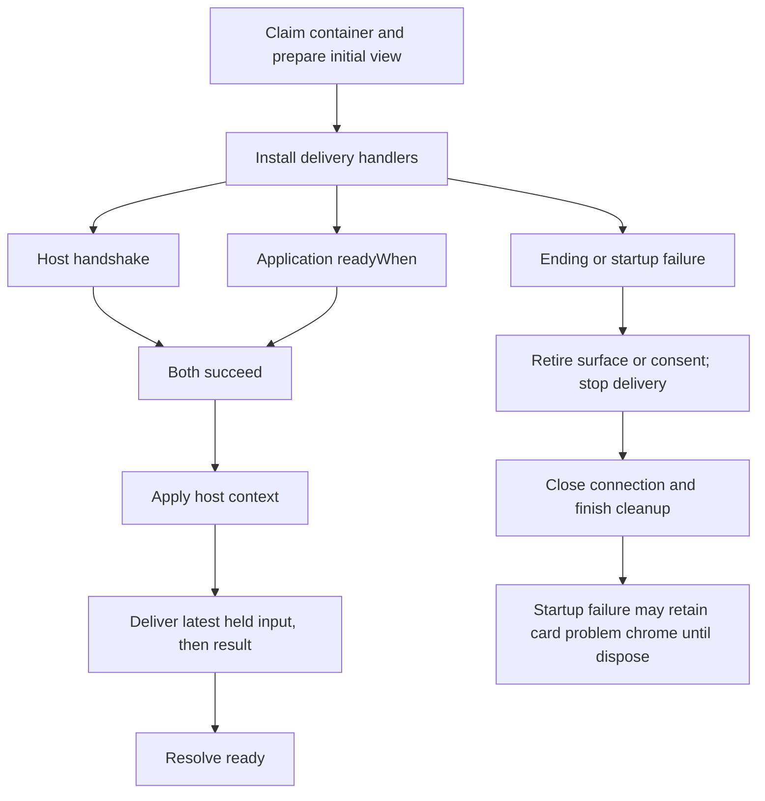

# SDK-owned view composition

The application states what its domain data means; the SDK composes how that data is rendered and delivered. An application installs one stack package, `@saga-a2ui/react-mcp-stack` or `@saga-a2ui/lit-mcp-stack`, plus its framework peers, and imports from the stack only. The SDK holds no domain schema and hardcodes no answer schema.

## Status

**Approved and implemented in source.** The owner approved design revision [`7a78e7eae99285174a11c62d43c1f0035658ec96`](https://github.com/MachineWisdomAI/saga-a2ui/blob/7a78e7eae99285174a11c62d43c1f0035658ec96/blueprints/features/view_composition.blueprint.md); that design decision is distinct from its merge and later implementation heads. The [lifecycle records](view_composition.lifecycle.md#status) retain each approved revision, landed change and independent review.

Both stacks are published at `0.7.7-rc.1`; Lit is no longer private or unversioned. Registry tarball integrity and included source bytes were checked against baseline `cdad54747dfbba756464676ac3b1b8c90148a566`: all 12 Lit-stack and 15 React-stack source files matched. This comparison establishes package/source identity, not a fresh installation or host run. The earlier “nothing published” statements belong to the historical receipts.

Acceptance by the motivating application and named-host qualification remain separate from SDK source and package availability. This refresh makes no new claim about Arabic right-to-left rendering, image consent in a host, destination adoption or stable promotion. Earlier frozen-candidate observations do not establish final-revision acceptance.

The stacks deliberately keep separate copies of their lifecycle modules, each with its own tests. Non-MCP delivery reuse of the card application remains unqualified, and this design does not establish full React parity.

## Ownership and example

Every versioned package shares one major.minor; patch may vary, and the version check enforces it. The retired integration pin remains historical; ordinary changes follow the [version policy](../../docs/version-policy.md).

The SDK owns the ordering between rendering and delivery; the application owns every domain schema and the whole-result logic. Dependencies point one way. Core imports no MCP, renderer or DOM. Components imports no DOM, MCP or renderer. Among SDK packages, MCP and components depend on core, not on one another or on the renderers; renderer packages consume core and components. `@saga-a2ui/react` and `@saga-a2ui/mcp` stay independent; only a stack connects a renderer to a delivery.

The maintained starter is a minimal application like this one. The surface is defined once, and the stack mounts it and routes each tool result to the application's update. The id constants are application-owned; the clear-action binding is omitted here.

```ts
const CLEAR_ID = 'clear';
const layout = defineSurface({
  surfaceId: 'starter', catalogId: CATALOG_ID,
  data: z.object({headline: z.string()}), initial: {headline: ''},
  root: {component: 'Column', bind: {}, props: {children: ['headline', CLEAR_ID]}},
  components: [
    {id: 'headline', component: 'Line', kind: 'title', text: {path: '/headline'}},
    {id: CLEAR_ID, component: 'ActionButton', child: 'clear-label'},
    {id: 'clear-label', component: 'Line', kind: 'body', text: 'Clear'},
  ],
});
const view = startA2uiView({
  container, layout, catalog: starterCatalog,
  onToolResult: (result, {surface}) => surface.update({headline: headlineFor(result)}),
});
await view.ready;
```

For a delivered result that the application's `headlineFor` validates as “Your notes”, the headline changes in place while the Clear control and its binding retain identity. `headlineFor` owns invalid-result wording and domain validation. `surface.update` returns a structured failure if the layout rejects its data; it does not clear the old surface, so an application that requires fail-closed presentation must handle that return value or retire the view. The abbreviated callback above assumes `headlineFor` returns valid layout data. A card application's rejection behavior is different and is specified below.

## Layers

**A. Surface authoring** (`@saga-a2ui/core/protocols/a2ui/v0_9`). `defineSurface({surfaceId, catalogId, data, root, components?, initial})` returns a `SurfaceLayout<TData>` holding the opening messages and typed, validated `update(data)` messages. `data` is a Zod 3 schema. `root` is one component object `{component, bind, props}` with no `id` and no top-level `children`; child ids go in `props`. `components` lists the rest. The root is never a string id and never repeats a root id.

**B. Bound surface** (`@saga-a2ui/react/a2ui`, `@saga-a2ui/lit`). In React, `openSurface(layout, catalog)` returns a `BoundSurface<TData>` with `update(data)` and `dispose`, rendered by `<Surface of={handle}/>`. In Lit, `createA2uiAppElement({catalog, layout, actions?})` builds an element that exposes `updateData(data)`. Each connect creates a default session from catalog and layout using the SDK decoder; injecting a session is an optional advanced choice. An update validates against the layout schema and applies in place, so mounted controls, focus, component state and action bindings survive. A rejected update returns `{ok: false, failure}` in both renderers, with `failure` as `{kind, message}`, and changes nothing. Presenting an equal answer again is a selection, not an update (layer C).

**C. Card conveniences** (`@saga-a2ui/{react,lit,components}/faithful-card`). Both renderers provide `createFaithfulCardView({dialect, maxLength, policy, contentSecurityPolicies, hostLinks})`, `openFaithfulCardSurface()` (a `CardSurface` with `present(content)` and `clear()`) and a host-link helper (React `useHostLink`, Lit `bindHostLink`). The stack reads the document, including the embedded policy and the CSP meta values, and passes them in; the renderer establishes image enforcement from them and takes no document. Lit also accepts application constructable stylesheets through the card start's `styles` option, because page selectors do not cross its shadow roots; custom properties inherit normally.

`present` revokes image consent, retires late link and image outcomes of the previous presentation and advances a presentation token, even for equal text. `present` itself leaves the previous presentation untouched when it rejects content; the card-app stack handles that rejection by calling `clear()` before showing the problem.

The public semantic content set includes `strong`, `em` and `hr`. No weight, size or colour is imposed on `strong` or `em`, and a closing strong footer inherits the footer treatment. `hr` is a divider, and one divider remains possible. The closing marker `data-saga-closing="paragraph"` goes on the final top-level block only when it is a paragraph; a trailing list, quote or table gets none, nested paragraphs are never marked, and the SDK gives the marker no attribution meaning. The private `data-testid` and `data-annotation` attributes are not styling contracts; styling follows the [faithful-card styling guide](../../docs/faithful-card-styling.md).

**D. Delivery and transport.** Core owns `HostLinks`, `LinkOpenOutcome` and `DeliveredResult`. `@saga-a2ui/mcp/view` provides `runToolResultView`, `hostLinksFromApp`, `startOwnSizing` and `readingProfile`. `@saga-a2ui/mcp/server` provides `operationViewFromHtml` with a structural CSP value, so mcp never imports components. Components owns the one policy transport pair, `embedContentPolicy(html, policy)` and `contentPolicyFromEmbedded(text)`:

- The configuration JSON writes every less-than sign as the six ASCII characters backslash, `u`, `0`, `0`, `3`, `c`, and JSON decoding restores it. A `</script>` inside a value stays inert, and a round trip returns an equal policy.
- The charset meta, if any, comes first, then the CSP meta and the configuration script, all before any other script. Insertion is immediately after `<head …>`, or after a `<meta charset>` only when that meta is head's first element.
- Rejected: no `<head>`, any `<script` before the insertion point, a charset meta after a script, and a double quote in the CSP value.

**E. Card application.** E1, in `@saga-a2ui/components/faithful-card`, is `FaithfulCardApp.define(identity).reader(...).policy('document').result(read).texts({waiting, problem, connectFailure, readyFailure, policyFailure}).build()`, an immutable value that `build()` validates once. The result reader is `read: (DeliveredResult) => {kind: 'content', content} | {kind: 'rejected', text?}`, specified below. E2, in the stacks, is `startFaithfulCardApp(definition, {container, readyWhen, sizing, hostContext, chrome, onError})` and `startA2uiView({container, layout, catalog, actions, readyWhen, sizing, hostContext, onToolResult, onError})`. Each returns `{ready, dispose}` at once, and the A2UI view also exposes its `BoundSurface`. A second start on a busy container throws `container-busy` and keeps the first view. Builder or start misuse throws naming the field and leaves a running view alone.

A card application supplies its own reader and texts; its startup stays small (the named values are application-owned):

```ts
import {FaithfulCardApp, startFaithfulCardApp} from '@saga-a2ui/react-mcp-stack/faithful-card';
const definition = FaithfulCardApp.define(identity)
  .reader(readerOptions).policy('document')
  .result(read).texts(texts).build();
const card = startFaithfulCardApp(definition, {container, readyWhen, sizing: 'own'});
await card.ready;
```

## Whole-result reading

`DeliveredResult` is `{isError: boolean, content: ContentBlock[], structuredContent?: unknown}`. `content` keeps every block in delivered order. Each block keeps its `type`; a text block also keeps its `text`, and any other block is opaque and carried as supplied. `structuredContent` is unchecked, and an absent field, a present `null` and malformed data stay distinct. MCP view maps `ToolResult` to this value, rejecting an invalid content list or a block without its required type/text rather than silently dropping it. Private result `_meta` is not part of `DeliveredResult`. The card stacks pass the neutral value unchanged to the definition's single `result` reader; there is no `classifyResult` override.

Schema, fallback and wording belong to the application's reader, and the SDK enforces none of them. The approved design uses the motivating application's reader rules below as an example, in order of precedence. These are application policy, not defaults supplied by either stack, and this document does not assert the current state of an external application's implementation:

- An error result rejects with zero cards, even beside valid structured content. Its text is its first usable error text, otherwise the application's unsupported wording.
- For any other result, the text comes from the first text block, which is then tested for a nonempty string; an empty first text block is not skipped.
- Absent or `null` structured data may show the application's exact fallback text with an empty heading.
- Present but malformed structured data, or an empty answer, rejects even beside fallback text.

The stack owns what follows: if the reader rejects or `present` rejects its content, the stack calls `clear()` to remove the stale card, image consent and link state, then shows the rejection text, or `texts.problem` when there is none. A reader that throws is reported with phase `result` and gets the same clearing and `texts.problem`; so does a throwing result map. The next valid result recovers.

## Startup and failure

The card entry first reads the embedded policy; the own-catalog entry does not require card policy. With delivery handlers installed, the runner starts the bridge handshake and `readyWhen` concurrently. Once both succeed, it applies the negotiated host context, then delivers held input and the latest result, and resolves `ready`. This gates delivered-result handling, not every initial DOM node: card waiting chrome and an own-catalog layout's initial data may already be mounted. Applications should keep private result data out of their initial layout. Host context is applied before the first held result is shown. The font gate receives an abort signal. A result that arrives before `ready` is held, a later one replaces it, and only the latest is shown, once, when the view is ready. Each failure rejects `ready` with its own kind. The text choices below belong to the card entry; an own-catalog application handles the rejected readiness promise rather than receiving these card texts:

- An absent policy means Standard with empty lists. A malformed or invalid policy gives kind `policy` and shows `texts.policyFailure`; no card content is mounted on a guessed policy (the problem chrome can still render).
- A connect rejection gives kind `connect` and shows `texts.connectFailure`.
- A `readyWhen` rejection disposes the connection and gives kind `ready` and `texts.readyFailure`.
- An application callback that throws during startup completes connection, listener and sizing cleanup, then gives kind `application`.
- `dispose()`, teardown or `pagehide` during startup aborts the readiness signal and drops held results. With successful teardown, it gives kind `disposed`, removes the initial view and shows no failure text. If the teardown callback throws, the startup failure becomes `application` unless an earlier specific startup failure already exists; that earlier kind is retained and the teardown error is reported separately. Cleanup still completes. A late readiness outcome never remounts or delivers a result.

Teardown retires card consent or the own-catalog surface before the connection closes and stops later host-context/result delivery. Ordinary teardown unmounts and releases the container; a startup failure can retain card failure chrome until `dispose()` removes it. Cleanup runs even when `onTeardown`, the chrome unmount or the reporter throws, and never skips connection disposal. Disposal releases the container and removes the `pagehide` listener, so a later `pagehide` calls no retired callback and a restart works.

After `ready`, a throwing callback is reported to `onError(error, phase)`, which defaults to `console.error`. The rest of that event's work is skipped and what the callback already changed stays, because the stack cannot roll back application side effects. A throwing ordinary host-context callback leaves the view running with its listeners in place.

The startup flow separates initial presentation from result readiness:



## Exports and installation

Each stack's convenience entries re-export their existing owners. The principal contracts are listed below; the [Lit exports](../../packages/lit-mcp-stack/src/faithful-card/index.ts) and [React exports](../../packages/react-mcp-stack/src/faithful-card/index.ts) also name the public option, chrome, reader and failure types. Browser imports reach no server module and server imports reach no browser code:

- `content-policy`: `createContentPolicy`, `embedContentPolicy`; types `ContentPolicy`, `CreatePolicyResult`, `PolicyConfiguration`, `PolicyFailure`.
- `server`: `attachRequestLifetime`, `createServerBudgets`, `operationViewFromHtml`, `registerPublicOperation`, `viewUriForHtml`; types `OperationView`, `RequestLifetime`.
- Card entry: `FaithfulCardApp`, `CardContent`, `CardResultOutcome`, `startFaithfulCardApp`, `RunningView`, `StartFailure`; React also exposes `/faithful-card.css` (Lit styles its card internally); React `useHostLink`, `HostLink`, `HostLinkOutcome`; Lit `bindHostLink`, `HostLinkBinding`, `HostLinkOutcome`; both `readingProfile` and `ReadingProfile`.

The main entry exports `startA2uiView`, `defineSurface`, `SurfaceLayout`, `z`, the renderer's action helpers and catalog types, plus `readingProfile`, `ReadingProfile` and delivery callback types. Its module graph exports nothing card-specific and does not import components; the stack package's installed dependencies are broader, as described next.

A stack connects the renderer and delivery, amending the [package layout](../../packages/README.md). `@saga-a2ui/components` and `@modelcontextprotocol/ext-apps` are regular stack dependencies so one install suffices under strict resolution. Components and markdown-it are expected in an installed full application, but the emitted browser graph of an own-catalog application excludes components, markdown-it and the server entry. Server-only consumers keep `@saga-a2ui/mcp/server` and install without a renderer. A renderer-named stack keeps its renderer install and peer obligations even for its `server` subpath, which makes no renderer-free promise; full applications such as Ansari may use it.

Host aliases cover `HTMLFragmentWrapper`, the retained Alexa and mobile reading cases and Echo Show classes. `echo_show` and `echo_show_15` match a whole underscore-separated word, not a substring. These are recorded observations, not fresh host acceptance.

## Acceptance

The approved destination acceptance target is a working Ansari build on the selected `0.7.x` release candidate, covering font gate, branding and attribution, consent reset, sizing, and failure and recovery. Its behavioral assertions stay, and mechanical selector changes are recorded as a before-and-after mapping. Registry availability now has separate package evidence; it does not establish that destination build, stable promotion or host acceptance. The checks below are separate; passing one does not stand in for another.

- **Boundary scan.** One known-bad consumer line per rule is reported, and the near-misses (a `before` fence, an excluded fixture, an exempted line naming its rule, a `pagehide` listener) are not. The include list covers consumer source, documentation and server code, with zero hits. Consumers may not import `@modelcontextprotocol/ext-apps` or `@saga-a2ui/mcp/view`, nor use A2UI wire literals, `createMessageSession`, `a2uiV0_9Decoder` or `IngestResult`. The supported `@saga-a2ui/mcp/server` is allowed, and blanket `@a2ui` imports are prohibited except qualified catalog authoring under justified, reviewed-line exemptions.
- **Exports and directions.** Each stack subpath export set is tested individually in that stack's `exports.test.ts`, apart from the dependency-direction check. Every package's `exports.test.ts` also asserts its own row of `scripts/package-direction.ts` (core imports no delivery, renderer or DOM; MCP imports core only; components import core only; a stack alone joins a renderer to a delivery) and fails on a deliberate wrong-direction import and manifest dependency.
- **Install.** Both recipes (one stack plus framework peers) install under strict pnpm 10 from packed tarballs with sibling packages supplied by overrides only, one React instance and the stack's declared dependencies present (`npm run test:pnpm-react`, `scripts/check-react-pnpm.ts`). A separate server-only consumer installs and compiles `@saga-a2ui/mcp/server` with no renderer peer. This is an installed-tree check; it says nothing about the emitted bundle.
- **Bundle.** The own-catalog emitted browser graph excludes components, markdown-it and the server entry. Each stack's `exports.test.ts` bundles the module graph of every entry from workspace source. `scripts/pack1.test.ts` builds the own-catalog and card pages from the packed copies and shows that only the card page carries the optional parser and catalog entry. Core plus Lit without a stack is the earlier `packed-consumer.test.ts` check, which makes no claim about a stack.
- **Policy transport.** Verify charset/CSP/configuration/script ordering, an inert closing-script string, equal round trip, all four input rejections, and invalid policy rejection at `createContentPolicy`.
- **Result reading.** Both stacks show valid structured heading/Markdown and preserve exact fallback bytes, including a terminal newline. Every reader rule runs through both stacks: an error beside valid structured content, an empty first text block, absent versus `null` versus malformed structured data, and a reader that throws with phase `result`.
- **Browser lifecycle, both stacks.** Early result, dispose during startup, late readiness outcome, duplicate start, restart after dispose, concurrent handshake/font preparation with `readyFailure`, invalid policy, host theme on the first shown result and on change, own sizing, and a host-context callback that changes a CSS variable then throws (error reported, change left, cleanup intact). Pagehide removal after a throwing cleanup is checked in startup and after `ready`.
- **Branding in a stack-started card.** Computed styles for `strong` (including a closing strong footer), `em`, `hr`, the closing marker, right-to-left text and fonts match layer C. `apps/lit-host/e2e/card-app-stack.spec.ts` runs these through `startFaithfulCardApp` of both stacks; `card-styling.spec.ts` is the lower-level evidence from the renderers' own card surfaces and is not credited with stack-level behavior.
- **Update versus selection.** An own-catalog label update keeps the control, binding and focus; presenting an equal answer again resets consent. The renderer packages' bound-surface tests (`packages/react/src/bound-surface.test.ts`, `packages/lit/src/a2ui/app-element.test.ts`) cover the update side, and the card-app stack spec covers the equal-answer reset.

## Replacement scope

The [historical replacement record](view_composition.lifecycle.md#replacement-scope) preserves the fourth revision's exact scope and predecessor permalink. Its approved mechanisms remain explained above; this documentation refresh adds no API or implementation authority.
