# Action binding

An Archive button in a list has more work to do than send a request. It needs the identity of the note in its own row, may need to check a session before sending anything, and must keep a second click from starting duplicate work. While the request runs, the row might disappear or be reused for a different note. A late answer must not update that other note's status.

SAGA separates the reusable action from the particular button running it. Application code defines the operation and attaches it to each rendered button. The shared runtime runs its prerequisites and handler, tracks pending work, and releases resources. The renderer adapter tells that runtime when the particular button ceases to exist. The application still decides authorization, what a result means and what to show the user.

## Status

The action runtime and React attachment described here are shipped in the `0.7.6-rc.1` npm packages. Lit implements the same contract but remains available through private candidate packages. There is no production Lynx adapter. The [published-source comparison](../../docs/2026-10-26_published-sdk-baseline_v1.md) identifies the exact packages and inspected source; it does not establish acceptance in every host.

The approved design and defaults amendment remain unchanged. [Lifecycle records](action_binding.lifecycle.md) preserve their exact design, review and landed-code SHAs, scoped Lit/React implementation and named-host observations. This explanatory revision does not broaden those approvals.

## Representative flow: archiving a note

Suppose a notes list shows Alpha and Beta, with an Archive button in each row. Both buttons can use the same `archiveNote` definition. Each has its own binding, so archiving Alpha does not make Beta's button busy.

When the user presses Alpha's button, the adapter delivers the event from that exact rendered instance. The action copies Alpha's note ID before any asynchronous work begins. A session prerequisite runs next. If it refuses, the archive handler never runs; if it proceeds, the handler sends the archive request. The server authenticates and authorizes that request independently of the client check.

After a readable successful reply, the action's success hook presents the archive result. If the row has meanwhile changed to Beta, the old invocation loses permission to present on it. Canceling that invocation does not undo an archive the server already applied. The application must reconcile with the server before offering a retry when the result is unknown.



The definition in this diagram is reusable code. Bindings belong to rendered instances; an invocation is just one admitted click. The server request has a separate lifetime, which is why ending the browser's wait cannot establish that server work stopped.

The [notes application's actions](../../examples/pack1-consumer/src/notes-actions.ts) implement this flow for both Lit and React. They also acquire an application-owned row hold to demonstrate acquisition, release and transfer. The subject reader separately detects a change in row identity. The [action guide](../../docs/actions.md) walks through that application's code. The examples below explain the underlying contract; helpers such as `recordArchived` and `playerOwner` are application code, not SDK exports.

## Purpose and boundaries

Application code decides which action belongs to which control. Layout supplies the component ID and structure; it names no handler. Setup attaches a callable to a rendered instance, and activation reaches that installed callable directly. SAGA does not look up behavior by the diagnostic label passed to `Action.server` or by a handler-name table.

The application owns backend operations, verified identity, authorization and authoritative effects. The action runtime cannot grant access or infer whether a remote write happened. MCP delivery owns the connection and request transport. Renderer adapters own framework events and mounting. Keeping these responsibilities separate allows one action definition to serve Lit and React without embedding either framework in the shared runtime.

### Component terminology

A **component type** is a kind of control, such as `Button` or `List`. A **component definition** is the ID-bearing declaration in the layout. A **template** describes children to create for each data item. A **rendered component instance**, shortened to **instance** here, is one component created and managed by a renderer. SAGA attaches actions through that instance or a renderer-owned handle representing it; the term does not require a JavaScript class instance or a single DOM element.

A2UI calls repetition **dynamic children**: a container's `children` can be a static array of component IDs or a template with `componentId` and `path`. Each data item produces an instance of the template's component tree, with a data scope for relative paths. A repeated row therefore has its own instances of child controls, such as an Archive button. See [A2UI components](https://a2ui.org/concepts/components/#best-practices) and [collection scopes](https://a2ui.org/specification/v0.9-a2ui/#collection-scopes-relative-paths).

The **data item** is the application entity an instance currently displays. Rendering again does not necessarily create a new instance, and an existing instance may display a different item. A `subject` reader tracks that semantic identity separately from the instance's lifetime. This distinction also follows the familiar [React list vocabulary](https://react.dev/learn/rendering-lists). SAGA qualifies “instance” with “rendered” where needed because A2UI also uses “component instance” for an ID-bearing protocol declaration.

### Lifetimes and owners

An action involves lifetimes that end for different reasons. Keeping them apart lets one definition serve two components without sharing pending state, and stops a client decision from claiming something about the server. The ownership boundaries matter when work outlives the control that started it.

| Lifetime | Covers | Owner | Ends when | Ending it does not imply |
| --- | --- | --- | --- | --- |
| Definition | What the builder produced: parameter extraction, prerequisites, handler, hooks, limits and the busy policy. It holds no pending flag, cancellation state, timer or resource | Application code | Nothing ends it; it is reusable and can bind to any number of instances | Anything about a binding or an invocation |
| Discovery (`watchById`) | A setup-time subscription that delivers handles | The application's setup code | It calls the returned unsubscribe function | That any binding is disposed or any callable removed |
| Rendered component instance | One component created and managed by a renderer, accessed directly or through its renderer-owned handle | Renderer adapter | The renderer destroys or recreates the component | That anything is canceled, unless the adapter also disposes the bindings on it |
| Binding | One definition attached to one event of one instance. It applies the definition's busy policy and exposes observable state for that pair | Application, or the adapter on its behalf | `dispose()`, or the adapter retires the instance or the surface or session containing it | That requests already sent have ended, or that another binding of the same definition is affected |
| Semantic subject | The application item the instance shows now, when the application supplies a `subject` reader | Application data | `subject()` returns a different value | That the binding is removed. Only an undecided in-flight invocation is canceled |
| Invocation | One activation of a binding that was not ignored: its parameters, the values its prerequisites provide, its abort signal, its deadline, and the resources it holds, from the user's event through any prerequisite, the handler, required hooks and cleanup | Shared action runtime | The invocation settles or is retired | That server work stopped. A local abort does not prove that the host forwarded cancellation |
| Acquired resource | What an invocation obtained and the application must release: a capability a server action issued, a player holding decoded media | Application resource owner | The application releases it, it expires on its own clock, or the media ends | That the invocation that acquired it is still running |

A further lifetime sits outside the module: the server request. A server action's definition holds a locally callable function that sends a request, and the function that serves the request lives on the server and is never referenced from the browser. The application listener and the MCP server operation own that request; its signal and deadline are described by the [request/view lifetime contract](../features/request_view_lifetimes.blueprint.md).

An acquired resource may outlive the invocation that acquired it. Playback continues after Play has settled, and Pause and Resume act on that player. Ownership of the resource ends only through release or an explicit transfer to a longer-lived owner. A later selection, label loss, host teardown or disposal releases the player; retiring a still-pending invocation releases only what it had already acquired. "Application resource owner" means the application code that acquires, holds and releases what an invocation obtains, and that owns application meaning such as the sign-in label and the selected item. In the example application it includes the player, the media service and the view controllers.

## Interfaces and behavior

The examples use the lower-level `@saga-a2ui/core/actions` contract. `Action`, `prerequisite`, `proceed` and `refuse` are its exports; application helpers and illustrative event types are named where used. A stack exposes a smaller convenience surface, so do not assume every lower-level action helper is re-exported from it.

### Authoring

#### Declaring prerequisites

A prerequisite is reusable work that must finish before a handler runs, and it may stop the handler. It is not defined by what it shows on screen. SAGA supplies the way to declare one and to attach it to an action. The check itself is application code: whether it reads state, refreshes a token or asks the server is the application's decision. A client-side session check avoids pointless work, but it is not authorization, and SAGA does not require a session fetch before every action.

```ts
// A reusable prerequisite that provides a value. SAGA does not decide how the session is checked,
// cached, or refreshed.
export const requireSession = prerequisite('session', async ({ signal }) => {
  const session = await currentSession(signal);
  return session ? proceed({ session }) : refuse('sign-in-required');
});

// A prerequisite that needs a provided value and the extracted params. Annotating the context fixes both.
export const confirmArchive = prerequisite(
  'confirm-archive',
  async ({ provided, params }: PrerequisiteContext<{ readonly session: Session }, { readonly noteId: string }>) => {
    const accepted = await askToArchive(provided.session.userKey, params.noteId);
    return accepted ? proceed({ confirmed: true as const }) : refuse('declined');
  },
);

// A guard that provides nothing. Durable audit that must exist before the handler runs belongs here.
export const auditIntent = prerequisite('audit-intent', async ({ signal }) =>
  (await auditStore.append('archive-requested', signal)) ? proceed() : refuse('audit-unavailable'),
);
```

Only `proceed(...)` and `refuse(...)` are semantic: they are the two ways a prerequisite answers. The string passed to `prerequisite` is a diagnostic label that appears in failure records and logs and never selects behavior. The `prerequisite` function exists so the compiler can infer what the callback needs and provides, and a plain `{ label, run }` object is equally valid. A guard that adds no values calls `proceed()` with no argument, and the values provided earlier pass through it unchanged.

#### Three actions

A synchronous local action stays small. It needs no parameters, prerequisites, hooks, limits or telemetry.

```ts
// 1. Synchronous local action: no params, no prerequisites, no hooks, no limits.
export const toggleDetails = Action.local<ButtonActivation>('toggle-details')
  .run(() => detailsPanel.toggle())
  .build();
```

An asynchronous local action extracts a parameter at activation, requires the session, passes the invocation's abort signal to its work, and states its bounds. Its failure hook says only what the outcome establishes about the local effect, in three states. Where the handler never started, no save was attempted. Where it returned, the save completed and only the view work failed. In every other case the save may or may not have happened, because the handler threw or a deadline or cancellation decided before it settled, and the runtime cannot tell which. A message that says "not saved" would be false in the last two cases. The hooks here are synchronous and the runtime does not start them for an obsolete invocation, so no gap exists between the runtime's check and the presentation write for a freshness check to cover.

```ts
// 2. Asynchronous local action that reuses the session prerequisite.
export const saveDraft = Action.local<ButtonActivation>('save-draft')
  .input(() => ({ text: readDraftText() }))
  .before(requireSession)
  .run(({ params, provided, signal }) => saveDraftLocally(provided.session.userKey, params.text, signal))
  .limits({ deadlineMs: 10_000, hookMs: 1_000 })
  .onSuccess(({ result }) => showSavedAt(result.savedAt))
  .onFailure((context) => {
    if (context.stage === 'prerequisites' && context.failure.kind === 'refused') return showSignIn();
    // input or prerequisite stage: the handler never started, so no save was attempted.
    if (context.stage !== 'running') return showError('Nothing was attempted; the draft is unchanged');
    const { failure } = context;
    // The handler returned, so the save completed; only the client's required view work failed.
    if (failure.kind === 'success-hook-error' || failure.kind === 'success-hook-timeout') {
      return showSavedButViewFailed(failure.result.savedAt);
    }
    // The handler threw, or had not settled when a deadline or cancellation decided: unknown.
    return showSaveStatusUnknown();
  })
  .build();
```

A server action reuses the same session prerequisite, adds one that needs the session and the parameter, adds a guard that records audit intent, and sends its request through `call`. It attaches to a data-bearing control, a row or button that shows one note, and extends the [representative flow](#representative-flow-archiving-a-note) with confirmation and durable audit. Each renderer's event carries the note identifier differently, so the workflow is written once as a function of one projection, `noteIdOf`, which reads and validates the identifier from that renderer's event. The current adapters expose `event.read(path)` during synchronous event delivery. The input extractor copies the needed values before that delivery ends; reading through the event later throws. Component ID alone cannot supply it, because a list can render one component ID twice with different data behind each instance (see [Identity](#identity-and-disposal-defaults)). The extractor validates the copied value as a nonempty string and keeps it, and a later asynchronous step never re-reads a position that may now show something else. The projection is the only renderer-specific part. Prerequisites, request, hooks, bounds and busy policy are the same for every renderer.

The success hook does required client work, a durable record, and then calls its own `current()` immediately before the synchronous presentation write. The failure hook reports only what the outcome establishes. Where the handler never started, no archive request was sent. Where it returned, the server effect is complete. Otherwise the effect is unknown and the message must not invite a retry.

```ts
function requireNoteId(value: unknown): string {
  if (typeof value !== 'string' || value === '') throw new Error('this row shows no note');
  return value;
}

// 3. Server action: the same prerequisite, a second one that needs it, a guard that provides nothing,
//    and a handler that initiates the request. The server's own handler is not referenced from here.
//    Only `noteIdOf` depends on the renderer's event shape.
export function archiveNoteWith<Event>(noteIdOf: (event: Event) => string) {
  return Action.server<Event>('archive-note', transport)
    .input((event) => ({ noteId: noteIdOf(event) }))
    .before(requireSession)
    .before(confirmArchive)
    .before(auditIntent)
    .run(async ({ params, call }) => {
      const reply = await call('archive_note', { noteId: params.noteId });
      // Tool-level failures arrive as a result with isError, not as an exception (pinned upstream doc).
      // This example's tool reports isError only when it changed nothing; that is the tool's contract, not MCP's.
      if (reply.isError) throw new ArchiveRejected('The server declined to archive the note');
      return parseArchived(reply);
    })
    .limits({ deadlineMs: 30_000, hookMs: 2_000 })
    // Required client work after the server effect, then this hook's own check right before the commit.
    // If `recordArchived` ignores the abort and outlasts `hookMs`, `current()` is false when it resumes.
    .onSuccess(async ({ result, signal, current }) => {
      await recordArchived(result.archivedAt, signal);
      if (current()) showArchived(result.archivedAt);
    })
    .onFailure(async (context) => {
      // Input or prerequisite stage: the handler never started, so no archive request was sent.
      if (context.stage !== 'running') {
        if (context.current()) showError('No archive request was sent');
        return;
      }
      const { failure } = context;
      // The handler returned, so the server effect completed; only client work failed. This failure hook
      // has its own eligibility, so its `current()` (unlike `scope.active`) stays true after the failure was
      // decided, while a late `current()` call from the abandoned `onSuccess` is false for good.
      if (failure.kind === 'success-hook-error' || failure.kind === 'success-hook-timeout') {
        await refreshArchiveList(context.signal);
        if (context.current()) showArchivedButViewFailed(failure.result.archivedAt);
        return;
      }
      if (failure.kind === 'handler-error' && failure.error instanceof ArchiveRejected) {
        if (context.current()) showError('The server declined the request');
        return;
      }
      // Timeout, transport failure, or an unreadable reply: the request may have been applied.
      if (context.current()) showArchiveStatusUnknown();
    })
    .whenBusy('ignore')
    .observe((event) => void event.phase)
    .build();
}

// Illustrative event projection; current ActionButton events use event.read('id') during input.
export const archiveNote = archiveNoteWith(({ noteId }: NoteActivation) => requireNoteId(noteId));
```

`parseArchived` throws `ArchiveReplyUnreadable` when the reply cannot be read. That lands in the last branch on purpose: the server answered, but the client cannot say what the answer was. The runtime decides which branch a failure takes from `stage` and `failure.kind`, which are facts it knows. Whether the server really did nothing after `isError` is a fact about this example's tool, not a promise of MCP. Two pieces are diagnostics and not semantics: the `observe` call, and the labels passed to `Action.local`, `Action.server` and `prerequisite`. The necessary pieces are the ordered `before` calls, `run`, optional `limits` overrides when the defaults do not suit the operation, and the hooks the application chooses to write.

#### The author-facing surface in one view

```text
Action.local<Event>(label)                      Action.server<Event>(label, transport)

  .input(extract)                one, first       reads the event, returns Params; sync, effect-free
  .atActivation(perform)         one, then        sync event-turn work for a qualified adapter/API
  .before(prerequisite)          any number       in the order written; adds provided values
  .run(handler)                  required         fixes Result
  .limits({ deadlineMs?, hookMs? })               optional per-action overrides; each field resolves independently
  .onSuccess / .onFailure / .onCanceled / .onFinally    each at most once
  .whenBusy('ignore' | 'replace')  .observe(observer)   each at most once
  .build()                                        returns the reusable ActionDefinition<Event>

component.bindAction(eventName, definition, { subject? })     returns ActionBinding
binding.state   binding.subscribe(listener)   binding.dispose()   binding.id
prerequisite and handler contexts: signal, current(), scope (the activation callback gets own only)
hook contexts: signal, current(); no scope

Discovery used by the authoring, Lit and React examples (not required of every renderer):
view.getById(id, kind)    view.watchById(id, kind, onHandle)
Current Lit and React instance handles: handle.read(path), handle.dataPath, handle.id
```

#### How the types connect

`Action.local<Event>(label)` and `Action.server<Event>(label, transport)` begin a draft whose `Event` is the event type that the target component's adapter delivers. Each later call refines one type parameter, and the compiler carries the refinement to every place that can use it.

- `input(extract)` runs at activation and fixes `Params`. It reads the event, which carries the current values the adapter supplies for that instance, and whatever current application state the author chooses, once, when the event occurs and not when the binding was created. It copies out what later work needs. It must not perform effects. If it throws, the invocation ends as `invalid-input`.
- `atActivation(perform)` fixes `Activation`, the value returned by work that an API requires inside the event itself (see [Event-turn work](#event-turn-work)). It receives the event and an activation scope that can take ownership of a token but cannot await an acquisition.
- Each `before(prerequisite)` adds to `Provided`. A prerequisite declares what it needs and what it provides, and the compiler rejects an ordering in which a need has not yet been provided or a need for params the action does not extract. A guard that provides nothing attaches without changing `Provided`.
- `run(handler)` fixes `Result` from the handler's return type, whether synchronous or a promise. The handler context carries `params`, `activation`, `provided`, an abort `signal`, the freshness check `current()` and the invocation `scope`. Server actions also carry `call`; a local handler context has no `call`.
- Hook contexts are narrowed by what exists when the hook runs. `onSuccess` sees `result`. `onFailure` is a union keyed by stage: an input failure has neither parameters nor `provided`, a prerequisite failure has parameters but no `provided`, and a failure while running has all of them. `onCanceled` has a `completing` variant that carries the result and no other variant does. Every hook context has a `signal` and its own `current()`, and none has a `scope`. `onFinally` receives the primary outcome, which keeps its stage, and a separate list of cleanup diagnostics.
- `bindAction(event, definition)` requires the definition's `Event` to accept what the component kind delivers for that event. A definition written for a field's change does not attach to a button's activation, a definition that needs a data-bearing row's `noteId` does not attach to a plain button, and an unknown event name is rejected. A definition written against a supertype of the event attaches where the adapter supplies a subtype.

**The synchronous boundaries.** Three callbacks must finish in the call that made them: the `input` extractor, the `atActivation` callback, and the adoption callback passed to `Held.transfer`. Each declaration takes a guard as a rest parameter. The guard asks for an extra argument that nothing can satisfy when the callback's inferred return type has any thenable constituent, so a plain `async` callback and a union such as `Promise<number> | undefined` are compile errors. A callback that always throws returns `never`, which is not a thenable and stays valid. The guard offers no diagnostic string, so supplying one is not a way past it. The types cannot see a promise returned through a declared `unknown` or `void`, so each boundary also checks at runtime. A thenable returned from `input` ends the invocation as `invalid-input`, one from `atActivation` ends it as `activation-error`, and one from an adoption callback makes `transfer` throw, leaves the token with the scope, and is not treated as a completed transfer. In all three cases the runtime attaches a rejection handler to the thenable, so its eventual rejection cannot become an unhandled rejection. Neither a type nor a returned-value check can stop a synchronous callback from starting deferred work, keeping the event, or reading it later; that remains the author's responsibility.

**Order and the immutable builder.** The order is fixed because it is the execution order: `input`, then `atActivation`, then any number of `before` calls, then `run`. After the first `before`, `input` and `atActivation` are no longer on the builder. This freezes the parameter shape at the point where prerequisites start depending on it, so a chain cannot change `Params` after attaching a prerequisite that was checked against the old shape. Reading the chain top to bottom matches what happens.

Every builder value is immutable. Each call returns a new builder and leaves its receiver as it was, so a retained alias is a branch: two `onSuccess` calls on the same alias produce two separate definitions, each with one hook, and neither sees the other. TypeScript does not give linear ownership of references, so the type-level hiding of a used method is a convenience for one chain, and the runtime does not rely on it. The runtime rejects a repeated registration on any chain, including one reached through an `any` cast or from JavaScript.

Repeated registrations are rejected rather than appended or replaced. `input`, `atActivation`, each of the four hooks, `limits`, `whenBusy` and `observe` can each be called once. Silently replacing a success hook that records a result with one that presents it would lose required work, and appending would leave ordering and per-hook budgets to guess at. An author who needs two pieces of success work calls both from one hook, where the order and the failure handling are visible. `before` is the one repeatable step because its order is the point.

After `run`, `limits`, hooks, `whenBusy` and `observe` can appear in any order, each at most once. `limits` overrides either or both settings. Hooks and server `build()` are available without a `limits` call because resolved defaults provide finite budgets. Resource ownership likewise needs no explicit `hookMs`. `build()` snapshots the per-action overrides; the SDK instance supplies its own application configuration. The renderer action host accepts instance configuration; neither it nor an action definition introduces mutable process-wide settings or an action registry. The builder may represent that configuration internally as a plain object; that representation is not a second public API, and this Blueprint offers no operation composition as an alternative.

### Direct attachment

Setup discovers a rendered control and attaches the definition to its event. In the notes application, both Lit and React use the instance's own data reader:

```ts
// ActionButtonActivation comes from the chosen renderer's actions entry point.
const actions = {
  archiveNote: archiveNoteWith<ActionButtonActivation>((event) =>
    requireNoteId(event.read('id')),
  ),
};
surfaceView.watchById('row-archive', ActionButton, (handle) => {
  handle.bindAction('activate', actions.archiveNote, {
    subject: () => handle.read('id'),
  });
});
```

The projection joins the illustrative workflow to the current adapter event. This attachment pattern is used by the [Lit notes view](../../examples/pack1-consumer/src/notes-view.ts) and [React notes view](../../examples/pack1-consumer/src/notes-react-view.tsx). `ActionButton` comes from the chosen renderer's actions entry point. `actions.archiveNote` is the application definition. The `subject` reader asks what note this exact instance represents now, rather than closing over the note it represented at setup.

`watchById` delivers existing and later instances with that layout ID. A repeated row has several `row-archive` instances, so `getById` would be ambiguous: it throws for zero or multiple matches instead of choosing a row. Discovery is only a setup convenience. Once installed, the callable receives events from its own instance without another ID lookup.

#### Identity and disposal defaults

A binding owns one instance/event slot. A second binding on that live slot throws, preventing accidental double execution. To change the action, dispose the old binding and bind the new definition to the same live handle. Disposing a binding leaves its handle usable; retiring the rendered instance makes the handle stale, and binding through it then throws.

The adapter disposes bindings when their instance or containing surface ends. A replacement instance starts without the old instance's pending work. Disposal is idempotent and removes only the installation that particular binding created, so late cleanup cannot detach its successor.

Stopping `watchById` stops discovery; it does not by itself dispose bindings already created. The Lit and React setup scopes track their registrations and bindings and retire them together. If application code separately subscribes to binding state, it owns that subscription's unsubscribe function as well.

#### Binding state, subject and ending

`bindAction` returns an `ActionBinding` with an opaque `id`, a `state` snapshot, `subscribe(listener)` and an idempotent `dispose()`.

`state.phase` is `idle`, `running`, `settling` or `disposed`. It is `running` from the start of the activation until the outcome is decided, which covers the prerequisites, the handler and the required `onSuccess`, because `onSuccess` is what decides success. It is `settling` from the decision until `onFinally` has settled or its budget has expired, covering the outcome hook, resource releases and `onFinally`. It is `idle` afterwards, but only for the invocation that currently owns the binding's state. Under `replace`, an older invocation's cleanup can finish beside a newer running one without setting the binding to `idle`, and a disposed binding stays `disposed`. The state object is replaced on every change and never mutated, so a renderer can compare identities to see whether anything changed. A spinner is a function of `running`, a disabled button usually a function of `running` or `settling`, and the author chooses. The state carries no settled result; presenting a result is the job of the application's hooks.

`subscribe` calls the listener synchronously after each state change and returns the unsubscribe function. The binding exposes nothing else: it carries no event or input, cannot invoke anything, and gives no way to find another binding, so it is not an action bus. A listener's synchronous exception is caught and does not affect the action, and a returned thenable gets a rejection handler, as for observers. A synchronous action that completes in the event's own call stack moves the state through `running` and `settling` to `idle` before the event handler returns, with listener calls inside it. How a renderer turns a subscription into a rerender (a reactive controller, a hook, a Lynx update) is the adapter's design: a React or Lynx `getSnapshot` can be a closure returning `binding.state`.

Disposing cancels the running invocation with cause `disposed`, detaches the callable so later events do nothing, ends the subscription's notifications after one final `disposed` state, and leaves any other binding of the same definition untouched. Disposal while an outcome-specific hook is running does not rewrite the decided outcome. It aborts the signals of the presentation hooks, which are `onSuccess` and `onFailure`, and the rest of cleanup continues (see [Hooks and cleanup](#hooks-and-cleanup)).

An instance identified by structure or list position can stay the same while the business item it displays changes. An invocation started for item A may still be awaiting while the same row shows item B, and reading current input at the next activation does not help that in-flight invocation. A structural key or data path is not a semantic item identity. The binding options give the application a small, optional way to say what the instance is currently about: `bindAction(event, definition, { subject })`. `subject` is a function the application writes that returns a primitive key or token for the item the instance now shows. It reads current application or renderer state through a supported API, never a view object captured by an earlier render.

The runtime captures `subject()` when an invocation starts. It compares a fresh read with `Object.is` at its own decision points and on every `current()` call (see [Freshness](#freshness-three-questions-that-look-alike)), and applies the [outcome rule](#outcome-decision-and-obsolescence) to what it finds: a mismatch before a terminal decision cancels the invocation with cause `subject-changed` and retains the callable and the binding, and a mismatch after a terminal decision only makes the remaining presentation hooks obsolete. A reader that throws at activation ends the invocation as `invalid-input`; one that throws later counts as a change. When no `subject` is given, an invocation's target is the instance alone, and the runtime detects no semantic replacement. That is correct for a fixed button and wrong for a recycled list row, where a late result can then present on whichever item now occupies the row.

### Execution semantics

This section is the single normative home for ordering, outcomes, obsolescence, freshness and the runtime and adapter seam. Renderer sections, the flow, the failure discussion and the verification matrix refer to it and do not restate it.

#### Order of events for one activation

When an event reaches a binding, the runtime proceeds in this order.

1. **Admission (synchronous).** An ended binding admits no new work. If the binding is `running` or `settling`, the runtime first revalidates the active invocation (see [The runtime and adapter seam](#the-runtime-and-adapter-seam)) and applies the [outcome rule](#outcome-decision-and-obsolescence) to what it finds. Only then does the definition's busy policy apply, through the binding. `ignore`, the default, drops the new activation: no hook runs, no invocation exists, and the optional observer sees an `ignored` event naming the busy invocation. The policy covers `settling`, so a second activation cannot overlap the release of resources the first still holds; revalidation therefore never bypasses `ignore`. If revalidation canceled the old invocation and its bounded cleanup is still pending, the new activation is dropped until that cleanup settles. `replace` cancels a running invocation with cause `replaced` and starts the new one at once. If the old invocation is already `settling`, its outcome stays as decided and its remaining cleanup continues beside the new invocation, with its presentation hooks made obsolete.
2. **Activation prefix (synchronous).** In the same call stack as the event, the runtime calls `input` and then `atActivation`. A throw, or a thenable return, ends the invocation as `invalid-input` or `activation-error`. No prerequisite or handler runs, and resources the prefix already took into the scope are released.
3. **Prerequisites (sequential).** Each prerequisite runs after the previous one has proceeded, in the order written.
4. **Handler.** It runs once every prerequisite has proceeded.
5. **Required success work.** If the handler returned in time, the required `onSuccess` runs, within `hookMs`. The binding is still `running`, because success is decided only when this hook completes.
6. **Outcome decision.** Every path fixes one outcome exactly once. From here the binding is `settling`.
7. **Outcome-specific hook.** `onFailure` or `onCanceled` runs after the outcome is decided, awaited within `hookMs`. A failed `onSuccess` decides `failed`, so `onFailure` follows it. `onCanceled` runs only for a canceled outcome, and `onFailure` only for a failed one.
8. **Resource release.** Tokens owned through the invocation's scope and not transferred are released in reverse order of ownership, each within `hookMs`.
9. **Final hook.** Finalization always occurs. A configured `onFinally` runs last, exactly once, for every invocation that began, and receives the outcome and the cleanup diagnostics collected so far. When it has settled, or its budget has expired, or at once if none is configured, the invocation is settled. The binding then returns to `idle` only if this invocation still owns the binding's state: a newer replacement invocation keeps its own phase, and a disposed binding stays `disposed`.

The runtime awaits a step only when it returned a promise. A prerequisite or handler that returns synchronously lets the invocation continue in the same call stack, so an action built only from synchronous pieces runs from the event to `idle` without yielding: `toggleDetails` has completed when the event handler returns. Nothing in the contract makes a `before` hook cross an asynchronous boundary merely because the API can await one. The cost is that a piece that sometimes returns a promise and sometimes a value changes when the invocation finishes, so neither timing should be relied on for an async-capable piece.

The diagram separates the normal execution path from events that can decide the outcome early. Cleanup follows a decision even when the handler never ran.


#### Outcome decision and obsolescence

The runtime decides an invocation's primary outcome once. After that the outcome is fixed: no later event changes it, reruns a hook, or hands a value to a hook that already ran. Four things can decide it, and the first to occur wins: a stage failure, expiry of the work deadline, a cancellation (`replaced`, `disposed` or `subject-changed`), and the completion of `onSuccess`. Success is the only one that needs work after the handler returns, because `onSuccess` is the required application work that makes success true.

The decision keeps the stage it was made in. A failed outcome is `input`, `prerequisites` or `running`, and a canceled outcome is `prerequisites`, `running` or `completing`. A timeout while prerequisites run is therefore a failed outcome in the `prerequisites` stage, which means the handler never started, and a timeout while the handler runs is in the `running` stage, which means its effect is unknown. `onFinally` receives this same outcome, so final reporting can tell the two apart.

| A cancellation arrives while | Outcome | What the outcome contains |
| --- | --- | --- |
| Prerequisites are running | `canceled`, stage `prerequisites` | No result. The handler never started |
| The handler has not settled | `canceled`, stage `running` | No result. The handler may be doing anything |
| The handler has returned and `onSuccess` has not finished | `canceled`, stage `completing` | The result the runtime already observed |
| The outcome is already decided | Unchanged | The remaining presentation hooks become obsolete (below). The outcome is never rewritten |

**Obsolescence.** An invocation becomes obsolete when its binding is disposed, a newer activation replaces it, the binding's optional `subject` reader returns a different value at a checkpoint, or the adapter's liveness reader reports the instance gone. Obsolescence is a condition of the presentation hooks and not a second outcome. It has these effects, and every other section of this Blueprint refers here.

- **Before a terminal decision** (prerequisites, handler or `onSuccess` still running), obsolescence is a cancellation: `replaced`, `disposed`, or `subject-changed`. An instance that is no longer live is treated as disposal. A changed subject keeps the callable and the binding installed. Liveness loss retires the binding. When `onSuccess` is running, the table decides `canceled(completing)`.
- **After a terminal decision**, the outcome stays as decided. The runtime starts neither `onSuccess` nor `onFailure` for an invocation that is already obsolete, because those hooks present results and a stale presentation is wrong. If failure was decided and `onFailure` is running when the invocation becomes obsolete, that hook's signal aborts, its `current()` returns false, the runtime stops waiting for it and records an `obsolete` diagnostic. The outcome stays `failed`: it is not rewritten to `canceled`, and `onCanceled` does not run for it. If the decided outcome is `canceled`, `onCanceled` still runs, because it responds to the cancellation.
- **Cleanup always finishes.** Resource releases and finalization run in every case, and a configured `onFinally` receives `obsolete: true`. Work that must run even for an obsolete invocation belongs in `onFinally` or a release, not in `onFailure`.
- **Without a `subject` reader**, the runtime detects no change of the item an instance shows, so a replaced row alone makes nothing obsolete. Disposal, replacement and loss of liveness still apply.

*Cancellation before the result.* A handler ignores the signal and keeps running, and the user presses the button again under `replace`. The runtime decides `canceled(running)`, runs any configured `onCanceled` and `onFinally`, and the invocation settles. When the old handler later resolves, that is a **late settlement**: the runtime drops the value, does not call `onSuccess`, does not rerun a hook, does not change the delivered outcome, and tells the observer that a late settlement occurred, with no value. `onCanceled` never learns what the handler eventually produced, because that result did not exist when the hook ran. A result that arrives before the decision but has not yet been observed by the runtime is treated the same way: the decision is the point after which nothing is delivered.

*Cancellation during required success work.* The handler returned a result and `onSuccess` is awaiting a write, and disposal arrives. The runtime had already observed the result, so it decides `canceled(completing)` and attaches that result. `onCanceled` receives it and can release or record what the handler produced. The `onSuccess` signal aborts and the runtime stops waiting for it. If `onSuccess` settles later, that too is a late settlement, and its failure is not reported to any hook. The runtime cannot recall a write the hook already started, so a write that must not be lost on cancellation has to be idempotent or belong in a prerequisite.

For any late settlement, three rules apply. A late value or error is dropped. A late resource handed to the scope is released at once by the runtime, within `hookMs`, with no hook involved. That is a separate responsibility from the terminal hooks, and a failure in it reaches only the observer, as a `cleanup-error` with step `release`. A resource that a handler returns inside its result instead of handing it to the scope is outside this protection, because a dropped result drops the resource with it. A handler therefore hands any resource to the scope before it returns.

#### Running prerequisites

A prerequisite may be asynchronous and may stop the handler. Its `run` function receives the values earlier prerequisites provided, the extracted parameters, the invocation's abort signal, `current()` and the invocation scope. It returns `proceed(values)`, `proceed()` or `refuse(reason)`, or a promise of one.

*Ordering and sharing.* Prerequisites run strictly in order, and the next does not start until the previous one has proceeded. The values each provides are merged into one object that later prerequisites, the handler and the hooks that run after prerequisites can see. A prerequisite that provides a key an earlier one already provided ends the invocation as `prerequisite-error`; the types do not always catch that collision, so the runtime does. Provided values are invocation-local. A prerequisite object holds no per-invocation state and is safe to share across actions.

*Refusal.* `refuse(reason)` ends the invocation as `failed` with kind `refused`, recording the prerequisite's label and the reason. The handler does not run. This is the ordinary result of an absent session, and the failure hook can respond to it differently from an error.

*Failure before context exists.* If a prerequisite throws or rejects, the invocation ends as `prerequisite-error`. The failure hook receives `stage: 'prerequisites'`, the failure and the parameters, and no `provided` object, because that object would be incomplete. The type of the failure context enforces this.

*Cancellation.* Cancellation aborts the invocation signal. The runtime stops waiting for the current prerequisite at once, starts no further prerequisite, and ends the invocation as canceled. A prerequisite that ignores the signal and resolves later is a late settlement, and its values are dropped.

*Durable audit.* A record that must exist before the handler may run is a prerequisite, like `auditIntent`: a refusal or error from it stops the handler, and its time counts against the work deadline. A record that must exist after the work is the required success hook, with its own `hookMs`. A record that is allowed to be lost is telemetry.

#### Event-turn work

`input` and `atActivation` are the two event-turn phases. The runtime calls them in the same call stack as the adapter's event delivery, before it awaits anything. Everything after them may cross an asynchronous boundary, and nothing requires it to.

`input` is optional. An action uses it when later work needs values copied from the event before anything awaits. `atActivation` is narrower, because whether particular work must run in the event turn depends on the API. In the playback application, `prepare()` is documented as called synchronously inside the user's activation, before any asynchronous authorization, so that audio unlocks. Opening a window, requesting a permission and starting audio each have their own rules, and browser activation is limited by time and by consumption rather than lost mechanically at the first `await`. Browser gesture and audio unlock requirements therefore apply only to environments that offer that capability, and the contract states no portable activation property. `atActivation` is the place for work that its author knows an API requires in the event's own call stack. `before` is for prerequisite work and promises nothing about activation. There is no generic `requiresActivation` flag.

`atActivation` is synchronous by type and by rule. The callback receives an activation scope with `own` and no `acquire`, because an acquisition awaits and nothing in the event turn may. A callback whose type shows a thenable is rejected by the compiler. A thenable that arrives at runtime, or a throw, ends the invocation as `activation-error`. Anything the callback took into the scope with `scope.own` before returning or throwing is released by the runtime, and nothing it tries to own after the invocation has ended is kept: `own` releases such a token at once and throws.

The published definition exposes no `eventTurn` property or execution-environment tag. Those belonged to the historical Lynx investigation. The implemented Lit and React adapters deliver the synchronous prefix in their event call stack; that does not promise a universal browser permission or audio-unlock result.

#### Handler and server calls

A local handler may return a value or a promise. A synchronous throw and a rejection are both `handler-error`. The handler receives the invocation signal and should pass it to cancellable work.

A server handler additionally receives `call(name, args, options?)`. An optional `timeoutMs` can narrow the remaining work budget, and optional `meta` travels as request `_meta`, separately from business arguments. Metadata is copied and frozen; application code must not use it to invent trusted identity. The runtime builds the transport request options itself: the invocation signal, and the time left in the work deadline as the timeout. The handler cannot widen either. `call` returns the upstream result unchanged, so a tool-level failure arrives as a result with `isError: true`, and the handler decides what that means. The pinned `callServerTool` throws for timeouts, lost connections and host rejections, and all of those arrive as `handler-error` with the server effect unknown.

Two limits are easy to over-read. The `App.callServerTool` timeout covers one call, not the whole invocation, which also includes prerequisites and hooks. And aborting the signal ends the client's wait and passes cancellation into the request options, but it does not show that the host forwarded cancellation or that the server stopped. A server action canceled after its request was sent reports `canceled` with the server effect unknown, and its canceled hook must be written that way. Local prerequisites and aborts prove neither server authorization nor remote cancellation.

#### Bounds: the work deadline and the hook budget

Two limits exist, and each covers one thing. Neither is a single maximum for the whole invocation, and this Blueprint proposes no third, universal timer.

The **work deadline**, `deadlineMs`, starts when the activation prefix has finished and the first prerequisite is about to run. It covers every prerequisite and the handler, and stops at the first of handler settlement or an earlier outcome decision. When it expires, the runtime aborts the invocation signal and decides `failed(timeout)` without waiting for a handler that ignores the signal, and a late handler result is a late settlement. A timeout while prerequisites are running is a prerequisite-stage failure, and the handler never started. Audit that must exist before the handler is prerequisite work, so it shares this deadline. The deadline does not cover required success work. The runtime arms its timer only when it has to wait on a promise.

The **hook budget**, `hookMs`, is a separate timer for each step after the handler settles: the required `onSuccess`, the outcome hook, each resource release, and `onFinally`. A step that exceeds its budget has its signal aborted, the runtime stops waiting, and the overrun is recorded as a `budget-exceeded` cleanup diagnostic. For `onSuccess`, the overrun is instead the decision `failed(success-hook-timeout)` with the result, since `onSuccess` is part of the outcome. Per-step timers give these maxima:

| Phase | Steps in it | Longest it can last (event loop permitting) |
| --- | --- | --- |
| `running` | Activation prefix, prerequisites, handler, required `onSuccess` | `deadlineMs + hookMs`, counted from the start of the work timer, which is after the synchronous activation prefix. Prefix time is in the phase but under no timer, because a timer cannot interrupt synchronous code, so the prefix is bounded only by the author's code finishing. An omitted override uses the resolved work default for local and server actions |
| `settling` | Outcome hook, one release per owned token, `onFinally` | `hookMs × (owned tokens + 2)` |

**Resolution and validation.** Resolve each setting independently, in this order: per-action override → application configuration on the owning SDK instance → SDK default. Omitting a setting inherits it; it does not disable its timer. Both local and server actions receive resolved budgets, including actions with hooks or scope-owned resources. Synchronous actions still complete synchronously when their callbacks do, and timers cannot preempt blocked JavaScript.

| Setting | SDK product default | Coverage |
| --- | --- | --- |
| `deadlineMs` | `30_000` ms | Prerequisites plus handler, after the synchronous activation prefix; progress cannot reset or extend it |
| `hookMs` | `5_000` ms | Each configured awaited hook and each bounded cleanup/release step separately, including late scope-resource release |

For example, an instance configured with `deadlineMs: 45_000` and an action overriding only `hookMs: 2_000` resolves to 45,000 ms work and 2,000 ms per step. With no instance setting, the same action resolves to 30,000 ms and 2,000 ms. A separate SDK instance keeps its own values. Configuration and definition inputs are validated when supplied, before activation or effects; explicitly invalid values are rejected even when another layer would override them. Zero, negative numbers, `NaN`, either infinity and non-number values are errors, never an instruction to fall back or disable a bound. Only omitted settings inherit; supplied values must be finite positive numbers. TypeScript's `number` type does not replace runtime validation, including for JavaScript callers. Resolved settings are stable for an invocation; changing another instance or a caller-owned configuration object cannot alter its clocks.

These are documented product defaults chosen for usable SDK behavior, not measured latency guarantees. Measurements may inform future tuning without blocking initial configurable defaults. The MCP TypeScript SDK documents a [60,000 ms request default](https://ts.sdk.modelcontextprotocol.io/v2/api/index/@modelcontextprotocol/client/#default_request_timeout_msec) (checked 2026-10-19); that transport request interval differs from SAGA's prerequisites-plus-handler interval and does not establish SAGA's values.

The default profile does **not** promise a 35-second maximum for the entire invocation. Required success work and subsequent cleanup retain their separate per-step budgets, as the phase table above describes. Host, gateway, server-request, resource and security clocks remain independent. A longer action override cannot make another owner wait longer, and `call` still cannot widen the remaining work budget or a narrower transport limit. For work that cannot fit the available request lifetime, applications may use an existing background operation and later retrieve its outcome; this amendment adds no background-job framework or automatic retry.

The invocation settles when `onFinally` has settled or its budget has expired. Nothing in an application hook has to clear a runtime timer, abort controller or pending flag, and a canceled or never-settling hook cannot extend `settling` past its budget. Two limits remain. JavaScript cannot preempt running code, so a hook that ignores its signal keeps running after the runtime stopped waiting and may still write. And a synchronous callback that blocks the event loop prevents any timer from firing until it returns, so the bounds above hold only while the event loop turns.

#### Hooks and cleanup

Hooks perform application work. They are not observers.

| Hook | Runs when | Phase | Awaited | Exception or overrun |
| --- | --- | --- | --- | --- |
| `onSuccess` | The handler returned before cancellation or the work deadline, and the invocation is not obsolete | `running` | Yes, within `hookMs` | The decision is `failed` in the `running` stage with kind `success-hook-error` or `success-hook-timeout`, carrying the handler's result. `onFailure` then runs |
| `onFailure` | A failed decision, at any stage, unless the invocation is obsolete | `settling` | Yes, within `hookMs` | Recorded as a cleanup diagnostic. The outcome stays as it was |
| `onCanceled` | A canceled decision, at any stage | `settling` | Yes, within `hookMs` | Recorded as a cleanup diagnostic. The outcome stays canceled |
| `onFinally` | Always, last, once | `settling` | Yes, within `hookMs` | Reported to the observer by step name only |

`onSuccess` is part of the outcome because it performs required work, such as recording a result or updating a view the user depends on. If it fails, the invocation did not succeed, and the failure hook can tell the author why. The other three hooks are responses and reporting, and a failure in them never rewrites how the invocation ended. The primary outcome and the cleanup diagnostics are different things. The outcome is the single decision, delivered unchanged to every hook. The diagnostics are a list the runtime appends to as cleanup proceeds: outcome-hook failures, overruns, release failures and obsolescence. `onFinally` receives both, as `outcome` and `cleanupErrors`. Resource releases run before `onFinally`, so their failures reach it. `onFinally`'s own failure has no later hook to receive it. The observer sees the step name, and the application sees nothing unless it catches inside its hook. An application requiring a durable finalization record must handle its recording failure inside that hook.

All hook signals abort when their budget expires. The `onSuccess` and `onFailure` signals also abort on obsolescence. The `onCanceled` and `onFinally` signals do not, because those hooks exist to answer it. An aborted signal asks a hook to stop and nothing more: a hook that has awaited calls its own `current()` before a presentation write, and that cooperative check, not the signal, is what authorizes the write.

#### Freshness: three questions that look alike

One flag cannot answer three different questions, so the contract keeps them apart.

- *Has the outcome been decided?* `scope.active` answers it: true from the start of the invocation until the outcome is decided. Handlers and prerequisites use it to stop work. It is false while an `onFailure` hook runs, so it cannot authorize that hook's write.
- *Has this work been asked to stop?* The `signal` answers it. A signal that has not aborted says nothing about a subject that changed while nobody was looking.
- *May this callback still change what this instance shows?* The callback's own `current()` answers it. Every prerequisite, the handler and every hook receives one, and each is a separate predicate. It is true only while all four of the following hold, read afresh on every call.
  1. **This callback is still eligible.** The runtime starts a callback's eligibility when it starts the callback, and ends it permanently, with no way back, at the first of these: the callback finishes, which for a synchronous callback means it returns or throws and for an asynchronous callback means the Promise it returned settles (merely returning a pending Promise does not end eligibility); its budget expires (the work deadline for a prerequisite or the handler, `hookMs` for a hook); or deadline, budget, cancellation or obsolescence makes the runtime stop waiting for it. Eligibility is the runtime's own bookkeeping behind the same small `current()` interface. It is not `scope.active`, and no adapter supplies it.
  2. The binding is not disposed and the invocation is not replaced.
  3. The adapter's liveness reader says the instance and installation are the live ones. (`AdapterInstance` in the [companion](./action_binding.evidence.md#a-authoring-declarations) names the liveness reader in the historical declarations. It is adapter plumbing, not an author API, and its shape is illustrative.)
  4. The binding's subject, if one was given, equals the one captured at activation.

  Adapter liveness and subject freshness are conditions 3 and 4, and they are not the whole of `current()`. Because eligibility is per callback, a failure hook that the runtime starts after the immutable failure decision has its own eligibility and can still present, while an ended, timed-out or superseded callback cannot regain permission merely because the binding, instance and subject are unchanged. A later `onFailure` has separate permission, and a timed-out callback never regains its own. Callback-budget bookkeeping stays in the runtime and never in a renderer adapter.

After any `await`, a callback calls its own `current()` immediately before its synchronous presentation write, as `archiveNote` does. Calling it is also a checkpoint, but only while the callback is eligible. If it finds a mismatch or a vanished instance, the runtime applies the [outcome rule](#outcome-decision-and-obsolescence). An ineligible callback gets `false` and changes nothing, so a late callback cannot cancel a newer invocation.

Two cases show why callback-specific eligibility matters. In neither case do the binding, instance, installation or subject change, and the cooperative check is all that stops the late write.

| Case | What happened | The late callback's `current()` | The callback the runtime is awaiting |
| --- | --- | --- | --- |
| Late `onSuccess` | `recordArchived` ignores abort and outlasts `hookMs`. The runtime decides `failed(success-hook-timeout)` and starts `onFailure`, which presents. The old record then resolves | False, for good: the runtime stopped waiting for this `onSuccess` at its budget | The running `onFailure` has its own eligibility and may still present |
| Late handler, `onFailure` or escaped closure | The work deadline expired and the handler ignores abort; or `onFailure` outlasted `hookMs`; or a finished callback scheduled `setTimeout(() => { if (current()) show(); })` | False, for good. The late handler result is dropped as a late settlement, and a later activation's presentation is not overwritten | None, or the running `onFailure`, which has its own |

The check is cooperative in both. Aborting a signal does not roll back a write the late callback has already started, and a callback that never calls `current()` is not suppressed.

#### The runtime and adapter seam

Adapters supply liveness and source notifications. The runtime supplies callback eligibility, decides outcomes, and owns every timer. The seam has these members, all internal and none an authoring method. The handle's `bindAction` returns a view that hides the runtime-facing ones.

| Member | Meaning | Supplied by |
| --- | --- | --- |
| `isLive()` | Is this still the instance that was bound, installed under the current host or model? A fresh pull on every call, never a cached boolean | Renderer adapter |
| `subject` | The application's optional reader for the item the instance now shows | Application, through `bindAction` options |
| `watchScope(revalidate)` (optional) | Subscribes to changes the adapter can observe and calls `revalidate` after each; returns the unsubscribe | Renderer adapter |
| `detach()` | Removes this binding's own installation. A no-op when the slot holds a newer installation | Renderer adapter |
| `deliver(event)` | Synchronous entry for an admitted event: runs `input` in the caller's stack and applies the busy policy. The Lit and React declarations call it `activate` on the object `createBinding` returns | Runtime |
| `recheck()` | Re-reads `subject()` and liveness now and applies the outcome rule | Runtime |

The shared decisions on this seam are as follows.

- **An incoming activation first revalidates the active invocation, then applies the busy policy.** Without the first step, a press on item B can be dropped as "busy" because of item A's obsolete invocation, which would then never end its presentation. Revalidation applies the outcome rule to A: an undecided A is canceled, and an A whose failure is already decided stays `failed` while its remaining presentation becomes obsolete. It does not replace the policy. If A's bounded cleanup is still pending after that, `ignore` still drops B until A settles, and `replace` starts B beside that cleanup.
- **Wake-ups are optional and invocation-owned.** While an invocation is not idle, the runtime may subscribe through `watchScope`. Each `revalidate` call requests the same recheck that any checkpoint performs and never produces a different outcome. The runtime unsubscribes when the invocation settles or is replaced or disposed. A binding that is idle holds no runtime subscription.
- **Checkpoints read liveness and subject.** The runtime reads them before each prerequisite, when the handler's result is observed, before `onSuccess` and `onFailure` start, at the busy decision, and on every `current()` call, and applies the [outcome rule](#outcome-decision-and-obsolescence) to what it finds. A checkpoint that finds the instance not live treats it as disposal, because the adapter's own retirement, which disposes the binding, may not have run yet in that window.
- **An adapter's own observation is separate.** An adapter may observe its instance or key while idle, for example to maintain tap-admission epochs. Settlement of an invocation ends the runtime's wake-up subscription and must not erase the adapter's identity history.

The lazy comparison has limits. Between checkpoints and `current()` calls nothing runs, so a mismatch nobody observes changes nothing yet, and a pull reader alone is not a reactive notification: the pending state of a stale invocation changes only when the runtime checks or when the adapter asks it to recheck through a supported seam. The comparison also cannot see history. Equal subject keys cannot detect an unobserved sequence A, B, A, and the common runtime holds no universal counter that could, because a counter bumped on every data change would cancel invocations on edits that do not change which item is shown. Two things can distinguish the round trip. An application can put a revision into the subject, for example `` `${id}:${revision}` ``, when an item can be deleted and recreated under one key or its content version matters. A renderer can maintain an explicitly qualified observed-key epoch that increments when its own subscription sees a different value, as the historical Lynx proposal explored. Callback observation is not proof that a native runtime delivers every intermediate change, so that second route remains conditional on evidence (see [Open decisions](#open-decisions)). When the key is the item's semantic identity, an invocation for A presenting on A again is correct.

An adapter keeps exact installation identity when detaching a binding: late cleanup removes only its own callable. The published action API does not expose a queued-event epoch or a `stale-installation` telemetry reason.

#### Resource ownership and handoff

A resource is anything an invocation acquires that someone must give back, such as a lock, a subscription or a running player. The runtime cannot make arbitrary cleanup safe by itself, so the contract divides the work. It does not promise safety for a callback that closes over shared state, and it does not release every resource at the end of the attempt, since that would stop a player that was started successfully.

**What the application's resource owner provides.** The scope releases a *token*, an application-defined value that identifies one acquisition. The owner of the underlying resource must satisfy these conditions.

1. The token identifies one acquisition, and `release(token)` and any token-scoped `end(token)` affect only that acquisition.
2. Release and end are idempotent, and a no-op for a token the owner has since superseded or already ended. A release that calls a shared object's whole-object `stop()` without testing which acquisition is current does not satisfy this: when two attempts share one `stop()`, the stale attempt's release stops the newer attempt's audio. A guard that compares the exact lease with the owner's current lease immediately before calling `stop()` does satisfy it, and a generation counter inside the owner is one way to build it. What the condition forbids is stale cleanup reaching a newer acquisition, not any particular mechanism. The test has to live where the stop is reached; a freshness check on the invocation in front of a callback that can still reach the shared player does not provide it.
3. Acquiring a new token from a single-resource owner supersedes the previous one. That is the owner's policy, applied at acquire time.
4. Stopping everything the owner holds is a separate owner operation, called from the owner's own teardown and never from an invocation. SAGA does not call it on binding disposal or subject change.

The playback application implements this ownership rule in its [player owner](../../apps/lit-host/src/playback/player-owner.ts). A lease identifies one start attempt. Ending an old lease cannot stop the newer lease's player, while the owner's own teardown can stop whichever lease it currently holds. This is the distinction the following sketch illustrates.

**What the scope provides.** The scope owns whatever has been handed to it and releases it at the right time.

- `scope.own(token, release)` takes responsibility for a token the caller already holds, synchronously. `scope.acquire(acquire, release)` awaits an acquisition and then owns its result, and is available after the event turn. Both return a `Held` with the `token`. `own` releases a supplied token and throws if the invocation has already ended. `acquire` called after ending does not start the acquisition; if an acquisition already in progress returns late, its token is released and the call rejects. A late handler stops at that point.
- At the end of the invocation the runtime releases every token it still owns, in reverse order, each within `hookMs`, after the outcome hook and before `onFinally`. `release` receives the token and a context whose `signal` aborts when that step's budget expires.
- `held.transfer(adopt)` moves responsibility to a longer-lived owner. It calls `adopt(token)` synchronously, and `adopt` must finish synchronously: a callback with a thenable type is a compile error. It returns true if `adopt` returned a non-thenable value and the invocation was still active. A token already transferred returns false without invoking adoption again; the runtime no longer owns or releases it. If the invocation ended while the scope still owned the token, transfer returns false and the scope releases it. Adoption that itself ends the invocation also returns false. If `adopt` throws, ownership stays with the scope. If `adopt` returns a thenable that the types could not see, `transfer` throws a `TypeError`, ownership stays with the scope, and the runtime attaches a rejection handler to the thenable. A later rejection reaches the observer as a `cleanup-error` with step `adopt`, and the work the callback started cannot be recalled, which is why the owner's own `end(token)` must be idempotent. `transfer` never reports a completed transfer for asynchronous adoption.

Transfer is how a resource survives a successful start. The following sketch uses an application owner that satisfies the conditions above.

```ts
export const play = Action.local<ButtonActivation>('play')
  .atActivation(({ scope }) => scope.own(playerOwner.begin(), (lease) => playerOwner.end(lease)))
  .before(requireSession)
  .run(async ({ activation, provided, signal }) => {
    const bytes = await fetchMedia(provided.session.userKey, signal);
    const started = await playerOwner.start(activation.token, bytes, signal);
    // Not started: the scope still owns the lease and releases it. Started: hand it to the owner with no await in between.
    if (started === 'blocked') return { state: 'gesture-needed' } as const;
    return activation.transfer((lease) => playerOwner.keep(lease))
      ? ({ state: 'playing', lease: activation.token } as const)
      : ({ state: 'gesture-needed' } as const);
  })
  .limits({ deadlineMs: 20_000, hookMs: 1_000 })
  .onSuccess(({ result }) => (result.state === 'playing' ? showPlaying() : showGestureNeeded()))
  // Every cancellation stage carries the activation token. After a transfer the owner holds the lease, so
  // end exactly this lease, idempotently. Before a transfer the scope releases it too, which is a harmless repeat.
  .onCanceled(({ activation }) => playerOwner.end(activation.token))
  .onFailure((context) => {
    if (context.stage === 'input') return showPlaybackFailed();
    if (context.stage === 'running') {
      const { failure } = context;
      if (failure.kind === 'success-hook-error' || failure.kind === 'success-hook-timeout') {
        // Chosen policy: only a result that records a started, transferred lease stays owner-held.
        if (failure.result.state === 'playing') return showPlayingButViewFailed();
        // A blocked start never transferred the lease. Nothing is playing; the scope still releases it.
      }
    }
    // Every other failure ends exactly this lease; a repeat of the scope's own release is harmless.
    playerOwner.end(context.activation.token);
    return showPlaybackFailed();
  })
  .build();
```

`PlayerOwner` (declared in the [companion](./action_binding.evidence.md#a-authoring-declarations)) has `begin()`, which ends the previous lease's audio and prepares the player; `start(lease, …)`, which rejects for a superseded lease; `keep(lease)`, which marks a lease as the owner's long-lived claim; `end(lease)`, which affects only that lease and is idempotent; and `endCurrent()` for the owner's own teardown. `begin()` runs in the event turn, and `atActivation` hands the new lease to the scope with `own`, so a later failure releases it. The paths then work as follows.

- *Pressed again before the first start finishes (`replace`).* The second `begin()` supersedes the first lease. The first invocation is canceled and its scope calls `end(lease1)`, which is a no-op because the owner has superseded it. The newer lease's audio is untouched.
- *Canceled or failed before transfer.* The scope still owns the lease. Its release runs after the outcome hook, and `end` stops only that lease's audio. A `blocked` start follows the same path.
- *Canceled after transfer, at any stage.* Transfer happens inside the async handler, before the runtime observes the handler's returned result, so a cancellation can still be classified as stage `running` while the owner already holds the lease. Every canceled context carries the activation token, and `onCanceled` ends exactly that token, so cancellation in `prerequisites`, `running` or `completing` is covered without waiting for a result and without a whole-owner `endCurrent()` that could stop a newer lease. This does not depend on a subject or definition change tearing down the owner, since neither does.
- *Success hook fails after the player started.* The failure hook reads the attached result before it claims anything. Only a result whose `state` is `playing` records a start and a transfer, so only that branch applies the chosen policy: the audio keeps playing, the lease stays owner-held, and the hook reports that the view update failed. An application that prefers silence on that failure adds `playerOwner.end(failure.result.lease)` to that branch. The policy is the author's.
- *Success hook fails after a blocked start.* The handler returned `gesture-needed` without a transfer, and `showGestureNeeded` threw, so the invocation is `failed(success-hook-error)` with that result. Nothing is playing and the scope still owns the lease. The failure hook skips the keep-playing branch, ends exactly this lease, and the scope's release repeats that harmlessly. A gesture-needed result is never reported as playing.
- *Failed or timed out while running.* The failure hook ends exactly the activation token, which covers a lease transferred just before the failure was decided.
- *Owner teardown and retained leases.* Binding disposal and subject change cancel an undecided invocation, and the paths above end its lease. They never rewrite a decided outcome or run `onCanceled` for it. They also leave alone a lease the owner deliberately holds past the invocation. That covers a successful, completed invocation after a transfer, and it covers the selected policy's `failed(success-hook-error)` or `failed(success-hook-timeout)` with a `playing` result, where the failure hook keeps the audio running. Disposing the binding later changes neither that failed outcome nor the owner's lease. Stopping a retained lease is the owner's teardown (`endCurrent()`), a separate application responsibility.

The sketch explains the ownership contract. The actual player owner is application code, and its source and historical acceptance are linked above; it is not an SDK player service. The sketch names its long-lived adoption and teardown operations `keep` and `endCurrent`; the maintained owner calls them `retain` and `teardown`, and its `start` takes the lease and bytes without the sketch's signal argument.

**Stale writes.** SAGA does not suppress arbitrary side effects. A handler that ignores its signal can still write to a component after the invocation was canceled, and aborting a signal does not stop a callback that has already started its own asynchronous work. Runtime suppression covers the runtime's own delivery and cooperative, freshness-checked commits, not arbitrary callback side effects that have already begun. The runtime gives guarantees it can keep. It never starts `onSuccess` for an invocation whose cancellation or deadline came first. It never starts `onSuccess` or `onFailure` for an invocation it knows is obsolete. It discards a late handler result instead of delivering it as a success. And it supplies each callback's own `current()`, which application code calls immediately before each synchronous write that follows an `await`. That check is reliable at the moment it runs and is permanently false for a callback the runtime has stopped waiting for, and it says nothing about what a callback does after it returns true. A write that cannot be conditioned on it must therefore be idempotent or must be a prerequisite.

#### Telemetry

An observer receives, for each phase, the action's label, an opaque `bindingId`, an opaque `invocationId`, elapsed time, a status and failure kind, and the name of a failed cleanup step. The two identifiers are runtime-generated, unique within the page session and derived from no input, so a collector can pair a `started` event with its `finished` event or hold a span open across concurrent bindings and attempts of the same definition. `binding.id` carries the same identifier for an application that wants to correlate its own records, and no API maps an identifier back to a binding.

An `ignored` event records a busy binding and the invocation that caused the new activation to be dropped. No new invocation was created. Telemetry carries no parameters, provided values, results, error objects, component text, failure categories or cancellation causes. An application that needs those details for its own records must handle them within its authorized data boundary.

The observer is a function that returns nothing or a promise, and a TypeScript function declared to return `void` can still be an `async` function. The runtime calls the observer synchronously, never awaits it, catches a synchronous throw, and attaches a rejection handler to a returned thenable, so neither can alter the outcome or surface as an unhandled rejection. Subscription listeners get the same treatment. The label is a diagnostic name for logs, and the runtime never uses it to find behavior. Telemetry is observational only and cannot be a required record. Durable audit is a prerequisite, and required client work is a hook.

## Renderer integration

Lit and React share the action runtime and instance-host implementation. Their adapters differ in how they discover a committed control and learn that it has gone away.

Lit binds through its action-aware catalog elements. Their handles read the instance's current data scope, and the host retires bindings when the element or containing surface ends. A recreated element gets a new instance even when the layout ID is unchanged.

React's `ActionButton` attaches during a layout effect for the committed host/node pair. Rendering alone creates no binding. This matters because React can discard a render without committing it: discarded work must not install a live handler or change the currently mounted button. Replacing the host or node retires the old instance before attaching the new one. The setup callback must have a stable identity unless replacing its bindings is intended.

For a composed application, `createReactActions` connects that setup to `startA2uiView`; the equivalent Lit integration is `createLitActions`. Lower-level React integration exposes `ActionsScope`, `InstanceHostProvider` and `useActionSetup`. The [React action source](../../packages/react/src/actions/index.ts) is the exported API; historical renderer sketches are not installation recipes.

Both adapters clean up partial setup if attachment throws. An application-supplied setup-error handler decides how to present that failure. Ending a view disposes its bindings, but does not by itself prove remote cancellation or release resources deliberately transferred to an application owner.

## Failure and recovery

An action outcome tells the application how far its handler got. That is enough to distinguish several useful recovery cases, but not enough to infer a remote effect after a lost reply.

| Observation | What is known | Appropriate application response |
| --- | --- | --- |
| Input failed or a prerequisite refused | The handler did not start. A prerequisite may have done its own work. | Explain the prerequisite or correct the input before a new activation. |
| A server explicitly reports a refusal with a no-effect guarantee | The server contract establishes that this operation changed nothing. | Explain the refusal; fix its cause before trying again. |
| The request times out, the transport rejects, or the reply cannot be interpreted | The server may have applied the operation. | Refresh authoritative state or use the application's idempotency/reconciliation mechanism. Do not blindly repeat the write. |
| The handler returns, then required `onSuccess` fails | The handler result is available; required client work failed. | Report the completed effect only as far as that result establishes it, and repair or refresh the presentation. |
| The row disappears while a request runs | Local presentation is retired; remote effects remain unknown. | Dispose the binding and release invocation-owned resources. Reconcile the effect through the application. |

For Archive, a reply carrying `isError` is not automatically a no-effect guarantee. The maintained notes application recognizes a specific server-declared no-effect response; other failures stay unknown. This avoids telling a user that a note was not archived when only the acknowledgement was lost.

SAGA supplies no automatic retry. A second activation is a new operation chosen by the application or user. Even when the archive handler did not start, earlier prerequisites may have performed their own requests or audit writes; their repeatability remains application policy.

### Error categories and safe presentation

`failure.kind` identifies the runtime failure, such as `handler-error` or `success-hook-timeout`. The accompanying category describes the cause when evidence establishes one. Application code can throw `ActionError(category, message, { cause })` to preserve a known cause and its original error. Categories are extensible, so consumers must handle unfamiliar values; an unclassified cause remains `unknown` rather than being guessed to be an authentication problem.

For example, the application may distinguish `authentication-required` from `permission-denied` when its response contract or typed cause establishes that distinction. The runtime does not infer it by searching an arbitrary exception's message or foreign status field. A known category supplements the outcome and stage; it neither changes the recorded result nor makes an uncertain server effect safe to retry.

The application chooses safe user-facing wording separately. Raw server text, payloads, credentials and stack traces are not automatically displayed, and categories or original causes do not enter the observer's restricted telemetry. An action timeout also does not choose an HTTP response status for the application's server.

### Resources after a successful invocation

A player illustrates why ending an action and ending everything it created are different operations. Once Play transfers its lease to the player owner, playback can continue while the action binding is idle. Pause and Resume act on that owner. Closing the view must also retire the owner if the application wants playback to end; disposing the finished Play binding cannot stand in for that responsibility.



The retained branch in the diagram applies after successful completion or an explicit application policy that keeps the player despite a presentation failure. Cancellation after transfer instead runs the action's token-specific cancellation hook, which ends that lease.

The owner checks the lease identity before stopping a player. If a new Play invocation already owns the current player, cleanup from the old invocation becomes a no-op. The ownership check belongs where the resource is released, because a UI freshness check cannot protect a shared player's later asynchronous cleanup.

## Verification outcomes

The [core action tests](../../packages/core/src/actions/) exercise the shared contract, and the [React action tests](../../packages/react/src/actions/) exercise committed-instance setup and retirement. The important behavioral checks include a refused prerequisite leaving the handler untouched, a second activation following the selected busy policy, an obsolete callback being unable to present cooperatively, and a late resource acquisition being released without harming a newer owner.

These checks establish different things from a real host run. The lifecycle record retains the exact historical revisions and observed host limitations. Matching npm source to repository source establishes which implementation is shipped; it does not prove that a particular host forwards cancellation, renders every composition or supports a retired renderer.

## Open decisions

The shipped Lit/React action contract does not depend on choosing a Lynx execution model. Lynx thread tagging, native-removal timing and adapter proposals remain historical investigations, available in the [original design](action_binding.lifecycle.md#original-design-investigations). There is no current Lynx setup to follow.

Applications still choose confirmation UI, durable audit, error wording, idempotency and which transferred resources survive a failed presentation update. Those are application decisions rather than missing runtime defaults. Broader renderer parity and host qualification remain bounded by their own acceptance records.

## Related contracts and implementations

- [Action guide](../../docs/actions.md): the maintained notes example, including guarded archive behavior.
- [Request and view lifetimes](../features/request_view_lifetimes.blueprint.md): separate ownership of transport requests and view retirement.
- [Core action exports](../../packages/core/src/actions/index.ts), [React action exports](../../packages/react/src/actions/index.ts), and [Lit action exports](../../packages/lit/src/actions/index.ts).
- [Lifecycle records](action_binding.lifecycle.md): approved design revisions, landed implementations and scoped acceptance.
