# Action binding

## Status

- **Bounded amendment, 2026-10-19.** The human owner approved independently resolved action defaults (30,000 ms work; 5,000 ms per bounded hook/cleanup step), instance-owned application configuration, explicit overrides, extensible error categories and honest effect reporting. This amendment replaces the earlier mandatory explicit limits and absence of numeric defaults only, together with the related failure-reporting clarification. Earlier design approvals and landed implementation records below remain intact for unaffected scope. Amendment implementation: **Implemented** for [#110](https://github.com/MachineWisdomAI/saga-a2ui/issues/110), as recorded below; the ACT4–ACT6 receipts remain historical evidence for the earlier explicit-limit runtime. The bounded STATE2 [#13](https://github.com/MachineWisdomAI/saga-a2ui/issues/13) source and named-host acceptance is complete after the separate server/controller implementation in [PR #115](https://github.com/MachineWisdomAI/saga-a2ui/pull/115) and safe-recovery repair in [PR #124](https://github.com/MachineWisdomAI/saga-a2ui/pull/124), as recorded in the [feature lifecycle](../features/request_view_lifetimes.blueprint.md#status). Playback migration and broader connector qualification remain separate. The [server amendment](../features/request_view_lifetimes.blueprint.md#status) supplies its approved contract; reference-application settings are delegated implementation choices, not additional approval gates. The coordinator attests that [amendment revision `564bcb2a13dd162515a80e7f491d2870990958ab`](https://github.com/MachineWisdomAI/saga-a2ui/blob/564bcb2a13dd162515a80e7f491d2870990958ab/blueprints/modules/action_binding.blueprint.md) records that approved scope. The owner approved the requirements before authoring; this revision mapping is the coordinator's attestation, not a claim that the owner reviewed this Git commit. Independent documentation review remains separate from human design approval.


- **Action-default amendment delivery.** Blueprint `564bcb2a13dd162515a80e7f491d2870990958ab` is **implemented** for the bounded #110 scope at [`MachineWisdomAI/saga-a2ui@c45992d61426b9707f199b57fa567e4222d29306`](https://github.com/MachineWisdomAI/saga-a2ui/commit/c45992d61426b9707f199b57fa567e4222d29306), through [PR #113](https://github.com/MachineWisdomAI/saga-a2ui/pull/113). Core resolves each optional work/hook setting independently from the action, owning instance and SDK defaults, validates supplied values before effects, and snapshots configuration. Lit and React forward instance configuration through their existing setup seams; the Lynx qualification fixture uses the defaults. Work, each hook and each release retain their separate bounds, including accepted limits longer than a platform timer span. Evidence-based extensible categories retain original causes and known successful results without claiming rollback or safe retry. Caller-facing declarations, consumers and tests use the optional-limit API; the evidence companion preserves the historical declarations. Application migration and production Lynx support remain outside this slice.
- **Action-default verification.** [Independent repair review 5574577422](https://github.com/MachineWisdomAI/saga-a2ui/pull/113#pullrequestreview-5574577422) approved exact head `70c94b6be1574ed84a95a7fbc244bd524ee1977f`; [required CI 39284756076](https://github.com/MachineWisdomAI/saga-a2ui/actions/runs/39284756076) passed. The reviewer independently passed 191 affected action-limit, asynchronous-action, resource-scope and server-action tests, core production/test typechecks and whitespace checks on Node 26.3.0/npm 11.16.0. An additional public-interface regression gave a long success hook and its subsequent release their full 3,000,000,000 ms each and verified timer cleanup. The repaired timer now checks remaining time across platform spans; ordinary errors with timeout/abort-like names remain unknown unless supported by typed platform or explicit application evidence. Unchanged adapter evidence was reused from the preceding 238-test review. The [PR report](https://github.com/MachineWisdomAI/saga-a2ui/pull/113) separately records the worker's broader 942 headless, 229 Lit/React and 58 Lynx Web cases, typecheck and mutation checks; those reports are not additional independent runs. No named-host behavior, remote cancellation, installation, publication or deployment is established by this delivery.

- **Design.** Approved by the human owner on 2026-10-17. The public interface is a fluent builder; the callable attaches directly to a renderer-created instance or to a renderer-owned handle for it; SAGA has no action registry, handler-name lookup at activation or global action bus; and `before` means reusable asynchronous prerequisites such as session validation. A public interface for composing operations was considered and rejected. The approval includes the concrete Lit, React and Lynx attachment and lifecycle proposals. The documented open decisions and feasibility questions remain open; approval does not supply missing runtime evidence or decide the separate migration choices owned by #69.
- **Design record.** The approved revision is `MachineWisdomAI/saga-a2ui@a60acdaf002b8fcca57bcdbd88e30e9c96acfda8`: the [Blueprint](https://github.com/MachineWisdomAI/saga-a2ui/blob/a60acdaf002b8fcca57bcdbd88e30e9c96acfda8/blueprints/modules/action_binding.blueprint.md), [declaration and evidence companion](https://github.com/MachineWisdomAI/saga-a2ui/blob/a60acdaf002b8fcca57bcdbd88e30e9c96acfda8/blueprints/modules/action_binding.evidence.md), and diagram bundle ([Mermaid](https://github.com/MachineWisdomAI/saga-a2ui/blob/a60acdaf002b8fcca57bcdbd88e30e9c96acfda8/diagrams/action-binding.mmd), [Excalidraw](https://github.com/MachineWisdomAI/saga-a2ui/blob/a60acdaf002b8fcca57bcdbd88e30e9c96acfda8/diagrams/action-binding.excalidraw), [SVG](https://github.com/MachineWisdomAI/saga-a2ui/blob/a60acdaf002b8fcca57bcdbd88e30e9c96acfda8/diagrams/action-binding.svg), [PNG](https://github.com/MachineWisdomAI/saga-a2ui/blob/a60acdaf002b8fcca57bcdbd88e30e9c96acfda8/diagrams/action-binding.png)). The status records that human decision. The later terminology edit uses “rendered component instance” and matching illustrative names without changing the approved design or its evidence boundaries.
- **Action module.** Partial; the provisional ACT1 slice landed through [PR #86](https://github.com/MachineWisdomAI/saga-a2ui/pull/86). ACT1 ([#77](https://github.com/MachineWisdomAI/saga-a2ui/issues/77)) implements, in the private `@saga-a2ui/core/actions` and `@saga-a2ui/lit/actions` exports, immutable synchronous local definitions (`Action.local(label)`, optional `input`, `run`, `build`), per-binding state with `subscribe` and idempotent `dispose`, direct attachment through `bindAction(event, definition)`, `getById`/`watchById` discovery, setup ownership, and the opt-in Lit `ActionButton` with a per-presentation host. ACT2 React and ACT3 Lynx Web qualification have landed, including the required shared binding-identity repair. ACT4 extends that selected-runtime baseline with asynchronous local actions, and ACT5 adds activation-time resource ownership and transfer, as recorded below. This remains partial and claims neither full renderer parity nor migration readiness. ACT6 adds server actions and the shared-contract join below; application migration (ACT7) and a production Lynx adapter remain unimplemented; Play and every controller safeguard are untouched. Blueprint `a60acdaf002b8fcca57bcdbd88e30e9c96acfda8` is **partially implemented** at `MachineWisdomAI/saga-a2ui@a7ab7c7baa381fb8f5c9bac5d743fcf9bb9ed865` (2026-10-18), limited to that ACT1 subset. The later records below identify the additional delivered subsets; the full design remains partially implemented.
- **React qualification (ACT2).** [PR #88](https://github.com/MachineWisdomAI/saga-a2ui/pull/88) landed at `MachineWisdomAI/saga-a2ui@2537f78528750924dafe69f4a31247ef9fc4d0dd` on 2026-10-18, extending the partial implementation of approved design `a60acdaf002b8fcca57bcdbd88e30e9c96acfda8`. The private, unreleased `@saga-a2ui/react/actions` export supplies `ActionButtonEntry`, `ActionButton`, `InstanceHostProvider` and `useActionSetup`. A committed host/node pair owns an instance; layout and synchronous node cleanup retire it. The shared ActionButton schema now belongs to core, with both Lit and React using it. This is the smallest synchronous attachment adapter and retained qualification fixture, not full React parity. At the ACT2 landed revision, asynchronous execution, prerequisites, hooks, resource ownership, server actions and application migration were unimplemented; the ACT4 record below adds the asynchronous local-action subset.
- **Verified existing code.** SDK main [`c3eecaa`](https://github.com/MachineWisdomAI/saga-a2ui/tree/c3eecaad89fcefc540ee7816a8b41731cb65e9d0) has the private, unreleased `@saga-a2ui/mcp`, `@saga-a2ui/core` and `@saga-a2ui/lit` packages. The behavior described under [Current implementation baseline](#current-implementation-baseline) was read in source and test files at that commit. Reading is not running, and no test was run for this Blueprint.
- **Type-level evidence.** The declarations in the [evidence companion](./action_binding.evidence.md) compile, and each intended negative case is rejected. That shows the examples are well typed against proposed declarations. It shows nothing about runtime ordering, timing, threads or any renderer.
- **Adapter and host evidence.** The merged ACT1 Lit slice was exercised in a local Chromium run through Playwright against a built synthetic consumer, and from packed package artifacts. That is not an actual host: nothing has run in ChatGPT web or Claude web. ACT2 adds a built React consumer under local Chromium, with React/React DOM 19.3.1, published `@a2ui/react` and shared `@a2ui/web_core` 0.13.0, Vite 8.3.4 and Playwright 1.64.0 (Chromium 156.0.8078.4). Its development build exercises Strict Mode. React unit lifecycle cases also run under jsdom 28.1.0. ACT3 adds the selected Lynx Web qualification described below. No registry-installed React or Lynx consumer, native Lynx run or named-host acceptance is established.
- **Verification and acceptance.** Independent review [5561253326](https://github.com/MachineWisdomAI/saga-a2ui/pull/86#pullrequestreview-5561253326) approved source head `bc5e09fd88e4036a494090244b438245d82d8812` after one repair. The reviewer observed both lifecycle regressions fail before the repair and pass afterwards: disposal during a running notification starts no handler and delivers one final notification; handles refuse binding and discovery as soon as their model is no longer live. The repaired head passed 39 core action tests, 25 checked-in browser action tests and two independent browser probes, workspace type checking, fixture builds, version enrollment and the 12-artifact LFS pointer check. CI [39093053418](https://github.com/MachineWisdomAI/saga-a2ui/actions/runs/39093053418) passed on that head. Earlier full verification of the unchanged behavior passed 594 headless tests and 144 browser specs, including test discovery and static checks; the worker separately reports repaired totals of 601 and 146. Historical test-first chronology is recorded in the PR separately from this regression evidence. These runs used local Chromium with Node 26.3.0 and npm 11.16.0; they establish no React/Lynx or named-host qualification, registry installation, release or deployment. The delivery coordinator records this landed revision; ACT2/ACT3 qualification must precede ACT4. The E20 delegation separately authorizes the scoped implementation and clean merges; design approval alone supplies no execution or publication authority.
- **ACT2 verification.** Independent review [5561432883](https://github.com/MachineWisdomAI/saga-a2ui/pull/88#pullrequestreview-5561432883) approved repaired source head `393ab88bd3541ded6dfdb491762b3edbecdb72df`. The first head failed before either React test suite could start on pinned Node 22.12; the repair replaced the incompatible jsdom dependency and added the built browser fixture. The reviewer observed pristine-head verification pass on Node 22.12.0/npm 11.16.0: 627 headless tests, 160 browser tests (including 14 React browser cases), discovery, static checks, type checking, builds, 12 LFS pointers and version enrollment. CI [39096889263](https://github.com/MachineWisdomAI/saga-a2ui/actions/runs/39096889263) passed. Browser assertions cover direct attachment and protocol separation, Strict Mode, repeated/current row data, synchronous disposal, stale handles, surface replacement, unmount and setup/discovery failure. Discarded transitions and same-node host changes remain covered under jsdom. A later layout-to-passive mutation failed the parent-layout assertion and restored source passed; this is regression evidence, not original test-first chronology. The PR records the historical batch-after-code gap. The lead E20 First Officer is delivery coordinator for this landed SHA. The ACT3 record below supplies its selected-runtime attachment evidence; these ACT2 results do not establish the remaining design, production installation, release, deployment or actual-host acceptance.
- **Lynx Web qualification (ACT3).** Approved Blueprint `a60acdaf002b8fcca57bcdbd88e30e9c96acfda8` is **partially implemented** at `MachineWisdomAI/saga-a2ui@71a6dea9ec5c0f558d7f97c1d8df0567f3080cf7` through [PR #89](https://github.com/MachineWisdomAI/saga-a2ui/pull/89) (2026-10-18). The retained `apps/lynx-fixture` consumes the same core action runtime on ReactLynx; it is a private qualification fixture, not a supported production adapter. Core now exposes the attached binding by reference and synchronous attachment notifications through `OpenInstance.attached` and `subscribe`. The fixture captures that identity so an old queued tap cannot invoke a replacement binding. Its opted-in control supplies stored rules from the public Surface/Resource seam to GenUI's exported `useChecks`; false model-bound checks prevent a tap, and model or rule-source changes update the gate. There is no second action runtime or expression interpreter.
- **ACT3 verification and limits.** Independent review [5561579715](https://github.com/MachineWisdomAI/saga-a2ui/pull/89#pullrequestreview-5561579715) approved source head `6a7781a7dc810d81196e8229c18be0a8064f34dd` after two repairs. The reviewer observed pristine-head normal verification pass on Node 22.12.0/npm 11.16.0: discovery, static checks, type checking, builds, 639 headless tests, 160 Lit/React browser tests, 51 Lynx Web browser tests, 12 LFS pointers and version enrollment; CI [39100017877](https://github.com/MachineWisdomAI/saga-a2ui/actions/runs/39100017877) passed. Three independent browser probes that had failed before their respective repairs now pass: queued-tap binding identity, a literal failing check and a false model-bound check followed by true recovery. These are later regression results; the PR separately records the fixture-first development and repair red/green chronology. The selected target is Chromium 156.0.8078.4 with GenUI 0.7.0, ReactLynx 0.128.0, compiler plugin 0.21.0, rspeedy 0.18.2 and Lynx Web core 0.26.4. Executable cases cover attachment, repeated/current-item identity, Signal/Resource notifications and binding-source replacement, setup failure, keyed reset, unmount and scrolling, item-keyed presentation, main/background partition, background AbortController availability and separately fetch cancellation. GenUI still owns its A2UI 0.10.6 interpreter beside SAGA's 0.13.0; the production version/interpreter choice is unresolved. In-batch unobserved A–B–A, Web's absence of native node recycling, dynamic check messages and model-bound `isValid` remain unqualified. Event-turn environment tagging is explicitly unresolved and unchecked. No native/Explorer or named-host acceptance, production adapter, installation, release, deployment, async action, resource-scope, server-action or migration completion follows. The lead E20 First Officer coordinates this landed revision. These ACT3 results alone do not establish ACT4–ACT7; the ACT4 record below extends the source baseline. Separate prerequisite outcomes and human decisions remain outstanding.
- **Asynchronous local actions (ACT4).** Approved Blueprint `a60acdaf002b8fcca57bcdbd88e30e9c96acfda8` is **partially implemented** at `MachineWisdomAI/saga-a2ui@6c5382322c8a1dae7ae5555653fcd906e587dfe1` through [PR #92](https://github.com/MachineWisdomAI/saga-a2ui/pull/92) (2026-10-18). The shared core runtime now awaits ordered reusable prerequisites and local handlers; it exposes `before`, `limits`, outcome hooks, `whenBusy('replace')`, `observe` and the optional `subject` reader through the fluent builder and direct instance binding. Work deadlines and per-hook budgets bound waiting; each callback has its own eligibility, settled outcomes remain immutable, and required success work precedes the success decision. Lit, React and the retained Lynx Web fixture consume the same runtime, with optional adapter wake-ups and fresh liveness/subject checks. No server request is introduced by a local action. Activation-time resource ownership (ACT5) is recorded below. Server actions (ACT6), application migrations (ACT7) and a production Lynx adapter remain outside these delivered subsets.
- **ACT4 verification and limits.** Independent review [5562703674](https://github.com/MachineWisdomAI/saga-a2ui/pull/92#pullrequestreview-5562703674) approved repaired head `a43f2d25b2228d6f71e78e8af98d17a86c27795e`; CI [39122460754](https://github.com/MachineWisdomAI/saga-a2ui/actions/runs/39122460754) passed on that head. The reviewer observed both original regression probes fail before repair and pass afterwards: an unnotified subject change during required success work cancels with the result retained, and work-deadline abort listeners already see `current()` as false. Reentrant activation also passes. Independent repaired-head checks on Node 26.3.0/npm 11.16.0 passed 104 core action tests, core production/test type checking, discovery, 12 LFS pointers and version enrollment. The initial independent pristine full run passed 698 headless, 172 built Lit/React browser and 58 real Lynx Web browser cases, plus builds and static checks; unchanged consumer evidence was reused for the two-file repair. The worker reports full repaired runtime/build verification, with its missing git-lfs supplied by the independent pointer check. Test edits and invocations precede the repair source edits in the canonical log; its reported five red assertions are distinct from the reviewer's later regression probes. The original runtime-before-tests chronology gap remains recorded in the PR. Qualification uses React 19.3.1, ReactLynx 0.128.0/GenUI 0.7.0, Lynx Web core 0.26.4 and Chromium 156.0.8078.4. GenUI's removed-array-row retirement and unobserved A–B–A remain measured limitations. These results establish no full renderer parity, production Lynx adapter, native/Explorer or named-host acceptance, registry installation, publication or deployment. The lead E20 First Officer coordinates this landed revision. The later ACT5 and ACT6 records add resource ownership and server actions; ACT7, remaining prerequisite outcomes and substantive human decisions stay open.
- **Activation and resource ownership (ACT5).** Approved Blueprint `a60acdaf002b8fcca57bcdbd88e30e9c96acfda8` is **partially implemented** at `MachineWisdomAI/saga-a2ui@78f3087543abc91d5bd5bacb2bd9ee4ddffda7d5` through [PR #94](https://github.com/MachineWisdomAI/saga-a2ui/pull/94) (2026-10-18). `atActivation` runs synchronously after input extraction and provides its value to later callbacks. Its scope can own resources; the invocation scope also supports asynchronous acquisition. Owned resources release in reverse order after the outcome hook and before `onFinally`, each with its own signal and hook budget. Cleanup diagnostics do not change an already decided outcome. A late acquisition is released, and an ended invocation cannot transfer ownership. `Held.transfer` hands ownership to a synchronous adopter only while the invocation remains active; a throwing or asynchronous adopter retains invocation ownership for cleanup. Cancellation requested inside the activation prefix waits for its value; a prefix failure uses the existing input-failure context and preserves the release sweep and final reporting. Seven built Lit consumer flows exercise the new behavior alongside core ownership and type tests.
- **ACT5 verification and limits.** Independent review [5562964438](https://github.com/MachineWisdomAI/saga-a2ui/pull/94#pullrequestreview-5562964438) approved source head `41287ed587fde814aa3b0cf140e4343c4f8d1570` after two repairs; CI [39126710028](https://github.com/MachineWisdomAI/saga-a2ui/actions/runs/39126710028) passed. The reviewer reproduced transfer reentrancy and exception leaks, a missing activation value in a cancellation callback, and interrupted asynchronous cleanup after a failing activation prefix. Four independent public-interface probes pass at the repaired head, along with 161 core action tests, workspace type checking and builds, test discovery, 12 LFS pointers and version enrollment on Node 26.3.0/npm 11.16.0. The initial pristine independent run passed 750 headless tests, 179 built Lit/React browser cases and 58 Lynx Web browser cases; unchanged consumer evidence was reused for the repairs. The worker reports 763 headless tests and full browser/build verification at the final head. The canonical repair logs show test edits and invocations before their source corrections; reported red assertions and the initial batch-style test-first sequence remain distinct from the reviewer's later regression evidence. Browser evidence uses Chromium 156.0.8078.4 with ReactLynx 0.128.0, GenUI 0.7.0 and Lynx Web core 0.26.4. React and Lynx retain their earlier qualification; this change adds no dedicated resource-ownership fixtures for those renderers. Event-turn environment tagging, cross-thread qualification, real-player lease feasibility and Play's stage mapping remain unresolved. This establishes neither a production Lynx adapter nor native/Explorer, named-host or human acceptance, registry installation, release or deployment. The lead E20 First Officer coordinates this landed subset. ACT6 is recorded below; application migration, remaining prerequisite outcomes and owner decisions stay open.
- **Server actions and shared-contract join (ACT6).** Approved design `a60acdaf002b8fcca57bcdbd88e30e9c96acfda8` is **partially implemented** at `MachineWisdomAI/saga-a2ui@591cb21e3e897f9cce9d1d06cab925e20953234b` through [PR #96](https://github.com/MachineWisdomAI/saga-a2ui/pull/96) (2026-10-18). `Action.server` uses the existing core runtime and a structural transport supplied by the application; MCP remains outside core. Server definitions require work and hook limits. The handler's `call` carries the invocation signal and remaining work timeout, permits only narrower request budgets, returns the transport result unchanged and sends nothing after the handler becomes ineligible. Local handlers have no server-call capability. The built Archive fixture shares one definition across repeated controls while reading each rendered instance's data and subject. Reusable prerequisites precede the protected request without replacing server authorization. The application distinguishes tool failure, transport rejection, work timeout, cancellation and required success-work failure, preserving returned results and unknown remote effects without automatic retries. Joined tests qualify earlier busy policies, freshness, immutable outcomes, bounded hooks/finalization and resource ownership through actual exports and repository configuration.
- **ACT6 verification and limits.** Independent review [5563140016](https://github.com/MachineWisdomAI/saga-a2ui/pull/96#pullrequestreview-5563140016) approved head `db276a40cd0f5c019833edb725c70b83e1df2ee3`; CI [39130173119](https://github.com/MachineWisdomAI/saga-a2ui/actions/runs/39130173119) passed. Independent pristine-head verification on Node 26.3.0/npm 11.16.0 passed 803 headless tests across 37 files, 187 built Lit/React browser cases, 58 real Lynx Web browser cases, static checks, discovery, workspace type checking and builds, 12 LFS pointers and version enrollment. Chromium was 156.0.8078.4; retained Lynx qualification used ReactLynx 0.128.0, GenUI 0.7.0 and Web core 0.26.4. The Archive integration uses real pinned App 2.0.3/client 2.3.1 types and a local App/AppBridge/MCP stack; its eight-case file also includes a controlled transport-rejection case. The built Lit fixture covers repeated IDs, direct/protocol separation, refusal, cancellation, subject retirement and failure effects; React adds three headless server-action cases. Lynx is unchanged and has no dedicated server-action fixture. The worker's initial tests and run precede the server API implementation batch; later join, type, consumer and mutation checks are qualification, not small behavior-by-behavior test-first history. Independent runs establish regression evidence. These results do not establish actual-host cancellation forwarding or acceptance, native/Explorer or full renderer parity, a production Lynx adapter, event-environment tagging, real-player feasibility, application migration, registry installation, release or deployment. CORE2, CORE3, VIEW2 and the unresolved STATE1/STATE2 policies remain separate prerequisites. The lead E20 First Officer coordinates this landed revision; the approved design and full module remain partial.
- **Related records.** [PR #69](https://github.com/MachineWisdomAI/saga-a2ui/pull/69) now records human approval of [request and view lifetimes at `7836c80345cec2aeb474d2eb026a1b9455819ef2`](https://github.com/MachineWisdomAI/saga-a2ui/blob/7836c80345cec2aeb474d2eb026a1b9455819ef2/blueprints/features/request_view_lifetimes.blueprint.md) on 2026-10-17. That record now identifies the independently reviewed STATE1 teardown/acquisition subset at `b84276d6efa90379436cf92ee9f3311327be8ebd` and keeps ownership of the remaining lifetime corrections and host evidence. The label-loss/recovery policy was decided on 2026-10-19 (final loss per view instance) and its implementation is tracked in [#105](https://github.com/MachineWisdomAI/saga-a2ui/issues/105). The earlier reconciliation at [`1e02dc6`](https://github.com/MachineWisdomAI/saga-a2ui/blob/1e02dc6a67f3781344dd5c476cc6ea64073a37d3/blueprints/features/request_view_lifetimes.blueprint.md#status) remains a historical draft. `authorized_playback` and `content_safety_levels` retain their approved baseline and partial implementation records, and the reusable Lit adapter and MCP connector retain their preparation slices. Under the [repository lifecycle policy](../README.md#lifecycle-and-revision-records), design, implementation and acceptance remain separate records.

## Purpose and boundaries

### Purpose

An application author needs to see, in ordinary typed code, which component invokes which callable, where its input comes from, what happens on completion or cancellation, and who owns cleanup. A `dispatch(action, input)` function describes invocation after the connection already exists. It does not show how an action is built, how it reaches one rendered component, or how event data, validated input, handler result and hook data relate in the type system. This Blueprint therefore starts from construction and attachment, and derives the execution contract from what those two operations establish.

Application code builds an action value and attaches it to a component. For a directly attached control, the markup supplies the component ID and layout and carries no action. Generated code or annotations emit the same public calls as hand-written code, so both behave identically. Shared code owns the work around the callable: prerequisites, pending state, cancellation, settlement and cleanup.

The proposal covers, in order: how an author builds and attaches an action; what the shared runtime does once an event arrives; what each of Lit, React and Lynx must supply for that to hold; one complete non-playback flow; and how the design is verified, migrated and decided.

### What stays outside the module

The [coding standards](https://github.com/MachineWisdomAI/saga-a2ui/blob/c3eecaad89fcefc540ee7816a8b41731cb65e9d0/CODING_STANDARDS.md) say what the action module does not own.

- The consumer application keeps domain values, backend calls, verified identity, authorization and authoritative effects. A client-side prerequisite is not authorization, and the server stays authoritative for every protected operation.
- `@saga-a2ui/mcp` keeps MCP and MCP Apps delivery, the view bridge and its connection lifetime.
- `@saga-a2ui/core` keeps renderer-independent protocol processing.
- The renderer packages keep framework binding, events, mounting and disposal. A catalog or custom-element registration that an upstream renderer requires stays at that renderer's adapter seam.

The module therefore cannot decide server authorization, close a connection, or hold an upstream renderer's required registration. It adds no compulsory middleware, no generic retry and no handler-name table, typed or untyped. Existing upstream protocol actions remain available for controls that do not use direct attachment.

### Component terminology

A **component type** is a kind of control, such as `Button` or `List`. A **component definition** is the ID-bearing declaration in the layout. A **template** describes children to create for each data item. A **rendered component instance**, shortened to **instance** here, is one component created and managed by a renderer. SAGA attaches actions through that instance or a renderer-owned handle representing it; the term does not require a JavaScript class instance or a single DOM element.

A2UI calls repetition **dynamic children**: a container's `children` can be a static array of component IDs or a template with `componentId` and `path`. Each data item produces an instance of the template's component tree, with a data scope for relative paths. A repeated row therefore has its own instances of child controls, such as an Archive button. See [A2UI components](https://a2ui.org/concepts/components/#best-practices) and [collection scopes](https://a2ui.org/specification/v0.9-a2ui/#collection-scopes-relative-paths).

The **data item** is the application entity an instance currently displays. Rendering again does not necessarily create a new instance, and an existing instance may display a different item. A `subject` reader tracks that semantic identity separately from the instance's lifetime. This distinction also follows the familiar [React list vocabulary](https://react.dev/learn/rendering-lists). SAGA qualifies “instance” with “rendered” where needed because A2UI also uses “component instance” for an ID-bearing protocol declaration.

### Lifetimes and owners

An action involves lifetimes that end for different reasons. Keeping them apart lets one definition serve two components without sharing pending state, and stops a client decision from claiming something about the server. This table is the one place the lifetimes are defined. Later sections state only where a renderer's retirement rule differs.

| Lifetime | Covers | Owner | Ends when | Ending it does not imply |
| --- | --- | --- | --- | --- |
| Definition | What the builder produced: parameter extraction, prerequisites, handler, hooks, limits and the busy policy. It holds no pending flag, cancellation state, timer or resource | Application code | Nothing ends it; it is reusable and can bind to any number of instances | Anything about a binding or an invocation |
| Discovery (`watchById`) | A setup-time subscription that delivers handles | The application's setup code | It calls the returned unsubscribe function | That any binding is disposed or any callable removed |
| Rendered component instance | One component created and managed by a renderer, accessed directly or through its renderer-owned handle | Renderer adapter | The renderer destroys or recreates the component | That anything is canceled, unless the adapter also disposes the bindings on it |
| Binding | One definition attached to one event of one instance. It applies the definition's busy policy and exposes observable state for that pair | Application, or the adapter on its behalf | `dispose()`, or the adapter retires the instance or the surface or session containing it | That requests already sent have ended, or that another binding of the same definition is affected |
| Semantic subject | The application item the instance shows now, when the application supplies a `subject` reader | Application data | `subject()` returns a different value | That the binding is removed. Only an undecided in-flight invocation is canceled |
| Invocation | One activation of a binding that was not ignored: its parameters, the values its prerequisites provide, its abort signal, its deadline, and the resources it holds, from the user's event through any prerequisite, the handler, required hooks and cleanup | Shared action runtime | The invocation settles or is retired | That server work stopped. A local abort does not prove that the host forwarded cancellation |
| Acquired resource | What an invocation obtained and the application must release: a capability a server action issued, a player holding decoded media | Application resource owner | The application releases it, it expires on its own clock, or the media ends | That the invocation that acquired it is still running |

A further lifetime sits outside the module: the server request. A server action's definition holds a locally callable function that sends a request, and the function that serves the request lives on the server and is never referenced from the browser. Today the application listener, handlers and resource service own the request. The reusable callback and deadline contract for it belongs to CORE3 ([#16](https://github.com/MachineWisdomAI/saga-a2ui/issues/16)).

An acquired resource may outlive the invocation that acquired it. Playback continues after Play has settled, and Pause and Resume act on that player. Ownership of the resource ends only through release or an explicit transfer to a longer-lived owner. A later selection, label loss, host teardown or disposal releases the player; retiring a still-pending invocation releases only what it had already acquired. "Application resource owner" means the application code that acquires, holds and releases what an invocation obtains, and that owns application meaning such as the sign-in label and the selected item. In the example application it includes the player, the media service and the view controllers.

### Vocabulary inherited from #69

[#69](https://github.com/MachineWisdomAI/saga-a2ui/blob/1e02dc6a67f3781344dd5c476cc6ea64073a37d3/blueprints/features/request_view_lifetimes.blueprint.md#terms) describes the example application with its own terms: a server action (an operation the view sends to the application server through the host and waits on; in the pinned recipe, `App.callServerTool`), a client action (a JavaScript function handled entirely in the view), a client continuation, a client-held resource, an attempt and a resource request. That pinned vocabulary belongs to the earlier draft, and a [terminology review](https://github.com/MachineWisdomAI/saga-a2ui/pull/69#issuecomment-6232496379) is attached to it. It is not an equivalence between execution location and A2UI wire forms: according to [A2UI's actions concept](https://a2ui.org/concepts/actions/), an `event` is dispatched to the agent and a `functionCall` is executed by the renderer, while the MCP Apps server action is a tool call to the application's own server. This Blueprint claims no correspondence between those pairs. Each renderer adapter states how an upstream wire form reaches a bound callable.

In this Blueprint's terms, the earlier #69 draft's attempt is the invocation of a server action together with its continuation, and its client-held resource is an acquired resource. That earlier draft says client actions need no deadline. That holds for Pause and Resume only because their sole effect is on a player that retirement releases. It does not extend to an asynchronous local action whose work retirement does not release, and the [bounds](#bounds-the-work-deadline-and-the-hook-budget) below treat that case.

The approved [request and view lifetimes](../features/request_view_lifetimes.blueprint.md) revision now follows this module’s vocabulary; the comparison above preserves the earlier design rationale.

### Evidence status

The table separates what exists from what it does not show. None of it is a run on a renderer or in a host, and the text elsewhere says which kind applies to each claim.

| Kind | What exists | Limit |
| --- | --- | --- |
| Verified SDK source | At `c3eecaa` the three private packages exist and contain no action builder, no action runtime and no SAGA React or Lynx adapter. `createA2uiAppElement` builds an element class from an application-supplied session factory, and `defineElements` registers catalog custom elements; neither attaches a callback to one rendered instance. The playback `AudioPlayer` has one whole-player `stop()` and a `prepare()` documented as called synchronously inside the user's activation ([`playback-view.ts` lines 19–44](https://github.com/MachineWisdomAI/saga-a2ui/blob/c3eecaad89fcefc540ee7816a8b41731cb65e9d0/apps/lit-host/src/playback/playback-view.ts#L19-L44)). The pinned `@modelcontextprotocol/ext-apps` 2.0.3 `App.callServerTool` accepts `RequestOptions`, so a signal and a timeout; its declaration says it throws for a timeout, a lost connection or a host rejection, and returns a tool-level failure as a result with `isError: true` | Read from source and the pinned declaration; not run against a host |
| Disconnect test | [`operation.test.ts` lines 130–135](https://github.com/MachineWisdomAI/saga-a2ui/blob/c3eecaad89fcefc540ee7816a8b41731cb65e9d0/packages/mcp/src/server/operation.test.ts#L130-L135) default the test host to JSON responses, and the [test at lines 246–276](https://github.com/MachineWisdomAI/saga-a2ui/blob/c3eecaad89fcefc540ee7816a8b41731cb65e9d0/packages/mcp/src/server/operation.test.ts#L246-L276) uses that default. The host helper ([`http-host.test-support.ts` lines 27–42](https://github.com/MachineWisdomAI/saga-a2ui/blob/c3eecaad89fcefc540ee7816a8b41731cb65e9d0/packages/mcp/src/server/http-host.test-support.ts#L27-L42)) passes `enableJsonResponse` to the real Node transport and closes the transport and server when the response closes. The test aborts a client `fetch`, asserts that the handler's signal aborts, releases the handler's late record, and asserts that a fresh call is served by a fresh handler invocation | Source reading, not a new run. It posts no separate `notifications/cancelled`, exercises no assistant host, and says nothing about the transport's response-write behavior or remote effects |
| Content policy | `viewCsp(mediaOrigin)` declares `connectDomains: [mediaOrigin]` and empty `resourceDomains`, `frameDomains` and `baseUriDomains` ([`playback-server.ts` lines 58–62](https://github.com/MachineWisdomAI/saga-a2ui/blob/c3eecaad89fcefc540ee7816a8b41731cb65e9d0/apps/lit-host/src/playback/playback-server.ts#L58-L62)), attached to the playback resource at line 161. [`content-policy-separation.test.ts` lines 64–76](https://github.com/MachineWisdomAI/saga-a2ui/blob/c3eecaad89fcefc540ee7816a8b41731cb65e9d0/apps/lit-host/src/playback/content-policy-separation.test.ts#L64-L76) asserts that the resource metadata permits only the media origin for connections | This is the declared policy. Whether a host enforces it is unverified. The controller's `acceptable()` check has no origin allowlist |
| Regression preparation | The independent review of [PR #76](https://github.com/MachineWisdomAI/saga-a2ui/pull/76#pullrequestreview-5558428247) records 544 headless and 117 browser tests, package-content checks and further probes at `c54a246`, a commit earlier than the merged `c3eecaa` | Preparation and regression evidence. It is not registry installation, not qualification of an integrated candidate in a host, and not evidence for any outcome planned here |
| Inspected renderer source | Lit and `web_core` 0.13.0 as published (the versions SAGA pins); the A2UI React renderer at commit [`45633b9`](https://github.com/a2ui-project/a2ui/commit/45633b97636daf89bafb43fa7db23e3cd916461d) (package version 0.14.0); `@lynx-js/genui` 0.7.0 at lynx-stack commit [`bb2f9ba`](https://github.com/lynx-family/lynx-stack/commit/bb2f9ba92c8fe936be39b882047ab94aae58809f); and the Lynx pages [Rendering Process and Lifecycle](https://lynxjs.org/react/lifecycle), [Main Thread Script](https://lynxjs.org/react/main-thread-script) and [Thinking in ReactLynx](https://lynxjs.org/react/thinking-in-reactlynx), retrieved 2026-10-17. The React layout-effect timing rests on the [`useLayoutEffect` reference](https://react.dev/reference/react/useLayoutEffect) | Reading shows what the code does, not that a SAGA adapter built on it works. The React source is the 0.14.0 commit, and whether the published 0.13.0 runtime behaves the same is unresolved. Lynx documentation pages are current text, not a snapshot tied to a runtime version |
| Type-level checks | The authoring declarations and the renderer-facing declarations and examples in the [evidence companion](./action_binding.evidence.md) compile under TypeScript 6.0.3 and 5.9.3 with `strict`, `noUncheckedIndexedAccess` and `exactOptionalPropertyTypes`, and exactly 26 diagnostics appear once the 26 `@ts-expect-error` directives of the authoring declarations are removed. The Lit schema module and element and the React boundary, entry and application sketch, as printed here and with the small wrapper the companion lists, also compile against the published `@a2ui/lit`, `@a2ui/react` and `@a2ui/web_core` packages at 0.13.0 and, separately, at 0.14.0 | Declaration compatibility only, with stand-ins for `CallToolResult` and `RequestOptions`, and without the SDK repository's own `tsconfig`. The package checks were run by the author in a scratch project whose files and command the companion prints. The React results and the 0.14.0 results are author-reported and have no independent reproduction. The Lit app-element amendment was not compiled |
| Reported Lynx checks | The Lynx control, slot, live reader and admission store compiled under `tsc` 5.9.3 against the published GenUI 0.7.0 and ReactLynx 0.121.0 declarations, and renderer-free Node 26.7 checks ran against the real `SignalStore` and `createResource` from that package and a stand-in runtime. A Node probe of `DataModel` in `@a2ui/web_core` 0.13.0 ran without a renderer. The [companion](./action_binding.evidence.md#reported-renderer-checks) lists these as reported historical checks | Reported by their author and not rerun for this Blueprint, whose bundle does not contain the checked sources. The Node stand-in has no hook budgets, no failure hooks and no full busy rule, so it shows nothing about the shared runtime. Node behavior of signals is not Lynx background-runtime behavior. Declared package versions are not proof of commit equivalence |
| Absent at design review | Any run of a SAGA adapter, the shared runtime, ReactLynx, a Lynx runtime, a browser integration or an actual host | Historical design-review baseline; the later ACT1 local/core and Lit evidence is recorded in [Status](#status). Later ACT2 React qualification is also recorded in Status; Lynx acceptance and actual-host evidence remain absent |

## Interfaces and behavior

The exported names remain illustrative pending implementation review. The rules describe the approved design, not existing runtime behavior. Explicit numbers in examples demonstrate overrides; the SDK defaults are defined under [Bounds](#bounds-the-work-deadline-and-the-hook-budget). The [evidence companion](./action_binding.evidence.md#a-authoring-declarations) preserves historical declarations: its mandatory-limit gates N13–N15 do not describe this amendment and need replacement during implementation.

### Authoring

#### Declaring prerequisites

A prerequisite is reusable work that must finish before a handler runs, and it may stop the handler. It is not defined by what it shows on screen. SAGA supplies the way to declare one and to attach it to an action. The check itself is application code: whether it reads state, refreshes a token or asks the server is the application's decision. A client-side session check avoids pointless work, but it is not authorization, and SAGA does not require a session fetch before every action.

```ts
// A reusable prerequisite that provides a value. SAGA does not decide how the session is checked,
// cached, or refreshed.
export const requireSession = prerequisite('session', async ({ signal }) => {
  const session = await currentSession(signal);
  return session ? proceed({ session }) : refuse('sign-in-required');
});

// A prerequisite that needs a provided value and the extracted params. Annotating the context fixes both.
export const confirmArchive = prerequisite(
  'confirm-archive',
  async ({ provided, params }: PrerequisiteContext<{ readonly session: Session }, { readonly noteId: string }>) => {
    const accepted = await askToArchive(provided.session.userKey, params.noteId);
    return accepted ? proceed({ confirmed: true as const }) : refuse('declined');
  },
);

// A guard that provides nothing. Durable audit that must exist before the handler runs belongs here.
export const auditIntent = prerequisite('audit-intent', async ({ signal }) =>
  (await auditStore.append('archive-requested', signal)) ? proceed() : refuse('audit-unavailable'),
);
```

Only `proceed(...)` and `refuse(...)` are semantic: they are the two ways a prerequisite answers. The string passed to `prerequisite` is a diagnostic label that appears in failure records and logs and never selects behavior. The `prerequisite` function exists so the compiler can infer what the callback needs and provides, and a plain `{ label, run }` object is equally valid. A guard that adds no values calls `proceed()` with no argument, and the values provided earlier pass through it unchanged.

#### Three actions

A synchronous local action stays small. It needs no parameters, prerequisites, hooks, limits or telemetry.

```ts
// 1. Synchronous local action: no params, no prerequisites, no hooks, no limits.
export const toggleDetails = Action.local<ButtonActivation>('toggle-details')
  .run(() => detailsPanel.toggle())
  .build();
```

An asynchronous local action extracts a parameter at activation, requires the session, passes the invocation's abort signal to its work, and states its bounds. Its failure hook says only what the outcome establishes about the local effect, in three states. Where the handler never started, no save was attempted. Where it returned, the save completed and only the view work failed. In every other case the save may or may not have happened, because the handler threw or a deadline or cancellation decided before it settled, and the runtime cannot tell which. A message that says "not saved" would be false in the last two cases. The hooks here are synchronous and the runtime does not start them for an obsolete invocation, so no gap exists between the runtime's check and the presentation write for a freshness check to cover.

```ts
// 2. Asynchronous local action that reuses the session prerequisite.
export const saveDraft = Action.local<ButtonActivation>('save-draft')
  .input(() => ({ text: readDraftText() }))
  .before(requireSession)
  .run(({ params, provided, signal }) => saveDraftLocally(provided.session.userKey, params.text, signal))
  .limits({ deadlineMs: 10_000, hookMs: 1_000 })
  .onSuccess(({ result }) => showSavedAt(result.savedAt))
  .onFailure((context) => {
    if (context.stage === 'prerequisites' && context.failure.kind === 'refused') return showSignIn();
    // input or prerequisite stage: the handler never started, so no save was attempted.
    if (context.stage !== 'running') return showError('Nothing was attempted; the draft is unchanged');
    const { failure } = context;
    // The handler returned, so the save completed; only the client's required view work failed.
    if (failure.kind === 'success-hook-error' || failure.kind === 'success-hook-timeout') {
      return showSavedButViewFailed(failure.result.savedAt);
    }
    // The handler threw, or had not settled when a deadline or cancellation decided: unknown.
    return showSaveStatusUnknown();
  })
  .build();
```

A server action reuses the same session prerequisite, adds one that needs the session and the parameter, adds a guard that records audit intent, and sends its request through `call`. It attaches to a data-bearing control, a row or button that shows one note, and it is the workflow that the [representative flow](#representative-flow-archiving-a-note) follows on every renderer. Each renderer's event carries the note identifier differently, so the workflow is written once as a function of one projection, `noteIdOf`, which reads and validates the identifier from that renderer's event. The adapter copied the underlying value from the exact rendered instance when it admitted the event. Component ID alone cannot supply it, because a list can render one component ID twice with different data behind each instance (see [Identity](#identity-and-disposal-defaults)). The extractor validates the copied value as a nonempty string and keeps it, and a later asynchronous step never re-reads a position that may now show something else. The projection is the only renderer-specific part. Prerequisites, request, hooks, bounds and busy policy are the same for every renderer.

The success hook does required client work, a durable record, and then calls its own `current()` immediately before the synchronous presentation write. The failure hook reports only what the outcome establishes. Where the handler never started, no archive request was sent. Where it returned, the server effect is complete. Otherwise the effect is unknown and the message must not invite a retry.

```ts
function requireNoteId(value: unknown): string {
  if (typeof value !== 'string' || value === '') throw new Error('this row shows no note');
  return value;
}

// 3. Server action: the same prerequisite, a second one that needs it, a guard that provides nothing,
//    and a handler that initiates the request. The server's own handler is not referenced from here.
//    Only `noteIdOf` depends on the renderer's event shape.
export function archiveNoteWith<Event>(noteIdOf: (event: Event) => string) {
  return Action.server<Event>('archive-note', transport)
    .input((event) => ({ noteId: noteIdOf(event) }))
    .before(requireSession)
    .before(confirmArchive)
    .before(auditIntent)
    .run(async ({ params, call }) => {
      const reply = await call('archive_note', { noteId: params.noteId });
      // Tool-level failures arrive as a result with isError, not as an exception (pinned upstream doc).
      // This example's tool reports isError only when it changed nothing; that is the tool's contract, not MCP's.
      if (reply.isError) throw new ArchiveRejected('The server declined to archive the note');
      return parseArchived(reply);
    })
    .limits({ deadlineMs: 30_000, hookMs: 2_000 })
    // Required client work after the server effect, then this hook's own check right before the commit.
    // If `recordArchived` ignores the abort and outlasts `hookMs`, `current()` is false when it resumes.
    .onSuccess(async ({ result, signal, current }) => {
      await recordArchived(result.archivedAt, signal);
      if (current()) showArchived(result.archivedAt);
    })
    .onFailure(async (context) => {
      // Input or prerequisite stage: the handler never started, so no archive request was sent.
      if (context.stage !== 'running') {
        if (context.current()) showError('No archive request was sent');
        return;
      }
      const { failure } = context;
      // The handler returned, so the server effect completed; only client work failed. This failure hook
      // has its own eligibility, so its `current()` (unlike `scope.active`) stays true after the failure was
      // decided, while a late `current()` call from the abandoned `onSuccess` is false for good.
      if (failure.kind === 'success-hook-error' || failure.kind === 'success-hook-timeout') {
        await refreshArchiveList(context.signal);
        if (context.current()) showArchivedButViewFailed(failure.result.archivedAt);
        return;
      }
      if (failure.kind === 'handler-error' && failure.error instanceof ArchiveRejected) {
        if (context.current()) showError('The server declined the request');
        return;
      }
      // Timeout, transport failure, or an unreadable reply: the request may have been applied.
      if (context.current()) showArchiveStatusUnknown();
    })
    .whenBusy('ignore')
    .observe((event) => void event.phase)
    .build();
}

// The data-bearing example below: the adapter copied `noteId` from the exact instance that fired.
export const archiveNote = archiveNoteWith(({ noteId }: NoteActivation) => requireNoteId(noteId));
```

`parseArchived` throws `ArchiveReplyUnreadable` when the reply cannot be read. That lands in the last branch on purpose: the server answered, but the client cannot say what the answer was. The runtime decides which branch a failure takes from `stage` and `failure.kind`, which are facts it knows. Whether the server really did nothing after `isError` is a fact about this example's tool, not a promise of MCP. Two pieces are diagnostics and not semantics: the `observe` call, and the labels passed to `Action.local`, `Action.server` and `prerequisite`. The necessary pieces are the ordered `before` calls, `run`, `limits` when an asynchronous hook or a server call needs a bound, and the hooks the application chooses to write.

#### The author-facing surface in one view

```text
Action.local<Event>(label)                      Action.server<Event>(label, transport)

  .input(extract)                one, first       reads the event, returns Params; sync, effect-free
  .atActivation(perform)         one, then        sync event-turn work for a qualified adapter/API
  .before(prerequisite)          any number       in the order written; adds provided values
  .run(handler)                  required         fixes Result
  .limits({ deadlineMs?, hookMs? })               optional per-action overrides; each field resolves independently
  .onSuccess / .onFailure / .onCanceled / .onFinally    each at most once
  .whenBusy('ignore' | 'replace')  .observe(observer)   each at most once
  .build()                                        returns the reusable ActionDefinition<Event>

component.bindAction(eventName, definition, { subject? })     returns ActionBinding
binding.state   binding.subscribe(listener)   binding.dispose()   binding.id
prerequisite and handler contexts: signal, current(), scope (the activation callback gets own only)
hook contexts: signal, current(); no scope

Discovery used by the authoring, Lit and React examples (not required of every renderer):
view.getById(id, kind)    view.watchById(id, kind, onHandle)
Optional data capability of a data-bearing kind: getById/watchById return a handle that also has readData()
```

#### How the types connect

`Action.local<Event>(label)` and `Action.server<Event>(label, transport)` begin a draft whose `Event` is the event type that the target component's adapter delivers. Each later call refines one type parameter, and the compiler carries the refinement to every place that can use it.

- `input(extract)` runs at activation and fixes `Params`. It reads the event, which carries the current values the adapter supplies for that instance, and whatever current application state the author chooses, once, when the event occurs and not when the binding was created. It copies out what later work needs. It must not perform effects. If it throws, the invocation ends as `invalid-input`.
- `atActivation(perform)` fixes `Activation`, the value returned by work that an API requires inside the event itself (see [Event-turn work](#event-turn-work)). It receives the event and an activation scope that can take ownership of a token but cannot await an acquisition (N22).
- Each `before(prerequisite)` adds to `Provided`. A prerequisite declares what it needs and what it provides, and the compiler rejects an ordering in which a need has not yet been provided (N2) or a need for params the action does not extract (N3). A guard that provides nothing attaches without changing `Provided` (P1).
- `run(handler)` fixes `Result` from the handler's return type, whether synchronous or a promise. The handler context carries `params`, `activation`, `provided`, an abort `signal`, the freshness check `current()` and the invocation `scope`. Server actions also carry `call`; a local handler context has no `call` (N8).
- Hook contexts are narrowed by what exists when the hook runs. `onSuccess` sees `result`. `onFailure` is a union keyed by stage: an input failure has neither parameters nor `provided`, a prerequisite failure has parameters but no `provided`, and a failure while running has all of them (N5). `onCanceled` has a `completing` variant that carries the result and no other variant does (N21). Every hook context has a `signal` and its own `current()`, and none has a `scope`. `onFinally` receives the primary outcome, which keeps its stage, and a separate list of cleanup diagnostics (N23).
- `bindAction(event, definition)` requires the definition's `Event` to accept what the component kind delivers for that event. A definition written for a field's change does not attach to a button's activation (N6), a definition that needs a data-bearing row's `noteId` does not attach to a plain button (N24), and an unknown event name is rejected (N7). A definition written against a supertype of the event attaches where the adapter supplies a subtype.

**The synchronous boundaries.** Three callbacks must finish in the call that made them: the `input` extractor, the `atActivation` callback, and the adoption callback passed to `Held.transfer`. Each declaration takes a guard as a rest parameter. The guard asks for an extra argument that nothing can satisfy when the callback's inferred return type has any thenable constituent, so a plain `async` callback (N16, N19, N20) and a union such as `Promise<number> | undefined` (N17) are compile errors. A callback that always throws returns `never`, which is not a thenable and stays valid (P4). The guard offers no diagnostic string, so supplying one is not a way past it (N18). The types cannot see a promise returned through a declared `unknown` or `void` (L1), so each boundary also checks at runtime. A thenable returned from `input` ends the invocation as `invalid-input`, one from `atActivation` ends it as `activation-error`, and one from an adoption callback makes `transfer` throw, leaves the token with the scope, and is not treated as a completed transfer. In all three cases the runtime attaches a rejection handler to the thenable, so its eventual rejection cannot become an unhandled rejection. Neither a type nor a returned-value check can stop a synchronous callback from starting deferred work, keeping the event, or reading it later; that remains the author's responsibility.

**Order and the immutable builder.** The order is fixed because it is the execution order: `input`, then `atActivation`, then any number of `before` calls, then `run`. After the first `before`, `input` and `atActivation` are no longer on the builder (N10, N11). This freezes the parameter shape at the point where prerequisites start depending on it, so a chain cannot change `Params` after attaching a prerequisite that was checked against the old shape. Reading the chain top to bottom matches what happens.

Every builder value is immutable. Each call returns a new builder and leaves its receiver as it was, so a retained alias is a branch: two `onSuccess` calls on the same alias produce two separate definitions, each with one hook, and neither sees the other (P6). TypeScript does not give linear ownership of references, so the type-level hiding of a used method is a convenience for one chain, and the runtime does not rely on it. The runtime rejects a repeated registration on any chain, including one reached through an `any` cast or from JavaScript.

Repeated registrations are rejected rather than appended or replaced. `input`, `atActivation`, each of the four hooks, `limits`, `whenBusy` and `observe` can each be called once (N11, N12). Silently replacing a success hook that records a result with one that presents it would lose required work, and appending would leave ordering and per-hook budgets to guess at. An author who needs two pieces of success work calls both from one hook, where the order and the failure handling are visible. `before` is the one repeatable step because its order is the point.

`limits`, when supplied, comes before the hooks and overrides either or both settings. Hooks and server `build()` are available without a `limits` call because resolved defaults provide finite budgets. Resource ownership likewise needs no explicit `hookMs`. `build()` snapshots the per-action overrides; the SDK instance supplies its own application configuration. The configuration attachment API remains an implementation design detail, but cannot introduce mutable process-wide settings or an action registry. The builder may represent that configuration internally as a plain object; that representation is not a second public API, and this Blueprint offers no operation composition as an alternative.

### Direct attachment

#### Attaching, discovering and disposing

Attachment obtains a handle for one rendered instance, once, at setup, and binds the definition to one of its events. One definition gives independent bindings, each with its own state. Disposing a binding does not retire its handle: the same live handle takes a new attachment, so changing an action needs no remount and no new catalog type.

The common obligation on every renderer is exact instance identity, a typed `bindAction` on that instance's handle, and owned disposal. `getById` and `watchById` are the discovery facade that the authoring, Lit and React examples use. They are not required of every renderer: the Lynx adapter, for example, delivers the exact handle directly from its catalog component's setup. Likewise `readData`, used below, is an illustrative optional capability of a data-bearing handle, not a method every handle must have. Each adapter keeps the data reader its renderer supports, as the [renderer proposals](#renderer-proposals) describe.

```ts
// The subject reader asks THIS handle for the note its instance shows now.
function archiveOn(handle: DataHandle<NoteEvents, NoteData>): ActionBinding {
  return handle.bindAction('activate', archiveNote, { subject: () => handle.readData()?.noteId });
}

// Attachment: one definition, independent bindings, observable state.
export const detailsBinding = view.getById('details-toggle', Button).bindAction('activate', toggleDetails);
export const saveBinding = view.getById('save', Button).bindAction('activate', saveDraft);
export const archiveBindingA = archiveOn(view.getById('archive-a', NoteRow));
export const archiveBindingB = archiveOn(view.getById('archive-b', NoteRow));
export const stopWatchingArchive = archiveBindingA.subscribe(() =>
  renderArchiveButton(archiveBindingA.state.phase === 'running'),
);
archiveBindingA.dispose();
stopWatchingArchive();
// Disposing a binding does not retire its handle: the same live handle takes a new attachment.
export const archiveBindingA2 = archiveOn(view.getById('archive-a', NoteRow));
// A second, different definition on the same data-bearing control kind: no catalog type per action.
export const starNote = Action.local<NoteActivation>('star-note')
  .input(({ noteId }) => ({ noteId: requireNoteId(noteId) }))
  .run(({ params }) => toggleStar(params.noteId))
  .build();
export const starBinding = view.getById('star-a', NoteRow).bindAction('activate', starNote);
```

`NoteRow` is a data-bearing control kind. One kind serves archive, star, open or any other action with a compatible event. Its event type carries the data its adapter copied from the instance that fired, and a handle for it can read what that same instance represents right now through `readData()`. Neither is a property of the generic `ComponentHandle`, which declares only `id` and `bindAction`. The companion therefore declares `DataSurfaceView`, an illustrative view that extends the general `SurfaceView` with `getById` and `watchById` overloads returning the stronger `DataHandle` for a data-bearing kind, and repeats each general overload after its specialized one. The example's `view` is declared as `DataSurfaceView`. A plain handle has no `readData` (N25), and nothing casts one into a data handle. An adapter that cannot supply the capability supplies an equivalent reader it owns: the Lit and React proposals declare a different stronger view, `InstanceView`, whose handles have `read(path)`, and the Lynx proposal hands its control's setup a handle with `read(prop)` and `itemKey(prop)` (see [Renderer proposals](#renderer-proposals)).

The star action omits `subject` because it is synchronous and has no gap in which the row could change. `archiveOn` passes one because the server call and the required hook leave a gap. Every example that holds a row across an asynchronous gap passes a subject whose reader is the exact handle's own data reader.

An instance that appears after setup, or is recreated, is discovered with `watchById`. Discovery delivers handles and nothing else: stopping it does not dispose the bindings its callback created. The example below therefore keeps what the callback creates and ends all of it from the owning setup's cleanup, including when the callback fails part way.

```ts
// Instances that appear later. Discovery only delivers handles; the owning setup also keeps and ends
// every binding and state subscription that its callback created, even when the callback fails part way.
const ownedRowBindings = new Set<() => void>();
export const stopRowDiscovery = view.watchById('row-archive', NoteRow, (handle) => {
  const binding = archiveOn(handle);
  let stopState: (() => void) | undefined;
  const end = (): void => {
    stopState?.();
    binding.dispose();
    ownedRowBindings.delete(end);
  };
  ownedRowBindings.add(end);
  try {
    stopState = binding.subscribe(() => {
      renderArchiveButton(binding.state.phase === 'running');
      if (binding.state.phase === 'disposed') end();
    });
  } catch (error) {
    end();
    throw error;
  }
});
export function teardownRows(): void {
  stopRowDiscovery();
  for (const end of [...ownedRowBindings]) end();
}
```

`watchById` is setup-time discovery. The adapter may index handles by component ID to implement it, and the index is never consulted to route an activation: once installed, the callable is reached through the instance's own event path. The instance also retires its bindings independently when its own lifetime ends, and the `disposed` notification in the example lets the application forget them. An adapter may use an internal collector to dispose exactly the bindings one registration created; that is adapter plumbing and not a second public watch operation. `watchById` calls the callback once per instance, and `handle.id` is the instance's component ID as the adapter reports it. That ID serves diagnostics and discovery. It is not an instance key.

#### Identity and disposal defaults

Repeated component IDs occur on inspected paths. In the Lynx GenUI 0.7.0 list-template branch one component ID is rendered once per item with a different data path for each ([`List/index.tsx` lines 73–87](https://github.com/lynx-family/lynx-stack/blob/bb2f9ba92c8fe936be39b882047ab94aae58809f/packages/genui/a2ui/src/catalog/List/index.tsx#L73-L87)), so two notes yield two instances that both report `row-archive`. The Lit/core 0.13.0 and React/core 0.14.0 resolution types likewise keep the protocol component ID, a document-unique node ID and a data path as separate identities ([0.13.0](https://unpkg.com/@a2ui/web_core@0.13.0/src/resolution/component-node.d.ts), [0.14](https://github.com/a2ui-project/a2ui/blob/45633b97636daf89bafb43fa7db23e3cd916461d/typescript/core/web_core/src/resolution/component-node.ts#L54-L84)). The contract therefore never selects behavior or data by component ID. Each handle stands for one instance, and the instance supplies its own event data and its own data reader. The proposed defaults for identity and disposal, offered for adapter authors to challenge, are:

1. A binding is identified by the pair (rendered component instance, event). The instance is created and managed by the renderer; a handle represents that specific instance. The same component ID after the renderer recreates the component is a different instance.
2. `getById` throws when no instance, or more than one, has the ID in the surface, naming the ID. It never picks the first match. A surface that repeats an ID in a template is reached through `watchById`, which delivers one handle per instance, or through an explicit adapter operation that addresses one instance.
3. A handle represents one instance. When the adapter destroys that instance, it disposes every binding on it, and the handle becomes stale: `bindAction` on a stale handle throws. A handle obtained before recreation does not attach to the new instance. Disposing a binding does not make its handle stale.
4. A binding lives no longer than its instance. The adapter also disposes it when it ends the surface or session that contains the instance. Setup code learns that its binding is gone from the `disposed` notification and attaches again to the new instance.
5. A second `bindAction` on the same instance and event throws while the first binding is live. Replacing behavior means disposing the first binding and then binding again on the same live handle. A silent second handler on one event would double-run work, and a silent replacement would hide a mistake.
6. Binding an event the component kind does not offer throws at setup, naming the event.
7. A recreated instance starts with no binding and an idle state. A reused definition carries no pending or cancel state from the old instance.

At `c3eecaa` nothing in the Lit code identifies an instance or lets an application reach one: the app element creates a fresh session on connect and disposes it on disconnect, and that is all. The inspected renderer sources already show that obtaining a handle differs by renderer. A Lit 0.13 default descendant has a context and no node, so its handle comes from a binding-aware catalog element. A React 0.14 handle comes from committed setup on a node whose cleanup list cannot be unregistered. The Lynx handle comes from setup inside a catalog component. The common contract therefore asks each adapter for outcomes, not for a mechanism: a handle per instance, disposal of its bindings at retirement, and a stale handle that throws.

Discovery, instance, binding and semantic subject are distinct lifetimes, defined in the [lifetimes table](#lifetimes-and-owners), and adapters must not conflate them.

When the application swaps a definition on a mounted node, as a React prop that now carries a different action does, the adapter disposes the old binding first, which cancels an undecided invocation with cause `disposed` (the [outcome rule](#outcome-decision-and-obsolescence) covers one that is already decided), and only then installs the new one. A disposal always detaches the callable that its own binding installed and never one installed afterwards, so an old binding's cleanup running late cannot remove its successor. Unsubscribing discovery alone leaves the old callable installed. Where the renderer's cleanup list cannot unregister an entry or run one registered after disposal, as in the inspected React node, the adapter must make the disposal of the old binding idempotent and refuse `bindAction` on a handle whose node was already disposed. A live node under a new host or model also needs the adapter's liveness reader to report that change, because reading only that a node was not disposed misses it. The adapter must not mutate published live state during an abandoned render to solve this.

The event types in these examples (`ButtonActivation`, `FieldChange`) are illustrative and adapter-defined. Each adapter declares the events of each component kind it renders. The contract assumes no pointer, no keyboard and no particular thread, and no event shape is shared across renderers beyond the component ID.

#### Binding state, subject and ending

`bindAction` returns an `ActionBinding` with an opaque `id`, a `state` snapshot, `subscribe(listener)` and an idempotent `dispose()`.

`state.phase` is `idle`, `running`, `settling` or `disposed`. It is `running` from the start of the activation until the outcome is decided, which covers the prerequisites, the handler and the required `onSuccess`, because `onSuccess` is what decides success. It is `settling` from the decision until `onFinally` has settled or its budget has expired, covering the outcome hook, resource releases and `onFinally`. It is `idle` afterwards, but only for the invocation that currently owns the binding's state. Under `replace`, an older invocation's cleanup can finish beside a newer running one without setting the binding to `idle`, and a disposed binding stays `disposed`. The state object is replaced on every change and never mutated, so a renderer can compare identities to see whether anything changed. A spinner is a function of `running`, a disabled button usually a function of `running` or `settling`, and the author chooses. The state carries no settled result; presenting a result is the job of the application's hooks.

`subscribe` calls the listener synchronously after each state change and returns the unsubscribe function. The binding exposes nothing else: it carries no event or input, cannot invoke anything, and gives no way to find another binding, so it is not an action bus. A listener's synchronous exception is caught and does not affect the action, and a returned thenable gets a rejection handler, as for observers. A synchronous action that completes in the event's own call stack moves the state through `running` and `settling` to `idle` before the event handler returns, with listener calls inside it. How a renderer turns a subscription into a rerender (a reactive controller, a hook, a Lynx update) is the adapter's design: a React or Lynx `getSnapshot` can be a closure returning `binding.state`.

Disposing cancels the running invocation with cause `disposed`, detaches the callable so later events do nothing, ends the subscription's notifications after one final `disposed` state, and leaves any other binding of the same definition untouched. Disposal while an outcome-specific hook is running does not rewrite the decided outcome. It aborts the signals of the presentation hooks, which are `onSuccess` and `onFailure`, and the rest of cleanup continues (see [Hooks and cleanup](#hooks-and-cleanup)).

An instance identified by structure or list position can stay the same while the business item it displays changes. An invocation started for item A may still be awaiting while the same row shows item B, and reading current input at the next activation does not help that in-flight invocation. A structural key or data path is not a semantic item identity. The proposal gives the application a small, optional way to say what the instance is currently about: `bindAction(event, definition, { subject })`. `subject` is a function the application writes that returns a primitive key or token for the item the instance now shows. It reads current application or renderer state through a supported API, never a view object captured by an earlier render.

The runtime captures `subject()` when an invocation starts. It compares a fresh read with `Object.is` at its own decision points and on every `current()` call (see [Freshness](#freshness-three-questions-that-look-alike)), and applies the [outcome rule](#outcome-decision-and-obsolescence) to what it finds: a mismatch before a terminal decision cancels the invocation with cause `subject-changed` and retains the callable and the binding, and a mismatch after a terminal decision only makes the remaining presentation hooks obsolete. A reader that throws at activation ends the invocation as `invalid-input`; one that throws later counts as a change. When no `subject` is given, an invocation's target is the instance alone, and the runtime detects no semantic replacement. That is correct for a fixed button and wrong for a recycled list row, where a late result can then present on whichever item now occupies the row.

### Execution semantics

This section is the single normative home for ordering, outcomes, obsolescence, freshness and the runtime and adapter seam. Renderer sections, the flow, the failure discussion and the verification matrix refer to it and do not restate it.

#### Order of events for one activation

When an event reaches a binding, the runtime proceeds in this order.

1. **Admission (synchronous).** The binding ignores an event captured under an earlier installation, with reason `stale-installation`. If the binding is `running` or `settling`, the runtime first revalidates the active invocation (see [The runtime and adapter seam](#the-runtime-and-adapter-seam)) and applies the [outcome rule](#outcome-decision-and-obsolescence) to what it finds. Only then does the definition's busy policy apply, through the binding. `ignore`, the default, drops the new activation: no hook runs, no invocation exists, and the optional observer sees an `ignored` event naming the busy invocation. The policy covers `settling`, so a second activation cannot overlap the release of resources the first still holds; revalidation therefore never bypasses `ignore`. If revalidation canceled the old invocation and its bounded cleanup is still pending, the new activation is dropped until that cleanup settles. `replace` cancels a running invocation with cause `replaced` and starts the new one at once. If the old invocation is already `settling`, its outcome stays as decided and its remaining cleanup continues beside the new invocation, with its presentation hooks made obsolete.
2. **Activation prefix (synchronous).** In the same call stack as the event, the runtime calls `input` and then `atActivation`. A throw, or a thenable return, ends the invocation as `invalid-input` or `activation-error`. No prerequisite or handler runs, and resources the prefix already took into the scope are released.
3. **Prerequisites (sequential).** Each prerequisite runs after the previous one has proceeded, in the order written.
4. **Handler.** It runs once every prerequisite has proceeded.
5. **Required success work.** If the handler returned in time, the required `onSuccess` runs, within `hookMs`. The binding is still `running`, because success is decided only when this hook completes.
6. **Outcome decision.** Every path fixes one outcome exactly once. From here the binding is `settling`.
7. **Outcome-specific hook.** `onFailure` or `onCanceled` runs after the outcome is decided, awaited within `hookMs`. A failed `onSuccess` decides `failed`, so `onFailure` follows it. `onCanceled` runs only for a canceled outcome, and `onFailure` only for a failed one.
8. **Resource release.** Tokens owned through the invocation's scope and not transferred are released in reverse order of ownership, each within `hookMs`.
9. **Final hook.** Finalization always occurs. A configured `onFinally` runs last, exactly once, for every invocation that began, and receives the outcome and the cleanup diagnostics collected so far. When it has settled, or its budget has expired, or at once if none is configured, the invocation is settled. The binding then returns to `idle` only if this invocation still owns the binding's state: a newer replacement invocation keeps its own phase, and a disposed binding stays `disposed`.

The runtime awaits a step only when it returned a promise. A prerequisite or handler that returns synchronously lets the invocation continue in the same call stack, so an action built only from synchronous pieces runs from the event to `idle` without yielding: `toggleDetails` has completed when the event handler returns. Nothing in the contract makes a `before` hook cross an asynchronous boundary merely because the API can await one. The cost is that a piece that sometimes returns a promise and sometimes a value changes when the invocation finishes, so neither timing should be relied on for an async-capable piece.

The [diagram](#representative-flow-archiving-a-note) in the representative flow shows this order, with the cancellation and telemetry paths drawn apart from it.

#### Outcome decision and obsolescence

The runtime decides an invocation's primary outcome once. After that the outcome is fixed: no later event changes it, reruns a hook, or hands a value to a hook that already ran. Four things can decide it, and the first to occur wins: a stage failure, expiry of the work deadline, a cancellation (`replaced`, `disposed` or `subject-changed`), and the completion of `onSuccess`. Success is the only one that needs work after the handler returns, because `onSuccess` is the required application work that makes success true.

The decision keeps the stage it was made in. A failed outcome is `input`, `prerequisites` or `running`, and a canceled outcome is `prerequisites`, `running` or `completing`. A timeout while prerequisites run is therefore a failed outcome in the `prerequisites` stage, which means the handler never started, and a timeout while the handler runs is in the `running` stage, which means its effect is unknown. `onFinally` receives this same outcome, so final reporting can tell the two apart (P7).

| A cancellation arrives while | Outcome | What the outcome contains |
| --- | --- | --- |
| Prerequisites are running | `canceled`, stage `prerequisites` | No result. The handler never started |
| The handler has not settled | `canceled`, stage `running` | No result. The handler may be doing anything |
| The handler has returned and `onSuccess` has not finished | `canceled`, stage `completing` | The result the runtime already observed |
| The outcome is already decided | Unchanged | The remaining presentation hooks become obsolete (below). The outcome is never rewritten |

**Obsolescence.** An invocation becomes obsolete when its binding is disposed, a newer activation replaces it, the binding's optional `subject` reader returns a different value at a checkpoint, or the adapter's liveness reader reports the instance gone. Obsolescence is a condition of the presentation hooks and not a second outcome. It has these effects, and every other section of this Blueprint refers here.

- **Before a terminal decision** (prerequisites, handler or `onSuccess` still running), obsolescence is a cancellation: `replaced`, `disposed`, or `subject-changed`. An instance that is no longer live is treated as disposal. A changed subject keeps the callable and the binding installed. Liveness loss retires the binding. When `onSuccess` is running, the table decides `canceled(completing)`.
- **After a terminal decision**, the outcome stays as decided. The runtime starts neither `onSuccess` nor `onFailure` for an invocation that is already obsolete, because those hooks present results and a stale presentation is wrong. If failure was decided and `onFailure` is running when the invocation becomes obsolete, that hook's signal aborts, its `current()` returns false, the runtime stops waiting for it and records an `obsolete` diagnostic. The outcome stays `failed`: it is not rewritten to `canceled`, and `onCanceled` does not run for it. If the decided outcome is `canceled`, `onCanceled` still runs, because it responds to the cancellation.
- **Cleanup always finishes.** Resource releases and finalization run in every case, and a configured `onFinally` receives `obsolete: true`. Work that must run even for an obsolete invocation belongs in `onFinally` or a release, not in `onFailure`.
- **Without a `subject` reader**, the runtime detects no change of the item an instance shows, so a replaced row alone makes nothing obsolete. Disposal, replacement and loss of liveness still apply.

*Cancellation before the result.* A handler ignores the signal and keeps running, and the user presses the button again under `replace`. The runtime decides `canceled(running)`, runs any configured `onCanceled` and `onFinally`, and the invocation settles. When the old handler later resolves, that is a **late settlement**: the runtime drops the value, does not call `onSuccess`, does not rerun a hook, does not change the delivered outcome, and tells the observer that a late settlement occurred, with no value. `onCanceled` never learns what the handler eventually produced, because that result did not exist when the hook ran. A result that arrives before the decision but has not yet been observed by the runtime is treated the same way: the decision is the point after which nothing is delivered.

*Cancellation during required success work.* The handler returned a result and `onSuccess` is awaiting a write, and disposal arrives. The runtime had already observed the result, so it decides `canceled(completing)` and attaches that result. `onCanceled` receives it and can release or record what the handler produced. The `onSuccess` signal aborts and the runtime stops waiting for it. If `onSuccess` settles later, that too is a late settlement, and its failure is not reported to any hook. The runtime cannot recall a write the hook already started, so a write that must not be lost on cancellation has to be idempotent or belong in a prerequisite.

For any late settlement, three rules apply. A late value or error is dropped. A late resource handed to the scope is released at once by the runtime, within `hookMs`, with no hook involved. That is a separate responsibility from the terminal hooks, and a failure in it reaches only the observer, as a `cleanup-error` with step `release`. A resource that a handler returns inside its result instead of handing it to the scope is outside this protection, because a dropped result drops the resource with it. A handler therefore hands any resource to the scope before it returns.

#### Running prerequisites

A prerequisite may be asynchronous and may stop the handler. Its `run` function receives the values earlier prerequisites provided, the extracted parameters, the invocation's abort signal, `current()` and the invocation scope. It returns `proceed(values)`, `proceed()` or `refuse(reason)`, or a promise of one.

*Ordering and sharing.* Prerequisites run strictly in order, and the next does not start until the previous one has proceeded. The values each provides are merged into one object that later prerequisites, the handler and the hooks that run after prerequisites can see. A prerequisite that provides a key an earlier one already provided ends the invocation as `prerequisite-error`; the types do not always catch that collision, so the runtime does. Provided values are invocation-local. A prerequisite object holds no per-invocation state and is safe to share across actions.

*Refusal.* `refuse(reason)` ends the invocation as `failed` with kind `refused`, recording the prerequisite's label and the reason. The handler does not run. This is the ordinary result of an absent session, and the failure hook can respond to it differently from an error.

*Failure before context exists.* If a prerequisite throws or rejects, the invocation ends as `prerequisite-error`. The failure hook receives `stage: 'prerequisites'`, the failure and the parameters, and no `provided` object, because that object would be incomplete. The type of the failure context enforces this (N5).

*Cancellation.* Cancellation aborts the invocation signal. The runtime stops waiting for the current prerequisite at once, starts no further prerequisite, and ends the invocation as canceled. A prerequisite that ignores the signal and resolves later is a late settlement, and its values are dropped.

*Durable audit.* A record that must exist before the handler may run is a prerequisite, like `auditIntent`: a refusal or error from it stops the handler, and its time counts against the work deadline. A record that must exist after the work is the required success hook, with its own `hookMs`. A record that is allowed to be lost is telemetry.

#### Event-turn work

`input` and `atActivation` are the two event-turn phases. The runtime calls them in the same call stack as the adapter's event delivery, before it awaits anything. Everything after them may cross an asynchronous boundary, and nothing requires it to.

`input` is needed everywhere, because it copies the event's values before anything awaits. `atActivation` is narrower, because whether particular work must run in the event turn depends on the API. In the playback application, `prepare()` is documented as called synchronously inside the user's activation, before any asynchronous authorization, so that audio unlocks. Opening a window, requesting a permission and starting audio each have their own rules, and browser activation is limited by time and by consumption rather than lost mechanically at the first `await`. Browser gesture and audio unlock requirements therefore apply only to environments that offer that capability, and the contract states no portable activation property. `atActivation` is the place for work that its author knows an API requires in the event's own call stack. `before` is for prerequisite work and promises nothing about activation. There is no generic `requiresActivation` flag.

`atActivation` is synchronous by type and by rule. The callback receives an activation scope with `own` and no `acquire`, because an acquisition awaits and nothing in the event turn may. A callback whose type shows a thenable is rejected by the compiler (N16, N17, N18). A thenable that arrives at runtime, or a throw, ends the invocation as `activation-error`. Anything the callback took into the scope with `scope.own` before returning or throwing is released by the runtime, and nothing it tries to own after the invocation has ended is kept: `own` releases such a token at once and throws.

A definition exposes `eventTurn`, the list of event-turn phases it uses. The list holds phase names only. It does not record which execution environment each callback was written for, and so it cannot show that an adapter may run a callback where the author wrote it. The requirement on the adapter is that it runs those callbacks in the event's own call stack, in the environment where the author wrote them, and never late. The Lynx facts bear on this requirement: ordinary `bindtap` delivery, `input` extraction and asynchronous prerequisites run on the Lynx background runtime, and no function reference crosses between the main thread and the background runtime. Under the proposed Lynx control both phases therefore run in the background event call stack. What is not yet defined is how a definition would record where its callbacks were written, so that `bindAction` could reject a mismatch and name the phase. A runtime function value carries no such marker. The candidates are a build-time tag from the compiler's directive handling and an explicit declaration by the author, and the choice is unresolved (see [Open decisions](#open-decisions)). Until it is made, the "reject at bind time" rule is a requirement without a mechanism, and an adapter can only run both phases in its own event stack.

#### Handler and server calls

A local handler may return a value or a promise. A synchronous throw and a rejection are both `handler-error`. The handler receives the invocation signal and should pass it to cancellable work.

A server handler additionally receives `call(name, args)`. The runtime builds the transport request options itself: the invocation signal, and the time left in the work deadline as the timeout. The handler cannot widen either. `call` returns the upstream result unchanged, so a tool-level failure arrives as a result with `isError: true`, and the handler decides what that means. The pinned `callServerTool` throws for timeouts, lost connections and host rejections, and all of those arrive as `handler-error` with the server effect unknown.

Two limits are easy to over-read. The `App.callServerTool` timeout covers one call, not the whole invocation, which also includes prerequisites and hooks. And aborting the signal ends the client's wait and passes cancellation into the request options, but it does not show that the host forwarded cancellation or that the server stopped. A server action canceled after its request was sent reports `canceled` with the server effect unknown, and its canceled hook must be written that way. Local prerequisites and aborts prove neither server authorization nor remote cancellation.

#### Bounds: the work deadline and the hook budget

Two limits exist, and each covers one thing. Neither is a single maximum for the whole invocation, and this Blueprint proposes no third, universal timer.

The **work deadline**, `deadlineMs`, starts when the activation prefix has finished and the first prerequisite is about to run. It covers every prerequisite and the handler, and stops at the first of handler settlement or an earlier outcome decision. When it expires, the runtime aborts the invocation signal and decides `failed(timeout)` without waiting for a handler that ignores the signal, and a late handler result is a late settlement. A timeout while prerequisites are running is a prerequisite-stage failure, and the handler never started. Audit that must exist before the handler is prerequisite work, so it shares this deadline. The deadline does not cover required success work. The runtime arms its timer only when it has to wait on a promise.

The **hook budget**, `hookMs`, is a separate timer for each step after the handler settles: the required `onSuccess`, the outcome hook, each resource release, and `onFinally`. A step that exceeds its budget has its signal aborted, the runtime stops waiting, and the overrun is recorded as a `budget-exceeded` cleanup diagnostic. For `onSuccess`, the overrun is instead the decision `failed(success-hook-timeout)` with the result, since `onSuccess` is part of the outcome. Per-step timers give these maxima:

| Phase | Steps in it | Longest it can last (event loop permitting) |
| --- | --- | --- |
| `running` | Activation prefix, prerequisites, handler, required `onSuccess` | `deadlineMs + hookMs`, counted from the start of the work timer, which is after the synchronous activation prefix. Prefix time is in the phase but under no timer, because a timer cannot interrupt synchronous code, so the prefix is bounded only by the author's code finishing. An omitted override uses the resolved work default for local and server actions |
| `settling` | Outcome hook, one release per owned token, `onFinally` | `hookMs × (owned tokens + 2)` |

**Resolution and validation.** Resolve each setting independently, in this order: per-action override → application configuration on the owning SDK instance → SDK default. Omitting a setting inherits it; it does not disable its timer. Both local and server actions receive resolved budgets, including actions with hooks or scope-owned resources. Synchronous actions still complete synchronously when their callbacks do, and timers cannot preempt blocked JavaScript.

| Setting | SDK product default | Coverage |
| --- | --- | --- |
| `deadlineMs` | `30_000` ms | Prerequisites plus handler, after the synchronous activation prefix; progress cannot reset or extend it |
| `hookMs` | `5_000` ms | Each configured awaited hook and each bounded cleanup/release step separately, including late scope-resource release |

For example, an instance configured with `deadlineMs: 45_000` and an action overriding only `hookMs: 2_000` resolves to 45,000 ms work and 2,000 ms per step. With no instance setting, the same action resolves to 30,000 ms and 2,000 ms. A separate SDK instance keeps its own values. Configuration and definition inputs are validated when supplied, before activation or effects; explicitly invalid values are rejected even when another layer would override them. Zero, negative numbers, `NaN`, either infinity and non-number values are errors, never an instruction to fall back or disable a bound. Only omitted settings inherit; supplied values must be finite positive numbers. TypeScript's `number` type does not replace runtime validation, including for JavaScript callers. Resolved settings are stable for an invocation; changing another instance or a caller-owned configuration object cannot alter its clocks.

These are documented product defaults chosen for usable SDK behavior, not measured latency guarantees. Measurements may inform future tuning without blocking initial configurable defaults. The MCP TypeScript SDK documents a [60,000 ms request default](https://ts.sdk.modelcontextprotocol.io/v2/api/index/@modelcontextprotocol/client/#default_request_timeout_msec) (checked 2026-10-19); that transport request interval differs from SAGA's prerequisites-plus-handler interval and does not establish SAGA's values.

The default profile does **not** promise a 35-second maximum for the entire invocation. Required success work and subsequent cleanup retain their separate per-step budgets, as the phase table above describes. Host, gateway, server-request, resource and security clocks remain independent. A longer action override cannot make another owner wait longer, and `call` still cannot widen the remaining work budget or a narrower transport limit. For work that cannot fit the available request lifetime, applications may use an existing background operation and later retrieve its outcome; this amendment adds no background-job framework or automatic retry.

The invocation settles when `onFinally` has settled or its budget has expired. Nothing in an application hook has to clear a runtime timer, abort controller or pending flag, and a canceled or never-settling hook cannot extend `settling` past its budget. Two limits remain. JavaScript cannot preempt running code, so a hook that ignores its signal keeps running after the runtime stopped waiting and may still write. And a synchronous callback that blocks the event loop prevents any timer from firing until it returns, so the bounds above hold only while the event loop turns.

#### Hooks and cleanup

Hooks perform application work. They are not observers.

| Hook | Runs when | Phase | Awaited | Exception or overrun |
| --- | --- | --- | --- | --- |
| `onSuccess` | The handler returned before cancellation or the work deadline, and the invocation is not obsolete | `running` | Yes, within `hookMs` | The decision is `failed` in the `running` stage with kind `success-hook-error` or `success-hook-timeout`, carrying the handler's result. `onFailure` then runs |
| `onFailure` | A failed decision, at any stage, unless the invocation is obsolete | `settling` | Yes, within `hookMs` | Recorded as a cleanup diagnostic. The outcome stays as it was |
| `onCanceled` | A canceled decision, at any stage | `settling` | Yes, within `hookMs` | Recorded as a cleanup diagnostic. The outcome stays canceled |
| `onFinally` | Always, last, once | `settling` | Yes, within `hookMs` | Reported to the observer by step name only |

`onSuccess` is part of the outcome because it performs required work, such as recording a result or updating a view the user depends on. If it fails, the invocation did not succeed, and the failure hook can tell the author why. The other three hooks are responses and reporting, and a failure in them never rewrites how the invocation ended. The primary outcome and the cleanup diagnostics are different things. The outcome is the single decision, delivered unchanged to every hook. The diagnostics are a list the runtime appends to as cleanup proceeds: outcome-hook failures, overruns, release failures and obsolescence. `onFinally` receives both, as `outcome` and `cleanupErrors`. Resource releases run before `onFinally`, so their failures reach it. `onFinally`'s own failure has no later hook to receive it. The observer sees the step name, and the application sees nothing unless it catches inside its hook. Whether that is enough is an open decision.

All hook signals abort when their budget expires. The `onSuccess` and `onFailure` signals also abort on obsolescence. The `onCanceled` and `onFinally` signals do not, because those hooks exist to answer it. An aborted signal asks a hook to stop and nothing more: a hook that has awaited calls its own `current()` before a presentation write, and that cooperative check, not the signal, is what authorizes the write.

#### Freshness: three questions that look alike

One flag cannot answer three different questions, so the contract keeps them apart.

- *Has the outcome been decided?* `scope.active` answers it: true from the start of the invocation until the outcome is decided. Handlers and prerequisites use it to stop work. It is false while an `onFailure` hook runs, so it cannot authorize that hook's write.
- *Has this work been asked to stop?* The `signal` answers it. A signal that has not aborted says nothing about a subject that changed while nobody was looking.
- *May this callback still change what this instance shows?* The callback's own `current()` answers it. Every prerequisite, the handler and every hook receives one, and each is a separate predicate. It is true only while all four of the following hold, read afresh on every call.
  1. **This callback is still eligible.** The runtime starts a callback's eligibility when it starts the callback, and ends it permanently, with no way back, at the first of these: the callback finishes, which for a synchronous callback means it returns or throws and for an asynchronous callback means the Promise it returned settles (merely returning a pending Promise does not end eligibility); its budget expires (the work deadline for a prerequisite or the handler, `hookMs` for a hook); or deadline, budget, cancellation or obsolescence makes the runtime stop waiting for it. Eligibility is the runtime's own bookkeeping behind the same small `current()` interface. It is not `scope.active`, and no adapter supplies it.
  2. The binding is not disposed and the invocation is not replaced.
  3. The adapter's liveness reader says the instance and installation are the live ones. (`AdapterInstance` in the [companion](./action_binding.evidence.md#a-authoring-declarations) names the liveness reader and the installation epoch. It is adapter plumbing, not an author API, and its shape is illustrative.)
  4. The binding's subject, if one was given, equals the one captured at activation.

  Adapter liveness and subject freshness are conditions 3 and 4, and they are not the whole of `current()`. Because eligibility is per callback, a failure hook that the runtime starts after the immutable failure decision has its own eligibility and can still present, while an ended, timed-out or superseded callback cannot regain permission merely because the binding, instance and subject are unchanged. A later `onFailure` has separate permission, and a timed-out callback never regains its own. Callback-budget bookkeeping stays in the runtime and never in a renderer adapter.

After any `await`, a callback calls its own `current()` immediately before its synchronous presentation write, as `archiveNote` does. Calling it is also a checkpoint, but only while the callback is eligible. If it finds a mismatch or a vanished instance, the runtime applies the [outcome rule](#outcome-decision-and-obsolescence). An ineligible callback gets `false` and changes nothing, so a late callback cannot cancel a newer invocation.

Two cases show the difference, and a future runtime test must enforce both. In neither case do the binding, instance, installation or subject change, and the cooperative check is all that stops the late write.

| Case | What happened | The late callback's `current()` | The callback the runtime is awaiting |
| --- | --- | --- | --- |
| Late `onSuccess` | `recordArchived` ignores abort and outlasts `hookMs`. The runtime decides `failed(success-hook-timeout)` and starts `onFailure`, which presents. The old record then resolves | False, for good: the runtime stopped waiting for this `onSuccess` at its budget | The running `onFailure` has its own eligibility and may still present |
| Late handler, `onFailure` or escaped closure | The work deadline expired and the handler ignores abort; or `onFailure` outlasted `hookMs`; or a finished callback scheduled `setTimeout(() => { if (current()) show(); })` | False, for good. The late handler result is dropped as a late settlement, and a later activation's presentation is not overwritten | None, or the running `onFailure`, which has its own |

The check is cooperative in both. Aborting a signal does not roll back a write the late callback has already started, and a callback that never calls `current()` is not suppressed.

#### The runtime and adapter seam

Adapters supply liveness and source notifications. The runtime supplies callback eligibility, decides outcomes, and owns every timer. The seam has these members, all internal and none an authoring method. The handle's `bindAction` returns a view that hides the runtime-facing ones.

| Member | Meaning | Supplied by |
| --- | --- | --- |
| `isLive()` | Is this still the instance that was bound, installed under the current host or model? A fresh pull on every call, never a cached boolean | Renderer adapter |
| Installation epoch | Stamped on each event when the adapter admits it. An event captured under another epoch is ignored with reason `stale-installation` | Renderer adapter |
| `subject` | The application's optional reader for the item the instance now shows | Application, through `bindAction` options |
| `watchScope(revalidate)` (optional) | Subscribes to changes the adapter can observe and calls `revalidate` after each; returns the unsubscribe | Renderer adapter |
| `detach()` | Removes this binding's own installation. A no-op when the slot holds a newer installation | Renderer adapter |
| `deliver(event)` | Synchronous entry for an admitted event: runs `input` in the caller's stack and applies the busy policy. The Lit and React declarations call it `activate` on the object `createBinding` returns | Runtime |
| `recheck()` | Re-reads `subject()` and liveness now and applies the outcome rule | Runtime |

The shared decisions on this seam are as follows.

- **An incoming activation first revalidates the active invocation, then applies the busy policy.** Without the first step, a press on item B can be dropped as "busy" because of item A's obsolete invocation, which would then never end its presentation. Revalidation applies the outcome rule to A: an undecided A is canceled, and an A whose failure is already decided stays `failed` while its remaining presentation becomes obsolete. It does not replace the policy. If A's bounded cleanup is still pending after that, `ignore` still drops B until A settles, and `replace` starts B beside that cleanup.
- **Wake-ups are optional and invocation-owned.** While an invocation is not idle, the runtime may subscribe through `watchScope`. Each `revalidate` call requests the same recheck that any checkpoint performs and never produces a different outcome. The runtime unsubscribes when the invocation settles or is replaced or disposed. A binding that is idle holds no runtime subscription.
- **Checkpoints read liveness and subject.** The runtime reads them before each prerequisite, when the handler's result is observed, before `onSuccess` and `onFailure` start, at the busy decision, and on every `current()` call, and applies the [outcome rule](#outcome-decision-and-obsolescence) to what it finds. A checkpoint that finds the instance not live treats it as disposal, because the adapter's own retirement, which disposes the binding, may not have run yet in that window.
- **An adapter's own observation is separate.** An adapter may observe its instance or key while idle, for example to maintain tap-admission epochs. Settlement of an invocation ends the runtime's wake-up subscription and must not erase the adapter's identity history.

The lazy comparison has limits. Between checkpoints and `current()` calls nothing runs, so a mismatch nobody observes changes nothing yet, and a pull reader alone is not a reactive notification: the pending state of a stale invocation changes only when the runtime checks or when the adapter asks it to recheck through a supported seam. The comparison also cannot see history. Equal subject keys cannot detect an unobserved sequence A, B, A, and the common runtime holds no universal counter that could, because a counter bumped on every data change would cancel invocations on edits that do not change which item is shown. Two things can distinguish the round trip. An application can put a revision into the subject, for example `` `${id}:${revision}` ``, when an item can be deleted and recreated under one key or its content version matters. A renderer can maintain an explicitly qualified observed-key epoch that increments when its own subscription sees a different value, and the Lynx proposal does so. Callback observation is not proof that a native runtime delivers every intermediate change, so that second route remains conditional on evidence (see [Open decisions](#open-decisions)). When the key is the item's semantic identity, an invocation for A presenting on A again is correct.

Separately, a queued event must not reach a current binding with props captured under an earlier installation. The adapter stamps each event with the installation epoch it was captured under, the binding admits it only when that epoch is the current one, and matching subject strings are not enough, since the captured props may be obsolete. A control may disable itself while busy, but an adapter cannot replace the definition's busy policy with unconditional refusal.

#### Resource ownership and handoff

A resource is anything an invocation acquires that someone must give back, such as a lock, a subscription or a running player. The runtime cannot make arbitrary cleanup safe by itself, so the contract divides the work. It does not promise safety for a callback that closes over shared state, and it does not release every resource at the end of the attempt, since that would stop a player that was started successfully.

**What the application's resource owner provides.** The scope releases a *token*, an application-defined value that identifies one acquisition. The owner of the underlying resource must satisfy these conditions.

1. The token identifies one acquisition, and `release(token)` and any token-scoped `end(token)` affect only that acquisition.
2. Release and end are idempotent, and a no-op for a token the owner has since superseded or already ended. A release that calls a shared object's whole-object `stop()` without testing which acquisition is current does not satisfy this: when two attempts share one `stop()`, the stale attempt's release stops the newer attempt's audio. A guard that compares the exact lease with the owner's current lease immediately before calling `stop()` does satisfy it, and a generation counter inside the owner is one way to build it. What the condition forbids is stale cleanup reaching a newer acquisition, not any particular mechanism. The test has to live where the stop is reached; a freshness check on the invocation in front of a callback that can still reach the shared player does not provide it.
3. Acquiring a new token from a single-resource owner supersedes the previous one. That is the owner's policy, applied at acquire time.
4. Stopping everything the owner holds is a separate owner operation, called from the owner's own teardown and never from an invocation. SAGA does not call it on binding disposal or subject change.

The current playback code is the motivating case. Its `AudioPlayer` has a whole-player `stop()`, and its controller calls it when a start settles after its attempt was retired ([`playback-view.ts` lines 257–271](https://github.com/MachineWisdomAI/saga-a2ui/blob/c3eecaad89fcefc540ee7816a8b41731cb65e9d0/apps/lit-host/src/playback/playback-view.ts#L257-L271)). That stale stop is a source-inspection candidate, and the real-player ordering is left to verification. A release that reaches that `stop()` without first testing the exact current acquisition does not give condition 2, and a test of that kind placed in an owner that wraps the player could. The player's own `start` guards decoded audio by context identity ([`web-audio-player.ts` lines 79–94](https://github.com/MachineWisdomAI/saga-a2ui/blob/c3eecaad89fcefc540ee7816a8b41731cb65e9d0/apps/lit-host/src/playback/web-audio-player.ts#L79-L94)), which is the kind of identity check an owner-scoped token generalizes.

**What the scope provides.** The scope owns whatever has been handed to it and releases it at the right time.

- `scope.own(token, release)` takes responsibility for a token the caller already holds, synchronously. `scope.acquire(acquire, release)` awaits an acquisition and then owns its result, and is available after the event turn. Both return a `Held` with the `token`. If the invocation has already ended, the token is released at once and the call throws or rejects, so a late handler stops at that point.
- At the end of the invocation the runtime releases every token it still owns, in reverse order, each within `hookMs`, after the outcome hook and before `onFinally`. `release` receives the token and a context whose `signal` aborts when that step's budget expires.
- `held.transfer(adopt)` moves responsibility to a longer-lived owner. It calls `adopt(token)` synchronously, and `adopt` must finish synchronously: a callback with a thenable type is a compile error (N20). It returns true if `adopt` returned a non-thenable value and the invocation was still active. It returns false and adopts nothing if the invocation had ended, in which case the runtime has released or will release the token. If `adopt` throws, ownership stays with the scope. If `adopt` returns a thenable that the types could not see, `transfer` throws a `TypeError`, ownership stays with the scope, and the runtime attaches a rejection handler to the thenable. A later rejection reaches the observer as a `cleanup-error` with step `adopt`, and the work the callback started cannot be recalled, which is why the owner's own `end(token)` must be idempotent. `transfer` never reports a completed transfer for asynchronous adoption.

Transfer is how a resource survives a successful start. The following sketch uses an application owner that satisfies the conditions above.

```ts
export const play = Action.local<ButtonActivation>('play')
  .atActivation(({ scope }) => scope.own(playerOwner.begin(), (lease) => playerOwner.end(lease)))
  .before(requireSession)
  .run(async ({ activation, provided, signal }) => {
    const bytes = await fetchMedia(provided.session.userKey, signal);
    const started = await playerOwner.start(activation.token, bytes, signal);
    // Not started: the scope still owns the lease and releases it. Started: hand it to the owner with no await in between.
    if (started === 'blocked') return { state: 'gesture-needed' } as const;
    return activation.transfer((lease) => playerOwner.keep(lease))
      ? ({ state: 'playing', lease: activation.token } as const)
      : ({ state: 'gesture-needed' } as const);
  })
  .limits({ deadlineMs: 20_000, hookMs: 1_000 })
  .onSuccess(({ result }) => (result.state === 'playing' ? showPlaying() : showGestureNeeded()))
  // Every cancellation stage carries the activation token. After a transfer the owner holds the lease, so
  // end exactly this lease, idempotently. Before a transfer the scope releases it too, which is a harmless repeat.
  .onCanceled(({ activation }) => playerOwner.end(activation.token))
  .onFailure((context) => {
    if (context.stage === 'input') return showPlaybackFailed();
    if (context.stage === 'running') {
      const { failure } = context;
      if (failure.kind === 'success-hook-error' || failure.kind === 'success-hook-timeout') {
        // Chosen policy: only a result that records a started, transferred lease stays owner-held.
        if (failure.result.state === 'playing') return showPlayingButViewFailed();
        // A blocked start never transferred the lease. Nothing is playing; the scope still releases it.
      }
    }
    // Every other failure ends exactly this lease; a repeat of the scope's own release is harmless.
    playerOwner.end(context.activation.token);
    return showPlaybackFailed();
  })
  .build();
```

`PlayerOwner` (declared in the [companion](./action_binding.evidence.md#a-authoring-declarations)) has `begin()`, which ends the previous lease's audio and prepares the player; `start(lease, …)`, which rejects for a superseded lease; `keep(lease)`, which marks a lease as the owner's long-lived claim; `end(lease)`, which affects only that lease and is idempotent; and `endCurrent()` for the owner's own teardown. `begin()` runs in the event turn, and `atActivation` hands the new lease to the scope with `own`, so a later failure releases it. The paths then work as follows.

- *Pressed again before the first start finishes (`replace`).* The second `begin()` supersedes the first lease. The first invocation is canceled and its scope calls `end(lease1)`, which is a no-op because the owner has superseded it. The newer lease's audio is untouched.
- *Canceled or failed before transfer.* The scope still owns the lease. Its release runs after the outcome hook, and `end` stops only that lease's audio. A `blocked` start follows the same path.
- *Canceled after transfer, at any stage.* Transfer happens inside the async handler, before the runtime observes the handler's returned result, so a cancellation can still be classified as stage `running` while the owner already holds the lease. Every canceled context carries the activation token, and `onCanceled` ends exactly that token, so cancellation in `prerequisites`, `running` or `completing` is covered without waiting for a result and without a whole-owner `endCurrent()` that could stop a newer lease. This does not depend on a subject or definition change tearing down the owner, since neither does.
- *Success hook fails after the player started.* The failure hook reads the attached result before it claims anything. Only a result whose `state` is `playing` records a start and a transfer, so only that branch applies the chosen policy: the audio keeps playing, the lease stays owner-held, and the hook reports that the view update failed. An application that prefers silence on that failure adds `playerOwner.end(failure.result.lease)` to that branch. The policy is the author's.
- *Success hook fails after a blocked start.* The handler returned `gesture-needed` without a transfer, and `showGestureNeeded` threw, so the invocation is `failed(success-hook-error)` with that result. Nothing is playing and the scope still owns the lease. The failure hook skips the keep-playing branch, ends exactly this lease, and the scope's release repeats that harmlessly. A gesture-needed result is never reported as playing.
- *Failed or timed out while running.* The failure hook ends exactly the activation token, which covers a lease transferred just before the failure was decided.
- *Owner teardown and retained leases.* Binding disposal and subject change cancel an undecided invocation, and the paths above end its lease. They never rewrite a decided outcome or run `onCanceled` for it. They also leave alone a lease the owner deliberately holds past the invocation. That covers a successful, completed invocation after a transfer, and it covers the selected policy's `failed(success-hook-error)` or `failed(success-hook-timeout)` with a `playing` result, where the failure hook keeps the audio running. Disposing the binding later changes neither that failed outcome nor the owner's lease. Stopping a retained lease is the owner's teardown (`endCurrent()`), a separate application responsibility.

This is an application-owned mechanism and not an existing one. The wrapper that makes the current player satisfy the owner conditions has to track which lease is current, and whether the real player's ordering lets it do that without changing the player is open (see [Open decisions](#open-decisions)).

**Stale writes.** SAGA does not suppress arbitrary side effects. A handler that ignores its signal can still write to a component after the invocation was canceled, and aborting a signal does not stop a callback that has already started its own asynchronous work. Runtime suppression covers the runtime's own delivery and cooperative, freshness-checked commits, not arbitrary callback side effects that have already begun. The runtime gives guarantees it can keep. It never starts `onSuccess` for an invocation whose cancellation or deadline came first. It never starts `onSuccess` or `onFailure` for an invocation it knows is obsolete. It discards a late handler result instead of delivering it as a success. And it supplies each callback's own `current()`, which application code calls immediately before each synchronous write that follows an `await`. That check is reliable at the moment it runs and is permanently false for a callback the runtime has stopped waiting for, and it says nothing about what a callback does after it returns true. A write that cannot be conditioned on it must therefore be idempotent or must be a prerequisite.

#### Telemetry

An observer receives, for each phase, the action's label, an opaque `bindingId`, an opaque `invocationId`, elapsed time, a status and failure kind, and the name of a failed cleanup step. The two identifiers are runtime-generated, unique within the page session and derived from no input, so a collector can pair a `started` event with its `finished` event or hold a span open across concurrent bindings and attempts of the same definition. `binding.id` carries the same identifier for an application that wants to correlate its own records, and no API maps an identifier back to a binding.

An `ignored` event has a `bindingId` and a reason: `busy`, with a `busyInvocationId` naming the invocation that caused the drop, or `stale-installation`, for an event captured under an earlier installation. It has no `invocationId`, since none was created. The event carries no parameters, provided values, results, error objects or component text, and the `ObservedEvent` type has no such fields (N9).

The observer is a function that returns nothing or a promise, and a TypeScript function declared to return `void` can still be an `async` function. The runtime calls the observer synchronously, never awaits it, catches a synchronous throw, and attaches a rejection handler to a returned thenable, so neither can alter the outcome or surface as an unhandled rejection. Subscription listeners get the same treatment. The label is a diagnostic name for logs, and the runtime never uses it to find behavior. Telemetry is observational only and cannot be a required record. Durable audit is a prerequisite, and required client work is a hook.

### Renderer proposals

The authoring and execution contract above is renderer-neutral. This section says where each part attaches in Lit, React and Lynx, what each adapter must add, and where the renderers differ. Every adapter is a proposal: none is implemented, and the source and declaration checks cited here do not show that an adapter built on them works.

The Lit and React proposals share one design, an instance host that publishes an `InstanceHandle` per rendered instance, discovered through `watchById`. That design is a Lit/React proposal. It is not a requirement that every renderer use an instance host or the same discovery API, and the Lynx proposal obtains its handle differently. What all three share is the builder, typed handle attachment, the busy policy, the optional subject, `state`, `subscribe` and `dispose`, and the seam described in [The runtime and adapter seam](#the-runtime-and-adapter-seam). They differ explicitly in how an instance's data reaches the event, and in which thread or event path admits the activation.

#### The trace every renderer completes

An action definition is a reusable value. A rendered component instance is one renderer-managed use of a component definition. They meet when application code binds the one to the other. Four identities stay apart, because renderers conflate them.

- The **protocol component ID** is the string in the layout. A list template renders the same ID once per data item, and a parent can reference one ID more than once.
- The **instance** is one rendered place for that ID and a data path. Upstream's node documentation says a template item's identifier "names a list position, not a data item" ([`component-node.d.ts`](https://unpkg.com/@a2ui/web_core@0.13.0/src/resolution/component-node.d.ts)), so a template item's instance is a position and not a business key. Not every instance is a list position, but no structural identity is a business identity, and business identity comes from data the application reads.
- The **framework lifetime** is how long Lit, React or ReactLynx keeps the thing that draws the instance.
- The **physical element** is the DOM node or native view the user presses. Lit's renderer reuses one element across different components, a React function component has no application-accessible JavaScript instance object, and a Lynx `<list>` reuses native nodes while its logical component instances persist.

Every renderer completes the same steps.

1. The layout of a directly attached control names its ID and component type and carries no action. Upstream actions on unrelated controls in the same layout keep their normal behavior.
2. The renderer opens an instance from the component's model and data path and makes a handle for it available to application code: the instance host publishes it in Lit and React, and the catalog component's setup receives it in Lynx.
3. Application code selects handles at setup time. In the Lit and React proposal it calls `getById` (exactly one instance) or `watchById` (every present and future instance).
4. `handle.bindAction(event, definition, options?)` creates a binding, which creates the binding's own invocation state, and the adapter installs the resulting callable in the instance's slot for that event.
5. The rendered control's activating event calls `activate` on the same instance.
6. `activate` calls the callable installed in that slot, with an event object the adapter builds from the instance's current data. Nothing between the event and the callable looks up an ID or a name.

The host or adapter may index live instances by component ID so that setup can find them. Nobody consults that index when a user presses a control. A snapshot or subscription on `binding.state` reports one binding's own state and routes nothing.

#### What each renderer must supply

These obligations come from the inspected sources and apply to every renderer, including Lynx. Each states the decision it feeds.

1. **The handle is an object with identity.** The ID selects a handle at setup and never routes an event. Upstream puts only `componentModel.id` in a dispatched action's `sourceComponentId`, and the same ID can render several times ([`component-context.js`](https://unpkg.com/@a2ui/web_core@0.13.0/src/resolution/component-context.js), [`surface-model.js`](https://unpkg.com/@a2ui/web_core@0.13.0/src/state/surface-model.js)). A listener that filters on that field is ID-based routing.
2. **Selection cardinality is explicit.** Where discovery by ID exists, `getById` fails for no instance and for several, and `watchById` handles instances that do not exist yet, which is the normal case at startup.
3. **Events are typed per kind and carry instance data.** A kind declares its events. The event delivered to `input` includes adapter-defined data for the instance that fired, because a template instance has no other way to say which item was pressed. The data is valid only during delivery. The shape is the adapter's: Lit and React offer a path reader, Lynx offers a property reader, and neither a DOM `Event` nor the same reader shape is required of every renderer.
4. **A handle for a template instance exposes a live data reader**, so that the application can write a `subject` without reaching into renderer internals. The Lit and React handle exposes `dataPath` and `read(path)`, and the Lynx handle exposes `read(prop)` and `itemKey(prop)`. Fixed controls with unique IDs can stay simpler.
5. **The instance supplies a freshness pull as well as a signal.** A signal that has not yet aborted proves nothing about whether a continuation still belongs to its instance. `isLive()` re-reads the renderer's own state.
6. **Bindings are scoped and owned.** Every binding ends with a known owner, and no silent replacement exists.
7. **The busy decision is a checkpoint, and the runtime accepts adapter wake-ups** while an invocation is not idle (see [The runtime and adapter seam](#the-runtime-and-adapter-seam)).
8. **Attachability is opt-in per catalog entry.** Only an element or view written to open an instance is attachable. Arbitrary third-party components are not promised an attach point, and the basic upstream `Button` is not wrapped.
9. **The interface does not promise browser activation.** An adapter runs the callable synchronously from the event handler, and that is all it promises.
10. **`AbortSignal` must exist in every renderer's execution environment.** Whether it exists in the Lynx background runtime is unresolved. If it does not, the interface needs a minimal one-shot substitute.

#### Instance data and the host (Lit and React)

The Lit and React proposals extend the generic event and handle with an `InstanceEvent` and an `InstanceHandle`, because a rendered instance has to supply data that the abstract contract leaves to the adapter. They also supply a stronger discovery view, `InstanceView`, that returns this handle. It is the view the Lit and React examples below use. It stays assignable to the general `SurfaceView`, so an action written for the general view still attaches through it, and it is not a requirement on Lynx.

```ts
export interface InstanceEvent extends ComponentEvent {   // the event an ActionButton delivers
  readonly dataPath: string;           // '/' outside any template
  readonly native: Event;
  read(path: string): unknown;         // this instance's data scope, now; answers only during delivery
}
export interface InstanceHandle<Events> extends ComponentHandle<Events> {
  readonly dataPath: string;
  read(path: string): unknown;         // undefined once the instance is not live
}
export interface ActionButtonEvents { readonly activate: InstanceEvent }
export declare const ActionButton: ComponentKind<ActionButtonEvents>;   // the catalog entry's directly imported token

export interface InstanceView extends SurfaceView {
  getById<Events>(id: string, kind: ComponentKind<Events>): InstanceHandle<Events>;
  watchById<Events>(
    id: string, kind: ComponentKind<Events>, onHandle: (handle: InstanceHandle<Events>) => void,
  ): () => void;
}
```

`ActionButton` is the component-kind token for the catalog entry proposed below. A fixed control needs no subject. In the examples that follow, `view` is an `InstanceView`.

```ts
export const openReport = Action.local<InstanceEvent>('open-report')
  .run(() => reportPanel.open())
  .build();

view.watchById('open-report', ActionButton, (handle) => {
  handle.bindAction('activate', openReport);
});
```

A row control copies the item's identity into the parameters when the user presses it, and supplies a `subject` so the runtime can tell when the position starts showing another item. The archive workflow from [Authoring](#authoring) attaches with this renderer's projection of the note identifier. The projection validates the copied identifier as a nonempty string, so an absent value fails at extraction and never becomes the text `"undefined"`.

```ts
// The authoring workflow with the Lit/React projection: the pressed row's `id`, read through its data scope.
export const archiveNoteFromRow = archiveNoteWith((event: InstanceEvent) => requireNoteId(event.read('id')));

view.watchById('row-archive', ActionButton, (handle) => {
  handle.bindAction('activate', archiveNoteFromRow, { subject: () => handle.read('id') });
});
```

`input` reads the pressed item from the event and copies the identifier, so a later `await` cannot turn the captured list position back into whichever item occupies it now. `handle.read('id')` is a pull through the instance's own data scope. It returns `undefined` once the instance has retired, which differs from any captured key, so a retired position also reads as a subject change. Omitting `subject` on a control inside a template forfeits all of this: the invocation targets the instance itself, and an invocation started for item A keeps running, and keeps presenting, after the position shows item B. That is right for a fixed control and wrong for a row. Whether an adapter should warn in development when a scoped handle binds without one is a development-experience option and not a condition of this design. Business identity comes from the data the application reads, never from the component ID.

The host that publishes handles has three members. `register` runs the application's setup against a view owned by that one registration, `open` is called by a renderer element for each instance, and `close` is terminal. `createBinding` is declared here only as the seam to the shared runtime; its body is the runtime's.

```ts
export interface BindingSeam {                       // what the runtime asks of an adapter for one binding
  readonly isLive: () => boolean;
  readonly subject?: () => unknown;
  readonly watchScope?: (revalidate: () => void) => () => void;
  readonly detach: () => void;
}
export declare function createBinding<Event>(
  definition: ActionDefinition<Event>, seam: BindingSeam,
): { readonly binding: ActionBinding; readonly activate: (event: Event) => void };  // activate is the common deliver entry

export interface OpenInfo {
  readonly kind: ComponentKind<any>;
  readonly componentType: string;
  readonly componentId: string;
  readonly dataPath: string;
  readonly events: readonly string[];
  readonly isLive: () => boolean;
  readonly read: (path: string) => unknown;
  readonly watchScope?: (revalidate: () => void) => () => void;
}
export interface OpenInstance {
  activate(event: string, native: Event): 'started' | 'unbound' | 'retired';
  readonly retire: () => void;
}
export interface InstanceHost {
  register(setup: (view: InstanceView) => void): () => void;
  open(info: OpenInfo): OpenInstance;
  close(): void;
}
export declare function createInstanceHost(options: { onSetupError(error: unknown): void }): InstanceHost;
```

`createBinding` is the Lit and React name for the runtime entry that the [seam table](#the-runtime-and-adapter-seam) calls `deliver`. The slot that holds the installed callable stores an installation token, and `detach` compares it before deleting, so a late disposal of an old binding cannot remove a newer one.

**How setup is owned.** `watchById` is discovery only. Stopping it stops deliveries of handles and disposes no binding, so the bindings and state subscriptions created during setup still need an owner, and the adapters give them one without adding a second public watch operation. `register(setup)` is internal to the adapters. It runs the application's setup function with a view that belongs to this one registration and returns a function that ends the registration. A registration records the discovery subscriptions its `watchById` calls made and every binding made through the handles it delivered, and ending it stops all of that discovery and disposes all of those bindings. The instance also retires its own bindings when its lifetime ends, so each binding has two paths to disposal, and both are idempotent.

Two failure rules follow. If the setup function throws, the registration ends and the error propagates to the caller, so nothing is left half attached. If one `watchById` callback throws, the registration disposes only the bindings that callback made, reports the error to the host's required `onSetupError` sink, and leaves every other binding, including one a different callback made on the same instance, in place. After `close()`, the host is terminal: `open` returns an instance that is already retired and `register` runs nothing.

#### Same-position replacement and work in flight

Lit and React both keep one instance per structural position. Lit's `bindsSameComponent` compares the component model, data model and data path ([`a2ui-lit-element.js` lines 285–298](https://unpkg.com/@a2ui/web_core@0.13.0/src/universal/a2ui-lit-element.js)), and the React resolver reuses a node when its component ID, data path, repeat ordinal (upstream `occurrence`), type and model identity match ([`node-resolver.ts` lines 475–510](https://github.com/a2ui-project/a2ui/blob/45633b97636daf89bafb43fa7db23e3cd916461d/typescript/core/web_core/src/resolution/node-resolver.ts#L475-L510)). Neither compares the business item stored at the path. When a list changes so that position 0 shows item B where it showed item A, the instance, the element or node, the binding and the installed callable all survive.

Two kinds of staleness follow. An *activation* reads current data: the event the adapter builds carries `read`, which evaluates against the instance's data scope at that moment, and the extractor copies what it needs. The DOM click listener calls `activate` synchronously, so no event waits in a queue holding values from an earlier render. A *continuation* is different: an invocation that started on item A is still running when the position shows B. It holds A's copied parameters, which stay correct for the work it was asked to do. What it must not do is act as though it still belongs to the position, and the common contract expresses that as the subject check.

1. The application replaces row 0's data. `DataModel.subscribe` calls its listener synchronously inside `set` (observed in a Node probe of `@a2ui/web_core` 0.13.0), and the adapter's listener queues a microtask that calls `revalidate`.
2. A microtask runs when the call stack that made the change empties, which is before the browser takes up the next input task, so a press should not arrive between the data change and the check (a planned Lit test verifies it). At that checkpoint the runtime reads `subject()` and applies the [outcome rule](#outcome-decision-and-obsolescence). With a subject reader and an undecided invocation, finding B where it captured A cancels the invocation with `subject-changed`, and the binding stays installed. If failure was already decided and `onFailure` is running, the outcome stays `failed` and that hook's presentation becomes obsolete. A binding without a subject reader sees no change.
3. While a canceled invocation's `onCanceled`, resource releases and `onFinally` run, each within `hookMs`, its cleanup is the only thing pending. The callable stays installed.
4. Presentation hooks (`onSuccess`, `onFailure`) do not start for the obsolete invocation. Work that must happen anyway belongs in `onCanceled`, a release or `onFinally`, and the application's own record that row A is being archived is keyed by the copied note identifier, not by position.
5. A press on B follows the definition's busy policy after the runtime revalidates the old invocation. Under `ignore` it is dropped while A's cleanup is still pending, and accepted once A has settled. Under `replace` it starts a new invocation at once, beside A's remaining cleanup. A control that should look idle for B while A's cleanup finishes derives its state from application data keyed by item, not from `binding.state`.

The wake-up covers a `subject` reader that depends on data under the instance's own scope, the row's item path or an ancestor such as `/rows`, because `DataModel.subscribe` notifies for the subscribed path and for its ancestors and descendants. A reader that depends on something else, such as application state outside the data model, gets no wake-up. For that reader the check happens at the next runtime checkpoint, the next `current()` call and the busy decision, and a spinner driven by `binding.state` can keep showing until one of those runs. The adapter promises nothing sooner, because `resolveDynamicValue` evaluates once and creates no subscription.

*A, then B, then A again.* A queued revalidation reads the value at the moment its checkpoint runs. Two `set` calls in one call stack, B and then A, each notify, but the two queued microtasks both read A, so neither finds a mismatch and the invocation continues. When a checkpoint does read B, the invocation is canceled at that moment, and a later return to A cannot revive it. A single `set` that moves the position from A directly to a new object with A's key is not an identity change. A round trip between checkpoints needs an application generation in the subject, as the seam section describes, and these adapters add no version counter of their own.

*Detaching with work in flight.* `dispose()` is the shared operation. It cancels an undecided invocation with cause `disposed` and leaves a decided outcome as it is, detaches the callable, and leaves other bindings of the same definition untouched, and a new `bindAction` for the same event on the same live handle then succeeds.

#### Lit (`@a2ui/lit` and `@a2ui/web_core` 0.13.0)

**What 0.13.0 provides.** All paths are in the published packages at [`unpkg.com/@a2ui/lit@0.13.0/`](https://unpkg.com/@a2ui/lit@0.13.0/) and [`unpkg.com/@a2ui/web_core@0.13.0/`](https://unpkg.com/@a2ui/web_core@0.13.0/).

- A catalog entry is a tag and a constructor: `WebComponentImplementation` extends `ComponentApi` with `tagName` and `element`, and SAGA's `LitComponentApi` entries have this shape.
- `a2ui-surface` renders through `ComponentContext`, not through nodes. Its `render` builds `new ComponentContext(this.surface, 'root', '/')` and calls `renderA2uiNode` (`src/surface/a2ui-surface.js`, lines 156–166), and nothing in that file creates a `NodeResolver`. On this default path `A2uiLitElement.node` stays undefined for every element under `a2ui-surface`. A custom descendant can supply a node, so the absence belongs to the default path and not to the element class. The 0.14.0 file contains the same constructor call, and its other behavior was not inspected.
- Parents rebuild the context on every render. `renderNode` calls `new ComponentContext(...)` each time when `node` is absent, and the `a2uiElement` directive keeps one custom element per child position and recreates it only when the tag name changes. On each render it assigns `element.node` and `element.context` synchronously, while the element's own `willUpdate` runs later. One element can therefore show a different component later, and its `context` object changes even when nothing observable has.
- Upstream already decides when a binding changed. `willUpdate` keeps the existing `A2uiController` when the private `bindsSameComponent` check passes, and otherwise disposes it and calls `createController()`, which is documented as overridable and is the supported seam. An override learns that the element now shows a different component or data path without copying the private comparison. Inside the override the public `controller` getter is `undefined` on the first bind, and on a replacement it still refers to the disposed old controller, so the element below never reads `controller` there.
- A component update with the same type and catalog keeps the model: `applyComponentUpdate` assigns `existing.properties`, and replaces the model through `removeComponent` then `addComponent` when type or catalog changes.
- Removal and disposal are observable synchronously. `removeComponent` deletes the entry, disposes the component, then emits `onDeleted`, and `SurfaceModel.dispose` disposes the data model and then the components model. After either, `surface.componentsModel.get(id)` no longer returns the captured model, visible at once to any later microtask. Emission is different: `EventEmitter.emit` awaits listeners one after another, so a listener other than the first runs at least a microtask later, and SAGA cannot choose its place in that order. `deleteSurface` disposes the surface before it emits `onSurfaceDeleted`.
- Data can be read once or subscribed. `DataContext.resolveDynamicValue` "evaluates the value once at the current moment without creating reactive subscriptions", `DataContext.dataModel` is public, and `DataModel.subscribe(path, onChange)` notifies for the path and its ancestors and descendants. `DataContext.surface` is optional in the declarations.
- The basic `Button` owns its click: its `@click` returns early when disabled and otherwise calls `props.action?.()`. A `functionCall` action resolves locally and an `event` action reaches `surface.dispatchAction`, which emits on `onAction`. `ButtonApi` requires `action` and `child`, with no `.optional()`.
- The play control is a different case. `saga-play-control` is a hand-authored `LitElement` that [`playback-main.ts`](https://github.com/MachineWisdomAI/saga-a2ui/blob/bcccb730489a0c5207899a755c5a8238b7f8c4f0/apps/lit-host/src/playback-main.ts) finds with `document.querySelector` and listens to directly. That is direct attachment, but the element is not rendered by A2UI, so it does not show that an A2UI-rendered component can be reached the same way. This section's design covers that second case.

**ID-only authoring and the catalog schema.** The layout of an attachable control names its ID and type and carries no behavior:

```json
{ "id": "open-report", "component": "ActionButton", "child": "open-report-label" },
{ "id": "open-report-label", "component": "Text", "text": "Open report" }
```

The basic `Button` cannot take this layout, because its schema requires `action`. A placeholder such as `{ "event": { "name": "open-report" } }` would invent exactly the handler name the design forbids, and it would make the upstream closure dispatch a server event from a control the application meant to handle locally. The proposal is an application-owned catalog entry whose schema has no `action`. The landed Lit package already gives the application the catalog (`new Catalog<LitComponentApi>(id, 'v0.9', [...])`) and `defineElements` for the tags. The entry's contract is renderer-neutral, and its Lit element is an optional export of `@saga-a2ui/lit`, so an application that does not list it carries none of it.

**The schema.** The catalog schema has no `action` field, so an ID-only layout is complete. It depends on `@a2ui/web_core` and the SDK's Zod export and on no renderer, so it lives in its own module that the Lit element and the React entry both import.

```ts
// action-button-schema.ts
import { CommonSchemas } from '@a2ui/web_core/v0_9';
import { z } from '@saga-a2ui/core/protocols/a2ui/zod3';

export const ActionButtonApi = {
  name: 'ActionButton',
  schema: z
    .object({
      child: CommonSchemas.ComponentId,
      checks: z.array(CommonSchemas.CheckRule).optional(), // same field as ButtonApi; yields isValid
    })
    .strict(),
};
```

**The element.** One element class serves every instance of this kind.

```ts
import { A2uiLitElement, type LitComponentApi } from '@a2ui/lit/v0_9';
import type { SurfaceModel } from '@a2ui/web_core/v0_9';
import { html, nothing } from 'lit';
import { ActionButtonApi } from './action-button-schema';
import { ActionButton, type InstanceHost, type OpenInstance } from './instance';

/** Set by the app element while it presents one surface, and removed when that presentation ends. */
export interface MountOwner {
  readonly host: InstanceHost;
  readonly surface: SurfaceModel<any>;
  readonly mount: () => Element | undefined; // the one <a2ui-surface> the app element rendered
}
export const mountOwners = new WeakMap<Element, MountOwner>();

// Finds the host from the DOM position, not from the surface object. The walk crosses shadow roots
// outward. It accepts the element only when the nearest <a2ui-surface> above it is the owner's mount.
function hostOf(element: Element, surface: SurfaceModel<any>): InstanceHost | undefined {
  let nearestSurfaceElement: Element | undefined;
  let root = element.getRootNode();
  while (root instanceof ShadowRoot) {
    const host = root.host;
    if (host.localName === 'a2ui-surface') nearestSurfaceElement ??= host;
    const owner = mountOwners.get(host);
    if (owner) {
      const sameMount = nearestSurfaceElement !== undefined && nearestSurfaceElement === owner.mount();
      return owner.surface === surface && sameMount ? owner.host : undefined;
    }
    root = host.getRootNode();
  }
  return undefined;
}

export class ActionButtonElement extends A2uiLitElement<typeof ActionButtonApi> {
  protected readonly api = ActionButtonApi;
  #instance: OpenInstance | undefined;

  // Upstream calls this on first bind and whenever the element comes to show a different
  // component or data path. It does not call it when a parent merely re-renders.
  protected override createController() {
    this.#retire();
    const controller = super.createController();
    this.#open();
    return controller;
  }

  override connectedCallback() {
    super.connectedCallback();
    if (this.controller) this.#open(); // reconnect: upstream keeps the controller
  }

  override disconnectedCallback() {
    super.disconnectedCallback();
    this.#retire();
  }

  #open() {
    if (this.#instance) return;
    const context = this.context;
    const { surface, path, dataModel } = context.dataContext;
    if (!surface) return; // DataContext.surface is optional in the 0.13.0 types: stay unbound
    const host = hostOf(this, surface);
    if (!host) return; // not presented by a SAGA app element: stay unbound
    const model = context.componentModel;
    // A fresh pull, never a stored answer. Each line closes a different window: the element left
    // the document; the model was removed, replaced or its surface disposed; a parent already gave
    // this element another component's context before its willUpdate has run.
    const isLive = () =>
      this.isConnected &&
      surface.componentsModel.get(model.id) === model &&
      this.context.componentModel === model &&
      this.context.dataContext.path === path;
    this.#instance = host.open({
      kind: ActionButton,
      componentType: model.type,
      componentId: model.id,
      dataPath: path,
      events: ['activate'],
      isLive,
      // This instance's own scope, not this.context, which a same-tag reuse may already have replaced.
      read: (dataPath) => (isLive() ? context.dataContext.resolveDynamicValue<unknown>({ path: dataPath }) : undefined),
      // Optional wake-up for the runtime while an invocation is not idle; delivered in a microtask.
      watchScope: (revalidate) => {
        const subscription = dataModel.subscribe<unknown>(path, () => queueMicrotask(revalidate));
        return () => subscription.unsubscribe();
      },
    });
  }

  #retire() {
    this.#instance?.retire();
    this.#instance = undefined;
  }

  protected override render() {
    const props = this.controller?.props;
    if (!props) return nothing;
    return html`<button type="button" ?disabled=${props.isValid === false} @click=${this.#onClick}>
      ${props.child ? this.renderNode(props.child) : nothing}
    </button>`;
  }

  #onClick = (event: Event) => {
    if (this.controller?.props?.isValid === false) return; // same check the basic Button makes
    this.#instance?.activate('activate', event);
  };
}

export const actionButtonEntry = {
  ...ActionButtonApi,
  tagName: 'saga-action-button',
  element: ActionButtonElement,
} satisfies LitComponentApi;
```

The upstream names in this block are `A2uiLitElement`, `createController`, `controller`, `context.componentModel`, `context.dataContext` (`surface`, `path`, `dataModel`, `resolveDynamicValue`), `componentsModel.get` and `renderNode`, and in the schema module `CommonSchemas`. The instance host, the `ActionButton` token and `OpenInstance` are proposed. The schema module and this block, exactly as printed, type-check against the published `@a2ui/lit` and `@a2ui/web_core` 0.13.0 packages and, separately, against 0.14.0, with the proposed declarations from [Instance data and the host](#instance-data-and-the-host-lit-and-react) and the evidence companion's [renderer declarations](./action_binding.evidence.md#b-renderer-declarations). That says nothing about lifecycle order, accessibility or browser behavior.

An alternative that reuses more upstream code is a subclass of `A2uiBasicButtonElement` registered under an entry without `action`, with its public `controller` getter overridden to return props that carry the callable. The basic Button's markup, styles and `isValid` handling would carry over. Two things argue against it. The override has to substitute a wrapper for a typed controller, which is an interop assertion that needs an explanatory comment. And an unbound press would be indistinguishable from a bound one, because the render path is not SAGA's. The recommended path costs about twenty lines of markup that mirror the basic Button's disabled rule. Which duplication to accept is a design choice for review. Either path covers only catalog entries that SAGA or the application writes.

**Event ownership and existing upstream actions.** `ActionButton` has no upstream `action` property, so its single click handler is the only activation site and there is no second effect to suppress. Application code must not add its own `click` listener to a rendered button as a shortcut. For a basic `Button`, upstream's own listener would run as well and the press would dispatch twice. Upstream `event` and `functionCall` actions on components that do not open an instance are untouched, and their closures still dispatch through `onAction` and `resolveDynamicValue` exactly as before. A catalog entry that keeps an upstream `action` beside the attach point must keep one owner per press: its one click handler starts the bound invocation when a binding exists and otherwise calls `props.action?.()`, never both, and a conformance test for such an entry counts effects.

**Instance lifetime in Lit.** The instance belongs to an element together with the component model and data path it currently shows. It does not belong to the element alone, because the directive reuses elements, and it does not belong to the `context` object, because parents replace that on every render.

- *Initial mount.* `createController` opens the instance during the first update, and the host delivers it to any `watchById` callback registered earlier. Calling `getById` right after the initial input is ingested fails, because rendering happens later, so `watchById` is the supported path.
- *Parent re-render.* The context object changes but `bindsSameComponent` holds, so `createController` does not run and the handle stays the same.
- *Same ID, same type, new properties.* The component model survives, so the instance and its bindings survive.
- *Same ID, new type or catalog.* The model is replaced. If the tag differs, the directive makes a new element and the old one disconnects. If the tag is the same, the element is reused: the directive assigns the new context at once, so `isLive` turns false at that moment, and `createController` retires the old instance and opens the new one at the next update. Either way the application's `watchById` callback fires for the new instance and binds again. A binding follows the instance it was made on, never the ID.
- *Data-path change.* The path is part of upstream's same-component test, so a new path means a new instance.
- *Data-context change at the same position.* The instance persists and `isLive` stays true. The subject check is the only protection for work in flight.
- *Template instances.* Each rendered item has its own element and its own `dataPath`, such as `/rows/0`, so `getById` fails when more than one row is rendered. The application attaches to every row in `watchById` and supplies `subject`. When the list shrinks, the removed elements disconnect and their instances retire. A reorder keeps instances on positions while the data moves, and the subject check cancels work whose item moved.
- *Ambiguous IDs.* Two identical references with the same ID and path under one parent have indistinguishable contexts at 0.13.0. They produce two handles, `getById` fails, and the only way to tell them apart is connection order, so the layout should avoid the duplication.
- *Disconnect and reconnect.* Disconnect retires the instance and disposes its bindings. A reconnect with the controller still in place opens a new instance, and the application's callback fires again. Moving an element in the DOM therefore cancels an in-flight invocation. Deferring retirement past a possible immediate reconnect would add machinery that cannot be justified without a measured case.
- *Node mode on a custom path.* If a custom descendant supplies `element.node`, the controller check is not sufficient: a sibling reorder gives a replaced node with a new unique `id` but the same model and path, so `bindsSameComponent` can still pass and `createController` would not run. A node-aware element would also override `willUpdate` and reopen the instance when `changedProperties.has('node')` and the node object differs. For retirement it would use `node.addCleanup`, which `dispose()` runs synchronously, and not `onDestroyed`, because `dispose()` emits and then disposes the emitter while `emit` awaits each listener in turn, so a second `onDestroyed` subscriber can be skipped. `addCleanup` has no unregister and does not run a callback added after disposal, so the element must check `node.disposed` before opening and keep the callback idempotent. The default `a2ui-surface` path never reaches this branch.

**Host ownership and discovery.** `createA2uiAppElement` in [`app-element.ts`](https://github.com/MachineWisdomAI/saga-a2ui/blob/c3eecaad89fcefc540ee7816a8b41731cb65e9d0/packages/lit/src/a2ui/app-element.ts) already owns the session, the one surface it presents, and their disposal: surface deletion clears `this.surface` and keeps the session, and disconnection unsubscribes the listeners and disposes the session. Attachment adds no second owner of either. It adds one optional dependency and one host per presented surface, which the app element creates and closes.

```ts
// Proposed amendment to packages/lit/src/a2ui/app-element.ts. Illustrative; not compiled.
interface A2uiAppDependencies {
  /* existing members */
  readonly actions?: {
    readonly attach: (view: InstanceView) => void;
    readonly onSetupError: (error: unknown) => void;   // a later watch callback failed
  };
}

// inside the A2uiApp class
#host?: InstanceHost;
readonly #mount = createRef<HTMLElement>();            // from 'lit/directives/ref.js'

#present(surface: SurfaceModel<LitComponentApi>) {
  this.#closeHost();                                   // a second createSurface for this id replaces the first
  const actions = deps.actions;
  if (actions) {
    const host = createInstanceHost({ onSetupError: actions.onSetupError });
    this.#host = host;
    mountOwners.set(this, { host, surface, mount: () => this.#mount.value });
    try {
      host.register(actions.attach);                   // close() ends the registration; the return value is unused
    } catch {
      this.#closeHost();
      this.failure = 'The actions for this content could not be attached.';
      return;
    }
  }
  this.surface = surface;                              // Lit renders it later, so every watch is already registered
}

#closeHost() {
  this.#host?.close();
  this.#host = undefined;
  mountOwners.delete(this);
}

// onSurfaceCreated:  if (surface.id === deps.surfaceId) this.#present(surface);
// onSurfaceDeleted:  if (id === deps.surfaceId) { this.#closeHost(); this.surface = undefined; }
// disconnectedCallback: unsubscribe the listeners, this.#closeHost(), then this.session?.dispose()
// render():          html`<a2ui-surface ${ref(this.#mount)} .surface=${this.surface}></a2ui-surface>`
```

*When the host exists.* It is created in the existing `onSurfaceCreated` listener for the matching surface, registered under the app element in a weak map, given its setup, and only then is `this.surface` assigned. Lit schedules the update that renders the surface asynchronously after that assignment, so every `watchById` is registered before any element opens an instance. If the setup function throws, the host closes, the surface is not assigned, and the existing `failure` state renders the existing fallback.

*When it ends.* Three exits call `close()`, which is terminal: it ends every registration, retires every instance and clears the host's discovery. On `onSurfaceDeleted` for the matching surface, upstream has already disposed the surface, so `surface.componentsModel.get(id)` returns no model and every `isLive` is already false. The session survives surface deletion, so a later `createSurface` with the same ID produces a new `SurfaceModel`, a new host and a fresh call to `attach`, which must therefore be safe to run once per surface instance. On `disconnectedCallback`, the listeners are unsubscribed first, so `onSurfaceDeleted` will not run for the session's own disposal, and the app element closes its host before it calls `session.dispose()`. The third exit is a setup failure, as above.

*Why a retained entry cannot reopen anything.* The weak map is keyed by the app element, and its entry is deleted when the host closes. A retired element that reconnects finds no entry and stays unbound. If the app element has meanwhile presented a different surface, the entry exists but names the new surface, and `hostOf` compares it with the surface the element still holds, so the old element is refused there as well.

*Which mount owns an element.* Looking up a host by `SurfaceModel` would be wrong, because two `<a2ui-surface .surface=${S}>` mounts for the same model share that key and both would publish into one scope. `hostOf` therefore starts from the element's position in the DOM. It walks outward through shadow roots, remembers the nearest `<a2ui-surface>` it passes, stops at the first element that has an entry in the weak map, and accepts only when that nearest surface element is the owner's own `#mount` and the owner's surface is the one the element holds. A raw second `<a2ui-surface>` for the same model, outside any app element or added by a subclass's chrome inside one, fails the comparison, and its `ActionButton` descendants stay unbound. Two app elements never share a host, because each creates its own session and surface on connect. An `ActionButton` placed in light DOM or slotted content is unsupported, because the walk does not pass through the owner's shadow tree and the element stays unbound. The walk relies on the app element and the surface rendering into shadow roots, which the app-element source shows, and a runtime test must confirm the chain through nested catalog elements. Because `defineElements` throws `ElementConflictError` for a tag bound to a different constructor, `ActionButtonElement` must not close over a per-session host: it finds its host through its position in the DOM.

An element mounted where it finds no host renders but cannot be bound, and a press does nothing. Under `actions.attach` the host exists before the surface renders, so a control that stays unbound is a missing `watchById`, not a timing artifact. Whether an unbound control should render disabled is a presentation decision.

**Application composition.**

```ts
// Real: createA2uiAppElement, defineElements, Catalog, LitComponentApi. Proposed: actions, ActionButton.
// `openReport` and `archiveNoteFromRow` are the definitions shown earlier.
export const catalog = new Catalog<LitComponentApi>(CATALOG_ID, 'v0.9', [actionButtonEntry /* , Text, ... */]);

export function registerElements(): void {
  defineElements([actionButtonEntry /* , the application's other elements */]);
}

export const ReportApp = createA2uiAppElement({
  createSession,          // the application's existing session construction
  initialInput,
  surfaceId: 'report',
  actions: {
    attach: (view) => {
      view.watchById('open-report', ActionButton, (handle) => {
        handle.bindAction('activate', openReport);
      });
      view.watchById('row-archive', ActionButton, (handle) => {
        handle.bindAction('activate', archiveNoteFromRow, { subject: () => handle.read('id') });
      });
    },
    onSetupError: reportSetupProblem,
  },
});
```

The same callback binds every instance of `open-report`, one binding each. `openReport` is a single reusable definition, and each binding keeps its own state and cancellation. The `attach` function receives the `InstanceView` that the registration supplies.

**Running work and freshness in Lit.** Checking `isLive` only when a press arrives would leave a running continuation unprotected between model removal and the later Lit update or disconnect. Two mechanisms cover it, and they differ in kind. The signal is a push: it aborts when the binding is disposed, which happens when the element disconnects, when `createController` retires the instance, or when `close()` runs. All of those happen at or after the next Lit update, or at the surface-deleted notification, so there is a gap in which the signal says nothing. `isLive()` is a pull that re-reads the facts the instance depends on: the component model still registered under the ID, the element's present context, the connection, and the host being open. It is correct from the moment `removeComponent` deletes the map entry or `SurfaceModel.dispose` clears the model, which is before any notification and before any update. The runtime's `current()` includes it, and the runtime's checkpoints read it, so an already-running continuation finds the transition at its next checkpoint or at its next `current()` call before a synchronous presentation write. Nothing here suppresses an arbitrary asynchronous callback that does not check. `componentsModel.onDeleted` could give a push for a removed component, but its emitter orders listeners the same way, so it would not replace the pull.

#### React (`@a2ui/react`, source at commit `45633b9`)

**What the inspected source provides.** Paths are under [`typescript/renderers/react/src/`](https://github.com/a2ui-project/a2ui/tree/45633b97636daf89bafb43fa7db23e3cd916461d/typescript/renderers/react/src) at that commit unless noted.

- A catalog entry can supply a node-aware `view`. `ReactComponentImplementation` has `render` and an optional `view: React.FC<NodeViewProps>`, where `NodeViewProps = { node: ComponentNode<ReactCatalogComponent>; buildChild }`. The root and `v0_9` barrels export `A2uiSurface`, `createComponentImplementation`, `NodeViewProps`, `ReactA2uiComponentProps` and `ReactComponentImplementation`.
- The factory fixes the props type. `createComponentImplementation<Api>(api, RenderComponent)` takes a `RenderComponent` over `ReactA2uiComponentProps<ResolveA2uiProps<...>>` (`adapter.tsx`, lines 38–44). A schema with the single field `child: CommonSchemas.ComponentId` resolves `child` to a string token, and the view passes the token to `buildChild` unchanged (`node-view.tsx`, lines 123–158).
- The surface resolves nodes and renders the `view`. `NodeContent` returns `<View node={node} buildChild={buildChild} />` when the implementation has a `view`, and `buildChild` renders a child as `<ChildElement key={child.id} node={child} />`, so a replaced node, which gets a new `id`, is a different React key and remounts. The root `ChildElement` in `A2uiSurface.tsx` has no such key.
- Resolvers are created only for committed renders, and disposal disposes nodes. `A2uiSurface` constructs its `NodeResolver` inside the `subscribe` function it passes to `useSyncExternalStore`. Its source comment says this keeps a discarded render from constructing one, and that StrictMode's double mount creates and disposes two in turn. The unsubscribe calls `resolver.dispose()`, which calls `disposeNode` for every record, recursively, ending with `node.dispose()`. Replacing a node also disposes the old one first (`node-resolver.ts`, line 508).
- Node disposal is synchronous and its cleanup API is minimal. `ComponentNode.dispose()` sets `disposed`, runs every `addCleanup` callback synchronously, catching and logging each error, then emits and disposes `onDestroyed`. `addCleanup(cleanup: () => void): void` returns nothing to unregister with, and a callback added after disposal is not invoked.
- Reuse ignores the business item. The resolver returns an existing node when its `componentId`, `dataPath`, repeat ordinal (upstream `occurrence`), type and model identity match.
- The factory-built view hides the node. The generated `view` calls `useNodeView(node, buildChild)` and passes the presentational component only converted props, `buildChild` and `context`.
- React context crosses host elements: the file comment in `node-view.tsx` says the React tree "nests like the DOM, so context, error boundaries and events pass from a component to the components it renders".
- Both `@a2ui/react` 0.13.0 and 0.14.0 exist on npm and both `/v0_9` type entries re-export `NodeViewProps`, `ReactComponentImplementation`, `createComponentImplementation` and `A2uiSurface`. 0.13.0 depends on `@a2ui/web_core` `^0.13.0`, matching SAGA's pin. The behavior above was read at the 0.14.0 commit, and whether the published 0.13.0 bundle's `NodeContent` and resolver match was not inspected.

**Wrapper and handle recipe.** The recipe uses only exported React-renderer API and the shared schema module, and no Lit code. It wraps the entry that `createComponentImplementation` already builds with a boundary that knows the node, and the presentational view calls `activate` through context. The boundary owns one instance for one committed `(host, node)` pair.

```tsx
import {
  createComponentImplementation, type NodeViewProps, type ReactComponentImplementation,
} from '@a2ui/react/v0_9';
import type { ComponentNode } from '@a2ui/web_core/v0_9';
import {
  createContext, useCallback, useContext, useEffect, useLayoutEffect, useRef, useState, type ReactNode,
} from 'react';
import {
  ActionButton, createInstanceHost, type InstanceHost, type InstanceView, type OpenInstance,
} from './instance';
import { ActionButtonApi } from './action-button-schema'; // the renderer-neutral schema, without `action`

export const InstanceHostContext = createContext<InstanceHost | undefined>(undefined);

/**
 * Owns one host for the mounted subtree. The effect creates the host and its cleanup closes it,
 * so Strict Mode's simulated unmount closes the first host and the second setup makes another.
 * Children render only once a live host exists.
 */
export function InstanceHostProvider(props: { onSetupError(error: unknown): void; children: ReactNode }) {
  const [host, setHost] = useState<InstanceHost>();
  const sink = useRef(props.onSetupError);
  useEffect(() => { sink.current = props.onSetupError; });
  useEffect(() => {
    const created = createInstanceHost({ onSetupError: (error) => sink.current(error) });
    setHost(created);
    return () => {
      created.close();
      setHost(undefined);
    };
  }, []);
  return host ? <InstanceHostContext.Provider value={host}>{props.children}</InstanceHostContext.Provider> : null;
}

/** Runs one setup per (host, setup) pair. The effect cleanup ends it: discovery and its bindings. */
export function useActionSetup(setup: (view: InstanceView) => void): void {
  const host = useContext(InstanceHostContext);
  useEffect(() => (host ? host.register(setup) : undefined), [host, setup]);
}

const ActivateContext = createContext<(native: Event) => 'started' | 'unbound' | 'retired'>(() => 'unbound');

interface Committed { open?: OpenInstance }

function InstanceBoundary({ node, children }: { node: ComponentNode; children: ReactNode }) {
  const host = useContext(InstanceHostContext);
  const committed = useRef<Committed | undefined>(undefined); // written only by the layout effect below

  // A layout effect runs during the commit, so the previous pair's cleanup and this pair's setup
  // happen together, before any passive effect and before a continuation can observe the change.
  useLayoutEffect(() => {
    // addCleanup does not call a callback added after disposal, so check first.
    if (!host || node.disposed || !node.context) return;
    const entry: Committed = {};
    committed.current = entry; // set before open(): a watch callback may bind during open()
    const isLive = () => !node.disposed && committed.current === entry;
    entry.open = host.open({
      kind: ActionButton,
      componentType: node.type,
      componentId: node.componentId,
      dataPath: node.dataPath,
      events: ['activate'],
      isLive,
      read: (path) => (isLive() ? node.context?.dataContext.resolveDynamicValue<unknown>({ path }) : undefined),
      watchScope: (revalidate) => {
        const dataContext = node.context?.dataContext;
        if (!dataContext) return () => {};
        const subscription = dataContext.dataModel.subscribe<unknown>(node.dataPath, () => queueMicrotask(revalidate));
        return () => subscription.unsubscribe();
      },
    });
    node.addCleanup(entry.open.retire); // synchronous when the resolver disposes this node
    return () => {
      if (committed.current === entry) committed.current = undefined;
      entry.open?.retire(); // idempotent: the addCleanup callback may have run first
    };
  }, [host, node]);

  const activate = useCallback(
    (native: Event) => committed.current?.open?.activate('activate', native) ?? 'unbound',
    [],
  );
  return <ActivateContext.Provider value={activate}>{children}</ActivateContext.Provider>;
}

export function withInstance(impl: ReactComponentImplementation): ReactComponentImplementation {
  const Inner = impl.view;
  if (!Inner) throw new Error('withInstance needs an entry with a generated view');
  const View = (props: NodeViewProps) => (
    <InstanceBoundary node={props.node}>
      <Inner {...props} />
    </InstanceBoundary>
  );
  return { ...impl, view: View };
}

// The inline view takes its props from the factory's parameter type:
// ResolveA2uiProps<...> has `child: string` and an optional `isValid`.
export const ActionButtonEntry = withInstance(
  createComponentImplementation(ActionButtonApi, ({ props, buildChild }) => {
    const activate = useContext(ActivateContext);
    return (
      <button type="button" disabled={props.isValid === false} onClick={(e) => activate(e.nativeEvent)}>
        {buildChild(props.child)}
      </button>
    );
  }),
);
```

The upstream names here are `createComponentImplementation`, `NodeViewProps`, `ReactComponentImplementation`, `ComponentNode` (`disposed`, `context`, `type`, `componentId`, `dataPath`, `addCleanup`) and `DataModel.subscribe`. The host, token, `OpenInstance` and `InstanceView` are proposed. The block and the application sketch below, as printed and together with the ordinary wrapper imports that the [evidence companion](./action_binding.evidence.md#c-printed-renderer-blocks) lists (the application sketch alone has no imports), type-check against both the published `@a2ui/react` 0.13.0 and 0.14.0 packages, with the proposed declarations from [Instance data and the host](#instance-data-and-the-host-lit-and-react) and the shared schema module shown in the Lit section. The React package does not import the Lit package. A consumer that renders an entry through `render` instead of `view` gets no boundary and an inert button.

*Commit-time ownership.* The boundary's layout effect is the only writer of the ref that says which instance is committed, and `isLive` reads that ref. The [`useLayoutEffect` reference](https://react.dev/reference/react/useLayoutEffect) documents that setup runs before the browser repaints, that the cleanup of the previous dependencies runs before the next setup, that cleanup runs on removal, and that Strict Mode in development adds one extra setup and cleanup. When a new host or node renders, the old pair's cleanup therefore retires its instance and disposes its bindings, and the new pair's setup opens another, in the same commit. That is earlier than a passive effect, which [React documents](https://react.dev/reference/react/useEffect) as possibly running after the browser has painted. Three consequences follow. A running invocation for the old pair sees `isLive()` false as soon as the commit finishes, because the ref no longer holds its entry, even though the node is still live and `!node.disposed` would have stayed true. A press can only reach the committed entry, since the click handler reads the ref at press time. And nothing is published from a render React discards or has not committed, because a render writes nothing: a continuation that resumes while a concurrent render is still pending sees the previous commit, which is what the screen still shows. The documentation supports the timing the recipe depends on. It does not show that the recipe, a host transition, a discarded render or the published packages behave this way, and those tests are pending.

*Why a ref and not state or context.* The presentational view needs the instance at press time, not at render time, so a ref read in the click handler avoids a second render and the stale-render case together. Setting the entry before `host.open` matters: a `watchById` callback runs inside `open` and binds immediately, and `isLive` must already be true for it.

*Retirement paths.* Retirement happens through the effect cleanup, through `node.addCleanup` (which runs synchronously when the resolver disposes the node, whichever of the two reaches the boundary first), and through the host's `close()`. `retire` is idempotent, so the order does not matter. The `addCleanup` registration cannot be removed, so it stays on the node and is harmless after the instance has already retired.

**Host and attachment ownership in React.** `InstanceHostProvider` creates the host inside an effect, closes it in the cleanup, and renders its children only once a live host exists. Strict Mode's simulated unmount closes the first host and its second setup creates another, so the host that children use is always an open one, and any reference retained to the first can no longer open an instance or register a setup. Mounting the provider once per surface view, at the component that renders `A2uiSurface`, makes that component's unmount the explicit owner teardown. The cost is one extra render before the surface mounts.

```tsx
function ReportActions({ definition }: { definition: ActionDefinition<InstanceEvent> }) {
  const setup = useCallback(
    (view: InstanceView) => {
      view.watchById('open-report', ActionButton, (handle) => {
        handle.bindAction('activate', definition);
      });
    },
    [definition],
  );
  useActionSetup(setup);
  return null;
}

export function ReportPanel({ surface, definition }: { surface: SurfaceModel<ReactCatalogComponent>; definition: ActionDefinition<InstanceEvent> }) {
  return (
    <InstanceHostProvider onSetupError={reportSetupProblem}>
      <ReportActions definition={definition} />
      <A2uiSurface surface={surface} />
    </InstanceHostProvider>
  );
}
```

The setup function must keep a stable identity per distinct definition, here through `useCallback`, because the registration is keyed to it. A different identity ends the registration and starts another.

- *First attach.* React runs child effects before parent effects, and layout effects before passive ones. By the time the registration's `watchById` runs, instances have usually opened already, which is why `watchById` delivers present instances as well as future ones.
- *Definition A changes to B.* React runs the cleanup first. The registration ends, discovery stops, and every binding it made is disposed, so an undecided invocation for A is canceled with cause `disposed` (one whose failure is already decided keeps that outcome) and its slot is free. The new effect then registers a setup that binds every present instance with B. The duplicate-attach rule never fires, and nothing was silently replaced. The cleanup and the next setup run within the same effect flush, so no input event separates them; if one did, the press would find an unbound instance and do nothing. An application that does not want A's in-flight work canceled by a change keeps the definition's identity stable and passes changing values through what `input` copies.
- *A stale cleanup cannot remove a newer binding.* `detach` compares the slot's installation token with its own, and a registration disposes only the bindings it recorded.
- *Strict Mode.* The provider's effect runs, is cleaned up, and runs again. The setup effect does the same: the first run's bindings are disposed by the cleanup and the second run binds afresh. The setup function does nothing except register discovery and bind, so running twice is harmless.
- *Setup refusal.* Two registrations binding the same instance and event make the second `bindAction` throw inside its callback. The registration disposes the bindings that callback made, reports to `onSetupError`, and leaves the first binding untouched.

**A function component is not the instance.** React does not give application code an object for a function component. It has no stable `this`, and React can re-run it, discard a render before commit, or mount a second copy. A `ref` passed to a function component reaches only what that component chooses to expose, a host element or an imperative handle published with `useImperativeHandle`. A ref could therefore carry a handle, but nothing in the upstream view path publishes one, a view can render zero, one or several elements, and a handle created during render would belong to a render React may discard. The instance is defined instead by the committed lifetime of the boundary for one `ComponentNode`, which is what the layout effect's setup and cleanup delimit. The element a user presses is whichever one the presentational component wires to `activate`.

**Lifetime under React rules.**

- *Discarded render.* The boundary opens an instance only in an effect, so a render React throws away opens nothing and no `watchById` callback fires for it. This follows `A2uiSurface`'s own rule for its resolver.
- *Initial mount.* If the layout effect runs within the commit, as the recipe assumes, no press can land between the first commit and the opening of the instance. Before the provider has a host, the surface is not mounted at all.
- *Replacement.* A replaced node changes the `key`, so the old boundary unmounts and its cleanup retires the old instance while the new node mounts and opens a new one. For the root node, which is not keyed, the boundary's `node` prop changes and the layout effect re-runs with cleanup first. In both cases the application's callback fires again. The resolver also disposes the replaced node before it creates the new one, which runs `addCleanup` as well.
- *Same ID, new node.* Upstream gives a replaced node a new `id`, including on sibling reorder. This is a new instance even if the `componentId` and `dataPath` are identical, and nothing carries over.
- *Template items.* `node.dataPath` distinguishes them, as `/rows/0` does in Lit. The resolver's reuse predicate omits the business item, so React has the same same-position behavior as Lit and the same subject rule. A keyed remount cannot retire an unchanged node whose data now represents another item, and the subject check is what protects an invocation there.
- *Data changes without node replacement.* The boundary and instance stay. The generated view re-renders with new props, and `read` evaluates against the node's current context.
- *Host or node transition with work in flight.* The commit-time ownership above covers it, and a planned test drives a pending invocation through it.
- *Unmount, surface swap and resolver disposal.* Effect cleanup retires the instance. When the `surface` prop changes or the surface unmounts, `A2uiSurface` disposes its resolver, which disposes its nodes and runs `addCleanup` callbacks synchronously. The instance is then retired and `isLive()` is false, whichever of that and React's cleanup reaches the boundary first.
- *Ambiguous IDs and two views.* Each `A2uiSurface` mount builds its own resolver and nodes, and a provider scopes one host to its subtree, so two views under separate providers have separate scopes. Two views under one provider are unsupported as a single scope: each node is its own instance with its own handle, `getById` fails for the repeated ID, and `watchById` delivers each one.
- *Disposal during a prerequisite or an async hook.* Both retirement paths dispose the bindings synchronously. A prerequisite is then canceled at stage `prerequisites`. A running `onSuccess` or `onFailure` has its signal aborted as obsolete, and its `current()` becomes false. If failure was already decided, the outcome stays `failed`, the obsolete `onFailure` stops presenting, and `onCanceled` does not run. Cancellation before a terminal decision follows the common contract. Releases and finalization still run, including a configured `onFinally`. Whether a hook that ignores its signal stops is outside any adapter's control.

**The version decision.** SAGA pins Lit and core at 0.13.0. The React source inspected is the commit that moves React, Lit and core from 0.13.0 to 0.14.0. The published `@a2ui/react` 0.13.0 exposes the same type names and depends on the pinned core, and the boundary and entry above type-check against it. What is not known is whether 0.13.0's published runtime renders the `view` and reuses nodes as the inspected commit does. The choice is between running the recipe against `@a2ui/react` 0.13.0, which keeps one A2UI version across renderers in an application that uses both, and adopting 0.14.0 for React or for all three, which is a dependency change outside this Blueprint. Running the React lifecycle tests against the published 0.13.0 package decides it. If its behavior differs from the inspected commit, the commit-based claims here need correcting before any implementation work cites them. This Blueprint changes no dependency.

#### Lynx (`@lynx-js/genui` 0.7.0)

The renderer examined is `@lynx-js/genui` 0.7.0 at lynx-stack commit [`bb2f9ba`](https://github.com/lynx-family/lynx-stack/commit/bb2f9ba92c8fe936be39b882047ab94aae58809f), A2UI subpath. `@saga-a2ui/lynx` is a planned package that does not exist, and the Lit extraction at `c3eecaa` shows only that an application can supply its own catalog to a renderer package, not a per-instance attachment. This section says where each part attaches in a ReactLynx tree, what the adapter must add, and what the Lynx threading model changes. Design and source feasibility, SDK implementation, runtime behavior, Web packaging and host acceptance are separate claims, and this section supports only the first. No host is claimed to support Lynx.

**Identities.**

| Term | Meaning here | Example |
| --- | --- | --- |
| Component ID | The A2UI identifier in the message stream | `submit-order` |
| Instance | One rendered use of a component ID, qualified by surface and data context | `row:2` on surface `s1`, data context `/orders/2` |
| Logical component lifetime | One mounted ReactLynx component instance and its hook state | One call of the catalog component, from mount to unmount |
| Physical node lifetime | The native UI element that displays it | A list cell that is created, hidden and reused for other items |
| Installation | One open-to-close run of the adapter's slot inside a logical instance | The span between the mount effect and its cleanup |

A binding belongs to a logical component instance. It does not belong to the component ID, because a template renders one ID many times, and it does not belong to the physical node, because `<list>` reuses nodes. The lifecycle page states that a `<list>` creates all its child component JS instances together while UI elements are created or reused as it scrolls, that `useEffect` and ordinary `ref` callbacks run even when the UI node does not exist or is in the reuse pool, and that `main-thread:ref` and its cleanup follow the physical element's visible and reused state. The binding therefore survives scrolling. When the instance presents a different application item, the [outcome rule](#outcome-decision-and-obsolescence) applies through the subject reader, and the mounted binding stays installed for the item now shown.

**What the pinned renderer provides.** These are source facts at `bb2f9ba`. Where the text says "by reading", the conclusion is an inference that was not reproduced on a runtime.

1. *A custom catalog component is a function component.* `defineCatalog` accepts `ComponentType<GenericComponentProps>`, a paired `[component, manifest]`, or a `ResolvedCatalogEntry` with an explicit `name` ([`defineCatalog.ts` L102–193](https://github.com/lynx-family/lynx-stack/blob/bb2f9ba92c8fe936be39b882047ab94aae58809f/packages/genui/a2ui/src/catalog/defineCatalog.ts#L102-L193)). Registration chooses an implementation, not a business action.
2. *The barrels export what a custom control needs, and the processor class, but a custom control cannot reach the processor instance.* `Button`, `NodeRenderer`, `useChecks`, `resolveDynamicValue`, `createMessageStore`, `MessageProcessor` ([`index.ts` L19–21](https://github.com/lynx-family/lynx-stack/blob/bb2f9ba92c8fe936be39b882047ab94aae58809f/packages/genui/a2ui/src/index.ts#L19-L21); [`store/index.ts` L6](https://github.com/lynx-family/lynx-stack/blob/bb2f9ba92c8fe936be39b882047ab94aae58809f/packages/genui/a2ui/src/store/index.ts#L6)) and the types `GenericComponentProps`, `ComponentInstance`, `Surface`, `MessageStore`, `ServerToClientMessage`, `CheckLike` and `ResolvedCatalogEntry` are exported, and `SignalStore` comes from `@lynx-js/genui/a2ui/store`. `A2UIProvider`, `A2UIContext`, `useA2UIContext` and `useCatalog` are not exported. The all-in-one `<A2UI>` therefore keeps the `MessageProcessor` instance it owns, and a custom control cannot obtain it to call `resolveDynamicValue`, which needs one.
3. *A rendered component receives a `Surface`.* `GenericComponentProps` carries `surface` and the plumbing props `id`, `setValue`, `sendAction` and `dataContextPath` ([`A2UIRenderer.tsx` L103–120](https://github.com/lynx-family/lynx-stack/blob/bb2f9ba92c8fe936be39b882047ab94aae58809f/packages/genui/a2ui/src/react/A2UIRenderer.tsx#L103-L120)). `Surface.components` is a `Map<string, ComponentInstance>` of the raw stored components and `Surface.store` is a `SignalStore`, a path-keyed map of signals. The built-in resolver reads a plain `{ path }` binding exactly this way, as `surface.store.getSignal(path).value` ([`useDataBinding.ts` L188–191](https://github.com/lynx-family/lynx-stack/blob/bb2f9ba92c8fe936be39b882047ab94aae58809f/packages/genui/a2ui/src/react/useDataBinding.ts#L158-L202)).
4. *Props are resolved before the component renders, and resolution executes function calls anywhere in them, including `action`.* `NodeRenderer` calls `useResolvedProps` ([L278–284](https://github.com/lynx-family/lynx-stack/blob/bb2f9ba92c8fe936be39b882047ab94aae58809f/packages/genui/a2ui/src/react/A2UIRenderer.tsx#L278-L284)), which resolves the whole component instance once for the snapshot and again when it subscribes. A leaf with a `call` goes to `executeFunctionCall`, and `resolveDeepValue` has no exclusion for `action` ([`resolveFunctionCall.ts`](https://github.com/lynx-family/lynx-stack/blob/bb2f9ba92c8fe936be39b882047ab94aae58809f/packages/genui/a2ui/src/store/resolveFunctionCall.ts#L114-L143)). By reading, an `action.functionCall` can run before the catalog component receives props, and can run more than once. The function context also exposes the processor and a `set(path, value)` operation, so registered functions are arbitrary application code.
5. *The protocol callback cannot report completion.* The `sendAction` given to a component discards the returned promise (`void sendAction(...)`, [L118](https://github.com/lynx-family/lynx-stack/blob/bb2f9ba92c8fe936be39b882047ab94aae58809f/packages/genui/a2ui/src/react/A2UIRenderer.tsx#L118)) and ends in `processor.dispatch({ userAction })`. `<A2UI>`'s listener resolves `[]` at once and then calls `onAction` inside a `try/catch` that only logs ([`A2UI.tsx` L216–225](https://github.com/lynx-family/lynx-stack/blob/bb2f9ba92c8fe936be39b882047ab94aae58809f/packages/genui/a2ui/src/react/A2UI.tsx#L216-L225)).
6. *Protocol messages reach the processor through the `messageStore` prop, in an effect.* `MessageStore` is a public interface (`subscribe`, `getSnapshot`, `push`, `clear`). `<A2UI>` creates one processor per mount and processes `messages.slice(processedCount)` in a `useEffect`. The prop documentation says replacing the store does not reset the processor and recommends a `key` for a new session ([`A2UI.tsx` L38–48, L238–249](https://github.com/lynx-family/lynx-stack/blob/bb2f9ba92c8fe936be39b882047ab94aae58809f/packages/genui/a2ui/src/react/A2UI.tsx#L238-L249)).
7. *A data update writes the signal store before components are re-expanded.* For `updateDataModel` the processor calls `surface.store.updateBatch`, and only afterwards re-expands template containers and publishes component updates ([`MessageProcessor.ts` L386–467](https://github.com/lynx-family/lynx-stack/blob/bb2f9ba92c8fe936be39b882047ab94aae58809f/packages/genui/a2ui/src/store/MessageProcessor.ts#L386-L467)). From the processor's effect, the data model already shows the new item before any component re-renders.
8. *`updateComponents` stores each incoming item whole, and template clones are positional.* The stored instance is `{ ...item }`. `cloneComponentTree` JSON-copies the original, names the copy `${originalId}${suffix}` with suffix `:${index}` for arrays and `:${key}` for objects, sets its `dataContextPath` and reuses an existing resource for that ID, and a clone does not record its original's ID ([L155–175](https://github.com/lynx-family/lynx-stack/blob/bb2f9ba92c8fe936be39b882047ab94aae58809f/packages/genui/a2ui/src/store/MessageProcessor.ts#L155-L175)). The built-in `List` keys an explicit child array by child ID and a still-templated `children` object by `item.key` or else by index, rendering every row from the one original ID with a different `dataContextPath` ([`List/index.tsx` L57–107](https://github.com/lynx-family/lynx-stack/blob/bb2f9ba92c8fe936be39b882047ab94aae58809f/packages/genui/a2ui/src/catalog/List/index.tsx#L57-L107)). Which branch a message sequence reaches is not settled by reading.
9. *The built-in `Button` requires a protocol `action`.* `enabled = isValid && ok`, with `ok` from `useChecks`. The view gets `bindtap={enabled ? handleClick : undefined}`, and `handleClick` calls `sendAction(action)` only when `action` exists. `action` is a required member of `ButtonProps` ([`Button/index.tsx` L16–107](https://github.com/lynx-family/lynx-stack/blob/bb2f9ba92c8fe936be39b882047ab94aae58809f/packages/genui/a2ui/src/catalog/Button/index.tsx#L16-L107)). `useChecks` takes `CheckLike[] | undefined` and counts an unrecognized condition shape as passing, so checks gate the interface and authorize nothing.
10. *A component update can replace a property binding without changing the instance, and its resource is public.* For `updateComponents` the processor spreads the incoming item, keeps the existing `dataContextPath`, replaces `surface.components[id]` and keeps the resource already registered for that ID ([L304–345](https://github.com/lynx-family/lynx-stack/blob/bb2f9ba92c8fe936be39b882047ab94aae58809f/packages/genui/a2ui/src/store/MessageProcessor.ts#L304-L345)). `<A2UI>`'s update listener then calls `resource.complete(...)` for each updated ID ([`A2UI.tsx` L168–205](https://github.com/lynx-family/lynx-stack/blob/bb2f9ba92c8fe936be39b882047ab94aae58809f/packages/genui/a2ui/src/react/A2UI.tsx#L168-L205)), and by reading every `surface.components.set` of one message precedes the first resource notification of that message. `orderId: { path: '/old/id' }` can therefore become `{ path: '/new/id' }` with the same surface, component ID and data context. `Surface.resources` is a public `Map<string, Resource>`, and `Resource` has a public `subscribe(callback)` and `getSnapshot()` ([`Resource.ts` L35–51](https://github.com/lynx-family/lynx-stack/blob/bb2f9ba92c8fe936be39b882047ab94aae58809f/packages/genui/a2ui/src/store/Resource.ts#L35-L51)). The built-in resolver follows the raw component's current binding, and it does not read an empty resolved path: `if (path && surface?.store)` ([`useDataBinding.ts` L184–193](https://github.com/lynx-family/lynx-stack/blob/bb2f9ba92c8fe936be39b882047ab94aae58809f/packages/genui/a2ui/src/react/useDataBinding.ts#L184-L193)).

**What the adapter supplies.** The adapter adds no authoring surface. Applications use the common builder and `handle.bindAction(event, definition, options?)`. The adapter supplies four things the shared contract leaves to it. Its declarations are below. They are the Lynx counterpart of the Lit and React `InstanceEvent` and `InstanceHandle`, and the Lynx proposal uses neither `watchById` nor `InstanceView`.

```ts
export interface ControlActivation extends ComponentEvent {
  readonly surfaceId: string;
  readonly sourceComponentId: string;
  read(prop: string): unknown;                 // valid only while extraction runs; throws afterwards
}
export interface ControlEvents { readonly activate: ControlActivation }
export interface LynxInstanceHandle extends ComponentHandle<ControlEvents> {
  readonly sourceComponentId: string;
  read(prop: string): unknown;                 // live; background only
  itemKey(prop: string): () => unknown;        // a subject reader; background only
}
export interface ActionControlOptions {
  readonly name: string;
  setup(handle: LynxInstanceHandle): void;   // runs once per mounted instance, in the background
  onSetupError(error: unknown): void;
  readonly disableWhileBusy?: boolean;
}
export declare function createActionControl(options: ActionControlOptions): { readonly name: string; readonly component: unknown };
```

1. *The event.* `ControlActivation` carries the component IDs, the surface ID, and `read(prop)`, which returns the named property of the tapped instance as the data model holds it at the call. `read` is valid only while extraction runs, so a later asynchronous step cannot turn a captured position back into whatever item occupies it now. No DOM `Event` is involved.
2. *A handle per instance.* `LynxInstanceHandle` is the common `ComponentHandle<ControlEvents>` plus `sourceComponentId`, a live `read(prop)`, and `itemKey(prop)`, which returns a subject reader. All three extra members are background only.
3. *An observable snapshot for rendering.* `useSyncExternalStore` needs a reference-stable snapshot and a subscription. The slot publishes `{ installation, binding, state, keyProp, epoch }`, where `binding` is a direct reference to the exact attached binding (or undefined while the instance is unbound) that changes on every attachment and disposal, `state` is the common `binding.state` object itself, and `epoch` is the observed-key epoch defined under freshness. The slot's `installation` plays the role of the seam's installation epoch, and the observed-key epoch is a separate counter, so the two are never conflated. The adapter invents no result field; a control that shows an outcome does so from the definition's own hooks.
4. *The runtime entry.* The adapter calls the runtime's `deliver(event)` and `recheck()` from the [seam](#the-runtime-and-adapter-seam). The slot's own `activate(token)` is the adapter's admission step in front of `deliver`.

**One generic control, selected per instance at setup.** Markup names a layout and component IDs and carries no action. The adapter proposes one catalog component type, here `ActionButton`, that any number of instances use. Application setup code sees each mounted instance once, after commit, and binds an already constructed definition to it. This is the setup-time component lookup the accepted direction permits. After setup the control holds a direct reference to the binding, and a tap calls it. Nothing is looked up by name at activation. No component type per action is introduced. The agent sends no action for the bound buttons, and a protocol action for the unrelated `help` button.

```json
{ "updateComponents": { "surfaceId": "orders", "components": [
  { "id": "root", "component": "Column",
    "children": ["submit-order", "cancel-order", "row-archive", "help"] },
  { "id": "submit-order", "component": "ActionButton", "child": "submit-label",
    "orderId": { "path": "/order/id" } },
  { "id": "submit-label", "component": "Text", "text": "Submit" },
  { "id": "cancel-order", "component": "ActionButton", "child": "cancel-label",
    "orderId": { "path": "/order/id" } },
  { "id": "cancel-label", "component": "Text", "text": "Cancel order" },
  { "id": "row-archive", "component": "ActionButton", "child": "archive-label",
    "noteId": { "path": "/note/id" } },
  { "id": "archive-label", "component": "Text", "text": "Archive note" },
  { "id": "help", "component": "Button", "child": "help-label",
    "action": { "event": { "name": "open_help" } } },
  { "id": "help-label", "component": "Text", "text": "Help" }
] } }
```

This layout uses fixed controls, so the `row-archive` control reads one absolute path. A control repeated by a list template binds a relative path such as `{ "path": "id" }`, which each instance resolves against its own data context, as the [representative flow](#representative-flow-archiving-a-note) shows. Application code, abridged. Two fixed controls bind two different local definitions, and the third instance binds the archive workflow from [Authoring](#authoring) with this renderer's projection of the note identifier.

```tsx
const orderIdOf = (event: ControlActivation): string => {
  const value = event.read('orderId');
  if (typeof value !== 'string' || value === '') throw new Error('no order selected');
  return value;
};

// Built once, reusable, inert: no pending flag, timer or resource lives here.
export const submitOrder = Action.local<ControlActivation>('submit-order')
  .input((event) => ({ orderId: orderIdOf(event) }))        // copies the item id at the tap
  .run(({ params, signal }) => postOrder('submit', params.orderId, signal))
  .limits({ deadlineMs: 15_000, hookMs: 1_000 })
  .onSuccess(async ({ result, params, current }) => {
    await refreshOrderRow(params.orderId);                   // required work; may take time
    if (current()) showOrderStatus(params.orderId, result.status); // checked at the commit
  })
  .whenBusy('ignore')
  .build();

export const cancelOrder = Action.local<ControlActivation>('cancel-order')
  .input((event) => ({ orderId: orderIdOf(event) }))
  .run(({ params, signal }) => postOrder('cancel', params.orderId, signal))
  .limits({ deadlineMs: 15_000, hookMs: 1_000 })
  .whenBusy('replace')
  .build();

// The authoring workflow with the Lynx projection: the pressed control's `noteId` property.
export const archiveNoteFromControl = archiveNoteWith((event: ControlActivation) => requireNoteId(event.read('noteId')));

// Module scope: one stable component type for the life of the bundle.
export const actionButton = createActionControl({
  name: 'ActionButton',
  setup(handle) {
    'background only';
    // An instance tracks one item key, and `itemKey` starts that watch at once. Each branch therefore
    // asks only for its own key, and an unrecognized ID starts no watch.
    switch (handle.sourceComponentId) {
      case 'submit-order':
        handle.bindAction('activate', submitOrder, { subject: handle.itemKey('orderId') });
        return;
      case 'cancel-order':
        handle.bindAction('activate', cancelOrder, { subject: handle.itemKey('orderId') });
        return;
      case 'row-archive':
        handle.bindAction('activate', archiveNoteFromControl, { subject: handle.itemKey('noteId') });
        return;
      default:
        return; // nothing bound: the control stays unbound and refuses taps
    }
  },
  onSetupError: (error) => console.error('[saga] setup failed', error),
  // Each definition's own busy policy decides what a second tap does.
  disableWhileBusy: false,
});
```

All three instances use one component type and receive different definitions. `submitOrder` ignores a second tap while it runs, and `cancelOrder` replaces the running invocation. The control overrides neither policy. By default it disables the tap while the binding is not idle, which is presentation only, and this application sets `disableWhileBusy: false` so that each definition's own policy decides. The `switch` runs once at setup to choose which definition to attach, and a tap does not consult it. The `help` button keeps its protocol path. An instance that setup does not recognize, such as a later `refund-order`, binds nothing and refuses every tap. The item identifier is copied by `input` at the tap from the data model as it stands then, and the handler receives only `params`. The markup binds the data to a prop (`orderId`, `noteId`) and the application reads it from the event, so business identity is data the application controls and is never inferred from a component ID or data path.

The generic control, abridged. Its render path reads props and the published snapshot and writes nothing.

```tsx
export function createActionControl(options: ActionControlOptions): ActionControl {
  const { name, setup, onSetupError, disableWhileBusy = true } = options;

  function ActionControlView(props: GenericComponentProps) {
    // Inert: constructing the slot does no I/O and registers nothing.
    const [slot] = useState(() => new InstanceSlot(setup, onSetupError));
    const snap = useSyncExternalStore(slot.subscribe, slot.getSnapshot, slot.getSnapshot);
    const where: Where = { surface: props.surface, componentId: id, sourceComponentId, dataContextPath: props.dataContextPath };

    // Effects run on the background side after commit.
    useEffect(() => { slot.open(where); return () => slot.close(); }, [slot]);
    useEffect(() => { slot.sync(where); }, [slot, where.surface, where.componentId, where.dataContextPath]);

    const checked = useChecks({ checks: readChecks(props['checks']), componentId: id, surface: props.surface, dataContextPath: props.dataContextPath });
    const token = slot.tapToken(snap, props);            // pure: what this render showed
    const idle = snap.state !== undefined && (!disableWhileBusy || snap.state.phase === 'idle');
    const enabled = props['isValid'] !== false && checked.ok && idle && token !== undefined;
    const onTap = () => { if (token) slot.activate(token); };
    /* child lookup through the public NodeRenderer, as the built-in Column does */
    return (<><view bindtap={enabled ? onTap : undefined}>{/* child */}</view>{/* first failed check message */}</>);
  }
  ActionControlView.displayName = name;
  return { name, component: ActionControlView };
}
```

`isValid` and `checks` gate `bindtap` as `Button` gates its own: a failing check leaves `bindtap` undefined and shows the first failure message. The control copies the built-in `Column`'s child-context rule and uses no CSS class names, because an application-owned catalog owns its styling, so visual, accessibility and `variant` parity with `Button` is not established. Rendering `<Button>` with a placeholder `action` is possible but ties the control to `Button`'s required `action`. Nothing is bound on first commit: `bindtap` is undefined until the mount effect has run setup and published a snapshot with a bound `state`. A render that React never commits constructs only an inert slot object and registers nothing, because binding and subscription happen in effects.

The table states the behavior the design requires for instances of one type. Renderer-free Node checks exercised the slot's rows against a stand-in runtime, and nothing has run in ReactLynx.

| Step | What happens | Result |
| --- | --- | --- |
| First commit | Every `ActionButton` instance renders before any effect has run | All are unbound: `bindtap` is undefined |
| Effects | `open` runs setup. `submit-order` binds `submitOrder`, `cancel-order` binds `cancelOrder`, each with its own subject reader | Each snapshot carries an `idle` state and each bound button enables |
| Tap on submit | `slot.activate` delivers to the submit binding | Submit is `running` and cancel is `idle`. No protocol callback runs |
| Tap on `help` | The built-in `Button` calls its renderer-supplied `sendAction` | `onAction` receives the `open_help` payload once |
| Application disposes the submit binding | `binding.dispose()` cancels an undecided invocation with cause `disposed` | The slot drops the binding, the snapshot has no state, and taps refuse as unbound |
| Application binds again on the same handle | `handle.bindAction('activate', otherDefinition, …)` | A new binding on the same mounted instance, with no remount and no new component type. The snapshot now carries the new binding reference |
| A tap closure captured before the dispose is delivered | `slot.activate(oldToken)`, item and mount unchanged | During the unbound interval the delivery is refused as unbound. After the second binding is attached, the old token is refused as stale, because it holds the first binding |
| Setup binds, then throws | `open` disposes what that setup attached, drops its key watch, retires its handle, then reports the error | The instance is unbound and refuses taps. A later installation that binds validly is not affected |
| A second `bindAction` while one is live | Same call | Throws, naming the event |
| Agent replaces `cancel-order` with a `Text` | The component type at that ID changes, so React unmounts the control | `close` retires the installation and disposes the binding |

**Bound-control action policy before prop resolution.** A wrapper cannot enforce the policy, because source fact 4 runs first. If an agent message gives `submit-order` a protocol `action`, `NodeRenderer` resolves it before `ActionControlView` renders. A `functionCall` in that `action`, or in an event's `context`, executes during resolution, before the tap and before any SAGA prerequisite. Overwriting the prop, warning in development, or `suppressActionDispatch` (which only withholds the callable) cannot undo that. The proposed enforcement point is the message buffer. The adapter supplies the `MessageStore` that `<A2UI>` reads, and that store checks each message before appending it. By source fact 6 nothing else carries messages to the processor `<A2UI>` owns.

```ts
export function admit(message: ServerToClientMessage, boundControlNames: ReadonlySet<string>): Admission {
  if (!('updateComponents' in message) || !message.updateComponents) {
    return { kind: 'admitted', message };
  }
  const { surfaceId, components } = message.updateComponents;
  const annotated: ComponentInstance[] = [];
  for (const item of components as ComponentInstance[]) {
    if (!boundControlNames.has(item.component)) { annotated.push(item); continue; }
    if ('action' in item) {
      return { kind: 'rejected',
        rejection: { surfaceId, componentId: item.id ?? '', reason: 'action-on-bound-control' } };
    }
    annotated.push({ ...item, [SOURCE_ID_PROP]: item.id } as ComponentInstance);
  }
  return { kind: 'admitted', message: {
    ...message, updateComponents: { ...message.updateComponents, components: annotated },
  } as ServerToClientMessage };
}
```

`createAdmittingMessageStore({ controls, onRejected })` wraps `createMessageStore()`, applies `admit` to every pushed message and to `initialMessages`, reports each rejection, and appends the admitted messages in order.

- *What it guarantees.* For items whose `component` is a bound control's catalog name, an `action` key of either shape (`event` or `functionCall`) never reaches the processor. That closes the duplicate protocol path for the bound control. An unbound `Button` with its own `action` is untouched and keeps its protocol path. Source fact 8 puts the type on every item, so the check holds no state.
- *What it does not guarantee.* It does not make rendering free of application code. Other properties of the bound control (such as `orderId: { call: … }`), its `checks[].condition`, and any other component's properties can still contain function calls that `useResolvedProps` or `useChecks` execute, and registered functions are arbitrary code (source fact 4). Restricting those routes to pure expressions is a restriction on the application and its catalog functions, enforced by review or a separate validator and not by this adapter, and this Blueprint does not propose changing GenUI. The adapter's live reader does not execute function calls: it supports only literals and plain data bindings and returns `undefined` for anything else. That alone does not make a tap refuse. Refusal comes from the validating policy the examples show, where the projection throws for a missing or empty value and `itemKey` returns `undefined` for an unreadable key, and an application must keep that validation.
- *Rejection, not removal.* A message that puts `action` on a bound control is rejected whole and reported with the component ID. Dropping the field silently would hide a supplied action, and a partial message could leave a surface half built. Removing the field and continuing is the alternative, listed under the open decisions.
- *Source ID annotation.* The admitted copy carries `sagaSourceId`, set by the adapter over any value the agent sent. A plain string property set on the stored item survives on the inspected path: the processor stores a spread of the item, cloning JSON-copies it, recursive resolution returns a string unchanged, and `splitUnsupportedProps` removes only fields whose value is the unsupported sentinel ([`useDataBinding.ts` L125–150](https://github.com/lynx-family/lynx-stack/blob/bb2f9ba92c8fe936be39b882047ab94aae58809f/packages/genui/a2ui/src/react/useDataBinding.ts#L125-L150)). That is source reading for this version, and runtime confirmation is pending. Without the annotation, setup would see `row-archive:3` and would have to parse a suffix that is an upstream convention, not an interface.
- *Advertised schema.* The `ActionButton` manifest can omit `action` so agents are told not to send it, and admission enforces it. An application that builds its own renderer on the exported `MessageProcessor` bypasses `<A2UI>` and this guard.

**Event ownership.** A tap on an `ActionButton` runs only the control's own `bindtap`. The control never calls the `sendAction` it receives, so `useAction`, `processor.dispatch` and `onAction` are not reached, and admission has removed the bound control's own `action` route to them. That guarantee is narrow. It covers the event path of this control and does not remove every catalog function that markup could trigger through other properties or `checks`. One tap makes at most one `deliver`, so no backend effect of the bound action runs twice through the two event paths. `NodeRenderer` still calls `useAction` for every node, which creates the callback and dispatches nothing until something calls it. Unrelated components keep `sendAction`, and `<A2UI onAction={…}>` stays wired for them. Composing with the upstream path is not available as an awaited stage, because the renderer discards the promise behind its callback, so an invocation that must settle cannot use it. An application that calls a protocol channel from its own handler makes an ordinary best-effort call and owns the duplicate-effect risk. The handle provides no such channel.

**Freshness: which item an instance shows.** A logical instance can present a different application item without remounting. After a reorder or a same-position replacement, the processor can produce the same `row:0` ID, the same `/orders/0` path and the same resource for item B that it produced for item A (source fact 8), and the `List` branches key by child ID, by `item.key` or by index, so an instance may also follow an item to a new path. A binding that depended only on surface, component ID and data path would leave A's pending invocation attached to a component now displaying B. That is a lifetime-correctness problem, not only a labeling one, and hiding a stale snapshot during render would be presentation and not cancellation. What the runtime does when it finds a changed key is the common [outcome rule](#outcome-decision-and-obsolescence): with a subject reader, an undecided invocation is canceled with `subject-changed` and the binding stays installed, and an already-decided outcome is kept. The adapter supplies four things for it, and the [evidence companion](./action_binding.evidence.md#d-lynx-freshness-and-admission-mechanism) holds the code sketches, the walkthrough of each interval and the full table of situations.

- **A live subject reader.** `handle.itemKey(prop)` reads the authoritative state through public types, not the render's props: the raw component the surface holds now (`surface.components.get(id)`), its plain `{ path }` binding resolved against the instance's data context path, and the signal for that path in `surface.store`. By source fact 7 the processor writes the signal store before it publishes component updates, so from the processor's effect onward a read sees the new item before any component re-renders. A literal is read as itself. A function-call binding, any other shape and an empty resolved path are unreadable: the reader returns `undefined`, and the change from a readable key to `undefined` counts as a change. The path-resolution rule is a version-sensitive copy of one the renderer does not export, `getSignal` registers an empty signal for an absent path, and the data context path is the last committed one, so after an item moves to a new path the reader reads the old path until `sync` runs and cancels conservatively. Signals are documented as reactive on the background thread, and whether `peek()` and `subscribe` behave as in Node on a Lynx background runtime is unverified.
- **An observed-key epoch.** The reader returns `"<epoch>:<key>"`. A key alone cannot tell an A, B, A that nobody observed, because the two A keys are equal under `Object.is`. The epoch increases whenever the adapter's subscription to the key's signal observes a different value, so an observed A, B, A produces two increments and changes the token, and each increment asks the runtime to `recheck()`. A change that never became visible to the subscription, such as B set and reverted inside one batched update, is not claimed to be detected, and an application that needs more joins a revision into the key. This subscription is the adapter's own instance observation. It may stay active while the binding is idle, because it maintains the tap-admission epoch, and it is separate from the runtime's invocation-owned wake-up. In the reported Node checks the subscription fires synchronously inside the update, so an invocation is canceled at the data change. Whether a Lynx background runtime delivers it synchronously, once per change and before React's re-render is unverified. If delivery is coalesced or late, the design degrades in a known direction: the runtime's reader still catches a changed key at its next checkpoint and `current()` still turns false, and only an unobserved return to the same key goes undetected.
- **A subscription that follows the key's actual source.** `updateComponents` can replace `orderId: { path: '/old/id' }` with `{ path: '/new/id' }` while the surface, component ID and data context stay the same (source fact 10). The slot therefore records the signal it subscribed through and `reconcile`s by signal identity, when setup first asks for the key, from the commit effect `sync`, and from the public component Resource's subscription. A notification from a retired signal is rejected, and the same key at another path does not move the epoch. Delivery order of the Resource and signal callbacks on a Lynx runtime is the same unverified mechanism as above. If the Resource callback is late, the live reads and the tap comparison stay correct, and only the count of an observed A, B, A on the new source waits for the commit effect.
- **Tap admission.** A queued `bindtap` closure belongs to the render that created it and to the binding attached then. `activate(token)` checks, in order, that the installation is live and is the one the token captured, that the observed-key epoch has not moved since that render, that a binding is attached (`unbound` otherwise), that the token's binding is the attached one by direct reference with no registry (`stale` otherwise), and that the live key still equals the key the render showed. A closure captured before a dispose is refused as unbound during the unbound interval and as stale once a second binding is attached. Other inputs follow the policy *current data*: `input` reads the instance's properties at the tap, copies what it needs, and a price that changed to 6 under the same key is delivered as 6. Whoever needs the shown value to be part of the contract binds a revision into the key. `tapToken` reads only the published snapshot and the render's props, so it is intended to be pure on both runtimes, and its purity is not pinned by a build check.

After a reorder, A's request may still be running on the server while row 0 shows B. Local cancellation does not prove the server stopped, so the application's server must tolerate a repeated request where that matters, or the application should hold reorders while an action is pending. The binding's own pending state is not carried across rows.

**Late completion and the unmount window.** A late handler result or error is dropped by the runtime and does not change the delivered outcome, and a late resource handed to the scope is released by the runtime. The adapter adds only that a retired binding no longer notifies the slot. One window is unresolved. Unmounting a component is detected by `close`, which runs in the effect cleanup. ReactLynx lifecycle hooks run asynchronously in the background, and the lifecycle page does not state when cleanup runs relative to the main thread removing the node. Between native removal and the cleanup, `installation.live` is still true and a hook's `current()` can still be true, so liveness is established after the adapter retires the instance, not at the instant the native node is removed.

A stale presentation write in that interval is not assumed harmless. A write to a native view the application still holds, or to state that is rendered elsewhere, could land on something that is gone or reused. Measuring the interval tells how large the window is on a device and does not prevent a write inside it. A stronger guarantee needs one of two things, and neither appears in the sources read. The first is a supported retirement seam: a signal that the logical instance has been removed, earlier than the effect cleanup. The sources name none for a logical component, and `main-thread:ref` cleanup follows the physical element, which scrolling reuses, so it is not a logical retirement signal. The second is a narrower support contract: the shared contract would state that a hook's presentation write must go to a target that tolerates a retired instance, for example application state keyed by the item identifier rather than a handle to a rendered view, and that `current()` is not a substitute for that tolerance. That narrower contract is the supported recommendation until a seam is found. Choosing between the two is a decision, and it needs no runtime run.

**Threads, prerequisites and gestures.** Where each piece runs:

| Piece | Runs in | Why |
| --- | --- | --- |
| Component body, `tapToken`, `useChecks`, child lookup | Both runtimes | The component body runs on the main and background threads. `tapToken` and the child lookup use only props and the published snapshot. `useChecks` reads the same inputs, but the pinned hook can execute application functions found in a check condition (source fact 4), so the component body is pure only if the application's check expressions are. That is the application restriction stated in the action-policy paragraph, not something the control enforces |
| `useEffect` bodies: `open`, `sync`, `close` | Background | Lifecycle hooks execute asynchronously in the background thread, and ReactLynx has no `useLayoutEffect` |
| `setup`, `handle.read`, `handle.itemKey`, `bindAction`, `reconcile`, the signal and resource subscriptions | Background | Side effects unrelated to rendering are background-only. `setup` carries the `'background only'` directive because it reaches the control as a function prop |
| `bindtap` handler, `activate`, `deliver`, `input` extraction | Background | The ordinary event callback runs on the background side. Extraction is synchronous in that call stack |
| Prerequisites, the handler, hooks, timers, network calls, the abort signal | Background | Synchronous ones need no boundary, and asynchronous ones are awaited work in the same runtime |
| Imperative element operations such as `setStyleProperty` | Main thread | Supported main-thread script work, not invocation work |

The documentation shows supported imperative main-thread operations and the sources do not say they are forbidden, so it is wrong to read all effects or data updates as forbidden on the main thread. The binding reference that appears in the snapshot and in the tap token is plausible as background-local identity, because the main-thread first-screen render starts unbound and later ordinary event work is background-side. That is a plausible mapping and not a pinned build proof, and the build-partition check listed under verification includes confirming that the snapshot's binding and token remain background-local.

A render-time selector and a live reader are different functions. `tapToken` is called during render, so it must be valid on both runtimes: it takes props and a snapshot and returns a plain object. The live reader and the signal subscription call `store`, signals and the `Surface` map, so they are background-only and are never called during render. They communicate through the published snapshot (`keyProp`, `epoch`) and the slot's fields, not through a shared function reference, because putting the `'background only'` directive on a function that render also calls would be a contradiction.

*Asynchronous prerequisites.* A prerequisite such as `requireSession` is ordinary awaited background work that finishes before the handler starts. The Lynx pages describe no DOM user-activation window, and nothing here depends on one. A prerequisite or hook that returns synchronously needs no artificial boundary.

*Event-turn phases and the optional main-thread bridge.* This control delivers a background `bindtap`, so both event-turn phases run in the background event call stack. A definition that needs a phase on the main thread cannot have it run by passing a background function by reference: no function reference crosses threads, and the adapter cannot move `atActivation` onto the main thread. The mechanism that would let `bindAction` reject a definition whose phase callback was written for another environment does not exist yet (see [Event-turn work](#event-turn-work)), and until it does this adapter cannot detect such a definition. Ordinary asynchronous background prerequisites do not depend on it. If an operation genuinely needs main-thread gesture work, the control could declare it in its own module as a separate `main-thread:bindtap` function carrying the `'main thread'` directive, which does synchronous element work only and then starts the invocation with `runOnBackground` over a background function that calls `slot.activate`. The sources identify no operation that needs this path, and the following sketch is illustrative and uncompiled.

```tsx
const startInvocation = runOnBackground(() => { void slot.activate(latestTokenRef.current); });
const onTapMainThread = (e: MainThread.ITouchEvent) => {
  'main thread';
  // synchronous element work only; capture JSON-serializable values only
  void startInvocation();
};
<view main-thread:bindtap={onTapMainThread} />
```

The binding, installation, slot and token objects must never be captured by the main-thread function or cross threads. The documentation says values captured by a main-thread function reach the main thread only after the component re-renders and must survive `JSON.stringify()`, so anything it captures can be one render stale, and `activate` repeats its checks. The design neither adds a registry nor replaces direct references to solve a transfer requirement that is not proven. Three checks would qualify the bridge: a build that accepts `runOnBackground` over a function referencing the slot, a device run that shows the call order, and a named host API that rejects non-gesture calls. A main-thread `setStyleProperty` for a pressed state must be undone in the `main-thread:ref` cleanup, or a recycled element keeps the old style. The design relies only on this about lifecycle: setup runs once per logical instance after its first commit, the cleanup runs in the background after the unmounting commit, an early or uncommitted render holds only an inert slot, and a tap handler already queued when cleanup runs finds the installation retired and is refused.

**Mount, session reset and unmount.** The processor and surfaces live as long as one `<A2UI>` mount, and a new session is a new mount. The application keys the mount and creates the admitting store with it:

```tsx
<A2UI key={sessionKey} messageStore={store} catalogs={catalogs} onAction={forwardToAgent} />
```

A changed `key` unmounts every catalog component, so each control runs `close()`, retires its installation, disposes its binding and cancels its invocation, and a fresh processor starts. Replacing the `messageStore` prop without changing the key is not an upstream error, but the processor keeps its surfaces and `processedCount`: a replacement store holding fewer messages than `processedCount` has all of them skipped, one holding exactly as many triggers nothing, and one holding more is processed from index `processedCount`. This adapter chooses a stricter rule and labels it as its own: one admitting store per session, replaced only together with the key, because bound controls and the admission annotation assume one continuous message history. `store.clear()` empties the buffer but leaves the processor's surfaces and the mounted bindings in place, so it is not a session reset. Within a mount, new messages update components in place through their resources, and an instance, its slot and any pending invocation continue. A component is removed from the rendered tree when its parent no longer references it, its subtree unmounts, or its surface is deleted, and in those cases the control's cleanup runs. A component ID merely omitted from a later `updateComponents` is not removed. The component type must stay stable, because React remounts instances when the component function identity changes, which would dispose every binding: `createActionControl` is called once at module scope and the `catalogs` array is a module constant.

**Failure.** `activate` never throws into the renderer. A refused tap returns `'unbound'` or `'stale'` and the control ignores it. A thrown `input` ends the invocation as `invalid-input` inside the runtime. A setup exception leaves the instance unbound, in this order: the slot disposes the bindings that setup attached and drops the key watch that setup started, retires the handle so a copy kept by the failed setup cannot bind later, publishes the unbound snapshot, and only then calls `onSetupError`. The reporter therefore sees an instance that is already unbound, and a reporter that itself throws cannot leave behavior installed. Cleanup is by identity: it disposes only what that setup attached, so a later installation's valid binding is not touched when a kept view from the failed setup is disposed.

**Versions and compatibility.** SAGA pins Lit and core at 0.13.0. `@lynx-js/genui` 0.7.0 depends on `@a2ui/web_core` at exactly 0.10.6 and ships its own `MessageProcessor`, resources and signal-backed state, with peer dependencies `@lynx-js/react >=0.121.0` and an optional `@lynx-js/lynx-ui >=3.133.0`. In a scratch install, npm installed 0.10.6 (through GenUI) and 0.13.0 (under an alias) side by side, and both expose a `v0_9` entry. Under default TypeScript optional-property rules, `A2uiMessage` from each version is assignable to the other. Under `exactOptionalPropertyTypes`, the 0.13.0 type is not assignable to the 0.10.6 type, and the compiler names `createSurface.sendDataModel`, declared `?: boolean | undefined` in 0.13.0 and `?: boolean` in 0.10.6. This is a type-level result. It does not show that the two versions' runtime message shapes and semantics agree, and version numbers in npm declarations do not establish that the published packages equal the pinned commit. Separately, the array `[actionButton, Button, Column, Text]` does not type-check under `strictFunctionTypes`, because the upstream built-ins declare narrower props than `ComponentType<GenericComponentProps>`. The compile check shows the single resulting error and that the file compiles with that option off. That is an observation about upstream's documented usage, not a design question. This Blueprint upgrades neither dependency.

The SDK standards place A2UI decoding in a named protocol module in core, and `packages/core/src/protocols/a2ui` now exists. Adopting GenUI means GenUI also interprets the protocol. Whether `@saga-a2ui/lynx` wraps GenUI and accepts a second validation path, or renders core-decoded values through its own catalog components, is open. It changes where messages enter the admitting store, not where the binding attaches. The core files at `c3eecaa` were not read for this purpose.

#### Renderer comparison

| | Lit | React | Lynx |
| --- | --- | --- | --- |
| Handle source | Instance host publishes an `InstanceHandle`; the element opens it from `createController` | The boundary's layout effect opens it for one committed `(host, node)` pair | The generic control's mount effect runs application `setup`, which receives the handle directly |
| Discovery | `watchById` against the host (proposed facade) | `watchById` through `useActionSetup` (proposed facade) | None needed: setup runs once per instance |
| Instance data | `read(path)` through the instance's data scope | `read(path)` through the node's data context | `read(prop)` and `itemKey(prop)` over the surface's live component and signal store |
| Event and thread admission | DOM `click` calls `activate` synchronously | DOM `click` calls `activate` through context | Background `bindtap` after a token check on installation, observed-key epoch, binding and live key |
| `isLive()` reads | Connection, registered model, element context, data path | Committed ref and `node.disposed` | Installation liveness and retirement (before adapter retirement it can still be true) |
| Wake-up | Microtask after a data-model change under the instance's scope | Same, from the node's data context | Adapter's observed-key subscription calls `recheck()` |
| Evidence | Source read; printed blocks type-check against published 0.13.0 and 0.14.0 declarations | Source read at 0.14.0; printed blocks type-check against published 0.13.0 and 0.14.0 declarations | Source read; printed examples type-check against stand-in declarations; compile and Node checks of an earlier version reported by their author; nothing run in ReactLynx |

## Representative flow: archiving a note

This flow follows one non-playback action from layout to settlement on each renderer: the `archiveNoteWith` workflow from [Authoring](#authoring), with its session, confirmation and audit prerequisites, its `archive_note` request, and its required `onSuccess` and `onFailure` hooks. The layout renders an attachable control named `row-archive` once per note, so two notes give two instances that differ in their data, here the scopes `/notes/0` and `/notes/1`. In Lit and React both instances report the component ID `row-archive`. In Lynx the expanded clones have distinct `componentId` values such as `row-archive:0` and `row-archive:1`, while `sourceComponentId` keeps the logical ID `row-archive` for both (see [identity in the Lynx section](#lynx-lynx-jsgenui-070)). The user presses the control on the first note while a session is valid.

The workflow is the same on every renderer. Only the projection that reads the note identifier from the renderer's event, and the way the application reaches the handle, differ. Both are shown in full where the renderer is introduced, and are repeated here only so the trace can be read in one place.

```ts
// Lit and React: `view` is an InstanceView; the projection reads the pressed row's `id` data.
export const archiveNoteFromRow = archiveNoteWith((event: InstanceEvent) => requireNoteId(event.read('id')));
view.watchById('row-archive', ActionButton, (handle) => {
  handle.bindAction('activate', archiveNoteFromRow, { subject: () => handle.read('id') });
});

// Lynx: the catalog control's setup receives the handle; the projection reads the control's `noteId` property.
export const archiveNoteFromControl = archiveNoteWith((event: ControlActivation) => requireNoteId(event.read('noteId')));
// inside setup(handle), for the instance whose sourceComponentId is 'row-archive':
//   handle.bindAction('activate', archiveNoteFromControl, { subject: handle.itemKey('noteId') });
```



The diagram shows the order for one activation. Construction and binding happen once, at setup. Each admitted event then runs the steps after the admission check. The dotted edge into the outcome box stands for the things that decide an outcome when they occur: a stage failure, an expired work deadline, or a cancellation caused by replacement, disposal or a changed subject. The first one wins, and nothing later changes the decision. Telemetry is a separate, one-way path to the observer. It is never awaited and cannot change the outcome. The hook boxes apply only to hooks the definition configures, and only the hook that matches the decided outcome runs; finalization itself is unconditional. The last box reports that the invocation has settled, and that the binding goes back to `idle` only when this invocation still owns the binding's state. The diagram claims no thread and no browser activation property, because the common contract promises none.

| Step | Common contract | Lit and React | Lynx |
| --- | --- | --- | --- |
| Layout | The markup names the control and its child and carries no action. Inside the list template, each note gets its own instance and data scope | `{ "id": "row-archive", "component": "ActionButton", "child": "archive-label" }`, rendered once per note, so `read('id')` resolves against each row's own scope | The same shape, with the property `noteId: { "path": "id" }`. The relative path joins each instance's data context, so the two rows read `/notes/0/id` and `/notes/1/id`. An absolute path such as `/note/id` would give both rows the same global note |
| Setup | Application code binds the definition once to each instance's handle and supplies a subject reader | `watchById` inside the registration that owns it, with `subject: () => handle.read('id')` | The catalog control's `setup(handle)` binds with `subject: handle.itemKey('noteId')` after the mount effect |
| Press | The renderer's event reaches the instance's own installed callable | A DOM `click` calls `activate` synchronously | A background `bindtap` calls `slot.activate(token)`, which checks installation, observed-key epoch, binding and live key before `deliver` |
| Admission | A stale-installation event is ignored. A busy binding first revalidates the active invocation, then applies the definition's `ignore` | The same | The same, after the token checks |
| Input | `noteIdOf` projects and validates the note identifier from the event's instance data, and `input` keeps it. Nothing is effected | `event.read('id')` through the instance's data scope | `event.read('noteId')` over the live component and signal store |
| Prerequisites | `requireSession`, then `confirmArchive`, then `auditIntent`, one after another, each able to refuse. They count against the work deadline | The same | The same, as awaited background work |
| Handler | `call('archive_note', { noteId })` with the runtime's signal and the time left on the work deadline | The same | The same |
| Required success work | `onSuccess` calls `recordArchived`, then its own `current()` immediately before the synchronous write | The same | The same |
| Settlement | The outcome is decided once. Runtime finalization always occurs: owned releases run (this action owns no token) and the observer is told. Application callbacks run only if configured, and this action configures no `onCanceled` and no `onFinally`. The invocation settles, and the binding returns to `idle` if it still owns the binding's state | The same | The same |

Several variations show what the contract fixes and what it leaves to the application. Each follows the [outcome rule](#outcome-decision-and-obsolescence) and does not restate it. The third column says what the outcome allows a hook to report. Where `archiveNoteWith`'s own `onFailure` prints something specific, the cell quotes it.

| What happens | Outcome | What the failure or cancel hook may say |
| --- | --- | --- |
| Everything succeeds | `succeeded` | Nothing; the view shows the archive |
| No valid session | `failed`, stage `prerequisites`, kind `refused` | No archive request was sent, although the session check may have made its own request. This action's hook prints exactly that for every input or prerequisite failure. A hook that reads `failure.prerequisite` could offer sign-in instead, which the outcome supports |
| The user declines the confirmation | `failed`, stage `prerequisites`, kind `refused` | No archive request was sent |
| The audit store is unavailable | `failed`, stage `prerequisites`, kind `refused` | No archive request was sent. The audit prerequisite stopped the handler |
| The tool answers with `isError` | `failed`, stage `running`, kind `handler-error` | In this example's tool, nothing changed, which is the tool's contract and not MCP's. The hook prints "The server declined the request" |
| The call exceeds the work deadline | `failed`, stage `running`, kind `timeout` | The archive status is unknown. The message must not invite a retry. The hook shows an unknown-status message |
| The server archives, then `recordArchived` throws or outlasts `hookMs` | `failed`, stage `running`, kind `success-hook-error` or `success-hook-timeout`, with the result | The note was archived and the client's required work failed. The hook awaits `refreshArchiveList`, then, if its own `current()` is still true, shows that the note was archived but the view failed |
| While the confirmation is open, the row now shows another note | With the subject reader shown above, at the next checkpoint or adapter wake-up: `canceled`, cause `subject-changed`, stage `prerequisites`. A mismatch nobody observes cancels nothing yet | No archive request was sent. A press on the new note first revalidates, which cancels the old invocation. `archiveNoteWith` defines no `onCanceled` or `onFinally` and owns no token, so once the old invocation is canceled it has no asynchronous cleanup left to wait for, and the press starts its own invocation. A definition with asynchronous cleanup would drop that press under `ignore` until the cleanup settles, and would start it beside the cleanup under `replace` |
| The handler succeeded, the required `onSuccess` then failed or timed out, `onFailure` is awaiting `refreshArchiveList`, and the row now shows another note | The outcome stays `failed` with the result attached. The hook's signal aborts and its `current()` is false, so it writes nothing about the new note. `onCanceled` does not run, and runtime finalization completes. The runtime records an `obsolete` cleanup diagnostic, which an `onFinally` hook would receive if one were configured. This action configures none | The server effect completed, and the message about the first note is not presented on the second |
| The row shows another note and the binding has no subject reader | No change is detected, so nothing is canceled. The invocation continues for the first note and may present on whichever note now occupies the row | That is the application's choice to omit the reader, and it is wrong for a recycled row |
| The user presses again while the first request runs under `ignore` | The second press is ignored. No second invocation exists | Nothing; the observer sees `ignored` with reason `busy` |
| The instance is unmounted during the request | `canceled`, cause `disposed`, stage `running` | The archive status is unknown, because aborting does not recall a request already sent |

A failure that follows a completed server effect is never retried automatically. A deliberate new activation is a new user operation, and recovery after an effect that completed or may have completed is application policy that must avoid duplicating the effect. The Blueprint creates no recovery interface.

## Failure and recovery

The decision rules for outcomes, cancellation, obsolescence and late settlement are in [Outcome decision and obsolescence](#outcome-decision-and-obsolescence). This section says what an application may report from them, who owns each failure path, and what recovery the design does and does not provide.

### What each outcome says about the server effect

The runtime knows only how far the handler got. It reports that through the stage and `failure.kind`, and an application derives its presentation from them, for a local effect as much as for a server effect. It does not report an effect it cannot know. Three states are distinguishable: known not to have started, known completed, and unknown.

| Outcome | How far the handler got | What the application may say |
| --- | --- | --- |
| `invalid-input`, `activation-error` | Not started | No handler request was sent. `atActivation` may have performed its own effects, so this is not a claim that nothing happened |
| `refused`, `prerequisite-error`, `timeout` during prerequisites, `canceled` during prerequisites | Not started | The handler's request was not sent. A prerequisite's own effects, such as an audit write or a session request, may have happened |
| `handler-error` | Threw | Unknown, unless the handler's own contract says otherwise (the example's tool-level `isError`). A transport failure, a parse or other post-response error and an unreadable reply are unknown |
| `timeout` while running, `canceled` while running | Unsettled | Unknown. The request may have been applied, and aborting does not recall it |
| `success-hook-error`, `success-hook-timeout`, `canceled` while completing | Returned | The handler completed. For a server action the application may report the effect as done, as far as the handler established it. Only the client work failed or was abandoned |
| `succeeded` | Returned and `onSuccess` completed | Done |

The server effect and the client's required work are therefore separate facts, and neither implies the other. A server action that archived a note and then failed to update the view is `failed` with the result attached, so the failure hook can say the note was archived and the view failed. A prerequisite failure means that no handler request was sent, and it does not mean that nothing happened anywhere. A timeout or a cancellation before any result says only that the client stopped waiting. A stalled call produces a timeout or cancellation outcome that is distinct from a refusal, so the application can stop presenting it as a sign-in problem.

### Error categories and safe presentation

The error contract distinguishes timeout, cancellation, authentication required, permission denied, transport/unavailable failures and validation or application failures when the available evidence supports them. Categories remain extensible and include an unknown/internal fallback; an unrecognized error must not be guessed to be an authentication failure. Authentication required and permission denied are distinct only when the underlying response or typed cause establishes the distinction. These categories supplement the existing stage, primary outcome and `failure.kind`; they do not rewrite a decided outcome or treat a tool `isError` result as transport success of the business operation.

Preserve the original cause for programmatic inspection, alongside any known result and stage. Safe user-facing messages are a separate application choice: raw server messages, payloads, credentials and stack details are not displayed automatically. The existing observer's payload restrictions remain intact. A timeout or cancellation ends the wait and proves neither rollback nor that a remote write stopped. When a known successful write is followed by a hook timeout, retain that success and report the client-step failure accurately; do not downgrade the write to unknown or invite replay. When the write outcome is unknown, report that uncertainty without automatic retry or a generic retry invitation.

Frontend timeout categories do not assign HTTP status codes. [RFC 9110 §15.5.9](https://www.rfc-editor.org/rfc/rfc9110.html#section-15.5.9) describes 408 for an incomplete incoming request; [§15.6.5](https://www.rfc-editor.org/rfc/rfc9110.html#section-15.6.5) describes 504 for a gateway or proxy waiting on an upstream server. Neither follows automatically from an action timeout. STATE2's application HTTP mapping remains open.

### Recovery

Nothing in the table above says a generic retry is safe. Only the "not started" rows leave the handler's request unsent, and a retry after any other row needs the application's own knowledge of whether the operation is idempotent. The runtime does not retry. A completed server effect followed by failed required client work is never replayed automatically, and a prerequisite that passes locally is not authorization to repeat a request. Recovery is a new activation that the user or the application chooses to make, and a hook can offer it only for the states the table marks as safe to describe.

### Failure paths owned by the adapters

- **Setup failure.** A setup function that throws leaves nothing half attached. In Lit and React the registration ends and the error propagates, or, for one `watchById` callback, only that callback's bindings are disposed and the error reaches the host's `onSetupError` sink. In Lynx the slot disposes what setup attached, drops its key watch, retires the handle and publishes the unbound snapshot before it reports the error. Whether a later setup error should also clear the whole surface is a product choice, not something a test decides (see [Open decisions](#open-decisions)).
- **Host, surface and session end.** Closing the Lit host on surface deletion, disconnect or setup failure retires every instance and ends every registration. The React provider's cleanup does the same for its subtree. A changed `key` on the Lynx `<A2UI>` mount closes every control. In each case bindings are disposed and undecided invocations are canceled with `disposed`, while a decided outcome stays as decided.
- **Late or racing disposal.** Disposal always detaches only the installation its own binding made, and every retirement path is idempotent, so an old binding's cleanup running late cannot remove a newer binding.
- **Native removal before cleanup (Lynx).** Between the native node's removal and the effect cleanup, `current()` can still be true. The Blueprint does not claim to prevent a stale presentation write in that window. See [Open decisions](#open-decisions) for the two ways to close it.
- **Teardown versus disposal at the bridge.** On host teardown the MCP view bridge calls the view's optional `onTeardown` once, before delivery stops, and leaves closing to the host. Binding teardown hangs off `onTeardown`, and each `ActionBinding.dispose()` must still run there, because that is how the adapter retires its bindings. Teardown must not call the `dispose()` of the bridge's connection, and must not close that connection itself. Its own later `dispose()` closes it once. The two are different objects with the same method name.

## Verification outcomes

Everything below is a planned condition and expected result, not observed evidence. The existing evidence and its limits are in [Evidence status](#evidence-status). No test was run for this Blueprint, so the first implementation step is to run the tests behind the [safeguards table](#safeguards-already-built), read their assertions and cite the results.

This section is a test matrix and not a second specification. Each row names the trigger, the expected result and the boundary that the result does not show, and the rule it tests is defined once in [Execution semantics](#execution-semantics). Checks of the shared runtime use fake timers, a fake clock and test doubles at the renderer and server seams, and need no DOM. Server checks use the real listener and handlers with a fake verifier, backend and store, and describe the JSON path only. Request counts are kept in three groups. "No handler run" and "no protected-operation request" mean the action's handler and the server action or resource request it would make. A prerequisite may perform its own requests, such as validating a session or asking for consent, and those are counted separately and never attributed to the handler. None of these checks asserts that a server stopped.

### Amendment verification outcomes

These acceptance checks are implemented for #110 by PR #113; the [Status](#status) record identifies the landed code, independent verification and separately reported worker evidence. The table remains the contract, not a claim of named-host or server behavior.

| Condition | Observable result |
| --- | --- |
| Local or server action with hooks/resources, without explicit limits | Builds and executes with 30,000 ms work and 5,000 ms per bounded step; omission is accepted by types and runtime |
| Override only one field, with and without instance configuration | Each field follows its own precedence; the other retains its inherited value |
| Two SDK instances with different configuration; mutate the original input object after construction | Each invocation retains its own resolved settings; no cross-instance or mid-invocation change |
| Explicit zero, negative, `NaN`, infinity or non-number at either configuration layer, including a shadowed value | Rejected before activation or effects; no silent fallback |
| Progress continues while prerequisites and handler consume the default work budget | Waiting ends at the original work deadline; later completion cannot revive the invocation |
| Several hooks/releases reach their own budgets | Each wait is bounded separately; no asserted 35-second whole-invocation cap |
| Longer action override encounters a shorter host/request deadline | The shorter boundary still ends its wait; no claim of remote cancellation or rollback |
| Distinguishable authentication and permission failures, then an unfamiliar error | Distinct supported categories, then unknown/internal fallback; cause inspectable, raw details absent from default presentation |
| Known write success followed by hook timeout; write with no observed outcome before cancellation | First preserves known success and client-step failure; second preserves uncertainty; neither automatically retries |

### Shared runtime outcomes

| Trigger | Expected result | Beyond the interface |
| --- | --- | --- |
| One definition bound to two components; one is activated, then canceled while the other is activated | Only that binding leaves `idle`. The other runs independently and completes with its own pending and cancellation state | The adapter delivers each event to its own instance |
| Two rows share `archiveNote` and show different notes | Each archives the note its own instance showed at activation; `watchById` delivers two handles and `getById` throws | Each adapter's data context supplies the identifier |
| A synchronous action with no promises anywhere | Reaches `idle` after runtime finalization, and after any configured `onFinally`, before the event handler returns | |
| `ignore`: second activation while running or settling | No second invocation and no hook; the observer sees `ignored` with reason `busy` and the busy invocation | |
| `replace`: second activation while running, then while settling | While running, the first ends `canceled(replaced)` and the second runs. While settling, the first outcome is unchanged and its presentation hooks are obsolete. When the old cleanup finishes beside the newer invocation, the binding stays `running` for the newer one, and a disposed binding stays `disposed` | |
| A press on item B while item A's invocation is busy and `subject()` now differs | The runtime revalidates first and applies the [outcome rule](#outcome-decision-and-obsolescence) to A: an undecided A is canceled with `subject-changed`, and an A that is `settling` after a decided failure, for example while `onFailure` runs, stays `failed` with its presentation made obsolete and its cleanup finishing. The busy policy then applies. Under `ignore`, B is dropped only while A's cleanup is still pending and accepted once A has settled. Under `replace`, B starts at once beside A's cleanup | The adapter's wake-up, when present, requests the same recheck and never a different outcome |
| An event captured under an earlier installation arrives | Ignored with reason `stale-installation`, even when the subject string matches | The adapter stamps the installation epoch |
| One session prerequisite attached to a local and a server action; the session is valid | Each handler runs only after the prerequisite settles. The prerequisite is defined once. The only session requests are those the prerequisite performs | Runtime with a fake prerequisite and a gated clock |
| The session prerequisite refuses; or any later prerequisite refuses | The handler never runs and no protected-operation request is sent. The failure hook sees `stage: 'prerequisites'`, kind `refused`, which differs from a handler failure, a timeout and a cancellation. Prerequisite requests are counted separately | |
| The prerequisite passes locally but the server refuses | The invocation settles as the server's refusal. A local pass is not treated as authorization, and no capability or resource is acquired | The application's server-side check |
| A guard calls `proceed()`; a prerequisite throws | Earlier provided values stay intact; a throw gives kind `prerequisite-error` and no `provided` in the hook context | |
| Cancel while a prerequisite is awaiting | The next prerequisite and the handler never start, and late values are dropped | |
| The handler ignores its signal and returns after cancel | `onSuccess` never runs, the outcome stays `canceled(running)`, and the observer sees `late-settlement` | |
| Cancel while `onSuccess` is awaiting | `canceled(completing)` with the result. `onCanceled` receives it and the `onSuccess` signal aborts | A write `onSuccess` already started is not recalled |
| A late handler calls `scope.acquire` after cancel | The token is released at once, the call rejects, and no hook runs | |
| The work deadline expires during prerequisites, then during the handler | `failed(timeout)` with stage `prerequisites` (handler never started), then with stage `running`. `onFinally` receives the stage; the signal aborts | Whether a host forwards the abort |
| A server action stalls past the work deadline | The caller sees a timeout outcome, not a sign-in problem | The playback mapping of this bound is in [Corrections by owner](#corrections-by-owner) |
| `onSuccess` throws or overruns after a server call returned | `failed(success-hook-error)` or `failed(success-hook-timeout)` with the result, stage `running`. The caller can tell the server effect completed and the client work failed. No new server request is sent | Server effect completed on a real host |
| Failure already decided, `onFailure` running, then the invocation becomes obsolete (subject changed, disposal or replacement) | The hook signal aborts and its `current()` is false. The outcome stays `failed`, `onCanceled` does not run, and releases and finalization still run. The `obsolete` diagnostic reaches `onFinally` when one is configured | |
| The same sequence with no `subject` reader | No change is detected, so nothing is canceled. Disposal and replacement still apply | The application's decision to supply a reader |
| `onSuccess` outlasts `hookMs` while ignoring abort; `onFailure` presents; the old record resolves | `failed(success-hook-timeout)`. The old `onSuccess` `current()` is false although binding, instance, installation and subject are unchanged, and the failure hook's own `current()` was true | Runtime enforcement of per-callback eligibility |
| `onFailure` outlasts `hookMs` and resumes after `onFinally`; a handler ignores abort after the deadline and calls `current()`; a closure scheduled by a finished callback calls `current()` | False in each case, and a later activation's presentation is not overwritten. A pending Promise keeps its callback eligible until it settles or its budget ends | Same |
| `onCanceled` never settles; `onFinally` throws | The state leaves `settling` after `hookMs` with a diagnostic; the observer sees the step name | |
| A canceled invocation's release runs while a newer lease is current; cancellation after `transfer` and before the handler's result is observed | The newer lease is untouched; `onCanceled` ends exactly the activation token | The owner satisfies the token conditions; real player ordering |
| The success hook fails after the player started, or after a blocked start | After a started player the lease stays owner-held under the sketch's policy and the hook reports the view failure. After a blocked start the outcome is `failed(success-hook-error)` with `state: 'gesture-needed'`, nothing is reported as playing, and the lease is ended | Real player ordering |
| `transfer` after the invocation ended, or with a callback that returns a hidden thenable | The first returns false and the scope releases the token. The second throws `TypeError`, the scope keeps the token, and a later rejection reaches only the observer | |
| The subject changes while the handler is awaiting | `canceled(running)` with cause `subject-changed` at the next checkpoint or wake-up. `onSuccess` and `onFailure` never present the old item on the new one, and the binding stays installed | Whether a renderer lets an adapter detect the change earlier |
| The subject goes A, B, A | No cancellation unless a checkpoint falls during B. Two sets in one call stack are both read as A by a queued revalidation. A subject carrying an application revision does cancel. Once an observed B has canceled an invocation, a later return to A does not revive it | A renderer's observed-key epoch needs native delivery evidence |
| An action prop is replaced on a mounted node; an asynchronous hook of invocation 1 resolves after its binding was replaced | The old binding is disposed first (a running invocation is canceled `disposed`) and the old cleanup running late leaves the new callable installed. The late hook result is not delivered to the replacement; its own side effects are not recalled | Renderer cleanup ordering |
| Discovery is unsubscribed | Existing bindings stay installed and active, no new handle is delivered, and the owning setup's teardown ends them | |
| `dispose()` while running, then the same live handle rebound, then the component recreated | The old invocation is canceled `disposed`. A rebound live handle starts idle. After recreation the stale handle throws on `bindAction` and the new instance is idle and unbound | Renderer recreation behavior |
| A component is unmounted while its invocation is pending | The invocation is retired and its signal aborts. Retirement cleanup runs at most once and nothing is delivered to the removed binding. A recreated component gets a fresh binding with no inherited pending state | Adapter sections cover how each renderer detects removal |
| The host tears down the view while an invocation is pending, then a late server result, bytes and `start` arrive | Each binding's `dispose()` runs. Nothing is presented, no new invocation starts, no client action reaches a released resource, no newer invocation is touched, and the later `dispose()` of the bridge's connection closes it once | Bridge with the fake `App`, invoking `app.onteardown` |
| A server call is canceled after it was sent | `canceled(running)` with no claim about the server effect | Whether a host forwards abort |
| An observer or subscription listener throws or returns a rejected thenable | The outcome is unchanged and no unhandled rejection occurs. The observer event carries no parameters, results, error objects or component text | |
| `limits` with a non-finite or non-positive number; a second registration of a hook through an `any` cast; two `onSuccess` calls on one retained alias | `limits` throws; the runtime throws; two independent definitions each with one hook result | |
| `atActivation`, `input` or an adoption callback returns a thenable the types did not see | `activation-error`, `invalid-input` or `TypeError` from `transfer`, with the rejection handled. A callback typed to return a thenable is a compile error, and an always-throwing callback stays valid | |
| A definition with an event-turn phase is bound on an adapter that cannot run it where it was written | `bindAction` throws naming the phase. This is the intended rule | The detection mechanism is undefined, so this row cannot be tested until the open decision on phase environments is made |
| One activation could reach the callable through both direct attachment and an upstream protocol path | The handler runs once per activation. A valid incoming protocol action for another purpose is neither dropped nor turned into a second run | The mechanism belongs to each adapter |

### Renderer conditions

Each of these needs a real renderer. Where a check ran renderer-free, the text says so, and no result below has run in a browser or on a Lynx runtime. Common rules are not repeated: the outcome, cancellation and eligibility rows above apply to every renderer.

**Lit runtime.**

1. Under `a2ui-surface`, `element.node` is `undefined`, and a parent re-render does not retire the instance: count `watchById` callbacks across several parent updates.
2. A press starts one invocation and an unbound press starts none. A basic `Button` on the same surface keeps its `onAction` behavior.
3. A same-ID type change, a catalog change, a data-path change and a list shrink each retire the old instance and open a new one, including the same-tag reuse case where `isLive` turns false when the directive assigns the new context, before `createController` runs. Disconnect and reconnect produce retire then open.
4. A press after `componentsModel.removeComponent` and before the next update is refused, and a running continuation's `current()` is false in that gap. `surface.dispose()` makes `componentsModel.get(id)` stop returning the captured model synchronously.
5. Same-position replacement with work in flight: start an invocation on row 0 showing A, replace the data so row 0 shows B with no element change, and expect the data-model listener to fire, the microtask check to cancel with `subject-changed`, A's parameters unchanged, presentation hooks not run, and a later press on B to start a separate invocation. Repeat with a reorder, with a change that leaves the key unchanged (no cancellation), and with a change only to a semantic key that is not among the rendered props.
6. A, B, A: two separate `set` calls with a checkpoint between them cancel at B. Two sets in one call stack, B then A, are both read as A by queued revalidation and do not cancel. A single `set` that replaces row 0 with an object having A's key does not cancel. A reader over state outside the data model gets no adapter wake-up, but a persistent change from A to B is found by the runtime's fresh read at the next checkpoint, `current()` call or busy decision, and cancels an undecided invocation without any generation. Only an unobserved A, B, A round trip, entirely between checkpoints and in either data source, needs an application-supplied revision. A later return to A cannot revive a canceled invocation. Adapter notification latency is separate from that fresh read.
7. `DataModel.subscribe` notifies synchronously inside `set` when registered from a Lit element, and the queued microtask runs before the next dispatched click.
8. Host teardown: after `onSurfaceDeleted` the weak-map entry is gone, every signal has aborted and a reconnected element stays unbound. After disconnecting the app element, `close()` ran before `session.dispose()`. `actions.attach` throwing shows the fallback and leaves nothing bound. A later `createSurface` with the same ID gets a fresh host and a fresh `attach` call. A retained reference to a closed host can neither open an instance nor register a setup.
9. Second mount: a raw `<a2ui-surface .surface=${S}>` for the managed surface, once outside any app element and once inside a subclass's chrome, leaves its `ActionButton` descendants unbound, and the owner walk reaches the app element through nested catalog elements.

**React runtime.**

1. Under StrictMode the host sequence is create, close, create, and the instance sequence is open, retire, open, with only the last host and instance live and bindable. A render discarded by Suspense or a transition opens no instance.
2. A keyed child replacement remounts, and a root replacement re-runs the layout effect. `watchById` registered in a parent effect still reaches instances that opened first.
3. Change `definition` from A to B on a mounted node with A running: A's invocation is canceled `disposed`, one binding exists for B, no duplicate-attach error occurs, and a press afterwards runs B only. Repeat from B back to A under StrictMode.
4. Host or node transition: render with a new host and the same live node, and with a new node and the same host. The old instance is retired by the layout cleanup within the commit, the new one binds afterwards, and a press during the interval reaches only the committed entry. With work in flight, `current()` is false at the first check after the commit and before any passive effect, and the guarded presentation commit is skipped.
5. Same-position replacement with work in flight: the expectations of Lit test 5, against the React resolver's reuse.
6. `NodeResolver.dispose()` runs `addCleanup` callbacks synchronously, and the retire callback and the effect cleanup can run in either order without a second effect.
7. Unmounting the provider closes the host, a retained reference can neither open an instance nor register a setup, and two views under separate providers make two scopes.
8. The layout-effect timing holds in the React version under test, and the published 0.13.0 behavior matches the inspected commit. The `useLayoutEffect` documentation supports the design. It does not show that these tests pass.

**Shared Lit and React conformance suite.** One suite runs against both renderers. It checks one binding per event, a refused second bind that leaves the first intact, `getById` failing on zero and on several instances, state isolation between two bindings of one definition, disposal of a binding removing only its own callable, a late disposal that cannot remove a newer installation, and retirement during an in-flight prerequisite and during an in-flight async hook. It asserts that the signal aborts and the runner sees it. Whether a non-cooperating hook stops is outside any adapter, and retirement does not claim to suppress a callback that ignores its signal. A press on an unbound `ActionButton` does nothing observable, and a bound one is unaffected by its neighbors. `getById(id, ActionButton)` fails for an ID that the layout renders through the basic `Button` or any third-party entry that does not open an instance, and `watchById` never delivers for it. The host cannot tell "not an attachable kind" from "not rendered yet" and does not guess.

**Lynx cases.** "Node" means exercised in the reported renderer-free check against the stand-in runtime and the real `SignalStore`. "Runtime" means it needs ReactLynx on a pinned Lynx runtime. None of the runtime parts has run, and the stand-in lacks the full busy rule and hook budgets, so a Node row is not conformance of the shared runtime.

| Condition | Expected result | Evidence |
| --- | --- | --- |
| One generic type, two instances, two definitions; tap one. A tap before open | The other stays idle. No token before open, `unbound` after | Node, then runtime |
| Data changes to B while A is running, before any render or `sync`; repeated with no adapter notification | An undecided invocation is canceled `subject-changed` at the change, the `onSuccess` write is skipped, and the binding is retained. Without the notification it is canceled at the runtime's next checkpoint | Node; ordering on a runtime |
| A, B, A: a tap on the old render; separately an in-flight A. Notifications stop and data changes to B, and a tap on a render that showed A. Same key, price 5 to 6, tap on the old render | Old closure refused, in-flight A canceled, and a fresh render's tap delivered. An A, A change that was not observed is not detected (stated limit). The stale tap is refused by the live key comparison. The price case is admitted, `input` reads 6, and `read` throws after extraction | Node; subscription delivery on a runtime |
| Expand a three-row template and read `sourceComponentId` of each clone. Compare `readLive` with the resolved prop for a literal, an absolute path and a relative path inside a template. A keyed `List` row moves to a new index, and the same under the array branch | `row-archive` for all three while `componentId` differs. Equal values. The subscription moves, and pending state follows or cancels as the companion's [table of situations](./action_binding.evidence.md#d-lynx-freshness-and-admission-mechanism) states | Runtime |
| Unmount mid-invocation, then let the handler finish; measure the interval between node removal and cleanup. Scroll a running row out of and back into a `<list>` | Cancellation requested once, later result ignored, interval recorded. The slot is not closed and the row still shows its state | Node (logic); runtime (interval and scroll) |
| Dispose then rebind on a mounted handle; a duplicate bind; capture a token under binding A, dispose A, bind B on the same handle with the item unchanged, deliver the old token, then a fresh token | New binding, duplicate throws, no remount. The old token is `unbound` between dispose and rebind and `stale` once B is attached, B is not started, and the fresh token delivers to B | Node, then runtime |
| `ignore` and `replace` definitions double-tapped | One start for `ignore`; one start plus a `replaced` cancellation for `replace` | Node (stand-in lacks the full busy rule) |
| A message with `action.functionCall` on an `ActionButton`, into the admitting store and into a plain store. Tap an unbound built-in `Button` with `action.event` in the same surface; tap a bound control with failing `checks` | Admitting store: rejection reported, nothing appended, the registered function never runs. Plain store: the function runs during resolution. `onAction` receives the payload once, no invocation starts and the first failure message displays | Node (rejection); runtime (the plain-store contrast and the button cases) |
| Change `key` on `<A2UI>` | Every control closes and the new session starts with a new processor | Runtime |
| A prerequisite that resolves after three seconds, then the handler | The handler starts after it resolves, with no gesture needed | Runtime |
| Build both bundles and search the main-thread bundle for the action modules | They are absent and the control module loads on the main thread. The snapshot's binding and the tap token remain background-local | Build |
| `updateComponents` replaces `orderId` from `/old/id` to `/new/id`; then an unrelated change at `/old/id`; then a change at `/new/id`; then C, B, C on `/new/id`. The same replacement stored but the resource not yet notified, with an old-source change between. A replacement to another path holding the same key | The epoch steps once at the replacement, the old-source change cancels nothing, the new-source change cancels, and the old C-closure is refused. One epoch step for the not-yet-notified case, and none for the same-key case, where the running invocation is kept | Node (resource notification simulated as the processor emits it); runtime for delivery order |
| Setup binds and then throws, with a nonthrowing reporter; then close, reopen with a valid setup, and dispose the failed setup's kept view. A binding whose resolved path is empty, with a value present at the empty path | The reporter sees an unbound slot, a tap returns `unbound`, the failed key watch is gone, the kept handle cannot bind and the later binding is untouched. The reader returns `undefined` and no invocation starts | Node |

**Activation tests.** Browser user activation is a window-level state with a timestamp and a consumption rule. The [HTML specification](https://html.spec.whatwg.org/multipage/interaction.html#tracking-user-activation) defines transient activation as the interval after the last activation shorter than the user agent's transient activation duration, which the specification expects to be "at most a few seconds", and says the state can end earlier through consumption. APIs fall into four classes: sticky-gated, transient-gated without consuming, transient-consuming, and history-action-consuming. An `await` does not end activation by itself, and a Node test that shows listener scheduling says nothing about any of this. The tests therefore run in real browsers against the actual API an action calls, for the Lit and React adapters, which both run the callable from a DOM `click`. For each API the test records its class and fires the same click with the runner calling it synchronously inside the handler, after one resolved-promise `await`, after an await on a prerequisite that takes less than the transient duration, and after one that takes longer. Each case records `navigator.userActivation.isActive` immediately before the API call and the API's result, and a case where a consuming API ran earlier in the prefix must not be misread as expiry. The result is a per-API, per-host table. The shared interface carries no `requiresActivation` flag, and the Lit and React adapters promise only that the callable starts synchronously from the event handler. A Lynx host is a separate case with its own execution model, and nothing here transfers to it: it needs its own supported runtime and thread evidence for how a gesture, a callable and any audio unlock relate, and it may find the DOM notion does not apply.

### Preserved behavior

Rows marked "regression" are outcomes the migration must keep. Unless a row says its assertions were read, the test titles in the safeguards table are candidates for existing coverage and are not yet confirmed to assert them. Rows marked "planned" are new.

| Condition | Expected result | Boundary |
| --- | --- | --- |
| A grant names another item or label, or carries a scheme other than `http:` or `https:` or a path other than the item's | `unavailable` or `session-changed` per the existing mapping, and no resource request is made | Action view controller (regression) |
| Resource acquisition is retired during proof signing | The request receives an aborted signal and makes no resource request | Controller with a fake `fetch` (planned; #69 plans the check) |
| After a label loss, an unsolicited positive result, then a correlated read started after the loss | The unsolicited result is ignored, and the correlated read recovers the view | Read view controller (regression) |
| A same-label opener for a different item after `ready` | The view moves to `ready` for that item | Action view controller (regression) |
| An opener or grant under another label, then an opener under the pinned label | `session-changed`, no selection, and no request; the human owner selected final loss on 2026-10-19 | Action view controller (implemented for #105; landed SHA to be recorded) |
| Input the Lit session rejects, then a valid input | The surface hides and a safe fallback shows, the valid input recovers it, and messages applied before the rejection remain in the session | Lit element (regression; atomic rollback is not claimed) |
| Two catalogs define one tag with different constructors | `ElementConflictError`, the first definition kept, nothing from the failing call added | `defineElements` (regression) |
| The verifier or body stalls; the lookup or storage read never settles; a result and the deadline coincide | The existing fixed failures for the stage, one response at most, no write after finish, and no storage read after the deadline. The checks #69 plans stay with STATE2 | Listener, resource service, raw socket client (planned) |
| The caller's HTTP request is aborted while a handler is pending | The signal given to the handler aborts and the late record has nowhere to go. A fresh call is served by a fresh handler invocation | Listener with the real Node transport (regression; assertions read, JSON response mode). Separately posted cancellation, other close paths, host forwarding and remote effects are not covered |
| An image result is replaced, the content changes, or the view is torn down or disposed | Consent revokes or retires exactly as today | Content view (regression) |
| Hide images after Show images, in the same view, including while the image response is still in flight | The image is removed, the Show images control returns and the blocked marker reads `consent-required`. The request already sent remains, and a late completion cannot restore the image. [`description-strict.spec.ts` lines 215–249](https://github.com/MachineWisdomAI/saga-a2ui/blob/c3eecaad89fcefc540ee7816a8b41731cb65e9d0/apps/lit-host/e2e/description-strict.spec.ts#L215-L249) asserts this in a browser | Content view in a browser (regression; assertions read, not run). The action is view-owned and the content-consent owner keeps it |

### Actual-host acceptance

Controller, runtime and listener checks do not establish the following. Each needs the real `App` and `AppBridge`, a built browser, and runs in ChatGPT web and Claude web, owned apart from this Blueprint: the host's sequence at teardown, whether it reuses a view for a later tool call, whether its forwarding of a server action can hang while the server is healthy, whether it sends `notifications/cancelled` or forwards an aborted `App.callServerTool`, two views open at once with one torn down, reversed selections in a built page, and recovery controls that stay reachable and announced at narrow widths and zoom. The review of PR #76 also records that the default upstream module Worker path failed cross-origin in both named hosts, which neither accepts nor rules out a Lynx renderer.

## Open decisions

Decisions, mechanisms and evidence are listed apart, because they need different things to close. Facts already established by the inspected sources are folded into the contract above and are not repeated here. Two things are not open and are not reopened: `subject` is an optional, application-supplied reader, and a test can verify a chosen policy but cannot choose it. Items marked as adapter choices can be settled during implementation review and do not block approval of the common interface.

### Decisions for human review

Each item names the missing evidence or authority, a recommendation, and its cost.

1. **Does the work deadline cover a prerequisite that waits for a person?** The deadline includes prerequisites so that a stuck session check cannot hold the binding running. No source measures how long a confirmation prompt should be allowed. *Recommendation:* keep one deadline over prerequisites and handler, and let an author who waits on a person set a longer one. *Cost:* the confirmation and the network call draw from one budget, and the alternative of a separate prerequisite budget adds a second limit every author must understand. A consumer whose prerequisite needs a user decision, with a measured typical duration, would settle it.
2. **Where cleanup exceptions go.** Failures of `onFailure`, `onCanceled` and releases reach `onFinally` through `cleanupErrors`, and a failure of `onFinally` itself reaches only the observer, as a step name. *Recommendation:* keep that, because a second application error channel is another concept to learn, and an application that needs the object can catch inside its hook. *Cost:* an uncaught error in the last hook is invisible to the application. A consumer that needs the error object and cannot catch it would change the recommendation.
3. **How a definition records the execution environment of its event-turn callbacks.** The contract requires an adapter to run `input` and `atActivation` in the event's call stack in the environment where the author wrote them, or to reject the definition at bind time. A runtime function value carries no marker of the environment it was written for, and `eventTurn` lists only phase names. The candidate mechanisms are a build-time tag from the compiler's directive handling and an explicit declaration by the author. *Resolving evidence:* a decision between them, and a build check that the compiler's partition matches. No operation found in the sources needs main-thread gesture work, so the optional main-thread bridge is not needed for ordinary prerequisites. *Recommendation:* adopt the bind-time rejection rule once a mechanism exists, and select no common thread guarantee. *Cost:* some definitions cannot be bound on some renderers.
4. **The Lynx window between native removal and effect cleanup.** `current()` can still be true after the native node is gone and before the adapter retires the instance. Closing the window needs either a supported logical-retirement seam earlier than effect cleanup, which the sources do not show, or a narrower support contract that requires a hook's presentation write to go to a target that tolerates a retired instance. *Recommendation:* adopt the narrower contract now and revisit if a seam appears. *Cost:* application authors on Lynx must key presentation state by item, not by a handle to a rendered view. Measuring the interval on a device sizes the window and does not close it.
5. **How the playback whole-attempt bound maps onto the two proposed bounds.** See the unresolved mapping under [Corrections by owner](#corrections-by-owner). The decision is whether the playback migration expresses key creation, the host call, proof signing, the resource request, the body read and `start` as one invocation under a single `deadlineMs`, or keeps #69's whole-attempt bound in the controller under STATE2. *Resolving evidence:* the migration sketch for the playback path, and a check that its stages fall inside the work interval. *Cost:* if they cannot fall inside one interval, the controller keeps its own bound and the shared runtime provides none, since this Blueprint adds no universal timer.
6. **Versions and the protocol interpreter.** React: run the recipe against the published `@a2ui/react` 0.13.0, or adopt 0.14.0 for React or for all three, which is a dependency change outside this Blueprint. Running the React lifecycle tests against 0.13.0 decides it. Lynx: `@lynx-js/genui` 0.7.0 depends on `@a2ui/web_core` 0.10.6 while SAGA pins 0.13.0, and GenUI ships its own `MessageProcessor`. Schema comparison and replaying recorded message sequences through both decode paths would show whether the runtime shapes agree. Whether `@saga-a2ui/lynx` wraps GenUI and accepts a second validation path, or renders core-decoded values through its own catalog components, is also open. It changes where messages enter the admitting store, not where the binding attaches.
7. **Whether the current player can be wrapped as an owner of leases.** The owner conditions need a wrapper around `AudioPlayer` that knows which lease is current, ends only the current lease's audio, rejects `start` for a superseded lease, and makes `end(token)` idempotent for a lease that never started. Its correctness depends on the real-player ordering when `stop()` and `prepare()` interleave with a pending `start`. *Resolving evidence:* a check against the real player, or a test double with its documented `stop()`-during-`start` rejection, in the playback migration. *Recommendation:* make the wrapper part of that migration and change the player's interface only if the check fails. *Cost:* if the player cannot support it, the playback application needs a player redesign that this contract does not describe.
8. **Choices that belong to the approver of the migration.**
   - *Label loss in the action view.* The human owner selected on 2026-10-19 the #69 recommendation of making loss final for the view instance, with recovery by a new view or reload. A user whose host reuses the view stays on `session-changed` until reload, and the sources do not say whether any host does. The alternatives not chosen were to drop the pin and accept the next opener, which restores the revival through a delayed copy, or to add a read that returns the opened item, which the inspected source does not have.
   - *Application deadline mapping* for protected endpoints, the resource route and the pre-migration playback attempt remains open. Action defaults are settled above; they do not select these separate clocks or prove that every playback stage falls inside one invocation.
   - *Answers on expiry.* Whether expiry ends in the existing `unavailable` state, whether a verifier timeout stays indistinguishable from a verifier fault or gets its own 5xx status (never 401), and whether the body timeout uses 408 with a new error name and a closed connection.
   - *Draining a slow reader* after the application has finished, for the JSON route, with any streaming policy settled through CORE3.
   - *Breakdown.* How the implementation sequence divides into tickets, and where the action module's first slice lands relative to CORE2. The lifecycle records for successor revisions of `authorized_playback` and `content_safety_levels` need their own human decisions.

**Adapter choices.** Each is a product or packaging choice with a stated recommendation in the section that introduces it. None is a prerequisite for the common interface. *Lit:* how much of the basic Button to reuse (the recommended element duplicates its disabled rule); whether a Lit mount identifies its owner by the shadow-root walk or declares other mounts unsupported; where `actions` lives (an amendment to `A2uiAppDependencies`, in a private, unreleased package); whether a watch-callback error after the surface renders should also clear the surface, which is a product choice that a test can then verify; whether an unbound `ActionButton` renders disabled; whether DOM moves defer retirement, which a measured case would justify. *All adapters:* whether to warn in development when a scoped handle binds without a subject. *Lynx:* whether a message that puts `action` on a bound control is rejected whole (proposed) or has the field removed with a reported warning; whether the adapter-set `sagaSourceId` is acceptable or the SDK asks GenUI to expose a clone's original ID; whether other inputs are read at the tap (proposed) or refused when any captured input changed; and package placement, since `@saga-a2ui/lynx` is planned with no consumer at `c3eecaa`.

### Mechanisms and evidence still missing

| Mechanism | Evidence that resolves it |
| --- | --- |
| Whether `Signal.subscribe` and `Resource.subscribe` call back synchronously, once per distinct value, and before the re-render that follows the processor's effect on the Lynx background runtime. This qualifies the proposed observed-key epoch. Where an application needs history across a round trip it still joins a revision into the subject | A runtime fixture logging the callback, the processor effect, the render and the commit effect for A, B, A, and for an `updateComponents` that replaces `orderId`'s path. Until then freshness rests on the runtime's own checkpoint reader and the live key comparison |
| Whether `signal.peek()` and `Surface` map reads in a hook continuation behave as in Node on Lynx | The same fixture |
| When effect cleanup runs on unmount and on scroll in a `<list>`, relative to native node removal | Cases that count `open`, `close` and the interval. A measurement does not prevent a stale write inside the interval |
| Which `List` branch a message sequence reaches, and the path of a moved row. The processor rewrites a template container's `children` to explicit clone IDs after a data update, which would send `List` through its array branch | A fixture for each message order that logs `id`, `dataContextPath` and the key per row |
| Whether `AbortController` exists in the Lynx background runtime and whether the application's network API honors it | A fixture on the pinned runtime |
| Whether `'background only'` on `setup` and `import 'background-only'` in action modules keep action code out of the main-thread bundle, whether `itemKey` readers passed as function props need the directive, and whether the snapshot's `binding` and the token stay background-local | The build-partition check |
| Whether the compiler accepts `runOnBackground` over a function that references a slot, and what call order a device shows | A build and a device run, and only if an operation needs the bridge |
| Late child creation: the control looks up its child with `surface.components.get` at render time, so a child created by a later message does not appear until the control re-renders. Presentation parity of the generic control with `Button` | A fixture that sends the child after the parent; an application check of styling and accessibility needs |
| Whether the Lit and React lifecycle claims hold: layout-effect timing under host transition, discarded renders, Strict Mode, and the published 0.13.0 React runtime | The Lit and React runtime tests above, run against the published packages |
| How the pinned SDK transport writes its JSON response and whether it tolerates a result returned after the response closed. The existing disconnect test shows only that a later call is served normally after a late release | A listener test against SDK 2.3.1 that observes the response write |
| What a separately posted `notifications/cancelled` does to the handler signal, and what other close paths do. Whether the pinned Node runtime reports an early client disconnect to the body reader | A two-client raw-socket test with the pinned SDK, and a raw-socket client that drops mid-body. Whether an assistant host forwards cancellation, and what a remote effect does, are host questions |
| Whether the real player can settle a retired `start` after a newer attempt began | A built-page test with the real audio player and reversed selections |
| What each named host does at teardown, on view reuse, on a stalled forward, and with an aborted `App.callServerTool`; whether any pinned host rejects with an error that distinguishes timeout, abort and refusal; whether it enforces the declared connect policy (`connectDomains: [mediaOrigin]`) on the built playback page, given that `acceptable()` has no origin allowlist | Runs in those hosts |
| Whether the existing tests cited in the safeguards table, other than the disconnect and Hide-images tests whose assertions were read, assert each behavior in their rows | Reading their assertions |
| Web packaging of a Lynx renderer and which host embeds Lynx. The coding standards create a package only with a working consumer | A named Lynx consumer |

## Related contracts and implementations

### Current implementation baseline

#### Package baseline

Three SDK packages exist at `c3eecaa` as private, unversioned, unreleased workspace packages, none installable from a registry, with the Lit application as their working consumer.

| Package | Landed by | Relevant content |
| --- | --- | --- |
| `@saga-a2ui/mcp` | CORE1, [`6c268cc`](https://github.com/MachineWisdomAI/saga-a2ui/commit/6c268cc924886d4f7dfeb1668d83d0e17324f00b), [PR #75](https://github.com/MachineWisdomAI/saga-a2ui/pull/75) | `/server`, `/view` and `/policy` entry points: bounded operations, the shared view bridge |
| `@saga-a2ui/core` | VIEW1, [PR #76](https://github.com/MachineWisdomAI/saga-a2ui/pull/76), `c3eecaa` | A2UI v0.9 decoder, validated message cases and processor session under [`packages/core/src/protocols/a2ui/v0_9/`](https://github.com/MachineWisdomAI/saga-a2ui/tree/c3eecaad89fcefc540ee7816a8b41731cb65e9d0/packages/core/src/protocols/a2ui/v0_9) |
| `@saga-a2ui/lit` | VIEW1, PR #76, `c3eecaa` | [`createA2uiAppElement`](https://github.com/MachineWisdomAI/saga-a2ui/blob/c3eecaad89fcefc540ee7816a8b41731cb65e9d0/packages/lit/src/a2ui/app-element.ts) and [`defineElements`](https://github.com/MachineWisdomAI/saga-a2ui/blob/c3eecaad89fcefc540ee7816a8b41731cb65e9d0/packages/lit/src/element-registration.ts) |

The [package layout](https://github.com/MachineWisdomAI/saga-a2ui/blob/c3eecaad89fcefc540ee7816a8b41731cb65e9d0/packages/README.md) records `components`, `react` and `lynx` as not yet implemented, and the action module existed in no package at that commit. Because CORE1 and VIEW1 are implementation slices rather than releases, the coding standards direct that owned callers and tests migrate together with an interface change, with no shims, aliases or parallel implementations. The pinned recipe in #69 is MCP Apps `@modelcontextprotocol/ext-apps` 2.0.3, with `@modelcontextprotocol/client`, core and server 2.3.1 and the Node transport 2.1.1.

#### What VIEW1 added, and what it did not

VIEW1 is more than file movement. In `createA2uiAppElement`, input the session rejects hides the prior surface and shows a safe fallback, and a later valid input recovers. Messages applied before the rejection stay in the session, so this is not atomic rollback. Connecting creates a fresh session, and disconnecting unsubscribes and disposes it. `defineElements` checks every tag before defining any, leaves a tag bound to the same constructor alone, and throws `ElementConflictError` for a different constructor, keeping the first definition.

None of this is an action mechanism. The catalog and custom-element registration it performs is upstream and framework setup at the Lit seam. It establishes no SAGA action registry and no operation that attaches a callable to one rendered instance, and it adds no hook, prerequisite, attempt cancellation, whole-attempt deadline or retirement. The protected listener, the controllers, the playback and media code, the MCP operation and view code, the image-consent owner and the description component are unchanged between `bcccb73` and `c3eecaa`, and so is the `callServerTool` timeout and signal behavior. The safeguards and candidate gaps below therefore hold at `c3eecaa`. VIEW1 is the working consumer for core and Lit, and any later binding operation must attach through these seams. The Lit proposal above chooses the application's catalog entry and a host-owned handle as the seam.

#### Safeguards already built

Each behavior is in source at `c3eecaa` unless the table attributes it to #69's inspection. Test titles come from the test files at that revision. For most rows only the titles were read, not the assertions. The action module and every correction must retain these behaviors, and replacing the code that provides one is allowed only with behavioral tests that cover it.

| Safeguard | Source and test titles | What the migration must keep |
| --- | --- | --- |
| Teardown and disposal differ. On host teardown the bridge calls the view's optional `onTeardown` once, before answering and before delivery stops, then releases its listeners and leaves closing to the host. The connection's `dispose()` closes it once, even after teardown, and also runs when `connect` fails | `connectToolResultView` in [`packages/mcp/src/view/index.ts`](https://github.com/MachineWisdomAI/saga-a2ui/blob/c3eecaad89fcefc540ee7816a8b41731cb65e9d0/packages/mcp/src/view/index.ts). `view.test.ts`: "tells the view once when the host asks it to tear down, and ignores results afterwards", "closes the app on dispose after host teardown so it can reconnect", "releases its handlers when the connection fails" | Binding teardown hangs off `onTeardown`, and each `ActionBinding.dispose()` runs there. Teardown code does not call the bridge connection's `dispose()` and does not own the connection, which is closed once by its own later `dispose()` |
| Protected authorization. The listener builds a fresh server and transport per POST and verifies the request. `registerProtectedOperation` turns the verified `authInfo` into the application's immutable identity, never runs the handler without one, and accepts no identity from tool arguments. The server authorizes every call, including each resource acquisition | [`packages/mcp/src/server/operation.ts`](https://github.com/MachineWisdomAI/saga-a2ui/blob/c3eecaad89fcefc540ee7816a8b41731cb65e9d0/packages/mcp/src/server/operation.ts); listener and resource service as inspected in #69. `operation.test.ts`: "gives the handler only the identity the transport verified for that request", "keeps concurrent principals apart", "ignores an account forged in the arguments" | A local prerequisite or a direct reference never substitutes for server authorization |
| Bounded, retirable server operations. `withinBound` waits for a handler only until `boundMs` or the request signal. A settlement that loses the race is ignored, progress reported after finish is dropped, and a throwing projection returns the fixed unavailable text | `withinBound`, `execute` and `requestFor` in `operation.ts`. `operation.test.ts`: "returns the unavailable text when the handler outlasts its bound, and a late record is not returned", "drops progress reported after the operation has finished" | The bound and the ignored late settlement stay. CORE3 owns any widening |
| Correlated recovery after label loss (read view). An error, changed label or unreadable result clears the view and retires earlier reads. An unsolicited positive result is ignored while the view is invalidated or a read is in flight, and only a correlated response from a read started after the loss recovers it. Each read has a never-reused generation and a timer | `connectSubscriptionsView` in [`apps/lit-host/src/mcp/subscriptions-view.ts`](https://github.com/MachineWisdomAI/saga-a2ui/blob/c3eecaad89fcefc540ee7816a8b41731cb65e9d0/apps/lit-host/src/mcp/subscriptions-view.ts). `subscriptions-view.test.ts`: "stays cleared after a failure until a correlated authenticated response arrives", "a tool input does not authenticate the next notification; only the correlated response recovers", "an older in-flight read cannot take a later read's identity after a refusal" | No unsolicited-result recovery path is introduced, and the bootstrap assumption for the opening result is unchanged |
| Grant, item, session and resource validation (action view). `acceptable` accepts a grant only if it names the selected episode and the pinned label and carries an `http:` or `https:` URL whose path is the media prefix plus that episode. It makes no origin comparison, so the fetch destination is the URL from the accepted grant, and which origins the page may reach is the content-security and resource policy's concern. `acquire` uses `credentials: 'omit'`, `cache: 'no-store'` and `redirect: 'error'`, so a redirect fails and the capability and proof headers are not carried to a destination other than the accepted grant URL. Generations are checked after key creation, after the server action, after acquisition and after `start`. Repeat presses are ignored while pending or playing. The resource service checks capability expiry and proof age when an acquisition begins (#69's inspection) | `acceptable`, `acquire` and `run` in [`apps/lit-host/src/playback/playback-view.ts`](https://github.com/MachineWisdomAI/saga-a2ui/blob/c3eecaad89fcefc540ee7816a8b41731cb65e9d0/apps/lit-host/src/playback/playback-view.ts), with `acquire` and `acceptable` at [lines 180–209](https://github.com/MachineWisdomAI/saga-a2ui/blob/c3eecaad89fcefc540ee7816a8b41731cb65e9d0/apps/lit-host/src/playback/playback-view.ts#L180-L209). `playback-view.test.ts`: "rejects a grant minted for a different sign-in than the one that opened the view, fetching nothing", "suppresses a second activation while one request is pending: one call, one player start", "does not follow a redirect to another destination: the capability and proof reach nobody else" | Validation stays in the application that knows the grant's meaning, and the runtime's generation-style freshness does not replace it. The scheme, item and path checks are not an origin allowlist, and nothing in the migration may describe them as one. The declared connect policy is separate and its host enforcement is unverified (see [Evidence status](#evidence-status)) |
| Stale resource-start cleanup. When `start` settles after its attempt was retired, the controller stops the player so a late start cannot leave audio running | The `current()` check after `player.start` in `playback-view.ts`. `playback-view.test.ts`: "stops the audio the moment the view is disposed, not when a late decode happens to finish", "stops the audio when the host tears the view down, before it answers the teardown request", "performs no protected media fetch for a Play that was retired while the host call was in flight" | The release for a stale acquisition stays. The correction below only scopes it so it cannot reach a newer one |
| Consent revocation. The public content view revokes image consent before every delivered result and permanently retires it on teardown and disposal. Description elements discard obsolete callbacks and revoke grants on content change or disconnect | POL1 and POL2 as described in #69. `image-consent.test.ts`: "kills live grants, tells subscribers, and makes every later grant dead" (retiring a view), "retires every live grant, and a grant made afterwards is fresh" (revoking a view). Browser specs in `description-strict.spec.ts` cover Hide images. The description component and view wiring were not re-read | Ownership stays with the content implementation. The action module adds no second consent lifetime |
| Safe rejection and tag-conflict handling (Lit, from VIEW1) | `createA2uiAppElement` and `defineElements`, described above. `element-registration.test.ts`: "fails explicitly for a different constructor on the same tag and keeps the first definition", "adds nothing from a call that fails, even for tags listed before the conflict" | Binding setup uses these seams and neither bypasses the conflict check nor claims atomic rollback |

#### Candidate gaps

These come from reading the controllers. None is reproduced, and none is shown to expose another user's data. Each repair begins with a reproduction.

On the server, #69 found that the credential verifier, the body read (byte limit only), the authorization check on the protected server action and on each resource acquisition, and the protected storage read have no deadline of their own. The subscriptions read is the only protected wait that has one. A server action abandoned during its authorization wait could still issue a capability, and an abandoned acquisition could still read protected storage. What Node reports to the body reader on an early disconnect is not established.

In the views, #69 lists five:

1. The read view registers no `onTeardown`. After teardown an armed read timer or active generation can still present rows, the retry state or sign-in-required, and `retry()` can start a new read.
2. In the action view, an opener under a different label presents `session-changed` and clears the selection, and a grant under a different label presents `session-changed` and keeps it. Both keep the old pin, so a later opener under the old label returns the view to `ready` and the server action to available. The sequence needs a delayed copy of an old opener, and whether any host produces it is unobserved. This is the baseline inspected before the 2026-10-19 decision, which makes the loss final.
3. Action-view teardown calls `retire`, which releases the player but sets no flag. Until the host closes the connection, the server action can pass its guards from a state such as `ready`, Pause and Resume can reach a released player, and an end event can present `ended`.
4. One player is shared across attempts. A `start` that settles after its attempt was retired calls `stop()`, which would stop a newer attempt's playback. The player's documentation says a `stop()` during `start` makes it reject, which covers the usual ordering, but the controller does not guarantee it.
5. No controller-owned bound spans key creation, the host call, proof signing, the resource request, the body read and `start`. `App.callServerTool` accepts a signal and timeout options and has a 60-second default timeout that resets on progress, and the controller supplies none of them. Acquisition has several awaits with no generation check between them and relies on the abort signal passed to `fetch`.

Two further observations are not in #69's list, and neither is reproduced.

- `run` treats every rejection of `app.callServerTool` as the host refusing the call and presents `sign-in-required`. A timeout or an abort would reject through the same path and be shown as a sign-in problem. Whether a pinned host rejects with a distinguishable error is unobserved.
- `execute` creates the handler's promise before `withinBound` checks `signal.aborted`, so a request already aborted still starts its handler, whose result is then discarded. Whether the pinned SDK ever invokes the callback with an already-aborted signal is unobserved.

### Corrections by owner

The action module does not resolve these candidates by construction. A shared runtime that cannot see a player, a media service or a label cannot repair them, and a generic claim that it can would hide who must act. The table assigns each correction to the party that owns the mechanism and keeps #69's issue identities: STATE1 ([#12](https://github.com/MachineWisdomAI/saga-a2ui/issues/12)) takes view-side cleanup in today's controllers, STATE2 ([#13](https://github.com/MachineWisdomAI/saga-a2ui/issues/13)) takes the bounds, and CORE3 ([#16](https://github.com/MachineWisdomAI/saga-a2ui/issues/16)) takes the reusable connector contract. STATE1 has a partial teardown/acquisition implementation as recorded in [Status](#status); its label-loss/recovery policy and host evidence remain open. STATE2 remains blocked by those unsatisfied outcomes and its application deadline/status decisions. #69 keeps ownership of these corrections.

| Candidate | Lands today in | Owner once the action module exists | Obligation |
| --- | --- | --- | --- |
| Read view keeps working after teardown | Subscriptions controller, STATE1 | Application resource owner. The read starts from the host's `toolinput`, not from a rendered instance, so it is not a bound action unless `retry` and `select` later adopt the module | Register `onTeardown`, mark the controller disposed, retire reads, drop private state, and leave the bridge connection's `dispose()` to close the connection once. Teardown does not call that `dispose()` |
| Action view returns to `ready` through the old label | Playback controller, STATE1 | Application resource owner, because the label is application meaning. The shared runtime only carries the result of a prerequisite that refuses | The human owner selected final loss per view instance on 2026-10-19. The same-label delayed-opener limit has no proposed repair |
| Teardown releases the player but leaves the controller live | Playback controller, STATE1 | The renderer adapter detects the host teardown or unmount and calls `ActionBinding.dispose()` on its bindings. The shared runtime guarantees a retired invocation neither presents, restarts nor accepts new work. The application resource owner releases the player | After teardown no new activation starts, no late callback presents or restarts through the runtime's own delivery and its freshness-checked commits, and the bridge connection's later `dispose()` still closes once. Teardown does not call that connection `dispose()`. In the current controller the retired state must differ from its existing `disposed` flag. At `c3eecaa` the controller's returned `dispose()` ([`playback-view.ts` lines 316–320](https://github.com/MachineWisdomAI/saga-a2ui/blob/c3eecaad89fcefc540ee7816a8b41731cb65e9d0/apps/lit-host/src/playback/playback-view.ts#L316-L320)) returns early when that flag is set, before it delegates to the bridge connection's `dispose()`, so setting the flag at teardown would skip the later close. The bridge ([`view/index.ts` lines 69–73](https://github.com/MachineWisdomAI/saga-a2ui/blob/c3eecaad89fcefc540ee7816a8b41731cb65e9d0/packages/mcp/src/view/index.ts#L69-L73)) uses its own `closed` flag and still closes after teardown stopped delivery. A distinct retired state preserves that close, and `ActionBinding.dispose()` is separate from both. Runtime suppression does not cover arbitrary callback side effects already begun |
| Stale `start` cleanup reaches a newer attempt | Playback controller, STATE1 | Application resource owner scopes the release to the acquisition that created it. The shared runtime runs an invocation's cleanup only for that invocation | A retired acquisition's cleanup must not stop, suspend or alter a newer invocation's resource. Whether the real player can settle a retired `start` after a newer one began is open evidence |
| No maximum across the whole attempt | Playback controller, STATE2 | STATE2 and the application keep #69's whole-attempt correction: a maximum that progress cannot extend, covering key creation, the host call, proof signing, the resource request, the body read and `start`. The shared runtime provides only the two bounds in [Bounds](#bounds-the-work-deadline-and-the-hook-budget), and no whole-invocation maximum. The application chooses the values and passes the invocation's signal to `App.callServerTool` | Expiry aborts the resource request and releases the player. The `App` call timeout stays as a narrower safeguard, and a local abort claims nothing about the server. The mapping below is unresolved |
| Protected server waits have no whole-request bound | Application listener, handlers, resource service, STATE2 | The connector and server request owner. The application listener owns the request deadline, its values and the answers written on expiry (STATE2), and CORE3 owns the reusable callback, progress and JSON and SSE completion contract. The resource service's authorization and storage waits belong to the application resource owner | One deadline per request, raced at each wait, so no later stage starts after the request ended. Passing a signal asks callbacks for cooperative cleanup, and racing is what stops the wait |
| Server residues: an issued capability is not retracted, a recorded proof stays spent, a late `denied` does not delete the grant | Resource service | Application resource owner | #69 accepts these as residual limits. The capability expires on its own clock, and every later acquisition asks the lookup again, so a revoked authorization still refuses new bytes |
| Timeout shown as a sign-in problem (new observation) | Playback controller | The shared runtime decides a work-deadline expiry as `failed(timeout)` and a cancellation as `canceled`, each distinct from a refusal, and the application's view maps them to presentation. A rejection from `callServerTool` arrives as `handler-error`, which the application can classify further only if the pinned host's error allows it (open) | A stalled call and a refused call become distinguishable to the caller |
| Handler started for an aborted request (new observation) | `execute` in the connector | The connector and server request owner, with CORE3 | Reproduce first. If confirmed, settle whether the handler starts at all or only its result is discarded |
| Image consent and description callbacks | Content implementation (POL1, POL2) | Existing content-consent owner | No change |

**Playback mapping to the bounds (unresolved).** #69's attempt is a server action plus its continuation. In this Blueprint's terms, the stages fit the two bounds as follows. The `play` sketch in [Resource ownership](#resource-ownership-and-handoff) puts the media fetch and the player start inside one handler, so those stages would share one `deadlineMs`, and a session or consent check written as a prerequisite shares it too. The server action's `call` is also a handler step, so it would fall inside the same interval if the same handler awaits it. The synchronous activation prefix is outside the interval, and anything placed in `onSuccess` or a release is under `hookMs` instead. The sketch shows neither key creation nor proof signing, so whether those fit depends on the migration placing them in a prerequisite or the handler. If the real controller keeps the host call and the resource request as separate invocations, no single bound spans them, and #69's whole-attempt bound stays with the controller under STATE2. The migration owner settles which, and this Blueprint adds no universal timer to cover the gap.

### Migration rules

Four rules govern moving existing controllers onto the module.

1. A controller migrates only when the module's behavior covers the verification outcomes above for that path. STATE1 and STATE2 may correct today's controllers first, since they repair defects that do not depend on the module's interface.
2. The change that moves a path also deletes the controller-local generation, abort and timer code it replaces, the unused exports and the superseded tests, and keeps the safeguards above covered by behavioral tests. The coding standards forbid leaving old and new paths in parallel.
3. An upstream catalog or custom-element registration the renderer requires stays at that renderer's adapter seam (today `defineElements` and the application's catalog), and no SAGA handler-name table, typed or untyped, takes over routing.
4. Protected authorization, grant validation and resource ownership stay in the application, and `@saga-a2ui/mcp` keeps the connection, even where a migrated path reads shorter.

### Approved designs needing later reconciliation

Neither approved baseline is rewritten here. The rejected account and session isolation design, with its generic account switching, retained-state expiry and focus or resume revalidation, is not revived. The reconciliation is a documentation change that follows human approval of this design.

`authorized_playback` (approved; PLAY1 and PLAY2 implemented through [#56](https://github.com/MachineWisdomAI/saga-a2ui/pull/56) and [#58](https://github.com/MachineWisdomAI/saga-a2ui/pull/58), the rest of its record still open) needs its general action model stated: a protected server action, a client continuation, a client-held resource, and local Pause and Resume actions that cannot extend authorization. Its implementation-sequence link already points to the proposed successor. Its failure discussion still contains retention, focus and resume language from the rejected proposal, followed by a note recording the rejection. That residual language needs reconciling with the accepted successor, not restoring. Playback-domain terms stay where the document describes the example itself, and its vocabulary needs mapping to this Blueprint's terms once those are approved, without implying a wire-level equivalence.

`content_safety_levels` (approved; POL1 and POL2 implemented through [#70](https://github.com/MachineWisdomAI/saga-a2ui/pull/70) and [#72](https://github.com/MachineWisdomAI/saga-a2ui/pull/72), the rest of its record still open) keeps its distinction between an authored protected action's authorization and resource policy and content rendering policy. Its Play-specific wording needs generalizing, and Show and Hide images need identifying as view-owned, revocable local actions. Their consent revocation is already implemented and browser-tested, and that cleanup stays intact.

### Relationship of the lifetime corrections to this contract

The corrections identified in the lifetime design are source-inspection candidates, not host-reproduced defects, and this contract claims to fix none of them by construction. It supplies the places where a fix would live.

| Candidate | Where the contract supplies the mechanism | What stays outside |
| --- | --- | --- |
| Cleanup runs on teardown but late presentation or new reads follow | Binding `dispose()`. Presentation hooks stop and their signals abort on disposal, and a disposed binding ignores later events | The adapter calling `dispose()` on its bindings at teardown |
| A controller releases its resource on teardown without marking itself retired | Disposal is a terminal state of the binding | The existing controller until it is migrated |
| A delayed old opener restores a stale selection | `current()` before each synchronous write, and the handler signal | Freshness and recovery rules for the session label |
| Cleanup after an old resource start affects a newer invocation | Owner-scoped tokens, ownership by the scope, token-scoped end on every cancellation stage, and transfer on success | The player owner that must satisfy the token conditions, and any shared resource the application holds outside the scope |
| No maximum across key creation, call, signing, acquisition and startup | `deadlineMs` over prerequisites and handler after the synchronous prefix, and `hookMs` over every step after it. Not a whole-invocation maximum | The mapping of playback's stages (above), and the server's own lifetime, which a client deadline cannot enforce |

### Implementation sequence

This sequence keeps the approved CORE1 and VIEW1 preparation order and the existing issue identities, and adds no ticket. Whether a step becomes one ticket or several is a breakdown decision for after human approval, and no implementation dispatch follows from this document.

1. Preparation is done: CORE1 ([#14](https://github.com/MachineWisdomAI/saga-a2ui/issues/14)) at `6c268cc` and VIEW1 ([#17](https://github.com/MachineWisdomAI/saga-a2ui/issues/17)) at `c3eecaa`. The approved sequencing amendment allowed both before #69 or this design, and approved neither.
2. Run the tests behind the safeguards table, read their assertions, and reproduce each candidate gap. This is the baseline the later steps measure against.
3. STATE1 ([#12](https://github.com/MachineWisdomAI/saga-a2ui/issues/12), recorded as depending on BROWSE2 [#9](https://github.com/MachineWisdomAI/saga-a2ui/issues/9) and PLAY1 [#10](https://github.com/MachineWisdomAI/saga-a2ui/issues/10)): read view teardown release, action view retirement on teardown, a stale `start` that cannot affect a newer attempt, and final label-loss handling, which the human owner decided on 2026-10-19.
4. STATE2 ([#13](https://github.com/MachineWisdomAI/saga-a2ui/issues/13), recorded as depending on STATE1 and PLAY2 [#11](https://github.com/MachineWisdomAI/saga-a2ui/issues/11)): the whole-attempt maximum, then the server request lifetime and the resource acquisition waits.
5. CORE2 waits for STATE2. When it lands, the working consumer uses the reusable action contract and reruns the affected integrated behavior, and the lifetime guarantees the contract adds are claimed only then. The adapter record names CORE2 as the "action contract re-run", while this module has no first slice defined, so where the module's first implementation slice lands is a breakdown decision.
6. CORE3 ([#16](https://github.com/MachineWisdomAI/saga-a2ui/issues/16)) keeps its full failure, deadline, callback, projection and transport matrix. The action module claims nothing about server-side stopping beyond what CORE3 and host observation establish.
7. VIEW2 ([#18](https://github.com/MachineWisdomAI/saga-a2ui/issues/18)) moves the account, selection, cancellation and teardown fixtures onto the public adapter and still requires STATE2. Each migrated path leaves its controller in the same change under the migration rules.
8. React and Lynx adapters follow their own evidence. Their design is part of this Blueprint now, and their implementation order is not. PACK1 ([#21](https://github.com/MachineWisdomAI/saga-a2ui/issues/21)) and PACK2 ([#22](https://github.com/MachineWisdomAI/saga-a2ui/issues/22)) keep their obligations.
9. After design approval, reconcile the `authorized_playback` and `content_safety_levels` prose, then run the actual-host acceptance.

### Related records and code

- [Request and view lifetimes, PR #69](https://github.com/MachineWisdomAI/saga-a2ui/blob/1e02dc6a67f3781344dd5c476cc6ea64073a37d3/blueprints/features/request_view_lifetimes.blueprint.md) (draft, reconciled with main `c3eecaa`), with its [terminology review](https://github.com/MachineWisdomAI/saga-a2ui/pull/69#issuecomment-6232496379).
- Approved `authorized_playback` and `content_safety_levels` Blueprints; the [reusable Lit adapter](https://github.com/MachineWisdomAI/saga-a2ui/blob/1e02dc6a67f3781344dd5c476cc6ea64073a37d3/blueprints/features/reusable_lit_adapter.blueprint.md#status) (approved baseline at `6785ae1`; VIEW1 preparation implemented at `c3eecaa`, CORE2, VIEW2 and packaging remaining); the [reusable MCP connector](https://github.com/MachineWisdomAI/saga-a2ui/blob/1e02dc6a67f3781344dd5c476cc6ea64073a37d3/blueprints/features/reusable_mcp_connector.blueprint.md#status) (partial: CORE1 landed at `6c268cc`, CORE2 and the full CORE3 contract outstanding).
- Current code at main [`c3eecaa`](https://github.com/MachineWisdomAI/saga-a2ui/tree/c3eecaad89fcefc540ee7816a8b41731cb65e9d0): `packages/mcp/src/view/index.ts`, `packages/mcp/src/server/operation.ts`, `packages/lit/src/a2ui/app-element.ts`, `packages/lit/src/element-registration.ts`, `apps/lit-host/src/mcp/subscriptions-view.ts`, `apps/lit-host/src/playback/playback-view.ts`.
- Upstream renderers: Lit and `web_core` 0.13.0, the A2UI React renderer at [`45633b9`](https://github.com/a2ui-project/a2ui/commit/45633b97636daf89bafb43fa7db23e3cd916461d), and `@lynx-js/genui` 0.7.0 at [`bb2f9ba`](https://github.com/lynx-family/lynx-stack/commit/bb2f9ba92c8fe936be39b882047ab94aae58809f).
- Implementation issues: CORE1 #14, VIEW1 #17, VIEW2 #18, PACK1 #21, PACK2 #22, BROWSE2 #9, PLAY1 #10, PLAY2 #11, STATE1 #12, STATE2 #13, CORE3 #16.
- Evidence: the [evidence companion](./action_binding.evidence.md) holds the authoring and renderer declarations with their type checks, and the reported renderer checks.
