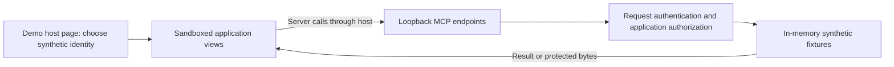

# SAGA demonstration: browse, descriptions, protected Play and notes

A synthetic, **local-only** application that shows one qualified pair end to end: the `lit-mcp`
stack on the `node` server target (`templates/lit-node`, `@modelcontextprotocol/node` 2.1.1). It
lets you explore allowed, denied, expired and recovery outcomes with synthetic subscriptions, media
and notes. The build installs packed SDK candidates outside the SAGA repository, then bundles them
into a standalone download.

It is a demonstration, not a starter. Start from [the Lit/Node starter](https://github.com/MachineWisdomAI/saga-a2ui/blob/main/templates/lit-node/README.md)
to build your own application: that template contains no account, token, media or business record,
and everything below stays out of it.

## Build or obtain the download

The commands in the next section run inside the **built download**, not this source directory. To build it from a SAGA checkout, install the repository dependencies with `npm ci` and run `npm run build:demo` from the repository root using Node 22.23.3 or newer. The output is `apps/lit-host/dist/demo`.

The source CLI can instead export the same download into a new directory:

```sh
npx tsx scripts/saga.ts demo --a2ui-stack lit-mcp --server node ./my-demo
```

This builds and copies the download; it does not install its dependencies or start it. This is a source-checkout command, not an npm-distributed CLI.

## Run it

Change into `apps/lit-host/dist/demo`, `my-demo`, or the directory containing a download's `server.mjs` and `package.json`.


```sh
npm install --omit=dev    # the few third-party packages server.mjs still imports; the SDK is bundled in
npm start                 # prints the host page's address; PORT=0 picks a free port
```

Open the printed `Open the demo host page:` address. Node 22.12 or newer is required.

| Variable | Meaning |
| --- | --- |
| `PORT` | The host page's port (default 3000). |
| `SAGA_DEMO_CAPABILITY_TTL_SECONDS` | How long an issued media capability lives (default 60). |
| `SAGA_DEMO_IMAGE_HOST` | One HTTPS host whose images descriptions may show. Default none, so the demonstration fetches nothing outside this machine. |
| `SAGA_DEMO_VIEWS_DIR` | Where the built pages are (default `views` beside `server.mjs`). |

The download's `release.json` records the candidate version and tarball digests, source commit and dirty state, qualified pair, and digests of the bundled server and view pages. It describes the local build, not a registry release or a deployment.

## How the local application fits together



The host page forwards calls using the selected public development credential. The server still makes its own decision for each protected request; a view's prerequisite check is only client-side preparation. The SDK supplies delivery, rendering and action lifecycle behavior, while the demonstration owns identity, entitlements, notes and media.

## Authentication is local-only

The sign-in choices on the host page are fixed, public **development credentials**
(`apps/lit-host/src/mcp/dev-auth.ts`). They are printed in the source and prove nothing about a
person: there is no password, no OAuth flow and no real account. The page and the process say so on
every start, the process refuses to start when `NODE_ENV=production`, and the page offers no field
to type a credential into.

A run against a real host uses that host's supported authentication instead. Give each protected
endpoint your own `OAuthTokenVerifier` (see `templates/lit-node/server/verifier.ts`), do not ship
`demo/lit-node/fixtures`, and put your own ingress host name in `allowedHosts`. This demonstration
has not been run in ChatGPT, Claude or Alexa+, and a local loopback run says nothing about a
remote host's authentication or audio.

## What you can do

The host page stands in for an assistant host: it mounts each app's view in a sandboxed frame, forwards
the view's server calls with the credential you chose, and logs every call. Use the demonstration
controls to change the synthetic backend while a view is open.

- **Browse** your subscriptions as Alice or Bob; each sees only their own. A credential the server
  refuses (expired, unknown, service-only, none) opens nothing and the log shows the HTTP status. A
  result for a different sign-in delivered to an open view clears it, and it stays cleared until a
  fresh view.
- **Descriptions** at both content levels. Standard renders Markdown, sends allowed HTTPS links to the host and permits images from the configured HTTPS host when the document enforces the required restrictions. Strict keeps links inactive and raw HTML inert. **Show images** permits only qualifying images for the current presentation; it does not activate links or HTML, expand the image allowlist, or compensate for missing enforcement. The control appears only when an image qualifies. A new result or closing the view revokes image consent. With the default empty image allowlist, no remote image loads.
- **Play** the first episode as Alice: a fresh entitlement check, a capability bound to the view's
  key, then the protected bytes. Bob, and the second episode, are refused with one fixed sentence.
  *revoke play access after next grant* shows **expired**: the grant was issued, the bytes were
  refused, and a new press is a brand-new Play that reuses nothing. An expired credential is
  *unconfirmed*, not a denial. If the host opens the player for a different sign-in, the player
  retires until a fresh view.
- **Notes** (the small non-playback action example of PACK1, `examples/pack1-consumer`) behind the
  starter's own request authentication. See below.

## The notes example

`examples/pack1-consumer/src/notes-actions.ts` defines the **Archive** action once with the fluent
builder and binds that one definition directly to each rendered row (`notes-view.ts`); the layout
names no action. Each binding keeps its own state, so two rows pending at once stay apart. It is not
derived from Play: Play is the application's own controller, Archive uses the general action
interface.

For a successful path, sign in as Alice, open Notes, and press **Archive** on one of her rows. The session prerequisite runs first; then `archive_note` asks the server to authorize the change. A confirmed response updates that row with its archive time and confirms the application's hold. Other rows keep independent invocation state.

What the controls let you see:

- **Refused prerequisite.** *end notes session*, then Archive: the asynchronous session check refuses,
  the row says `Not archived: sign-in-required`, and the log shows no `archive_note` call. The
  handler's protected request was never sent.
- **Server-side denial stays authoritative.** *revoke archive permission*, then Archive: the session
  check passes and the request is sent, and the server says no (`The server declined; nothing
  changed`). The view never decides.
- **Cancellation is the client no longer waiting.** *hold archives*, press Archive, then **Close all
  views**. The row's hold is given back and nothing is shown, but the server was never told to stop:
  *release archives* and reopen the notes to see the note archived. Closing a view does not undo a
  remote effect.
- **The application owner releases or retains its resource separately.** Each press takes a hold from
  the application's own owner (the *pending* and *confirmed* lines). The invocation gives it back on
  every non-success end, and hands it to the owner for good only after the server confirmed.

## What is where

| Path | Owner |
| --- | --- |
| `fixtures/` | The demonstration's synthetic accounts, episodes, media and credentials. Never part of the starter. |
| `server/main.ts`, `server/demo-server.ts` | Composition: the application's listener, a second listener for the Strict level, the host page and its small forwarding surface. |
| `server/notes-endpoint.ts` | Serves the notes example behind `templates/lit-node/server/authenticate.ts`, the starter's glue, used as it ships. Authentication, the request body and each backend wait of the notes operations are stages of one request, bounded by 3 s per operation and 10 s per request. A wait that ends says the notes are unavailable, never that nothing changed. |
| `host/` | The stand-in host page, built on the repository's local host fixture. |

The protocol, transport and renderer behavior is the SDK's: the SDK is bundled into `server.mjs` from
the installed packages, and the views are the application's installed views.

Stop the process with Ctrl+C when finished. Its signal handler closes the demonstration listeners; restarting creates fresh in-memory fixtures. **Close all views** retires the client presentations without stopping the server or reversing an archive already sent.

## Limits

Loopback only, in memory, one process. The local host fixture is not an assistant host. No OAuth
flow or registry install is involved, nothing is published or deployed, and its bundled SDK comes from candidate builds of this source. The SDK packages, including Lit and its MCP stack, also have public npm releases; use [public installation](https://github.com/MachineWisdomAI/saga-a2ui/blob/main/docs/public-install.md) for a registry-based application. Running this download does not test that installation path.
