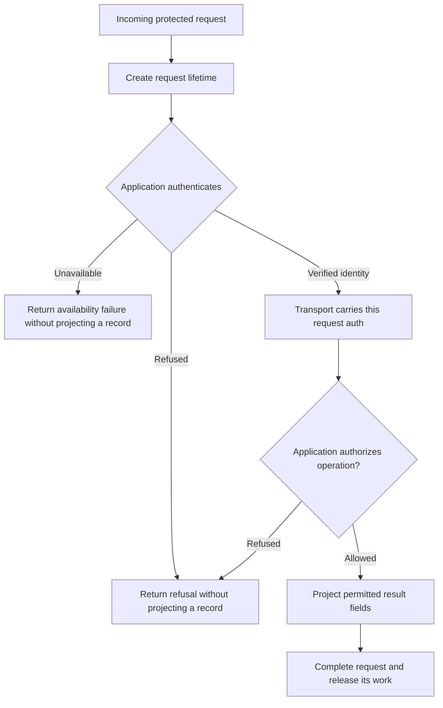

# Attach SAGA to an existing backend

<!-- Generated by scripts/guide-recipes.ts from templates/*. Do not edit; run `npm run guide:recipes`. -->

This document is generated. Each snippet is the maintained starter template’s own text, cut from the files CI builds and qualifies, so it cannot drift from a tested file. The [setup guide](getting-started.md) explains the concepts and the order to read them in.

Attaching SAGA to a backend you already run is an integration you make in your own source. No command edits an existing application: `saga init` creates one new directory and nothing else. The Lit and React stacks belong to the [public npm release set](public-install.md). These source-based snippets use matched local candidate packages so they can qualify unpublished changes (see [Install the packages from a candidate](getting-started.md#install-the-packages-from-a-candidate)).

## Which pairs have a recipe

<!-- pairs -->
| Stack | Server | Maintained template | `saga init` |
| --- | --- | --- | --- |
| `lit-mcp` | `node` | [`lit-node`](../templates/lit-node/) | offered |
| `lit-mcp` | `express` | [`lit-express`](../templates/lit-express/) | offered |
| `lit-mcp` | `fastify` | [`lit-fastify`](../templates/lit-fastify/) | offered |
| `lit-mcp` | `hono` | [`lit-hono`](../templates/lit-hono/) | offered |
| `lit-mcp` | `hapi` | [`lit-hapi`](../templates/lit-hapi/) | offered |
<!-- /pairs -->

A pair is listed only while CI qualifies it, and a qualified pair is not automatically offered by `saga init`: that command offers the pairs in its own list. A recipe is not a claim about any other pair, and no full matrix is claimed.

### Required servers without a recipe yet

<!-- uncovered -->
Every required server target has a qualified template above.
<!-- /uncovered -->

## The steps, whichever server you use

1. Install the SDK packages the recipe lists from one candidate, together, and keep the `@a2ui/markdown-it` override in your root `package.json`.
2. Decide who is asking. Your application authenticates the request (`server/verifier.ts` is the seam for your identity provider) and gives SAGA the result only through the transport’s per-request auth, as in the identity handoff below. A protected operation that receives no verified identity does not run; a declared public operation needs none and is given none.
3. Read the built HTML before listening. The preparation snippet defines `view` from `options.html` and its actual filename (`index.html` in the starter); `server/main.ts` reads that file. Prepare it once and reuse it in each request factory.
4. Register the operations your backend exposes. The handler makes your own authorization decision for that request’s identity, and the projection copies the public fields out of the record by name.
5. Build the view with your own catalog and serve it as the operation’s view resource, as the starter does. The view’s address preserves its filename and fingerprints its final bytes, so rebuild the view and restart the server together.
6. Attach each action to the rendered control it belongs to. The layout names no action; the attachment is application code.

## Place authentication before protected work

The snippets show the integration seams, not complete replacement listeners. Keep the surrounding route and request-lifetime setup from the linked template when adapting it to your backend. Authentication establishes who is asking; the operation handler separately decides whether that identity may perform the operation. Neither a tool argument nor a previous request supplies that identity.



This flow describes the protected route. The public route establishes its own request lifetime but does not read credentials or receive an identity. The lifetime starts before authentication and body waiting so those stages share the request’s limits. An authorization refusal also ends protected work without projecting a record.

- **Node:** the protected route calls `authenticate` before `serve(account, ...)`, then attaches the accepted context to that request. See the complete [Node listener](../templates/lit-node/server/listener.ts).
- **Express:** mount `identify` before the protected endpoint handler, as in `app.all(ACCOUNT_PATH, identify, ...)`. Preserve the listener’s body-handling order rather than adding a parser ahead of its request guards. See the [Express listener](../templates/lit-express/server/listener.ts).
- **Fastify:** attach `identityHandoff` as the protected route’s `onRequest` hook, before parsing and protected work. See the [Fastify listener](../templates/lit-fastify/server/listener.ts).
- **Hono:** the protected route authenticates the authorization header and passes `decision.authInfo` to `serve`; the public route calls `serve` without it. See the [Hono listener](../templates/lit-hono/server/listener.ts).
- **Hapi:** register the application authentication scheme and strategy, then register the maintained `mcpPlugin` with `auth: 'account'` for the protected endpoint and `auth: false` for the public endpoint. The displayed `createServer` factory receives identity already established by that strategy; it does not authenticate by itself. The [Hapi listener](../templates/lit-hapi/server/listener.ts) shows registration, and the template’s [bridge](../templates/lit-hapi/server/bridge.ts) carries the authenticated credentials into that request’s factory and Node transport.

The starter verifier refuses every credential until you implement your identity provider. Its example authorization callback returns true for any identity that has passed verification; replace that placeholder with your application’s policy before exposing protected operations. A missing or rejected credential and insufficient scope produce authentication refusals. A verifier failure or exhausted authentication budget is an availability failure; it does not acquire a challenge header merely because it happened during authentication.

## Keep request and application cleanup connected

Each incoming HTTP exchange owns one request lifetime. Preserve the listener or bridge code that creates it before authentication/body waiting and connects it to response completion, disconnects, deadlines and server shutdown. Reuse the prepared immutable view and endpoint registration; do not reuse a previous request’s identity or lifetime for another request.

The protected-operation example runs authorization through `request.within`. Pass its signal through to cancellable backend work, as the example passes it to `authorize`. When the request ends, that boundary stops waiting; application code that ignores cancellation can still continue. Cancellation does not undo a remote effect. Test the behavior of your own dependencies and avoid reporting an interrupted operation as definitely unapplied.

Connect endpoint cleanup to your existing server’s shutdown lifecycle. The starter’s `listener.close()` closes its MCP endpoint work and HTTP exchanges; [Node main](../templates/lit-node/server/main.ts) shows how the standalone starter calls it on process termination. Adapt that ownership to your server instead of installing a second competing signal handler. Hapi’s plugin and server stop path own the corresponding cleanup.

Read the complete listener, including its refusal paths and close method, before lifting an excerpt into your application. The recipe does not make your existing backend inherit the starter’s deadline, body-limit or cleanup behavior automatically.

CI qualifies the starter’s listener and operations against real MCP clients. That qualification belongs to the starter: attaching the same lines to your application does not inherit it. Test your own authentication, authorization and refusal paths in your application.

<!-- recipe:lit-node -->
## `node` with `lit-mcp`

Template: [`templates/lit-node`](../templates/lit-node/). Server adapter: `@modelcontextprotocol/node` 2.1.1. SDK packages: `@saga-a2ui/core`, `@saga-a2ui/lit`, `@saga-a2ui/components`, `@saga-a2ui/mcp`, `@saga-a2ui/lit-mcp-stack`.

The snippets below call the starter's own application files, which you read in the template (or in a project `saga init` created) and adapt: `server/authenticate.ts`, `server/authorization.ts`, `server/endpoint.ts`, `server/identity.ts`, `server/verifier.ts`. `server/verifier.ts` and `server/authorization.ts` are where your identity provider and your policy go; the starter ships neither.

### Prepare the view and endpoint handlers once

From `templates/lit-node/server/listener.ts`:

```ts
const view = prepareStarterView(options.html, options.filename);
const status = createEndpoint(
  (lifetime) => createStatusServer({ view, lifetime }),
  { maxRequestBodySize: MAX_REQUEST_BYTES },
);
const account = createEndpoint(
  (lifetime) =>
    createAccountServer({ view, lifetime, authorize: options.authorize }),
  { maxRequestBodySize: MAX_REQUEST_BYTES },
);
```

### Hand the verified identity to the transport

From `templates/lit-node/server/listener.ts`:

```ts
// Who is asking is decided before any server is built. The verified context travels to the tool
// only as the transport's per-request auth; no tool argument can name an account.
const decision = await authenticate(req, options.verifier, lifetime);
if (!decision.ok) {
  res
    .writeHead(
      decision.status,
      decision.challenge === undefined
        ? {}
        : { 'WWW-Authenticate': decision.challenge },
    )
    .end();
  return;
}
Object.assign(req, { auth: decision.authInfo });
```

### Register a protected operation

From `templates/lit-node/server/operations.ts`:

```ts
/**
 * A protected operation. The listener verified the request and the transport hands that context
 * to `identity`; with none the handler never runs. `handle` makes the application's own
 * authorization decision for this request's identity, then returns a record, and `project` copies
 * the public fields out of it by name.
 */
export function createAccountServer({
  view,
  lifetime,
  authorize,
}: AccountServerOptions): McpServer {
  const server = new McpServer({
    name: 'saga-starter-account',
    version: '0.0.0',
  });
  registerProtectedOperation(
    server,
    {
      name: ACCOUNT_TOOL,
      title: 'Show my account',
      description: 'Shows the account the server verified for this request.',
      annotations: READ_ONLY,
      input: z.strictObject({}),
      output: AccountOutputSchema,
      view,
      failures: {
        absent: TEXT.noAccount,
        unavailable: TEXT.unavailable,
        invalidOutput: TEXT.invalidOutput,
        signInRequired: TEXT.signInRequired,
      },
      identity: identityOf,
      async handle(_input, identity, request) {
        // Replace this with a call to your backend. The decision to answer is made here, for this request.
        if (
          !(await request.within('authorization', (signal) =>
            authorize(identity, signal),
          ))
        )
          return { kind: 'refused', text: TEXT.notAllowed };
        return { kind: 'record', record: identity };
      },
      project: (record) => ({
        text: 'Signed in.',
        data: { accountId: record.accountId },
      }),
    },
    { lifetime },
  );
  return server;
}
```

### Attach an action to a rendered control

From `templates/lit-node/src/view.ts`:

```ts
// Runs once for each presented surface. The same definition could be attached to any number
// of controls; here it is attached directly to the one rendered Clear control.
attach: (surfaceView) => {
  surfaceView.watchById(
    CLEAR_ID,
    ActionButton,
    (handle) => void handle.bindAction('activate', actions.clearNote),
  );
},
```
<!-- /recipe:lit-node -->

<!-- recipe:lit-express -->
## `express` with `lit-mcp`

Template: [`templates/lit-express`](../templates/lit-express/). Server adapter: `@modelcontextprotocol/express` 2.0.2. SDK packages: `@saga-a2ui/core`, `@saga-a2ui/lit`, `@saga-a2ui/components`, `@saga-a2ui/mcp`, `@saga-a2ui/lit-mcp-stack`.

The snippets below call the starter's own application files, which you read in the template (or in a project `saga init` created) and adapt: `server/authenticate.ts`, `server/authorization.ts`, `server/endpoint.ts`, `server/identity.ts`, `server/verifier.ts`. `server/verifier.ts` and `server/authorization.ts` are where your identity provider and your policy go; the starter ships neither.

### Prepare the view and endpoint handlers once

From `templates/lit-express/server/listener.ts`:

```ts
const view = prepareStarterView(options.html, options.filename);
const status = createEndpoint(
  (lifetime) => createStatusServer({ view, lifetime }),
  { maxRequestBodySize: MAX_REQUEST_BYTES },
);
const account = createEndpoint(
  (lifetime) =>
    createAccountServer({ view, lifetime, authorize: options.authorize }),
  { maxRequestBodySize: MAX_REQUEST_BYTES },
);
```

### Hand the verified identity to the transport

From `templates/lit-express/server/listener.ts`:

```ts
// Who is asking is decided before any server is built. The verified context travels to the tool
// only as the transport's per-request auth (`req.auth`); no tool argument can name an account.
const identify: RequestHandler = async (req, res, next) => {
  const decision = await authenticate(req, options.verifier, lifetimeOf(res));
  if (!decision.ok) {
    res
      .writeHead(
        decision.status,
        decision.challenge === undefined
          ? {}
          : { 'WWW-Authenticate': decision.challenge },
      )
      .end();
    return;
  }
  req.auth = decision.authInfo;
  next();
};
```

### Register a protected operation

From `templates/lit-express/server/operations.ts`:

```ts
/**
 * A protected operation. The listener verified the request and the transport hands that context
 * to `identity`; with none the handler never runs. `handle` makes the application's own
 * authorization decision for this request's identity, then returns a record, and `project` copies
 * the public fields out of it by name.
 */
export function createAccountServer({
  view,
  lifetime,
  authorize,
}: AccountServerOptions): McpServer {
  const server = new McpServer({
    name: 'saga-starter-account',
    version: '0.0.0',
  });
  registerProtectedOperation(
    server,
    {
      name: ACCOUNT_TOOL,
      title: 'Show my account',
      description: 'Shows the account the server verified for this request.',
      annotations: READ_ONLY,
      input: z.strictObject({}),
      output: AccountOutputSchema,
      view,
      failures: {
        absent: TEXT.noAccount,
        unavailable: TEXT.unavailable,
        invalidOutput: TEXT.invalidOutput,
        signInRequired: TEXT.signInRequired,
      },
      identity: identityOf,
      async handle(_input, identity, request) {
        // Replace this with a call to your backend. The decision to answer is made here, for this request.
        if (
          !(await request.within('authorization', (signal) =>
            authorize(identity, signal),
          ))
        )
          return { kind: 'refused', text: TEXT.notAllowed };
        return { kind: 'record', record: identity };
      },
      project: (record) => ({
        text: 'Signed in.',
        data: { accountId: record.accountId },
      }),
    },
    { lifetime },
  );
  return server;
}
```

### Attach an action to a rendered control

From `templates/lit-express/src/view.ts`:

```ts
// Runs once for each presented surface. The same definition could be attached to any number
// of controls; here it is attached directly to the one rendered Clear control.
attach: (surfaceView) => {
  surfaceView.watchById(
    CLEAR_ID,
    ActionButton,
    (handle) => void handle.bindAction('activate', actions.clearNote),
  );
},
```
<!-- /recipe:lit-express -->

<!-- recipe:lit-fastify -->
## `fastify` with `lit-mcp`

Template: [`templates/lit-fastify`](../templates/lit-fastify/). Server adapter: `@modelcontextprotocol/fastify` 2.0.1. SDK packages: `@saga-a2ui/core`, `@saga-a2ui/lit`, `@saga-a2ui/components`, `@saga-a2ui/mcp`, `@saga-a2ui/lit-mcp-stack`.

The snippets below call the starter's own application files, which you read in the template (or in a project `saga init` created) and adapt: `server/authenticate.ts`, `server/authorization.ts`, `server/endpoint.ts`, `server/identity.ts`, `server/verifier.ts`. `server/verifier.ts` and `server/authorization.ts` are where your identity provider and your policy go; the starter ships neither.

### Prepare the view and endpoint handlers once

From `templates/lit-fastify/server/listener.ts`:

```ts
const view = prepareStarterView(options.html, options.filename);
const status = createEndpoint(
  (lifetime) => createStatusServer({ view, lifetime }),
  { maxRequestBodySize: MAX_REQUEST_BYTES },
);
const account = createEndpoint(
  (lifetime) =>
    createAccountServer({ view, lifetime, authorize: options.authorize }),
  { maxRequestBodySize: MAX_REQUEST_BYTES },
);
```

### Hand the verified identity to the transport

From `templates/lit-fastify/server/listener.ts`:

```ts
// Who is asking is decided before any server is built or any body is read. The verified context
// travels to the tool only as the transport's per-request auth; no tool argument can name an account.
const identityHandoff = async (
  request: FastifyRequest,
  reply: FastifyReply,
) => {
  const decision = await authenticate(
    request.raw,
    options.verifier,
    lifetimeOf(request),
  );
  if (!decision.ok) {
    if (decision.challenge !== undefined)
      reply.header('WWW-Authenticate', decision.challenge);
    return reply.code(decision.status).send();
  }
  Object.assign(request.raw, { auth: decision.authInfo });
};
```

### Register a protected operation

From `templates/lit-fastify/server/operations.ts`:

```ts
/**
 * A protected operation. The listener verified the request and the transport hands that context
 * to `identity`; with none the handler never runs. `handle` makes the application's own
 * authorization decision for this request's identity, then returns a record, and `project` copies
 * the public fields out of it by name.
 */
export function createAccountServer({
  view,
  lifetime,
  authorize,
}: AccountServerOptions): McpServer {
  const server = new McpServer({
    name: 'saga-starter-account',
    version: '0.0.0',
  });
  registerProtectedOperation(
    server,
    {
      name: ACCOUNT_TOOL,
      title: 'Show my account',
      description: 'Shows the account the server verified for this request.',
      annotations: READ_ONLY,
      input: z.strictObject({}),
      output: AccountOutputSchema,
      view,
      failures: {
        absent: TEXT.noAccount,
        unavailable: TEXT.unavailable,
        invalidOutput: TEXT.invalidOutput,
        signInRequired: TEXT.signInRequired,
      },
      identity: identityOf,
      async handle(_input, identity, request) {
        // Replace this with a call to your backend. The decision to answer is made here, for this request.
        if (
          !(await request.within('authorization', (signal) =>
            authorize(identity, signal),
          ))
        )
          return { kind: 'refused', text: TEXT.notAllowed };
        return { kind: 'record', record: identity };
      },
      project: (record) => ({
        text: 'Signed in.',
        data: { accountId: record.accountId },
      }),
    },
    { lifetime },
  );
  return server;
}
```

### Attach an action to a rendered control

From `templates/lit-fastify/src/view.ts`:

```ts
// Runs once for each presented surface. The same definition could be attached to any number
// of controls; here it is attached directly to the one rendered Clear control.
attach: (surfaceView) => {
  surfaceView.watchById(
    CLEAR_ID,
    ActionButton,
    (handle) => void handle.bindAction('activate', actions.clearNote),
  );
},
```
<!-- /recipe:lit-fastify -->

<!-- recipe:lit-hono -->
## `hono` with `lit-mcp`

Template: [`templates/lit-hono`](../templates/lit-hono/). Server adapter: `@modelcontextprotocol/hono` 2.0.2. SDK packages: `@saga-a2ui/core`, `@saga-a2ui/lit`, `@saga-a2ui/components`, `@saga-a2ui/mcp`, `@saga-a2ui/lit-mcp-stack`.

The snippets below call the starter's own application files, which you read in the template (or in a project `saga init` created) and adapt: `server/authenticate.ts`, `server/authorization.ts`, `server/endpoint.ts`, `server/identity.ts`, `server/verifier.ts`. `server/verifier.ts` and `server/authorization.ts` are where your identity provider and your policy go; the starter ships neither.

### Prepare the view and endpoint handlers once

From `templates/lit-hono/server/listener.ts`:

```ts
const view = prepareStarterView(options.html, options.filename);
const status = createEndpoint(
  (lifetime) => createStatusServer({ view, lifetime }),
  { maxRequestBodySize: MAX_REQUEST_BYTES },
);
const account = createEndpoint(
  (lifetime) =>
    createAccountServer({ view, lifetime, authorize: options.authorize }),
  { maxRequestBodySize: MAX_REQUEST_BYTES },
);
```

### Hand the verified identity to the transport

From `templates/lit-hono/server/listener.ts`:

```ts
// Who is asking is decided before any server is built. The verified context travels to the tool
// only as the transport's per-request auth; no tool argument can name an account.
const decision = await authenticate(
  c.req.header('authorization'),
  options.verifier,
  lifetime,
);
if (!decision.ok)
  return new Response(null, {
    status: decision.status,
    headers:
      decision.challenge === undefined
        ? {}
        : { 'WWW-Authenticate': decision.challenge },
  });
return serve(c, account, decision.authInfo);
```

### Register a protected operation

From `templates/lit-hono/server/operations.ts`:

```ts
/**
 * A protected operation. The listener verified the request and the transport hands that context
 * to `identity`; with none the handler never runs. `handle` makes the application's own
 * authorization decision for this request's identity, then returns a record, and `project` copies
 * the public fields out of it by name.
 */
export function createAccountServer({
  view,
  lifetime,
  authorize,
}: AccountServerOptions): McpServer {
  const server = new McpServer({
    name: 'saga-starter-account',
    version: '0.0.0',
  });
  registerProtectedOperation(
    server,
    {
      name: ACCOUNT_TOOL,
      title: 'Show my account',
      description: 'Shows the account the server verified for this request.',
      annotations: READ_ONLY,
      input: z.strictObject({}),
      output: AccountOutputSchema,
      view,
      failures: {
        absent: TEXT.noAccount,
        unavailable: TEXT.unavailable,
        invalidOutput: TEXT.invalidOutput,
        signInRequired: TEXT.signInRequired,
      },
      identity: identityOf,
      async handle(_input, identity, request) {
        // Replace this with a call to your backend. The decision to answer is made here, for this request.
        if (
          !(await request.within('authorization', (signal) =>
            authorize(identity, signal),
          ))
        )
          return { kind: 'refused', text: TEXT.notAllowed };
        return { kind: 'record', record: identity };
      },
      project: (record) => ({
        text: 'Signed in.',
        data: { accountId: record.accountId },
      }),
    },
    { lifetime },
  );
  return server;
}
```

### Attach an action to a rendered control

From `templates/lit-hono/src/view.ts`:

```ts
// Runs once for each presented surface. The same definition could be attached to any number
// of controls; here it is attached directly to the one rendered Clear control.
attach: (surfaceView) => {
  surfaceView.watchById(
    CLEAR_ID,
    ActionButton,
    (handle) => void handle.bindAction('activate', actions.clearNote),
  );
},
```
<!-- /recipe:lit-hono -->

<!-- recipe:lit-hapi -->
## `hapi` with `lit-mcp`

Template: [`templates/lit-hapi`](../templates/lit-hapi/). Server adapter: `@modelcontextprotocol/node` 2.1.1. SDK packages: `@saga-a2ui/core`, `@saga-a2ui/lit`, `@saga-a2ui/components`, `@saga-a2ui/mcp`, `@saga-a2ui/lit-mcp-stack`.

The snippets below call the starter's own application files, which you read in the template (or in a project `saga init` created) and adapt: `server/authenticate.ts`, `server/authorization.ts`, `server/bridge.ts`, `server/identity.ts`, `server/verifier.ts`. `server/verifier.ts` and `server/authorization.ts` are where your identity provider and your policy go; the starter ships neither.

### Prepare the view and endpoint handlers once

From `templates/lit-hapi/server/listener.ts`:

```ts
// Both endpoint registrations below keep one persistent handler and reuse this immutable view.
const view = prepareStarterView(options.html, options.filename);
```

### Hand the verified identity to the transport

From `templates/lit-hapi/server/listener.ts`:

```ts
// Hapi's authentication strategy snapshots the verified credential before the body wait.
// The bridge carries that request's auth to this factory and the Node transport; SAGA's
// identityOf hook reads only that auth. No argument or previous request names an account.
createServer: ({ lifetime, authInfo }) => {
  if (authInfo === undefined)
    throw new Error(
      'The protected route did not establish request identity.',
    );
  return createAccountServer({
    view,
    lifetime,
    authorize: options.authorize,
  });
},
```

### Register a protected operation

From `templates/lit-hapi/server/operations.ts`:

```ts
/**
 * A protected operation. The listener verified the request and the transport hands that context
 * to `identity`; with none the handler never runs. `handle` makes the application's own
 * authorization decision for this request's identity, then returns a record, and `project` copies
 * the public fields out of it by name.
 */
export function createAccountServer({
  view,
  lifetime,
  authorize,
}: AccountServerOptions): McpServer {
  const server = new McpServer({
    name: 'saga-starter-account',
    version: '0.0.0',
  });
  registerProtectedOperation(
    server,
    {
      name: ACCOUNT_TOOL,
      title: 'Show my account',
      description: 'Shows the account the server verified for this request.',
      annotations: READ_ONLY,
      input: z.strictObject({}),
      output: AccountOutputSchema,
      view,
      failures: {
        absent: TEXT.noAccount,
        unavailable: TEXT.unavailable,
        invalidOutput: TEXT.invalidOutput,
        signInRequired: TEXT.signInRequired,
      },
      identity: identityOf,
      async handle(_input, identity, request) {
        // Replace this with a call to your backend. The decision to answer is made here, for this request.
        if (
          !(await request.within('authorization', (signal) =>
            authorize(identity, signal),
          ))
        )
          return { kind: 'refused', text: TEXT.notAllowed };
        return { kind: 'record', record: identity };
      },
      project: (record) => ({
        text: 'Signed in.',
        data: { accountId: record.accountId },
      }),
    },
    { lifetime },
  );
  return server;
}
```

### Attach an action to a rendered control

From `templates/lit-hapi/src/view.ts`:

```ts
// Runs once for each presented surface. The same definition could be attached to any number
// of controls; here it is attached directly to the one rendered Clear control.
attach: (surfaceView) => {
  surfaceView.watchById(
    CLEAR_ID,
    ActionButton,
    (handle) => void handle.bindAction('activate', actions.clearNote),
  );
},
```
<!-- /recipe:lit-hapi -->
