# Build tic-tac-toe with React

You play tic-tac-toe against an AI assistant, inside the chat. You click a square on a board. The assistant answers by playing O. Both of you use the same game, so neither can cheat the other: the server checks every move.

This guide builds that game with saga a2ui and React. It is a weekend-sized project, and you can read it in about ten minutes. Ten minutes is reading time. Installing, building and connecting a host take longer.

By the end you can say how a click and an assistant turn share one game, which files you would change to make your own app, what saga handles for you, and what to do next.

## The finished game

You ask the assistant for a game of tic-tac-toe. It starts one, and the chat shows a new board with nine empty squares. This is the same board a few moves into a game, with your turn again:


You play X and move first. Each square is a button, so the keyboard works too. Squares you cannot play are switched off: one that is taken, any square while the assistant is thinking, and every square once the game is over.

Three things make it different from a page you would build on its own:

- **The board lives in the chat.** The assistant's host, such as Claude or ChatGPT, shows it as a card next to the conversation. The host is the application that runs the assistant. Here it is called an MCP host, because it talks to your game over the Model Context Protocol (MCP). You do not need to know the protocol to follow this guide.
- **The assistant plays through the same door you do.** Your click and the assistant's turn both end in one server operation, `play_move`. An operation is a named action your server offers. The server alone decides whether a move is legal.
- **Your click wakes the assistant.** A page can call your server, but it cannot make the assistant speak. So after your move the board adds a short message to the conversation, as if you had typed it. That is what hands the turn to the assistant.

## Run it

The finished game is in this repository as [`examples/tic-tac-toe`](../examples/tic-tac-toe). It was generated with `saga init` and keeps the starter's structure. You need Node 22.23.3 or newer and npm.

```sh repository
npm ci
npm run build:tic-tac-toe
node apps/lit-host/dist/tic-tac-toe/server.mjs
```

The first command installs the repository's tools. The second packs the SDK, installs it into a clean copy of the example, and builds the board and the server. The third starts the server. It prints the address of its MCP endpoint, which looks like this:

```text
Tic-tac-toe MCP endpoint: http://127.0.0.1:3000/mcp
```

This route builds the SDK packages from your checkout. The game needs that: adding a message to the conversation and operations that open no card come with the source packages (React stack `0.8.1-rc.1`), and the `0.7.7-rc.1` release on npm does not have them. Nothing here is a published artifact.

Add the address to an MCP host that can show an app, then ask the assistant for a game. [Connecting to Claude, ChatGPT and Alexa+](#connect-it-to-claude-chatgpt-and-alexa) below covers the three hosts. None of the three has been run against this game yet. The [host compatibility guide](host-compatibility.md) records what each host is known to support.

You can also try the board without any host. The browser tests mount it in a small local stand-in for a host, `apps/lit-host/e2e/host-fixture`, and play whole games there: clicks, keyboard moves, the assistant's replies and the messages the board sends. [The guided change below](#make-one-change-a-move-list) runs one of them.

## Your first click

Say "Let's play tic-tac-toe." The assistant calls the game's `new_game` operation, and the host shows a new, empty board. Its status line reads "Your move. You are X." and all nine squares are playable. The picture above shows a game that is further on, so start from the empty board here.

Click the centre square of the empty board. Three things happen, in this order:

1. **The board asks the server to play your move.** It calls `play_move` for X, and says which move number it has on screen. If something else has changed the game since, the server refuses the move and changes nothing.
2. **The server answers with the whole game.** The board shows your X and the status line changes to "Waiting for the assistant to play O…". The squares switch off, because it is not your turn.
3. **The board adds a message to the conversation,** as you:

   > Your move in tic-tac-toe game `zDfjqVwo1WmUlxN1BOqAhw`. The board is in your context; if it isn't, read it with get_game. Then play O with play_move.

   The message names the game and never draws the board. The server owns the state, so the message carries only the game's identifier. The board also hands the assistant a copy of the game as background it can see and the chat does not show. If the host cannot take that copy, the message is still sent, and the assistant reads the game with `get_game`.

The assistant now has its turn. It reads the game if it needs to and calls `play_move` for O. The board, meanwhile, checks the server every second and a half, for up to a minute. Those two numbers are provisional defaults, to be settled by runs in real hosts. When O appears, the board shows it and gives the turn back to you.

If the host takes no message at all, the status line tells you what to do: "Tell the assistant it's their move." The board keeps checking either way.

When your move ends the game, the board sends a different message instead, "I won our tic-tac-toe game." or "Our tic-tac-toe game ended in a draw.", and waits for nothing.

## The layout and the operations

The server (`server/`) holds the game: the rules in `rules.ts`, the stored games in `game-store.ts` and the four operations in `operations.ts`. The board (`src/`) shows it: the layout in `surface.ts`, the components that draw it in `catalog.tsx`, the actions in `actions.ts` and where each is attached in `view.tsx`. `contract.ts` and `text.ts` hold the shape of a game and every sentence anyone reads.

The layout is written in A2UI, a format that describes an interface as data: named components and the values they show. It says "a status line, nine squares, a New game button" and names no behavior.

The server offers four operations:

| Operation | Called by | Opens the board | Returns |
| --- | --- | --- | --- |
| `new_game` | Assistant or board | Yes | A new game |
| `show_game` | Assistant | Yes | Opens or reopens the board on a game |
| `get_game` | Assistant or board | No | The current game |
| `play_move` | Assistant or board | No | The game after the move |

`play_move` takes a game identifier, a square from 0 to 8, the player and `expectedMoveNumber`. The last one is the stale-state protection: a click made on an old board, or sent twice, names a move number the game has already passed, and the server refuses it with no effect.

All four are declared with `registerPublicOperation`. The two that return only data leave out `view`:

```ts
registerPublicOperation(
  server,
  {
    name: GET_GAME_TOOL,
    title: 'Read a game',
    // ...
    annotations: READS,
    input: GameIdInputSchema,
    output: GameOutputSchema,
    failures,
    handle: async ({ gameId }) => gameFound(await store.get(gameId)),
    project,
  },
  { lifetime },
);
```

`new_game` and `show_game` add `view: views.newGame` and `view: views.showGame`, which attach the board. The split matters because a host shows a result on the card it opened for that call: if the assistant read the game with `show_game` on every turn, each turn would open another board. `get_game` and `play_move` return data and a short text for the model, and open nothing.

The click and the assistant's turn reach the same `play_move`, but they reach the board differently, because the host routes a result by who made the call:


[Editable Mermaid](../diagrams/tic-tac-toe-turn-loop.mmd) · [PNG](../diagrams/tic-tac-toe-turn-loop.png)

**Your move.** The board makes the call, so the result comes back to the action that made it. That action is one definition, shared by all nine squares (`src/actions.ts`):

```ts
const playSquare = Action.server<ActionButtonActivation, Reply>(
  'play-square',
  host.server,
)
  .input((event) => {
    const shown = game.current();
    if (shown === undefined) throw new Error('no game is on screen');
    return {
      gameId: shown.gameId,
      expectedMoveNumber: shown.moveNumber,
      square: Number(event.read('index')),
    };
  })
  // ...
  .run(async ({ params, call }) =>
    readMove(await call(PLAY_MOVE_TOOL, { ...params, player: 'X' })),
  )
```

The same file's `handOver` function then adds the message. The copy of the game for the assistant travels as the message's `context`, and the game opts in to sending the message even if the host cannot take that copy:

```ts
context: {
  text: CONVERSATION.boardForAssistant(played),
  data: { game: played },
  bestEffort: true,
},
```

**The assistant's move.** The model makes the call, and a host delivers a model call's result to a card it opened for that call, not necessarily to the board that is already on screen. So the board reads the game itself while it waits.

Each square is bound to the action in `src/view.tsx`, and the layout names no action:

```ts
surfaceView.watchById(
  SQUARE_ID,
  ActionButton,
  (handle) =>
    void handle.bindAction('activate', actions.playSquare, {
      // ...
      subject: () => game.subject(),
    }),
);
```

If a call fails or times out, the move may or may not have been applied. The board reads the game again before it offers a square.

## What saga handles

You write the game: its rules, where it is stored, the layout, the components, the actions and the sentences. saga handles the plumbing:

- **Operations.** It checks every input and output against the contracts you declare, bounds how long a call waits, gives your handler a cancellation signal when the wait ends, and turns a failure into a fixed safe message. A handler that ignores the signal keeps running, and ending a wait does not undo what it already did, so make your own work stop when the signal fires.
- **The board.** It serves the board as an operation's card, connects it to the host, keeps a result that arrives early, and ends the view once when the host or page goes away.
- **Actions.** It attaches one definition to each control with state of its own, so nine squares share one action.
- **The conversation.** It adds the message and its context, and says whether the host took them.

## Make one change: a move list

The guided change adds a list of the moves so far under the board. The game already carries its `history`, and the board already turns each move into a line of words, so the change touches only the layout and the catalog.

```diff
diff --git a/src/catalog.tsx b/src/catalog.tsx
--- a/src/catalog.tsx
+++ b/src/catalog.tsx
@@ -81,6 +81,18 @@ const Board: ReactCatalogComponent = createComponentImplementation(
   ),
 );
 
+/** The moves so far, one per line, in the order they were played. */
+const MoveList: ReactCatalogComponent = createComponentImplementation(
+  { ...ListApi, name: 'MoveList' },
+  ({ props, buildChild }) => (
+    <ol className="moves" aria-label="Moves so far">
+      {childrenOf(buildChild, props.children).map((move, at) => (
+        <li key={at}>{move}</li>
+      ))}
+    </ol>
+  ),
+);
+
 const SquareFaceApi = {
   name: 'SquareFace',
   schema: z
@@ -129,6 +141,7 @@ export const boardEntries: readonly ReactCatalogComponent[] = [
   Column,
   Row,
   Board,
+  MoveList,
   Line,
   SquareFace,
   Shown,
diff --git a/src/surface.ts b/src/surface.ts
--- a/src/surface.ts
+++ b/src/surface.ts
@@ -46,7 +46,7 @@ export const boardSurface = defineSurface({
   root: {
     component: 'Column',
     bind: {},
-    props: { children: ['status', 'board', 'controls'] },
+    props: { children: ['status', 'board', 'controls', 'history'] },
   },
   components: [
     {
@@ -98,6 +98,12 @@ export const boardSurface = defineSurface({
       when: { path: '/canCheck' },
       child: CHECK_ID,
     },
+    {
+      id: 'history',
+      component: 'MoveList',
+      children: { componentId: 'move', path: '/history' },
+    },
+    { id: 'move', component: 'Line', kind: 'body', text: { path: 'text' } },
     { id: CHECK_ID, component: 'ActionButton', child: 'check-label' },
     {
       id: 'check-label',
```

In `surface.ts` the layout gains a `history` component that repeats a `move` line for each entry of the game's `history`. In `catalog.tsx` a new `MoveList` component draws those lines as an ordered list. The server, the controller and the actions do not change. The patch is `examples/tic-tac-toe/guided-change/move-list.patch`.

The build you already ran also built the changed game, in `apps/lit-host/dist/tic-tac-toe-guided`. Stop the first server with Ctrl-C, because both use port 3000, and start the changed one:

```sh repository
node apps/lit-host/dist/tic-tac-toe-guided/server.mjs
```

After your click on the centre square the list reads "1. You: row 2, column 2". When the assistant has played, it adds a second line such as "2. Assistant: row 1, column 1".

To watch the change work without a host, run its browser test on the local host fixture, a stand-in for a host that records what the board appends to the conversation. The test clicks a square, then plays O by calling the server directly, because no assistant is involved. Build the fixture's page first, because building it clears the example's build:

```sh repository
npm run build -w apps/lit-host
npm run build:tic-tac-toe
cd apps/lit-host
npx playwright install chromium
npx playwright test e2e/tic-tac-toe.spec.ts -g "adds a move list"
```

This is a local check. It does not show that an assistant played, or that any host behaves the same way.

## Connect it to Claude, ChatGPT and Alexa+

None of the three has been run against this game, so this guide claims nothing about them. What follows is what to expect from the [host compatibility guide](host-compatibility.md), which records bounded runs of other saga apps.

A host reaches your server over the network, so the loopback address is not enough. Put the server behind a public HTTPS address, add its host name to `ALLOWED_HOSTNAMES` in `server/listener.ts`, rebuild, and register the address in the host's own connector or app settings, following the host's documentation. The game has no sign-in, so anyone who holds a game's identifier can play either side. Games live in memory and expire thirty minutes after their last move.

No recorded run covers this game's hand-over: a card appending a message and its context, and an assistant answering it. How long a host waits for a call also matters. One recorded Claude run ended its wait at about 30 seconds, and in recorded ChatGPT and Claude runs some first loads of a card needed the host's Try again button.

### Claude

Claude on the web has displayed saga views from a tool result and run calls from a card to the server, in the recorded notes application. Expect the board to open and a click to play X. Whether Claude takes the board's message, and the assistant then plays O, is unverified. If the message is not taken, the status line says "Tell the assistant it's their move." and you can type it. Details: [host compatibility](host-compatibility.md#chatgpt-and-claude).

### ChatGPT

ChatGPT on the web has the same recorded display and card calls, and one recorded reload removed a pending view. A reloaded board can be opened again on its game with `show_game`. The hand-over is unverified, as for Claude. Details: [host compatibility](host-compatibility.md#chatgpt-and-claude).

### Alexa+

The Alexa+ simulator has displayed saga views from a conversation, but calls from a card already on screen to the server did not complete usably in the recorded probes ([host compatibility](host-compatibility.md#alexa)). The board's click and its wait are such calls, so do not expect them to work there.

You would play by voice instead: you say your move, and the assistant calls `play_move` for X and then for O, and `show_game` to show the board. The tool's description allows this when you state your move in the conversation. A voice or conversation move is a different interaction from clicking the board. There is no click, no message appended by the board and no wait, and the board only displays. The server applies the same rules. That Alexa+ behaves this way with this game is unverified.

## What else this design allows

The game keeps four things apart: what the board says (the A2UI layout), who draws it (a renderer), how it reaches the person (a delivery), and where the game lives (the server and its store). Each can change on its own. Each arrangement below carries one of three labels:

| Label | What it means |
| --- | --- |
| Runnable | The guide's own app runs this way. |
| Straightforward composition | Built from existing packages. |
| Architectural sketch | Needs adapters that do not exist yet. |



[Editable Mermaid](../diagrams/tic-tac-toe-arrangements.mmd) · [PNG](../diagrams/tic-tac-toe-arrangements.png)

- **The game as built.** *Runnable.* React draws the board, MCP Apps delivers it, and one Hono server holds the endpoint, the rules and an in-memory store.
- **A gateway and an app API on separate servers.** *Straightforward composition.* Put the rules and the store behind an HTTP API that other clients can use too, and make the MCP server a thin gateway whose operations call it. `GameStore` is the seam. The API must keep the check-and-apply step of `GameStore.play` atomic.
- **Renderer independence.** *Straightforward composition.* The contract, the rules and the server import nothing from React, and the layout is plain A2UI data. A Lit view of the same game needs its own catalog and view on `@saga-a2ui/lit-mcp-stack`, which the [Lit track](build-notes-with-lit.md) shows.
- **A native A2UI host without MCP.** *Architectural sketch.* The layout is data that any host able to render A2UI could draw. The board reaches the server through `host.server` and the conversation through `host.conversation`, which such a host would supply. No such adapter exists in this repository.
- **A2A delivery.** *Architectural sketch.* A2A is a protocol for agents to message one another. `appendMessage` would become an A2A `message/send`, and its `context` would become a data part on that message. The [A2A delivery issue](https://github.com/MachineWisdomAI/saga-a2ui/issues/198) owns the work, and nothing sends it today.
- **`GameStore` on Workers KV or a Durable Object.** *Architectural sketch.* A Durable Object serializes the requests for one game, so it can give `play` its one-step check. Workers KV has no conditional write on the move number. The repository ships neither store, and its listener is a Node listener, so the endpoint would also need a Workers host.

The A2A sketch, as one turn of the game:


[Editable Mermaid](../diagrams/tic-tac-toe-a2a-delivery.mmd) · [PNG](../diagrams/tic-tac-toe-a2a-delivery.png)

## Where to go next

Start your own project from the same starter the example came from:

```sh repository
npx tsx scripts/saga.ts init --a2ui-stack react-mcp --server hono ../my-saga
```

It creates one new directory and installs nothing. The starter is not the game: it serves a status view and a protected account view, and the example replaced its operations and removed its sign-in files. The [setup guide](getting-started.md#create-a-new-project) covers installing and starting it, and the [example's README](../examples/tic-tac-toe/README.md) maps the example's files and tests. Replace the rules, the store and the layout with your own, and keep the operations, the action and the conversation message as the pattern.

Other places to go:

- [React integration](react-consumers.md): add the React stack to an application you already have.
- [Build the notes application with Lit](build-notes-with-lit.md): the Lit track, which leads to the [action guide](actions.md) and its traced allowed and denied requests.
- [Attach saga to an existing backend](attach-to-existing-backend.md): add an endpoint to a server you run.
