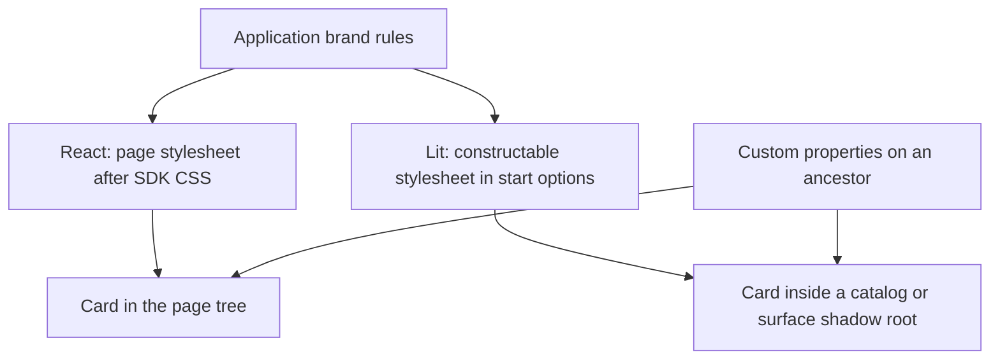

# Styling the FaithfulCard

A branded application styles FaithfulCard with ordinary CSS using the classes, elements and custom properties below. Both renderers emit the same styling surface, so the same brand rules work with either stack. A normal MCP application starts the card through `@saga-a2ui/react-mcp-stack/faithful-card` or `@saga-a2ui/lit-mcp-stack/faithful-card`; lower-level renderer integrations remain available through `@saga-a2ui/react/faithful-card` and `@saga-a2ui/lit/faithful-card`. Anything not listed here is not contract and may change in any release: the markup a renderer wraps around content, the stylesheet's own selectors, and every `data-testid` or `data-annotation` attribute.

The names live in one list, `FAITHFUL_CARD_STYLING` in `@saga-a2ui/components/faithful-card`, which both renderers' tests read.

## Class names

| Class                     | What it marks                                                                                              |
| ------------------------- | ---------------------------------------------------------------------------------------------------------- |
| `.saga-card`              | The card's root. It carries the tokens below and is also the alert shown when content is refused           |
| `.saga-card-content`      | The interpreted content, inside the root                                                                   |
| `.saga-card-link`         | A link the host may open: a button, so it can never navigate by itself                                     |
| `.saga-card-link-status`  | The readable answer after a link request, directly after its `.saga-card-link`                             |
| `.saga-card-controls`     | The Strict control row (Reveal source, Show images)                                                        |

Inside `.saga-card-content` an application may select the semantic elements `h3`–`h6` (the page owns the top levels, so a Markdown `#` renders as `h3`), `p`, `ol`, `ul`, `li`, `blockquote`, `pre`, `code`, `table`, and the CommonMark inline and rule elements `strong`, `em` and `hr`.

## Strong, emphasis and rules

CommonMark `**strong**`, `*emphasis*` and a thematic break (`---`) render as `strong`, `em` and `hr`. The card sets no weight, size, slant or colour on `strong` or `em`, so each takes the browser's default (a weight of 700 from a 400 body, an italic slant) and inherits its size and colour from the block that holds it. Its only rule for `hr` is the line it draws, in `--saga-card-border-color`. An application restyles them by element, and a treatment it gives a block reaches the `strong` or `em` inside:

```css
.saga-card strong {
  font-weight: 700;
}

/* Right-to-left emphasis is not slanted. The card gives each block the direction of its own text. */
.saga-card em:dir(rtl) {
  font-style: normal;
  font-size: 1.15em;
}

/* One divider: a rule draws it, so a footer that follows a rule adds none. */
.saga-card .saga-card-content > hr + p[data-saga-closing='paragraph'] {
  border-top: 0;
}
```

A closing paragraph that is only a strong sentence keeps the footer's size and colour on its `strong`, and the weight the application gives it.

### Replacing selectors that reached into the card's markup

A rule written against what the card happened to render moves to the committed names by a mechanical replacement. It keeps the visual rule; it does not promise the same document structure, which stays the renderer's.

| Instead of a selector on                                          | Select                                                              |
| ----------------------------------------------------------------- | ------------------------------------------------------------------- |
| An attribute such as `[data-testid=…]` or `[data-annotation=…]`   | The class or element it sat on, from the lists above                |
| An element a renderer wrapped around a paragraph, list or table   | `.saga-card-content > p`, `> ul`, `> ol`, `> table` and so on       |
| A bold or italic span by a generated class                        | `.saga-card strong`, `.saga-card em`                                |
| A divider by its position or class                                | `.saga-card .saga-card-content > hr`                                |
| The last paragraph by position, to find a footer                  | `[data-saga-closing='paragraph']`, then the application's own test  |

## Custom properties

Set any of these on the card or an ancestor. Each has a neutral fallback; unset properties leave the card inheriting the page.

`--saga-card-font-family`, `--saga-card-font-size`, `--saga-card-line-height`, `--saga-card-reading-width` (default `70ch`), `--saga-card-text-color`, `--saga-card-accent-color` (links and the quote rule), `--saga-card-muted-color` (link hostnames), `--saga-card-border-color` (tables and rules) and `--saga-card-code-background`.

There is no typed bridge from a host's own CSS variables to these properties. An application maps a host's theme onto them itself. For a host that is read on a device rather than at a desk, both stacks export `readingProfile(context, hostName)` (from their main and `/faithful-card` entries), the one place that recognises such hosts. It answers `'device'` or `'desktop'` for the `hostContext` callback's arguments, and the application maps the answer onto its own tokens (for example a larger `--saga-card-font-size`) and onto a `data-reading-profile` attribute of its own. The card decides nothing from the profile, and the application never branches on a host name.

## The closing marker

The final top-level block of the content carries `data-saga-closing="paragraph"` when, and only when, that block is a paragraph, whatever its words:

- a trailing list, quote, table, code block or rule means no marker;
- a paragraph nested in a quote, a list item or a table cell is never marked;
- a card with no blocks, or content the card refused, has none.

The marker is structural. The SDK recognises no attribution: whether a marked paragraph is an attribution, a signature or an ordinary sentence is the application's decision, made from the paragraph's words by the application's own code.

```css
/* Any closing paragraph. */
.saga-card .saga-card-content > p[data-saga-closing='paragraph'] {
  margin-bottom: 4px;
}

/* Only what the application's own classifier recognised as its footer. */
.saga-card .saga-card-content > p[data-saga-closing='paragraph'][data-app-footer] {
  border-top: 1px solid var(--saga-card-border-color);
}
```

Re-run the classifier each time the card shows new content; the marker moves with the content, and a previous answer's paragraph is gone. The application supplies `data-app-footer`; the SDK never sets it.

For a working integration, see [`classifyAttribution` in the branded fixture](../apps/lit-host/e2e/card-styling/branded.ts) and [the stack probe's observer setup](../apps/lit-host/e2e/card-app-stack/probe.ts). The classifier finds `[data-saga-closing="paragraph"]`, checks its text against the application's attribution sentence, and sets or removes its own attribute. That fixture calls the attribute `data-app-attribution`; use the same name in your classifier and CSS if adapting it. It recursively visits open shadow roots, so it also finds Lit's closing paragraph.

The probe watches content changes (`childList` and `characterData` with `subtree`) and reruns classification after rendering. An observer on the page container cannot see changes inside a shadow root, so it discovers and watches each open shadow root as well. This is application-owned DOM integration, not a public SDK classifier hook. If you use an observer in a long-lived page, disconnect it when that application view ends; SDK stylesheet cleanup does not own your observer.

## Reaching the card from a stylesheet

Use custom properties for inherited choices such as body size, colour and reading width. Use selectors for specific content treatments, such as a border on the application's closing attribution. The selector rules need to reach the tree containing the card:



React's card shares the page's styling scope. A Lit card renders in the tree provided by its catalog or surface, which can be inside a shadow root; page selectors cannot cross that boundary. Custom properties inherit across it, while the Lit `styles` option places selector rules in the root where the card lives.

- **React** renders into the page's own tree, so a page or component stylesheet applies. Import `@saga-a2ui/react-mcp-stack/faithful-card.css` for the SDK's presentation, then add brand rules after it. A lower-level React integration can import `@saga-a2ui/react/faithful-card.css` directly.
- **Lit** renders the card inside shadow roots that the catalog and the A2UI surface create, so a page stylesheet cannot select into it. Pass constructable stylesheets as `styles` to `startFaithfulCardApp` of the Lit stack (or to `createFaithfulCardView` when composing the card yourself); each connected card adopts them into the root it lives in. Custom properties inherit through shadow roots and need no sheet.

For example, setting `--saga-card-font-size: 18px` on the application's view container changes the card's inherited body size in either renderer. A rule such as `.saga-card strong { font-weight: 700; }` must instead be in React's page stylesheet or a constructable stylesheet supplied through Lit's `styles`. Lit includes its neutral card presentation; it has no separate stack CSS import.

Each connected Lit card holds its adopted styles for its connected lifetime. Disconnecting releases that hold; a shared sheet remains while another card uses it, and a sheet the root already owned is not removed. A root without stylesheet-adoption support is left unchanged. Missing or misplaced brand CSS does not relax content policy: links, image consent and refused-content behavior still follow the card's policy.

## Qualification

This is the lower-level evidence. `apps/lit-host/e2e/card-styling.spec.ts` renders a branded stylesheet written against this surface alone (`e2e/card-styling/branded.ts`) in both renderers, mounted through each renderer's `openFaithfulCardSurface`, and asserts computed styles for a paragraph, a list, a link and the closing block. It also covers a trailing list, a paragraph nested in a quote, list item or table cell, and a final paragraph that merely reads like an attribution: it carries the marker and receives no application footer styling, because the fixture's classifier rejects it. Strong, emphasis and rules are covered the same way: `strong` at weight 700, right-to-left `em` set apart from Latin `em`, a closing strong sentence inheriting the footer's size and colour, and exactly one divider where a rule precedes the footer; without the stylesheet they keep the browser's defaults. A structural scan of the stylesheet, the React templates and the Lit element for the committed names is a small additional check; the rendering is the proof.

### Through the stack's start

`card-styling.spec.ts` mounts the renderers' card surfaces directly. It does not start a card application, so it is lower-level evidence and is not the stack-level qualification.

`apps/lit-host/e2e/card-app-stack.spec.ts` starts the card through `startFaithfulCardApp` of each stack, in the local host fixture's sandboxed iframe and over a real `AppBridge`, with the real definition and the application's chrome. It uses no private test hook. The probe page uses the same branded stylesheet and the same application classifier as the lower-level specification, and each stack receives the stylesheet the way an application would give it: the React page applies it as page CSS beside the stack's public `faithful-card.css`; the Lit page passes it as the start's `styles` option, which the stack hands to the card view that adopts it into the card's root. On both stacks the same cases assert the semantic DOM the stylesheet depends on (`strong`, `em`, `hr`, right-to-left direction, links, lists, the structural closing marker only on a final top-level paragraph, and the application's own attribution classification, which follows each answer), the computed styles of the paragraph, link, list, footer, emphasis, right-to-left emphasis, rule and strong-footer rules, a held result shown only after the application's font readiness work settles, the reset of image consent when an equal answer arrives again, and that the stack still reports the size.

This is a local fixture result, not acceptance by any actual host.
