# Getting started with SAGA A2UI

SAGA connects an application's UI to an MCP host. Your application supplies the view, the meaning of its data and the actions its controls perform. A stack package connects the renderer to MCP delivery and manages the view's lifetime.

For an existing Lit or React application, install its published MCP stack and framework peers. For a runnable Lit starter or local demonstration, use the source checkout and its matched candidate tarballs. The source CLI is development tooling; both renderer stacks are available on npm.



## Start from the demo

The demonstration is a synthetic, local-only application of one qualified pair, built from packed candidate tarballs outside the repository. It is the fastest way to see the workflow: browse, descriptions at both content levels, protected Play, and the notes actions. It is **not a starter** and not a release download; no hosted copy exists.

Use a source checkout with Node 22.23.3 or newer (the repository toolchain minimum). From its root:

```sh repository
npm ci
npm run build:demo
```

```sh demo
npm install --omit=dev
npm start
```

The first block writes `apps/lit-host/dist/demo`; run the second inside it. Open the `Open the demo host page:` address it prints. The generated demo itself requires Node 22.12.0 or newer. Choose Alice in the local host page, open Notes, and press Archive on a note. The row reports the archive result. End the notes session and try another Archive: the prerequisite refuses and no archive request is sent. These are synthetic local credentials, not a production identity flow.

See the [demonstration README](../demo/lit-node/README.md) for the controls, the environment variables and what each shows.

## Install a published stack

The seven-package release set is published at `0.7.7-rc.1` under `next`, including Lit and the Lit MCP stack. Pin the exact version rather than relying on mutable tags. The [release receipt](https://github.com/MachineWisdomAI/saga-a2ui/releases/tag/v0.7.7-rc.1) records anonymous installation, integrity, compilation and build checks; the [published baseline](2026-10-26_published-sdk-baseline_v2.md) identifies the package and source revisions used here. See [public installation](public-install.md) for registry checks and package selection.

Use Node 22.12.0 or newer and a bundler that handles TypeScript source. The packages export source rather than precompiled JavaScript. This registry path configures an existing application; the runnable local demo above is the quickest way to see a complete view before integrating your own backend. In your application's root `package.json`, merge this override with your existing settings before installing:

```json
{"overrides": {"@a2ui/markdown-it": "0.2.1"}}
```

A2UI 0.13.0 permits a newer Markdown package whose peer requirements target A2UI 0.14.0. The override keeps the supported combination together. It belongs at the consumer root; a dependency's own override is not inherited.

Choose one stack for that application. For Lit:

```sh
npm install --save-exact --strict-peer-deps @saga-a2ui/lit-mcp-stack@0.7.7-rc.1 lit@3.3.3
```

For React:

```sh
npm install --save-exact --strict-peer-deps @saga-a2ui/react-mcp-stack@0.7.7-rc.1 react@19.3.1 react-dom@19.3.1
```

Each stack brings core, components, MCP and its renderer at the matching SDK version. Your application does not need to install those packages separately for the stack's API. Keep the resulting lockfile. Existing applications should reconcile their framework version with these peer requirements before proceeding.

Use the main entry for an application-owned catalog, `/faithful-card` for the optional card application and `/server` for server integration. Import server code only in the server build. Installing the package does not create a project, start a backend or register an application with a host.

The [React integration guide](react-consumers.md#open-a-typed-surface) shows how to open, mount, update and dispose a typed surface in an existing React application. For MCP delivery, the application still needs its own catalog, result handling and backend; this install section does not create those files or promise a running host connection. The [view-composition example](../examples/pack1-consumer/) shows a complete application using the stack. It is a development example, not a React `saga init` template.

## Which packages do what

Package names are flat under `@saga-a2ui`. There are no aggregate packages: no `@saga-a2ui/genui`, `protocol`, `transport` or `tools`. Groups exist only in the documentation ([package layout](../packages/README.md)).

| Group | Package | State |
| --- | --- | --- |
| Core | `@saga-a2ui/core` | Implemented. Renderer-independent action contract (`/actions`), the A2UI v0.9 message session (`/protocols/a2ui/v0_9`) and the Zod 3 alias for catalog schemas (`/protocols/a2ui/zod3`). |
| Delivery | `@saga-a2ui/mcp` | Implemented. `/server` (protected operations, verified request identity, one request lifetime), `/view` (the view's connection) and `/policy`. |
| GenUI renderers | `@saga-a2ui/lit`, `@saga-a2ui/react` | Lit is the full renderer. React has direct action attachment, the optional FaithfulCard slices and, through its stack, the named composition capabilities (typed surfaces, the card and the card application); that is not full React parity. A `@saga-a2ui/lynx` package does not exist; Lynx delivery is retired (see below). |
| Stacks | `@saga-a2ui/lit-mcp-stack`, `@saga-a2ui/react-mcp-stack` | Implemented. A stack connects one renderer to MCP delivery, so an application installs one stack plus its framework peers and imports from it only: `startA2uiView` for an application's own catalog, and `startFaithfulCardApp` from the `/faithful-card` subpath for a card application. Both stacks are published at `0.7.7-rc.1`. |
| Components | `@saga-a2ui/components` | Implemented, optional. The passive FaithfulCard slice. The React stack installs it transitively; an own-catalog application need not import it, and its main-entry browser bundle excludes it. |
| Tooling | none | No tooling package is implemented. `@saga-a2ui/publish` is a proposal in the draft [host publication design](../blueprints/features/host_publication.blueprint.md); there is no such command. `saga init` is a script in this repository, not a package. |

Renderer packages keep independent maturity and peers. The starter installs the Lit and MCP stack and the packages it depends on (`core`, `lit`, `components` and `mcp`), imports its view from `@saga-a2ui/lit-mcp-stack`, and keeps `@saga-a2ui/mcp/server` for its server.

## Component, definition, template and instance

A repeated list can have several buttons with the same layout ID. Each button still needs to act on its own row. The [action binding design](../blueprints/modules/action_binding.blueprint.md#component-terminology) distinguishes the layout declaration from the rendered instance and the data it currently shows:

| Word | What it is | In the notes example |
| --- | --- | --- |
| Component type | A kind of control the application's catalog allows | `ActionButton` |
| Definition | One ID-bearing entry in the layout | `row-archive`, a child of `note-actions` |
| Template | A definition repeated once per data item | `{ componentId: 'note-row', path: '/notes' }` repeats the whole row |
| Rendered instance | One component the renderer created from a definition | The Archive button of the second note's row |
| Data item | The value that instance currently shows | `/notes/1`, read with `event.read('id')` |

The layout gives the markup its IDs and structure and **names no action**. Behavior is decided by application code. A reusable fluent action definition (`Action.local(...)` or `Action.server(...)`, finished with `.build()`) holds no pending state, so one definition can be attached to every instance. Setup finds instances by the layout's own ID (`watchById`), and `bindAction('activate', definition)` attaches the definition to that exact instance (or renderer-owned handle). Each attachment keeps its own state, so two rows pending at once stay apart. Discovery happens at setup, once per presented surface; nothing looks an action up by a string at activation time, and no handler-name table, event bus or registry exists.

The `bind-action` snippet in the [generated recipes](attach-to-existing-backend.md) is the starter's own attachment.

## Create a new project

This is the source-based Lit path. From the checkout root, run `npm ci` if its dependencies are not already installed.

`saga init` is a script in this repository, run from a checkout. It creates one new directory from the maintained starter template and installs nothing, runs no package manager and no hook, and never changes anything that already exists.

```sh repository
npx tsx scripts/saga.ts --help
npx tsx scripts/saga.ts init --a2ui-stack lit-mcp --server hono ./my-app
```

`--a2ui-stack` selects the renderer/delivery combination; `--server` selects the server framework. The command creates `my-app` and installs nothing. Use Node 22.23.3 or newer for this source checkout. Keep this checkout unchanged while exporting the project and packing its dependencies so their candidate identities match.

### Install the packages from a candidate

This source workflow qualifies the checkout using candidate builds of Lit and the Lit stack. Both packages are also published on npm. The project `saga init` creates depends on `@saga-a2ui/*` packages pinned to the exact candidate version of the commit that produced them. A package manager resolves those pins only from that candidate's tarballs, so a plain `npm install` cannot resolve those commit-specific candidate versions from the public registry.

Build the candidate from the checkout that ran `saga init`, then install the tarballs the project uses in one command:

```sh repository
npm ci
npm ci --prefix apps/lynx-fixture
npm run build
npm run candidate:pack -- --out candidate-out
```

The second line is needed because the root build still builds the retained Lynx fixture, which has its own lockfile; it is historical evidence, not a Lynx recipe. The pack writes `candidate-out/packages/saga-a2ui-<package>-<version>.tgz` for the seven packages. Then open a terminal in `my-app` and install all five tarballs together. `PATH` must point back to the checkout's candidate output from that directory:

```sh
npm install ./PATH/candidate-out/packages/saga-a2ui-core-VERSION.tgz ./PATH/candidate-out/packages/saga-a2ui-components-VERSION.tgz ./PATH/candidate-out/packages/saga-a2ui-lit-VERSION.tgz ./PATH/candidate-out/packages/saga-a2ui-mcp-VERSION.tgz ./PATH/candidate-out/packages/saga-a2ui-lit-mcp-stack-VERSION.tgz
```

Replace `PATH` and `VERSION` with your files; the version is the one in the project's `package.json`. A plain `npm install` cannot retrieve these candidate versions from npm; install their tarballs instead. A public release does not replace the matched candidate set used by this source workflow. A candidate is not a public registry release. Install every package of the combination you use together, from the same candidate, and keep the `@a2ui/markdown-it` override in your root `package.json` (the starter carries it). [Candidates: contents, update, rollback](candidate-update-and-rollback.md) is the authority for the matched set, the update sequence and rollback; do not update one package alone. CI also uploads each candidate as a workflow artifact.

After installing those tarballs inside `my-app`, build and start it:

```sh project
npm run build
npm start
```

`npm run typecheck` checks the view and the server. `npm start` prints two endpoint addresses: `/status/mcp` is public and reads no credential; `/account/mcp` is protected. **The protected endpoint refuses every credential until you replace `server/verifier.ts`.** The starter ships no identity provider and no account, sample data or test verifier. These addresses are MCP endpoints, not browser pages. The server is ready when it prints them. Connect an MCP Apps-capable host to the public `/status/mcp` endpoint and invoke its `get_status` tool to request the starter view. A remote host needs a reachable application address; starting a loopback server does not deploy it. For an immediately viewable local application without host setup, use the demo above. The [template README](../templates/lit-hono/README.md) lists the files that are yours.

### HTTP defaults

Use **stateless MCP** and **prepare the built view once at startup**. The five maintained starters each construct two persistent `createMcpHandler` instances: one for the public status endpoint and one for the protected account endpoint. Each factory constructs a fresh server for a request. Each handler owns a separate notification bus, subscription limit and shutdown operation, so public subscribers cannot receive protected endpoint notifications or consume its subscription slots.

The Hono target uses the official `@modelcontextprotocol/hono` validation middleware and Hono's Node adapter. Hono supplies routing and middleware; Node remains the runtime. Its routes mount `handler.fetch(c.req.raw, { parsedBody, authInfo })`; Node, Express and Fastify use the official `toNodeHandler` adapter. The application authenticates before invoking the protected handler and reads the body under the request's deadline. All mounting paths pass `parsedBody` explicitly: in the pinned SDK this preserves the original `Request` object in both modern and legacy factories, allowing the endpoint's WeakMap to recover the admitted lifetime through `ctx.requestInfo`.

When deploying behind an ingress, configure both Host and Origin validation for the clients you accept. Allowing a public Host does not make a remote browser Origin pass localhost-only Origin validation; use an explicit trusted-origin policy when accepting those requests.

#### Response modes and slow tools

For modern requests, leave `responseMode` unset (`'auto'`):

| Mode | Behavior | When to use it |
| --- | --- | --- |
| `'auto'` | Returns JSON unless a related mid-call message upgrades the response to SSE. | Default for normal application endpoints. |
| `'json'` | Returns only the terminal result; drops mid-call progress and logging. | When discarding those notifications is intentional. |
| `'sse'` | Uses SSE from the start. | When an always-streaming response is required. |

SAGA's `request.reportProgress(...)` emits progress only when the client supplied a `progressToken`. A slow call without a related message remains JSON in `auto`; elapsed time alone never starts streaming. The SDK's `keepAliveMs` defaults to 15,000 milliseconds (`0` disables it), and in `auto` starts only after SSE upgrade. Configure the application's request and operation budgets, proxy timeouts and response mode for the work it actually performs; keepalive does not extend those budgets.

These modes describe the modern path. The pinned handler's default compatibility path serves 2025-era clients with a fresh stateless transport per request and SSE responses. It retains the older initialization exchange but creates no protocol session; GET and DELETE return 405. No opt-in is needed to serve 2026-07-28 alongside that compatibility path. See the [upstream handler reference](https://ts.sdk.modelcontextprotocol.io/v2/api/@modelcontextprotocol/server/server/createMcpHandler.html).

#### Protocol state and notifications

The [2026-07-28 specification](https://modelcontextprotocol.io/specification/2026-07-28/changelog) removes protocol sessions, the initialization handshake and SSE replay. Modern requests carry their protocol version and capabilities in `_meta`; clients re-issue a request after a broken stream. An old session map or replay store does not belong in a new request/answer application.

- Keep cross-call application state behind explicit server-minted handles passed as ordinary tool arguments.
- For additional input, use the multi-round-trip pattern: return `resultType: "input_required"` with input requests and request state, then accept the client's retry with `inputResponses`. Do not describe older server-initiated requests as a reason to introduce sessions.
- Long-running background work can use the separate `io.modelcontextprotocol/tasks` extension when both application and client support it. The starters do not implement a task workflow.
- `subscriptions/listen` is an opted-in POST response stream for change notifications. Request progress and logging stay on their own request's response stream. Subscription streams and ordinary long-running SSE responses both hold HTTP connections.
- The default subscription bus is in-process and `maxSubscriptions` defaults to 1024 per handler. A multi-replica application using notifications needs a shared pub/sub implementation **within the same authorization boundary**. These fixed starter operations publish no change notifications.

The starters' request deadline also applies to response streams (10,000 milliseconds by default). An application adding long-lived subscriptions must choose a stream lifetime policy; keepalives do not bypass the deadline.

To preserve an existing sessionful 2025 deployment, route it explicitly using upstream `isLegacyRequest` ahead of a modern handler configured with `legacy: 'reject'`; that is a separate migration choice.

#### Startup, view identity and shutdown

Read and validate the built HTML before listening. Compute `viewUriForHtml(finalHtml, 'index.html')` once and retain the immutable `OperationView` used by discovery, tool results and resource reads. A URI such as `ui://views/index.<32-character-sha256-prefix>.html` identifies both the file and its final bytes. Rebuilding the document changes its address automatically, while identical filenames and bytes agree across replicas. Full SHA-256 checksums remain available in qualification records. Answer-specific data never enters this cached document.

On `SIGINT` or `SIGTERM`, the starter stops admission, cancels active request lifetimes, closes both persistent MCP handlers, then closes the Node HTTP listener and connections. `handler.close()` aborts modern exchanges and subscription streams; legacy exchanges also need request/connection teardown. The [Hono Node guide](https://hono.dev/docs/getting-started/nodejs) likewise makes the application's underlying HTTP server responsible for shutdown.

The CLI creates a separate reference project; it does not migrate an existing application. Preserve your own operations, renderer and policy when adapting its HTTP layer. A Lit starter does not require an existing React application to change renderer.

### Unqualified pairs are refused

`saga init` offers only the pairs CI qualifies and that its own list names: `lit-mcp` on `node`, `express`, `fastify`, `hono` and `hapi`. Asking for another pair exits with status 1 before anything is written, and the message lists the five supported ones:

```sh repository
npx tsx scripts/saga.ts init --a2ui-stack react-mcp --server node ./my-app
```

A template directory existing does not add a pair, and a *qualified* template is not automatically *offered*: the [pair table](attach-to-existing-backend.md#which-pairs-have-a-recipe) shows which pairs have a qualified template and which of them `saga init` offers today (all five). Hapi uses the SAGA-maintained bridge over the official Node/server SDK; React has no starter, template or `saga init` pair.

## Attach to an existing backend

Attaching SAGA to a server you already run is a documented integration you make in your own source. **No command performs it, and the CLI never edits an existing application.** The recipes are in [Attach SAGA to an existing backend](attach-to-existing-backend.md). That document is generated from the same maintained, CI-qualified template files `saga init` copies, so an authentication or server snippet is the starter's own text, and a server that is not yet qualified has no recipe. To print the same snippets yourself:

```sh repository
npx tsx scripts/starter-snippets.ts
npx tsx scripts/starter-snippets.ts --template lit-express
```

Additional server slices add their own recipe by joining the qualified inventory and regenerating the recipes (`npm run guide:recipes`); `scripts/guide.test.ts` fails until they do. The Hapi recipe traces its route authentication through the request factory and transport to the verified-identity hook. Each application supplies its verifier and authorization policy.

## Compose a view with a stack

An application installs one stack plus its framework peers and writes only what is its own. The stack connects to the host, holds a result that arrives before the view is ready (the latest wins), gives each result to the application, and ends the view once, before the connection ends, when the host tears it down, `dispose()` runs or the page goes away. A raw `pagehide` listener is not needed for any of that; the application keeps one only for behavior that is its own.

The Lit starter's composition is this. It is excerpted line for line from `templates/lit-node/src/view.ts`, and `scripts/guide.test.ts` fails when a line stops being there or when the call omits an option `createLitActions` requires. The layout is in `surface.ts` and the catalog in `catalog.ts`. `requireElement`, `say`, `show` and `retire` are the application's own helpers in the same file: what a result means and what ending the view takes with it. `retire` ends only what the application owns. The surface owns the discovery and the bindings made in `attach`, and ends them when it leaves the page, before the stack calls `onTeardown`.

```ts
import {
  ActionButton,
  createLitActions,
  startA2uiView,
} from '@saga-a2ui/lit-mcp-stack';

const view = startA2uiView({
  container: requireElement('starter-app'),
  layout: starterSurface,
  catalog: starterCatalog,
  identity: { name: 'saga-starter-view', version: '0.0.0' },
  actions: createLitActions({
    attach: (surfaceView) => {
      surfaceView.watchById(
        CLEAR_ID,
        ActionButton,
        (handle) => void handle.bindAction('activate', actions.clearNote),
      );
    },
    onSetupError: () => say(PROBLEM_TEXT),
  }),
  onToolResult: (result, running) => show(result, running.surface),
  onTeardown: retire,
});
await view.ready;
```

`attach` runs once for each presented surface and binds the application's action to the control it finds. `onSetupError` is required: it receives the error of a setup that throws, and the page shows only the safe fallback while the text goes to your callback. In `show`, `surface.update({ headline })` validates the data against the layout and applies it in place: the mounted controls, their bindings and focus survive, and a rejected update changes nothing. A card application states a validated definition instead (`FaithfulCardApp.define(...)`) and starts it with `startFaithfulCardApp` from `@saga-a2ui/lit-mcp-stack/faithful-card` or `@saga-a2ui/react-mcp-stack/faithful-card`. Neither stack asks the application to write A2UI messages, to import the MCP Apps bridge, or to order the handshake; the repository's consumer boundary scan (`scripts/consumer-boundary.test.ts`) fails a template, example or view module that does. The catalog is written against the stack's own exports too (`A2uiLitElement`, `basicCatalog`, `Catalog`, `CommonSchemas`, `z`), so an application that installs the stack names no upstream renderer or schema package.

A stack's installed tree includes `@saga-a2ui/components` and `markdown-it` as its declared dependencies; the emitted bundle of an application that uses only the main entry does not (the card entry is where they are used). The [React consumer dependency guide](react-consumers.md) has the React recipe and the registry-versus-candidate distinction.

## Content policy

A view that shows supplied Markdown (the optional FaithfulCard) does so under one **trusted content policy** that the application chooses in its own server code. Neither the model nor the supplied content sets it.

- **Standard** permits validated HTTPS links through the host, and images from explicitly allowed HTTPS hosts.
- **Strict** keeps every link inert, shows blocked fragments as accessible placeholders (or inert text) that the reader can reveal as text, and loads a permitted image only after the reader chooses **Show images**. Consent is revoked by a new result or by closing the view.

Both keep ordinary formatting and both retain server authorization and data-sharing checks. The starter itself shows no Markdown: its view is served with the closed policy `CLOSED_VIEW_CSP` from `@saga-a2ui/mcp/policy`, which allows no network or external resource. Ansari's branding and presentation rules stay with Ansari.

### Rebuild and resource matching

A view is served as an MCP App resource whose address is `ui://views/<filename>.<32-character-sha256-prefix>.html`, the SHA-256 of the exact bytes served. A view that embeds a policy has an address that depends on that policy, so **changing the policy or rebuilding the view changes the address**. Rebuild the view from the installed packages, restart the server so it serves the rebuilt view, and pair a server only with the view built beside it. A view that meets a result it does not understand shows that the view and its server are from different builds instead of rendering it. `npm run candidate:identity` prints the identities for a given policy.

## Identity and the evidence behind it

The application authenticates the request and its server decides what the account may see; SAGA carries the verified result. In the starter, `server/listener.ts` verifies the request, hands the result to the transport, and the operation reads it with `identityOf`. No tool argument can name an account, a prior call authorizes nothing, and two overlapping requests each see their own identity.

**Synthetic versus real identity.** The demonstration's sign-in choices are fixed public development credentials printed in the source (`apps/lit-host/src/mcp/dev-auth.ts`). They prove nothing about a person, the page and the process say so, and the process refuses `NODE_ENV=production`. They are not a model for production. A real host uses its supported authentication through your own `OAuthTokenVerifier`, and a loopback run says nothing about it.

**Evidence is several different things.** A claim is only as wide as the check that supports it:

| Evidence | It shows | It does not show |
| --- | --- | --- |
| Invocation | An action ran against an instance, with its prerequisites, hooks and outcome | That the control was visible, or that a host delivers the gesture |
| Rendering | A view displayed content under a policy in the local host fixture | Rendering in ChatGPT, Claude or Alexa+ |
| Authentication | A request with an accepted, refused or absent credential was admitted or refused | An OAuth or DCR flow, or any real identity provider |
| Audio | The local audio clock advanced | Audio in a remote host |

Named-host receipts exist for a few specific flows and are recorded in [host compatibility observations](host-compatibility.md). The starter, the demonstration and this guide have not been run in an actual assistant host.

## Actions

The attachment above is the whole of what this guide teaches. [Change a component and trace allowed and denied requests](actions.md) is where the details belong: it changes a component and its action, then traces input, prerequisites, verified identity, authorization, delivery and cleanup, with every case run. This section is the short version.

The verified **non-playback** example is the notes application: `examples/pack1-consumer/src/notes-actions.ts` defines Archive once and `notes-view.ts` attaches it to each rendered row. The demonstration serves it behind the starter's own authentication, and its README shows each outcome:

- **Asynchronous prerequisites.** Checking that the session is still valid is a prerequisite that runs before the handler. If it refuses, no protected request is sent.
- **Outcome hooks.** Success, failure and cancellation each have a hook that reports what that outcome establishes. A timeout or an unreadable reply is *unknown*, not "nothing happened".
- **Application resource ownership.** A hold the application takes for a press is given back on every non-success end and handed to its owner only after the server confirms. The application owns it, not the binding.

Two limits matter before you rely on a client-side control:

- **A client check does not authorize a protected server operation.** The server decides again for every protected request; a prerequisite only saves a request.
- **Cancellation does not undo remote effects.** Closing a view stops the client waiting. It does not establish that the host forwarded cancellation or that the server stopped, and an applied write stays applied. Uncertain writes are not retried automatically.

Defaults, kept separate: action work 30 seconds and each hook or cleanup 5 seconds; server operations 3 seconds inside a 10-second request budget that starts before authentication. Invalid explicit settings fail, and a stage never resets its parent's budget.

## What is implemented and what is not

| Area | Implemented, qualified in source | Not done or not shown |
| --- | --- | --- |
| Shared action contract | `@saga-a2ui/core/actions`, with the opt-in Lit and React `ActionButton` controls; Play runs on it | A registry or handler-name table, which do not exist |
| Lit | The full renderer, available on npm; matched candidate tarballs qualify the starter, demonstration and notes example | Windows |
| React | **Direct action attachment** (`@saga-a2ui/react/actions`, ACT2), the optional FaithfulCard text and image-consent slices and, through `@saga-a2ui/react-mcp-stack`, the named composition capabilities (typed bound surfaces, the card factory and the card application), from the same tarballs; the notes browse and Play run through React in a local fixture host | Full React parity and broad host coverage are not established. Bounded notes and protected-player Claude/ChatGPT observations are preserved in the [action lifecycle record](../blueprints/modules/action_binding.lifecycle.md); they do not supply a React starter, template, CLI pair or complete host matrix |
| Server targets | `node`, `express`, `hono`, `fastify`, `hapi` qualified with `lit-mcp` | No full matrix; `saga init` offers those five servers; the standalone demonstration is the Node application only |
| Lynx | Nothing. Lynx delivery was retired on 2026-10-19; `apps/lynx-fixture` and the Lynx proposals in the Blueprints are **historical** designs and evidence, with no delivery promise, no recipe and no adapter | Any current Lynx setup |

A renderer is qualified by running its own lifecycle, not by declaring that it could: a type declaration that compiles is not a working setup claim, and no renderer is forced through a Lit-specific lifecycle (custom elements and `createA2uiAppElement`). React attaches through its own provider and hook; the shared contract is renderer-neutral.

<!-- react -->
### React applications

Use SAGA's React A2UI entry point for public surface and catalog APIs. Do not add direct dependencies on `@a2ui/react` or `@a2ui/web_core`, or import their catalog or surface APIs yourself:

```ts
import {A2uiSurface, Catalog, type ReactCatalogComponent} from '@saga-a2ui/react/a2ui';
```

`@saga-a2ui/react/a2ui` is the supported surface. Keep React and React DOM as your declared peers, pin `@a2ui/markdown-it` 0.2.1 at the consumer root, and keep the separate Zod majors apart: [the React consumer dependency guide](react-consumers.md) is the recipe. Any later React pair exposure keeps its own renderer qualification.
<!-- /react -->

## Troubleshooting setup

**Candidate packages cannot be found on npm.** The Lit starter pins commit-specific candidate versions. Build and install the matched tarballs, rather than replacing those pins with independently selected public packages. The CLI's generic `npm install` next step does not do this for you.

**The protected endpoint refuses your credentials.** Replace `server/verifier.ts` with your application's verifier and supply its authorization policy. The clean starter deliberately has no test account or identity provider. The public `/status/mcp` endpoint can work while `/account/mcp` correctly refuses access.

**The demo directory does not exist.** Run `npm run build:demo` in the source checkout first. It produces the standalone directory whose own `npm start` serves the demonstration. The standalone demo supports Node only; the other server targets are starter templates.

**A React starter command is refused.** The React stack is published, but there is no React `saga init` pair. Integrate the stack in a React application; do not replace its lifecycle with a Lit-specific lifecycle or follow the retired historical Lynx fixture as a setup path.

## Where to go next

- The attach recipes: [Attach SAGA to an existing backend](attach-to-existing-backend.md).
- The command that creates a project, and its safety rules: `scripts/saga.ts` and the "Creating a project with `saga init` (CLI1)" section of the [development reference](development-reference.md#creating-a-project-with-saga-init-cli1).
- The action contract in depth: the [action binding design](../blueprints/modules/action_binding.blueprint.md) and [The action contract across the current codebase (ACT7)](development-reference.md#the-action-contract-across-the-current-codebase-act7).
- The design this guide implements: the [application setup Blueprint](../blueprints/features/application_setup.blueprint.md).
