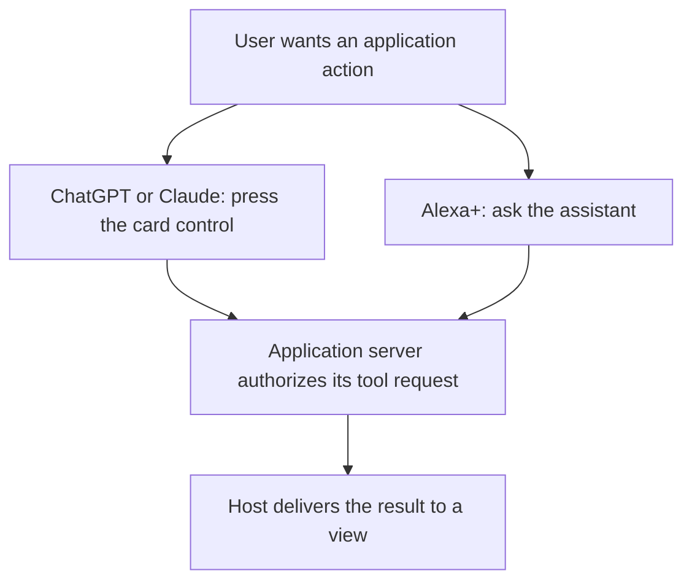

# Host compatibility

SAGA views have rendered in ChatGPT web, Claude web and the Alexa+ simulator. Serve a view from your MCP server and let the SDK handle its host connection; choose the interaction flow according to what that host delivers. The observations below cover specific applications and resources, not every SDK feature or host version.

| Your application | ChatGPT | Claude | Alexa+ |
| --- | --- | --- | --- |
| Shows a SAGA view with your server's data | Yes | Yes | Yes |
| Shows a FaithfulCard answer with source attribution | Yes | Yes | Yes |
| Reading layouts observed | Desktop | Desktop | Echo Show simulator sizes |
| Signs the user in and applies your authorization | Yes | Yes | Not yet tested |
| Receives an in-card server action response | Yes | Yes | Not delivered in the observed simulator runs |
| Recovers from slow calls, reloads and closed cards | Yes | Yes | Not yet tested |

## ChatGPT and Claude

The retained ChatGPT web and Claude web runs cover rendered views, protected tool calls and bounded recovery flows:

- **Views with live data.** Lit and React views display your server's data, and a button's server call updates the same card in place.
- **Protected actions.** A control bound with `Action.server` calls your protected tool. The signed-in user's verified identity reaches your server (ChatGPT signs in through OAuth), your authorization decides, and the card shows the allowed or refused outcome.
- **Private data stays out of the conversation.** Data meant only for the view, such as a playback grant, reaches the card and never appears in what the model sees. Tool arguments carry what the user chose, never an account.
- **Recovery.** A slow call ends with a clear message when its time budget runs out, a late result does not revive the observed timed-out card, and opening the item again creates a fresh card that can request its own result. Reload observations establish removal and fresh-view recovery; local lifecycle tests separately check ownership after the old frame becomes unobservable.
- **Faithful answers.** FaithfulCard renders the supplied answer in light and dark with its attribution, artwork, readable links and image annotations, and lays out mixed English and Arabic lists in the right direction. IASER's Ansari runs its answer card in both hosts.

In ChatGPT, a newly opened app card occasionally appears blank the first time; the host's **Try again** displays it.

## Alexa+

SAGA views and FaithfulCard answers have displayed in the Alexa+ simulator at small and large Echo Show sizes. SAGA exposes a device reading profile for recognized Alexa+ and Echo Show hosts; the application maps that profile to its typography and layout. These simulator observations do not establish physical-device acceptance.

Build Alexa+ interactions around the assistant's own tool calls: the user asks, Alexa+ calls your tool, and the card shows the result. A button inside the card that calls the server directly did not update the card in the retained Alexa+ simulator runs. The simulator received the server's answer but did not pass it on to the card, so the call timed out. The same failure was observed with plain MCP Apps code using React and Lit, which points to the host delivery path rather than a SAGA-only failure. Offer those actions through the conversation in Alexa+ and keep in-card buttons for ChatGPT and Claude.

The server remains responsible for authentication and authorization on either route. The diagram shows where to initiate the interaction; it does not establish Alexa+ protected-action or sign-in acceptance. Those remain untested in the retained scope.

## Evidence

The linked records distinguish actual-host observations from source and local-browser checks. Protected-action runs used synthetic accounts and data; passive Ansari answer-card observations have their own consumer record. The status sections of the [MCP connector](../blueprints/features/reusable_mcp_connector.blueprint.md#status), [request and view lifetimes](../blueprints/features/request_view_lifetimes.blueprint.md#status), [Lit adapter](../blueprints/features/reusable_lit_adapter.lifecycle.md#status) and [content safety](../blueprints/features/content_safety_levels.lifecycle.md#status) designs link each run. The [action binding](../blueprints/modules/action_binding.blueprint.md#status) status covers the React protected-player control.

Private-grant delivery is not audible-playback acceptance: the retained protected-player runs ended at the expected loopback media failure. No remote rollback or forwarded server cancellation is established. Public npm availability is also separate from these historical resource-specific observations; installing a newer package does not extend their scope.
