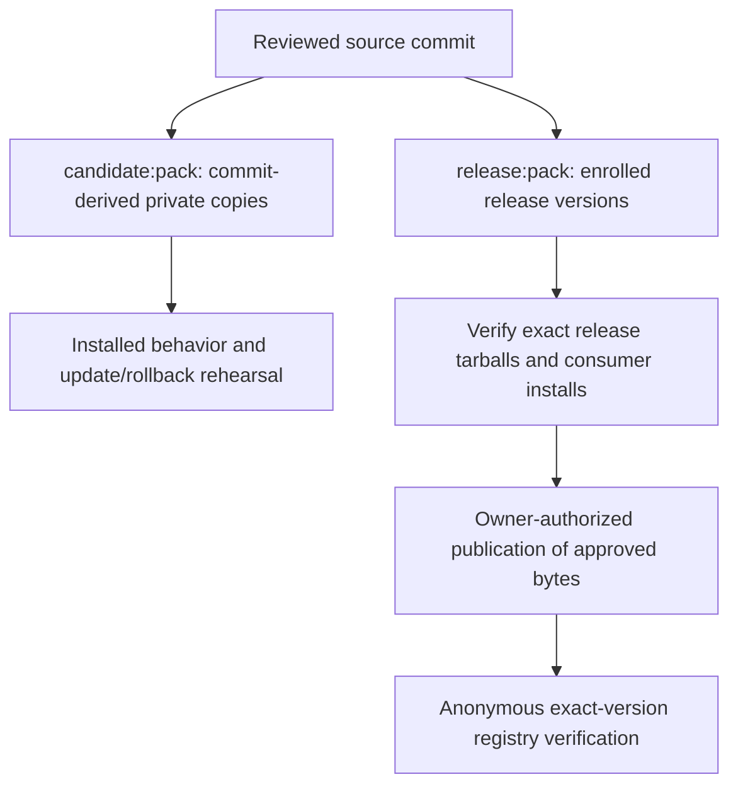

# Preparing a seven-package release

The public release set is `@saga-a2ui/core`, `@saga-a2ui/components`, `@saga-a2ui/mcp`, `@saga-a2ui/react`, `@saga-a2ui/react-mcp-stack`, `@saga-a2ui/lit` and `@saga-a2ui/lit-mcp-stack`. Both renderers and both stacks are enrolled in version policy and release packing. The source CLI, workspace root, templates and example applications are outside the publication set.

Read exact prepared versions from the reviewed manifests and generated `release.json`; verify registry availability separately through [public installation](public-install.md). Release candidates use `next`. Existing publication authority remains required; a private candidate copy does not establish a continuing hold on the source package. The owner can authorize preparation, merge and publication together; carry that authorization through the verified release rather than asking again at each step.

## Build the exact artifacts

From the reviewed commit, on Node >=22.23.3 (the current source-tooling minimum):

```sh
npm ci
npm run release:pack -- release-out
```

`release-out/release.json` identifies the source revision, dirty state, exact
package manifests, file inventories, SHA-256 digests and npm SHA-512 integrity.
The seven tarballs are in `release-out/packages`. A dirty build is preparation
only: rebuild after committing and reviewing the final source. This command
does not publish, tag, deploy or change repository visibility.

Release packing retains the enrolled versions and exact sibling dependencies,
ships Apache-2.0 `LICENSE` with every package, and includes the Markdown notices
with components. Exports are TypeScript source and require a TypeScript-aware
bundler. No precompiled JavaScript runtime is claimed. Both stacks pin their renderer and other SDK siblings to enrolled release versions.

The existing `candidate:pack` remains a separate, nonpublishable qualification
path: its copies always have `private: true`, commit-derived candidate versions
and an invalid registry, even after source version enrollment. Candidate and
local-CI rehearsal evidence is not evidence about release bytes (see
[candidate installation, updates and rollback](candidate-update-and-rollback.md)).



The two packing paths start from source but produce different package identities and bytes. Candidate behavior checks support the release decision; they do not replace validation of the release tarballs or the anonymous registry install after publication.

## Release sequence

Each step is a separate, reviewed change or an owner action. Steps 1 to 3 are
preparation, steps 4 and 5 are owner actions that publish a release candidate,
and stable promotion (step 6) is held and never implied by an earlier step.

1. Changes land on `main` through the ordinary [version policy](version-policy.md),
   so every unit shares one major.minor and the current prerelease advances
   with product changes. Repository documentation alone leaves the versions alone; exported template files follow the explicit release-path exception in the version policy.
2. Qualify the exact head as a candidate: from that commit run `candidate:pack`,
   `candidate:verify`, `candidate:rehearse` and the packed-consumer suites,
   including `test:pnpm-react` (see [candidate installation, updates and
   rollback](candidate-update-and-rollback.md)). This is the behavioral
   qualification and is a local source rehearsal. Reuse unchanged evidence; a
   source change after this step requalifies what it affects.
3. Build `release:pack` from that commit and verify those exact bytes
   (identities, sibling pins, files, dependency graph, and the lower-level,
   stack-only and server-only installs below). Fresh package bytes alone do not
   require rerunning unchanged behavior or host evidence.
4. The owner approves the exact source, package names, versions, tarball
   integrity and tag, and the tag names the exact commit that was demonstrated.
5. Publish the approved bytes under the `next` tag (see below), then verify
   through an anonymous registry install. Downstream adoption and named-host
   acceptance are separate evidence.
6. Held until the owner decides: an explicit promotion change
   (`chore(release): promote version`) turns the prerelease into the stable
   version. Promotion changes only version metadata, so unchanged behavioral
   evidence carries over, but the `release:pack` bytes are rebuilt from the
   promoted commit and verified again, and the stable `latest` tag is a
   separate publication decision.

## Qualify the exact artifacts before publishing

Verify the seven tarballs that would be published, not a candidate or an earlier
build of different source. Evidence from another source revision or version
identity is context, not qualification of these bytes. Use React and React DOM
**19.3.1**, MCP Apps **2.0.3**, and Zod **4.6.7** for MCP schemas. Keep the
consumer-root override `@a2ui/markdown-it: 0.2.1`. SAGA owns A2UI **0.13.0** and its
Zod **3.25.76** context; do not add direct application A2UI dependencies or force
a single Zod version. Follow [React consumer dependencies](react-consumers.md)
for public imports and the pnpm root override.

Qualify all exact sibling bytes locally, whether or not their version numbers already exist on the registry. A local install supplies them from the reviewed tarballs through overrides so a registry copy cannot substitute for the artifact under review. Keep the three consumer checks
apart, as `npm run test:pnpm-react` (`scripts/check-react-pnpm.ts`) does, and
none stands in for another:

- **Lower-level consumer** (availability of the seven packages). It names every
  SAGA tarball as a direct dependency and as an override, plus React, React DOM,
  MCP Apps and Zod.
- **Stack-only consumer** (the documented one-stack recipe, for React and for
  Lit). Its direct dependencies are only the stack and its framework peers
  (`react`, `react-dom`; `lit`), and its typed fixture imports every stack entry
  and nothing else: no upstream renderer or schema package, no Zod, no other
  SAGA package. The sibling tarballs are supplied by overrides only. Direct
  declarations would mask a dependency or an export the stack failed to
  provide, so only this consumer shows that the recipe resolves. It also checks
  the exact sibling resolutions, the stack's full peer requirements and one
  copy of each framework runtime.
- **Server-only consumer.** Names `@saga-a2ui/mcp`, the MCP server package and
  Zod, and compiles `@saga-a2ui/mcp/server` with strict peers and no renderer
  package or peer anywhere in the tree (`lit` arrives only beneath upstream
  `@a2ui/web_core`, which core depends on). A renderer-named stack's `/server`
  entry is compiled separately, under the full application recipe above; it is
  a convenience for an application that already installs the stack and is not
  renderer-free.

Then check two different footprints; neither stands in for the other:

- **Installed tree** (an install check, on the stack-only consumer). An
  application that depends on the stack and declares `react` and `react-dom`
  gets `core`, `components`, `mcp`, `react`, the MCP Apps bridge and `markdown-it`
  beneath the stack, resolved with strict peers and exactly one React runtime.
  Components and Markdown belong in this tree.
- **Emitted browser graph** (a bundle check). An own-catalog application's
  browser bundle excludes components and Markdown, and no browser entry imports
  the stack's Node-only `/server` entry; the server is composed separately. The
  stack's `exports.test.ts` inspects this; an install does not.

Run strict peer installation, dependency-tree checks and strict TypeScript
compilation without `skipLibCheck`, then the application's existing build and
tests. Reuse unchanged runtime and host evidence; requalify changed resources
with their application owner. Local tarballs are not anonymous public npm
installation evidence, and a local or CI rehearsal is not acceptance in a real host.

## Publication and verification

The owner approves the exact source, package names, versions, tarball integrity
and tag before publication. Verify publish rights for each package. A dry
run, `npm publish TARFILE --dry-run --access public --tag next --ignore-scripts`,
inspects publication metadata without uploading. Publish only the approved
tarball bytes through the authorized account and public npm access, the foundational packages and renderers before the stacks that pin them.

After publication, install the exact versions anonymously from the public
registry in a clean consumer, compare registry integrity to the approved
artifacts, and run that consumer's strict install/build/typecheck/tests. Preserve
its lockfile. Only then document these versions as publicly available.

The version updater owns each package version, its workspace-lock entry and
the sibling dependency fields that mirror it. Future changes use the repository
version policy; changing a version does not authorize publishing it.
