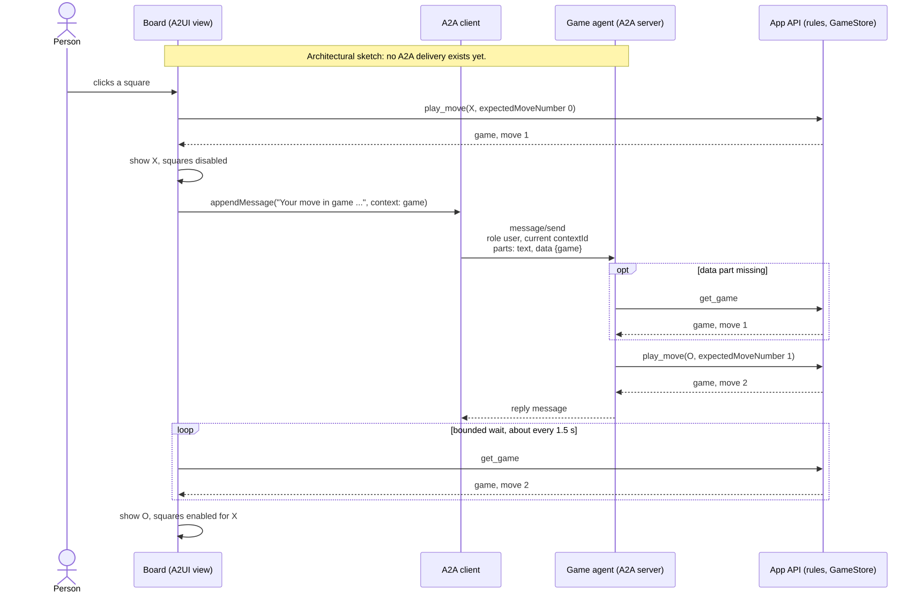

# Other ways to structure the game

The [React tutorial](build-tic-tac-toe-with-react.md) runs one Hono server on your computer. It stores games in memory and serves a React card to Claude or ChatGPT through MCP Apps. The card and the assistant call the same server operations.

The game separates its rules and storage from its display. That makes the following changes possible, but they require work beyond the tutorial. Only the React app with its local server is implemented here.

## Put the game behind an existing API

If another application also needs the games, move the rules and storage behind that application’s HTTP API. The MCP operations can call that API through an implementation of `GameStore`.

The API must check `expectedMoveNumber` and apply a move atomically. Two requests for the same move number cannot both succeed. Moving the map to a database without preserving that check would allow a click and an assistant call to overwrite each other.

The current operations already depend on the `GameStore` interface, so they do not need to know where the games are stored. The repository does not include an HTTP-backed game store.

## Draw the board with Lit

The game contracts, rules, and server do not import React. A Lit version could reuse those files and the A2UI layout, with a Lit catalog and view built on `@saga-a2ui/lit-mcp-stack`.

The [Lit notes tutorial](build-notes-with-lit.md) shows that stack in use. A Lit tic-tac-toe view would still need its own implementation and tests; it is not supplied with this game.

## Use a host without MCP Apps

The layout is A2UI data, but the current view also needs server calls and conversation handoff. A native A2UI host would have to supply equivalents of `host.server` and `host.conversation` before it could run the same interaction. This repository does not provide that adapter.

A2A delivery is another proposed option. A conversation message could become an A2A `message/send` with a text part and a data part containing the game. The assistant would play through the game API, and the board would still need to learn the result. The [A2A delivery issue](https://github.com/MachineWisdomAI/saga-a2ui/issues/198) tracks this work; the tutorial does not send A2A messages.

[Diagram source](../diagrams/tic-tac-toe-a2a-delivery.mmd)

## Keep games on Cloudflare

A [Durable Object](https://developers.cloudflare.com/durable-objects/concepts/what-are-durable-objects/) could own each game and serialize its moves. [Workers KV](https://developers.cloudflare.com/kv/concepts/how-kv-works/) does not provide the conditional write on `expectedMoveNumber` that this game needs, so replacing the map with independent KV reads and writes would not preserve the rules under concurrent requests.

Neither store is implemented here. The current listener also uses Node’s HTTP server; deploying it as a Worker would require a different listener. The Quick Tunnel in the tutorial forwards requests to your existing Node process and does not move the game onto Cloudflare.
