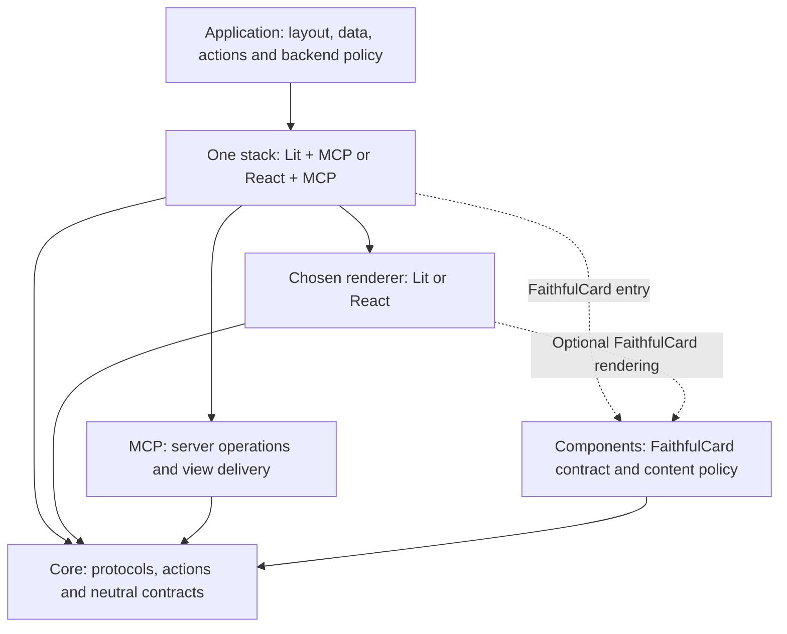

# Package layout

A SAGA application normally installs one **stack**: the package that connects its chosen renderer to MCP Apps delivery. The application supplies its layout, data, actions and backend decisions. The stack supplies the connection and rendering lifecycle, using smaller SDK packages underneath.

The seven packages below are published in the [`0.7.7-rc.1` release](https://github.com/MachineWisdomAI/saga-a2ui/releases/tag/v0.7.7-rc.1). Both Lit and React and their MCP stacks are included. For an installation, follow [public installation](../docs/public-install.md): choose an exact registry version, add the Markdown override, install the stack and framework peers, and commit the lockfile. Source manifest versions can advance ahead of npm; a private candidate build is a way to test unpublished changes, not a restriction on using the published packages.

## Choose the application entry point

| Application | Install | Import from |
| --- | --- | --- |
| Lit with an application-owned catalog | `@saga-a2ui/lit-mcp-stack` and `lit` | The stack root |
| React with an application-owned catalog | `@saga-a2ui/react-mcp-stack`, `react` and `react-dom` | The stack root |
| A FaithfulCard application with either renderer | The same stack and framework peers | The stack's `/faithful-card` entry; React also needs `/faithful-card.css` |
| The application's MCP backend | The chosen stack, including its framework peers | The stack's `/server` entry, kept out of browser code |

A **catalog** maps component types in an A2UI layout to the renderer implementations that display them. Choose the root entry when the application defines that catalog and decides how each tool result updates its surface. FaithfulCard presents application-supplied content as a readable card, with bounded Markdown and explicit link and image policies. Choose `/faithful-card` when that content presentation fits the application: supply its card definition and result reader, and let the stack present it. Choose an application-owned catalog when the interface needs a custom layout or controls such as a notes list with an Archive button in each row. The card can also be one component in an application-owned catalog; it is not a requirement for every SAGA view.

For example, when building a new Lit notes application, install the Lit stack and Lit. Its browser code imports `defineSurface`, `createLitActions` and `startA2uiView` from the stack root. It declares the notes layout and Archive action, then updates the bound surface when a result arrives. Initially the surface shows the current notes, each with its own Archive button. Clicking Alpha's button passes Alpha's identity to the application's action. Its backend imports operation registration from the stack's `/server` entry, independently authenticates and authorizes the request, and archives that note only if access is allowed. On a successful reply, application code reads the result and updates the bound surface so Alpha no longer appears among the active notes; the stack renders the new data without deciding what “archived” means. If the client stops waiting before a reply arrives, the application must reconcile the note's state with the backend before offering a retry: cancellation does not prove that the server left Alpha unchanged. The application does not reconstruct the MCP bridge, decode A2UI wire messages or install each SDK dependency separately. The [action guide](../docs/actions.md) traces Archive in the synthetic notes fixture, including its shared lower-level action and server code. The [maintained starters](../templates/README.md) show the stack-based application setup described here.

The arrows show how the layers are composed, not every npm dependency. MCP does not depend on a renderer, and the renderer does not own the MCP connection; the stack joins them. The dashed paths show optional FaithfulCard use. A stack's installed dependency tree includes the components package, but its root browser entry does not import FaithfulCard or Markdown. Installing a dependency and including it in the emitted browser bundle are different things.

## Packages by group

### Core

[`core/`](core/) owns renderer-independent protocols, actions and value contracts. Its A2UI decoder and typed surface definitions live under `src/protocols/a2ui/<version>/`. Protocol parsing belongs here rather than in application code or a renderer adapter.

`@saga-a2ui/core/actions` implements reusable local and server actions: prerequisites, per-control bindings, pending-work policies, bounded hooks, resource ownership and freshness checks. A definition can be shared by several controls, while each binding tracks its own invocation. The application supplies the operation and decides authorization and presentation; the runtime governs when that work can run and when its resources must be released. See [action binding](../blueprints/modules/action_binding.blueprint.md) for the execution and cleanup contract.

Two smaller entries keep delivery and rendering independent. `/delivered-result` defines the neutral result shape passed to an application's reader. `/host-links` defines the request and outcome for asking a host to open a validated link; MCP supplies the host integration, and a renderer can consume it without importing MCP. The action and host-link implementations have no renderer, DOM or MCP runtime dependency. Other parts of core use upstream A2UI contracts and the Zod 3 alias exposed by `/protocols/a2ui/zod3`.

### Delivery

[`mcp/`](mcp/) owns MCP and MCP Apps integration through `/server`, `/view` and `/policy`. The server entry supplies operation registration, budgets and request lifetimes. The view entry connects the application to its host, handles host context and tool results, and owns connection teardown. Policy has its own entry rather than being mixed into a renderer.

For a view, `runToolResultView` installs handlers before connecting, holds early results until readiness work finishes, and applies host context before delivering the first result. It ends the view once on explicit disposal, host teardown or `pagehide`. A throwing application callback is reported; changes the callback already made are not rolled back. Helpers provide host links, sizing, a reading profile derived from host context, and conversion to core's neutral delivered-result shape. Conversion does not interpret the application's content.

MCP consumes core contracts where needed but imports neither components nor a renderer. Applications using a stack get the relevant delivery behavior through that stack rather than reproducing its ordering rules.

### GenUI renderers

Here, GenUI means graphical A2UI rendering: a layout and catalog describe the interface. A model does not have to generate either. [`lit/`](lit/) and [`react/`](react/) connect that interface and the shared action runtime to their framework's rendering and component lifetimes.

Lit provides the A2UI renderer and catalog integration. Its main entry does not import the optional action controls or FaithfulCard. `/actions` adds `ActionButton` and `createLitActions`; `/faithful-card` adds the card element, catalog entry and content-view integration. The shipped Lit sources use `static properties` and `declare` rather than decorators so an application's own TypeScript settings can compile them.

React provides typed A2UI surfaces through `/a2ui`, action controls and setup through `/actions`, and FaithfulCard through `/faithful-card` with an explicit `/faithful-card.css` stylesheet. These are implemented composition capabilities, not a claim that React supports every Lit capability or that every combination has been accepted in every host. Consult [host compatibility](../docs/host-compatibility.md) for the observed host scope and the [view composition design](../blueprints/features/view_composition.blueprint.md) for capability boundaries.

Both renderers use the shared action-button schema and list components as an optional peer. An own-catalog integration can therefore use a renderer without selecting FaithfulCard. React and React DOM must use the matched peer versions declared by the package; the installation guide gives the supported recipe.

There is no `@saga-a2ui/lynx` package or production Lynx adapter. [`apps/lynx-fixture`](../apps/lynx-fixture/) remains a separate qualification fixture outside the npm workspace. Its historical action-attachment results are not a supported installation recipe.

### Stacks

[`lit-mcp-stack/`](lit-mcp-stack/) and [`react-mcp-stack/`](react-mcp-stack/) connect one renderer to MCP Apps delivery. Each root entry exposes `startA2uiView` and the authoring tools its application needs: surface definitions, schemas, catalog helpers and renderer action setup. `/faithful-card` exposes `startFaithfulCardApp`, the card application definition and its result reader. `/content-policy` provides policy creation and embedding; `/server` re-exports backend operations and request lifetimes. Browser entry points do not import the Node-only server entry.

The stack owns starting and ending the view, not the meaning of the application's result. With an attached, unused container, `startA2uiView` returns a handle synchronously; a missing or already claimed container throws `StartError` before connecting. Its `ready` promise reports whether startup succeeded, and `dispose()` ends the view and removes its rendering. Disposal is idempotent, waits for cleanup and does not reject. A startup failure remains visible until disposal. Application teardown work can release resources outside the rendering; an exception in that callback is reported without skipping connection disposal. The [request and view lifetime design](../blueprints/features/request_view_lifetimes.blueprint.md) explains how those lifetimes relate.

For an action, ending a view or cancelling an invocation can end the client's wait, but it cannot prove that a server-side effect was undone. The application still owns reconciliation after an uncertain response and must not turn a transport cancellation into a promise that nothing happened remotely.

Each stack declares exact SDK sibling dependencies and the MCP Apps bridge. The application installs one stack plus its framework peers, then imports its SDK authoring surface from the stack. Components are installed because the stack offers a card entry even when the application uses only the root entry. The Lit and React stacks own their lifecycle implementations separately; there is no additional shared-stack package.

### Components

[`components/`](components/) owns renderer-neutral component contracts and behavior. Its current export, `/faithful-card`, defines the versioned card content and reader, Markdown interpretation under a trusted dialect and bound, content policy, image consent scopes and the A2UI catalog contract. Lit and React supply the actual rendering.

FaithfulCard is a passive content component: it can sit beside an application-authored control, but the card does not itself acquire that control's action behavior. It imports no MCP, renderer, DOM or server API. Each future component owns its own contract rather than inheriting FaithfulCard's Markdown or policy requirements.

### Tooling

The source CLI, [`scripts/saga.ts`](../scripts/saga.ts), implements `init`, `demo` and optional publication preparation. `init` creates a maintained Lit starter for Node, Express, Fastify, Hono or Hapi; `demo` creates the qualified Lit/Node demonstration. Both write a new directory without installing or running its contents. The [templates overview](../templates/README.md) explains which sources own the generated output.

[`saga publish`](../scripts/publish/README.md) checks release input and prepares ChatGPT or Claude submission materials, and `publish handoff` records the later manual submission process. Those commands exist in source tooling; there is no published `@saga-a2ui/publish` package. They do not deploy, upload or submit an application. Runtime packages do not depend on publication tooling.

## Dependencies and versions

Package names are flat under the `@saga-a2ui` scope; subpaths such as `/server` select an entry inside a package, not another package. There are no aggregate `protocol`, `transport`, `genui`, `tools` or `a2a` packages. This keeps each renderer's dependencies and capabilities explicit, while a stack gives an application one integration surface.

Dependency direction points toward renderer-independent contracts. Core does not depend on delivery, renderers or optional components. Components do not depend on MCP or renderers. Renderers and MCP can use core without depending on one another's implementations. Package export tests enforce those boundaries, while the [consumer boundary check](../scripts/consumer-boundary.test.ts) checks that maintained consumers contain application meaning rather than SDK transport and decoding glue.

All seven SDK packages use coordinated release versions, with exact sibling pins in each release. They export TypeScript source, so an application needs a TypeScript-aware bundler. The workspace root, templates and examples are not published packages. Candidate tooling packs the same seven packages with a matched private prerelease identity to qualify source changes before publication; see [candidate installation, updates and rollback](../docs/candidate-update-and-rollback.md). A successful candidate build does not publish a release or qualify a new host.
