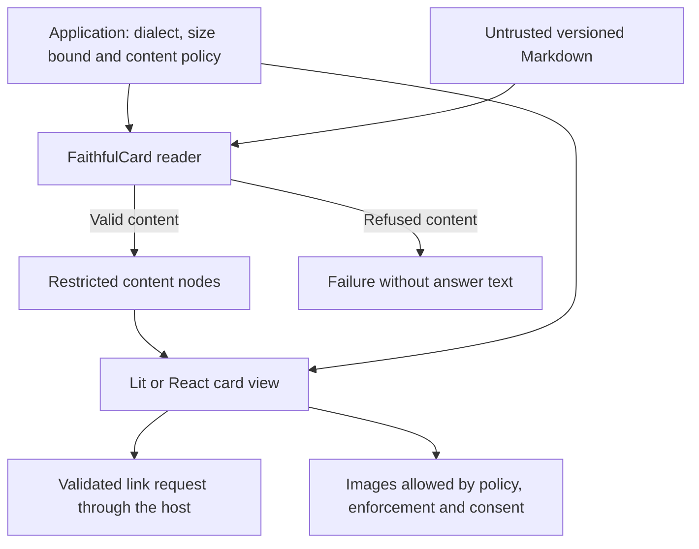

# @saga-a2ui/components

This package contains renderer-neutral component contracts and behavior. Its current component, **FaithfulCard**, presents application-supplied Markdown as readable content with explicit limits on interpretation, links and images. Lit and React render the card; this package decides how its content is read and which content effects are permitted. It does not create a DOM view or connect to an assistant host.

The public entry is `@saga-a2ui/components/faithful-card`; there is no root import. Most card applications use their Lit or React stack's `/faithful-card` entry, which exposes the application definition and starts the view. Import this lower-level package when composing a renderer, content reader or policy integration. An application-owned catalog can include the card beside its own controls; the passive card does not inherit an adjacent control's action behavior.

## Read content under trusted settings

A card's content has exactly two fields: `contractVersion: 1` and `markdown`. The application chooses the Markdown dialect and finite size bound separately. Content cannot select a more permissive dialect or enlarge that bound.

```ts
import { createFaithfulCardReader } from '@saga-a2ui/components/faithful-card';

const created = createFaithfulCardReader({
  dialect: 'commonmark',
  maxLength: 20_000,
});

if (!created.ok) throw new Error(created.failure.message);

const result = created.reader.read({
  contractVersion: 1,
  markdown: '## Delivery\n\nYour order arrives **Friday**.',
});

if (result.ok) {
  console.log(result.card.source); // Original Markdown, unchanged.
  console.log(result.card.blocks); // Restricted nodes for a renderer.
} else {
  console.log(result.failure.kind); // No rejected answer text is echoed.
}
```

This example interprets the heading and paragraph; it does not display them. A card renderer consumes the interpreted nodes and applies the view's content policy. `maxLength` is measured in UTF-16 code units, not bytes. The example's 20,000-unit bound is an application choice, not a library default. The supported dialects are `commonmark` and `commonmark-tables-strikethrough`.

Reader creation returns a failure for invalid settings; a card must not be mounted with guessed settings. Reading refuses invalid content, unsupported versions, excessive length or excessive nesting. Those failures do not echo the supplied answer. `describeContentFailure` supplies the component's explanation for a rejected card. The application separately owns the surrounding waiting, result-rejection and connection-error wording.



The content and trusted configuration enter separately. Parsing produces a representation; it does not grant permission to open a link or fetch an image. Those decisions remain subject to the policy applied by the view.

## Links, images and consent

`createContentPolicy` constructs the immutable policy; `embedContentPolicy` and the policy transport helpers carry its resource requirements into the mounted document. The **standard** level permits validated HTTPS links through the host and images from explicitly allowed hosts. The **strict** level keeps links inert and requires reader consent before an otherwise-permitted image may load.

An allowlisted image host is not sufficient on its own. Before serving the view, `embedContentPolicy` inserts the policy configuration and a derived Content-Security-Policy meta element into its HTML. That document policy gives images and fonts their own permitted origins, rather than relying only on the host’s broader resource permission. The view rebuilds the policy from the embedded configuration and supplies the document’s actual CSP strings to `createCardView`; `establishImageEnforcement` marks image enforcement established only if those strings contain the exact derived policy. A missing or mismatched policy keeps content images inert, even from an allowed host. This check establishes what the document declares, not independent proof of a host’s enforcement. See the [resource restrictions and enforcement gate](https://github.com/MachineWisdomAI/saga-a2ui/blob/main/docs/development-reference.md#standard-descriptions-pol1) for the implementation details. Consent cannot relax the allowlist or make missing enforcement valid. A link request is made through the supplied `HostLinks` interface; a denied, unavailable or failed request does not fall back to browser navigation.

Consent belongs to one view and the content for which it was granted. For example, a strict card may initially show text and an image placeholder. The reader chooses to show an eligible image, then a new result replaces that card. The view revokes the old grant so the new content does not inherit permission. Hiding images also revokes the grant. On teardown, `retire()` permanently ends the consent scope; a late callback cannot create a live grant in that retired scope. A new view receives a new scope.

`createCardView` joins the reader, policy, host-link implementation, image-enforcement result and consent scope for a renderer. Whoever owns that view must end its consent when the view ends. Its reader settings are validated before anything is built; invalid settings throw rather than mounting a partly configured card.

## Define a card application

`FaithfulCardApp` packages the application's identity, reader settings, policy source, result reader and surrounding text into one validated definition. The result reader receives the whole `DeliveredResult`, including the delivery's error indication, ordered content and unchecked structured content. It chooses either card content or a rejection; the SDK does not silently override its interpretation of an error result.

A result reader that throws is reported and its result rejected without custom wording. Invalid or missing definition fields cause `build()` to throw before startup. In this release the policy source is the mounted document; the definition cannot select another source. A Lit or React stack starts the completed definition and owns its host connection and rendering lifecycle. See [view composition](https://github.com/MachineWisdomAI/saga-a2ui/blob/main/blueprints/features/view_composition.blueprint.md) for that boundary and [FaithfulCard styling](https://github.com/MachineWisdomAI/saga-a2ui/blob/main/docs/faithful-card-styling.md) for the styling surface both renderers expose.

## Installation and compatibility

Components is published at `0.7.7-rc.1` in the [seven-package release](https://github.com/MachineWisdomAI/saga-a2ui/releases/tag/v0.7.7-rc.1). Use Node **22.12.0 or newer** and a TypeScript-aware bundler; the exports are TypeScript source. Pin matching exact SAGA versions and verify current registry tags rather than treating a source manifest as proof of publication.

Follow [public installation](https://github.com/MachineWisdomAI/saga-a2ui/blob/main/docs/public-install.md) for the stack and framework peers, including the Markdown override at the consumer workspace root. This package imports neither MCP nor a renderer, DOM or server API. A stack installs it to offer FaithfulCard, while the stack's root browser entry can remain free of card and Markdown imports for an application-owned catalog.

The package is Apache-2.0, with dependency licenses retained separately. Preserve its included `THIRD_PARTY_NOTICES.md` when bundling the Markdown parser. Package availability does not establish acceptance of a card in every host.
