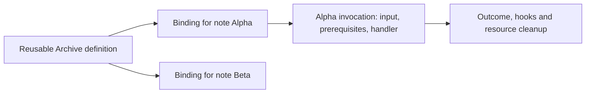

# @saga-a2ui/core

Core contains the parts of SAGA that do not belong to a renderer or delivery protocol: actions, A2UI v0.9 decoding and surface definitions, and the contracts for delivered results and host links. The same action definition can run behind a Lit or React control because core knows about an invocation and its owner, not a DOM component or an MCP connection.

Most applications use core through a renderer's MCP stack. Choose [`@saga-a2ui/lit-mcp-stack`](https://github.com/MachineWisdomAI/saga-a2ui/tree/main/packages/lit-mcp-stack) or [`@saga-a2ui/react-mcp-stack`](https://github.com/MachineWisdomAI/saga-a2ui/tree/main/packages/react-mcp-stack) for that route. Import core directly when implementing a lower-level integration or a renderer-neutral shared definition. Core does not render an interface, establish a host connection or authorize backend operations.

## Entry points

There is no root import from `@saga-a2ui/core`. Select the contract you need:

| Entry | Responsibility |
| --- | --- |
| `/actions` | Local and server action definitions, prerequisites, instance bindings, invocation state and resource ownership. |
| `/actions/action-button-schema` | The shared A2UI schema for an action button; renderer adapters provide its implementation. |
| `/protocols/a2ui/v0_9` | Typed surface definitions, validated message decoding and message sessions. |
| `/protocols/a2ui/zod3` | The Zod 3 alias used by the A2UI contracts. Keep it separate from MCP's Zod 4 context. |
| `/delivered-result` | The neutral shape of one complete result: its error indication, ordered content blocks and unchecked structured content. |
| `/host-links` | A host link-opening interface and outcomes, without depending on a particular host or renderer. |

## Actions and their owners

An action **definition** is reusable behavior. A **binding** attaches that behavior to one rendered control, and an **invocation** is one admitted activation of that binding. Two rows can share the same Archive definition without sharing pending state. Renderer adapters report when a control is removed; core then ends the work owned by that binding.

Alpha's invocation owns its input and resources; Beta's binding is unaffected by Alpha becoming busy. An application's prerequisite may refuse the action before its handler runs. The backend must still authenticate and authorize the protected operation independently.

For example, the [notes action](https://github.com/MachineWisdomAI/saga-a2ui/blob/main/examples/pack1-consumer/src/notes-actions.ts) copies the activated row's note ID, checks the session, and sends an archive request. On a confirmed success it presents the archive time for that row. If the row now represents another note, the old invocation must not write its result there. The binding's `subject` reader and the hook's `current()` check provide freshness information; after asynchronous work, presentation still needs the current hook's check. The [action guide](https://github.com/MachineWisdomAI/saga-a2ui/blob/main/docs/actions.md) follows the complete allowed and refused cases.

Actions support work limits, per-hook budgets and cancellation signals. Limits resolve from the action, then its instance host, then the defaults: 30 seconds of work and 5 seconds per awaited hook or cleanup step. An invocation releases resources it still owns when it ends; a resource explicitly transferred to an application owner becomes that owner's responsibility. A cancellation signal requests that work stop. It neither rolls back a remote write nor proves that the backend received the cancellation, so the application must reconcile an uncertain result before retrying a consequential operation. See [action binding](https://github.com/MachineWisdomAI/saga-a2ui/blob/main/blueprints/modules/action_binding.blueprint.md) for busy policies, hook outcomes and ownership transfer.

## Protocol and result boundaries

`defineSurface` describes a typed A2UI layout and its data. The protocol entry also supplies lower-level decoding and session APIs for SDK integrations. A session decodes unknown input before applying messages to its surface state. Decoding is all-or-nothing, but applying a decoded batch is sequential: an upstream processor rejection stops the batch without undoing messages already applied. Bad input is returned as a failure value rather than thrown as an input error.

Disposing a message session is idempotent and makes later ingestion fail. Callers still unsubscribe subscriptions they hold; session disposal does not take ownership of those handles. Applications using a stack should use its view lifecycle instead of creating a second message session beside it.

`DeliveredResult` deliberately leaves interpretation to the application. It preserves `isError`, all ordered content blocks and the distinction between absent structured content, `null` and a malformed value. Mapping a result does not validate an application schema or choose a fallback message.

`HostLinks.open` asks a host to open a destination already validated by content policy. It reports `opened`, `denied`, `unavailable` or `failed`. A non-opened outcome does not navigate by another route. `NO_HOST_LINKS` represents the absence of that capability; it keeps links inert. The renderer can consume this contract while MCP provides the implementation, without either importing the other.

## Installation and compatibility

Core is published at `0.7.7-rc.1` in the [seven-package release](https://github.com/MachineWisdomAI/saga-a2ui/releases/tag/v0.7.7-rc.1). Release candidates use the npm `next` tag; verify the current registry and pin matching exact SAGA versions. Node **22.12.0 or newer** and a TypeScript-aware bundler are required because the exports are TypeScript source.

Use the [public installation guide](https://github.com/MachineWisdomAI/saga-a2ui/blob/main/docs/public-install.md) for stack installation and the consumer-root Markdown override. A direct core integration does not thereby require a renderer, a Markdown parser or MCP. React applications should consume A2UI through their stack or `@saga-a2ui/react/a2ui`, preserving the separate A2UI Zod 3 and MCP Zod 4 dependency contexts.

Core is Apache-2.0; dependency licenses are retained separately. Publication of this package establishes neither support for every renderer nor acceptance in a particular host.
