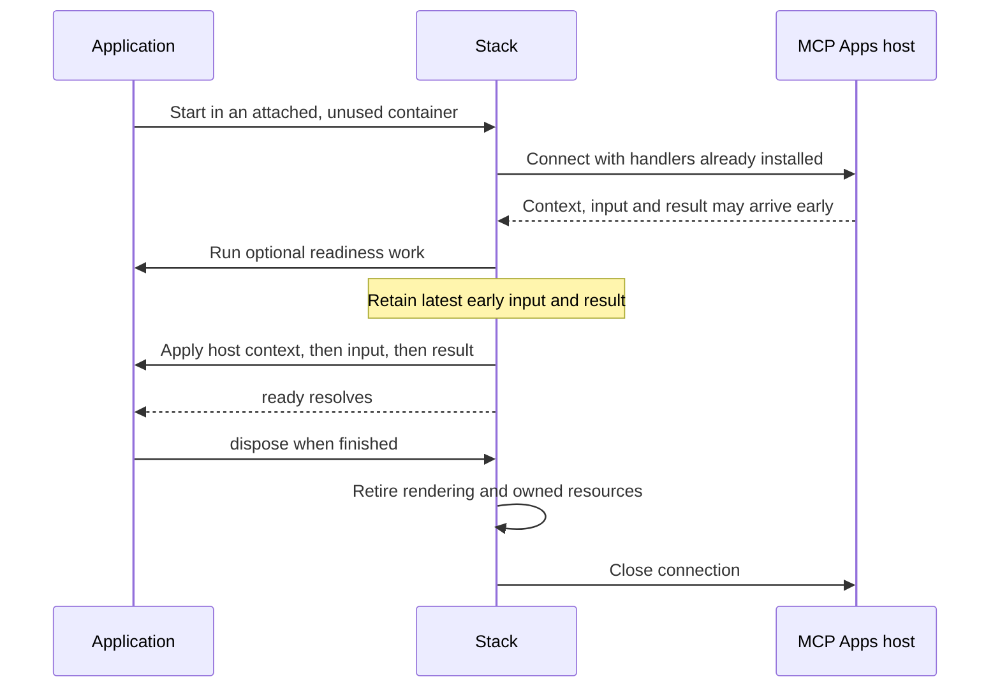

# @saga-a2ui/lit-mcp-stack

The Lit MCP stack joins one renderer to MCP Apps delivery. The application supplies its layout, catalog, actions and interpretation of results; the stack owns the host connection, rendering startup and view cleanup. Install this stack plus its framework peers and import its SDK authoring surface from this package rather than rebuilding the bridge from lower-level packages.

The stack is for a view embedded by an MCP Apps host. Opening its HTML as an ordinary standalone page does not supply that host connection. The application's backend still owns data, identity verification, authorization and consequential effects; the view's connection is not proof that a request is authorized.

## Install a matched release

Version `0.7.7-rc.1` is published in the [seven-package release](https://github.com/MachineWisdomAI/saga-a2ui/releases/tag/v0.7.7-rc.1). Use Node **22.12.0 or newer** and a TypeScript-aware bundler: the exports are TypeScript source. Before installing, preserve existing root overrides and add:

```json
{
  "overrides": {
    "@a2ui/markdown-it": "0.2.1"
  }
}
```

Then install at the application root:

```sh
npm install --save-exact --strict-peer-deps @saga-a2ui/lit-mcp-stack@0.7.7-rc.1 lit@3.3.3
```

Commit the lockfile. The stack declares its SAGA siblings with exact version pins; do not declare a second set of those packages just to use the stack's exported APIs. Lit is a peer in the declared `^3.3.3` range; the recipe pins 3.3.3 explicitly. For later releases, verify npm tags and the exact version before changing the recipe. Source versions and candidate builds do not establish registry availability. See [public installation](https://github.com/MachineWisdomAI/saga-a2ui/blob/main/docs/public-install.md) for package-manager and dependency-context details.

## Choose the application entry point

| Entry | Responsibility |
| --- | --- |
| Root | `startA2uiView` for an application-owned catalog, plus surface definitions, catalog helpers, `createLitActions`, `Action`, failures and `readingProfile`. |
| `/faithful-card` | `FaithfulCardApp`, `startFaithfulCardApp`, result-reader types, host-link helpers and `readingProfile`. |
| `/content-policy` | `createContentPolicy` and `embedContentPolicy` for the server that prepares a card view's HTML. |
| `/server` | Operation registration, server budgets, request lifetimes and view-resource helpers. Node only; keep this entry out of browser imports. |

Choose the root for an interface with application-defined layout and controls, such as a notes list. Choose `/faithful-card` for readable Markdown content with a trusted dialect, size bound and link/image policy. A custom catalog can also include FaithfulCard beside its own controls.

The root browser entry imports neither FaithfulCard nor Markdown. The installed package tree nevertheless includes components because the stack also offers the card and content-policy entries. Installed dependencies and the application's emitted browser bundle are different scopes.

## Start an application-owned view

Supply `startA2uiView` with an attached, unused `container`, a typed `layout`, the `catalog` implementing its components, and `onToolResult`. Optional action setup can be a `createLitActions` value or a factory receiving `host.server` when an action needs the application's backend through the host. The application defines what a result means and calls `view.surface.update(data)` with validated application data. Ordinary updates preserve mounted control identities, focus and bindings; a rejected update returns a failure without replacing the existing presentation.

The Lit stack defines the supplied catalog's custom elements and creates the app element that presents the layout. Application code does not register a second presentation in the claimed container. A conflicting custom-element tag cannot be overwritten with another constructor; give different implementations different tags.

For example, a notes view begins with the notes from its starting result. Each Archive button is bound to the row's identity. When Alpha is activated, the application's action may check its prerequisites, then call the backend through `host.server`. The backend independently verifies the caller and authorizes the archive. On a confirmed reply, application code interprets the result and updates the surface to show Alpha's new state. The stack transports and renders that decision; it neither decides what “archived” means nor automatically applies an action's reply to the layout. If cancellation leaves the result uncertain, application code must reconcile the backend state before offering a retry. See the [action guide](https://github.com/MachineWisdomAI/saga-a2ui/blob/main/docs/actions.md) for the complete request and failure flow.



Handlers are installed before the connection starts, so an early result is not lost. Until startup completes, only the latest input and latest result are retained; this is not a queue of every intermediate answer. After the handshake and optional `readyWhen(signal)` both succeed, the application receives host context, then the held input, then the held result, and `ready` resolves. `onToolInput` describes the tool call's arguments, not its response, and authenticates nothing. An exception in these startup callbacks fails startup.

The optional `hostContext` callback receives negotiated context and the host's name before the first result and on change. `readingProfile` helps an application map that context to its own presentation tokens. `sizing: 'host'` is the own-catalog default; choose `'own'` when the view should report its size instead. There is one sizing owner in either mode.

## Start a FaithfulCard application

Build a `FaithfulCardApp` definition with the application identity, reader settings, policy source, result reader and surrounding text. Its result reader receives the complete neutral `DeliveredResult`, including `isError`, ordered content blocks and unchecked structured content. It returns either card content or a rejection. It owns schema validation, fallback decisions and rejection wording; the stack does not discard an error result before that reader can inspect it.

Call `startFaithfulCardApp(definition, { container, sizing })`. Unlike the own-catalog default, the card call requires an explicit sizing choice. The stack reads and validates the policy embedded in the container's document, sets up the trusted card view, connects the host and presents each accepted result. A malformed embedded policy fails before connection. A result-reader exception is reported and becomes a rejected result using the definition's problem text.

A new answer is a new presentation even if the text is identical: previous image consent and transient card controls do not carry over. Rejection clears the previous answer and shows the application's problem text. The stack owns view-wide consent revocation and retirement; content cannot relax the policy or enable images when the required document restrictions are absent. For application chrome, supply a function returning a Lit template from the card node and the current waiting, answer or problem state. Place the supplied card exactly once. The `styles` option accepts constructable stylesheets for card shadow roots; CSS custom properties inherit normally.

For example, an answer application can read a versioned description from `structuredContent`, reject an unsupported version with its own message, and otherwise return the description as card content. The card then interprets the Markdown under the definition's limits. A later result replaces that presentation, while the definition and host connection remain the same. The [view composition design](https://github.com/MachineWisdomAI/saga-a2ui/blob/main/blueprints/features/view_composition.blueprint.md) explains the distinction between application result interpretation and card rendering.

## Failure and teardown

Both start functions return a view handle synchronously after accepting their inputs. A missing, detached or already claimed container throws `StartError` before connecting. An application action factory or attachment setup that throws causes startup to fail with kind `application`; its actions' `onSetupError` still receives attachment errors. The stack cleans up failed setup rather than leaving a partly wired surface; use the returned handle’s disposal boundary before retrying.

The handle's `ready` promise rejects with `StartFailure` for startup failure. Kinds distinguish invalid card policy, connection failure, rejected readiness work, application callback failure and disposal before readiness. Handle these as application outcomes rather than assuming that receiving a handle means the view is ready. A throw after startup is reported to `onError` with its phase; application changes already made are not rolled back.

A rejected `ready` promise is not a uniform signal that the container is free. A card displaying startup failure text, including an invalid embedded policy, keeps its container claim until disposal. A failure before any view starts may already have released the claim, and a failure without retained presentation cleans up automatically. For every start that returned a handle, call and await that handle’s `dispose()` before retrying in the same container; this is safe even when cleanup has already finished. If start throws synchronously, no new handle exists: a `container-busy` error leaves the existing owner intact, so end that view rather than treating the failed start as its cleanup.

Call and await `dispose()` when the application ends the view. It is idempotent, never rejects, removes the rendering and releases the container for another start. Host teardown and `pagehide` also end the view: readiness is aborted, held results are dropped, later delivery is ignored, listeners are removed and the connection is closed. An own-catalog `onTeardown` callback releases application resources outside the rendered surface; it runs once after the surface retires and must tolerate a view that never became ready. A throwing teardown callback is reported without skipping connection cleanup.

View teardown does not establish that server work stopped, and cancellation cannot undo a backend effect already applied. The application remains responsible for remote reconciliation and for resources transferred out of an invocation's ownership.

## Compose the backend separately

The Node-only `/server` entry exposes `createServerBudgets`, `registerPublicOperation`, `operationViewFromHtml`, `viewUriForHtml` and `attachRequestLifetime`, with the corresponding view and lifetime types. It re-exports server behavior without loading the renderer. Import it in backend code, never a browser entry; install the package's framework peers even when using this entry.

For a card view, the server uses `/content-policy` to construct the policy and embed its configuration and derived Content-Security-Policy in the served HTML. The browser stack reconstructs that policy and checks the actual document restrictions before allowing content images. It does not trust a policy supplied by a tool result. See the [content policy implementation](https://github.com/MachineWisdomAI/saga-a2ui/blob/main/docs/development-reference.md#standard-descriptions-pol1) for the enforcement boundary and the [package layout](https://github.com/MachineWisdomAI/saga-a2ui/tree/main/packages) for ownership across the SDK.

The stack connects the named renderer and delivery capabilities; package availability is not deployment or acceptance of every application in every host. Consult [host compatibility](https://github.com/MachineWisdomAI/saga-a2ui/blob/main/docs/host-compatibility.md) for observed limits. The package is Apache-2.0, with dependency licenses retained separately.
