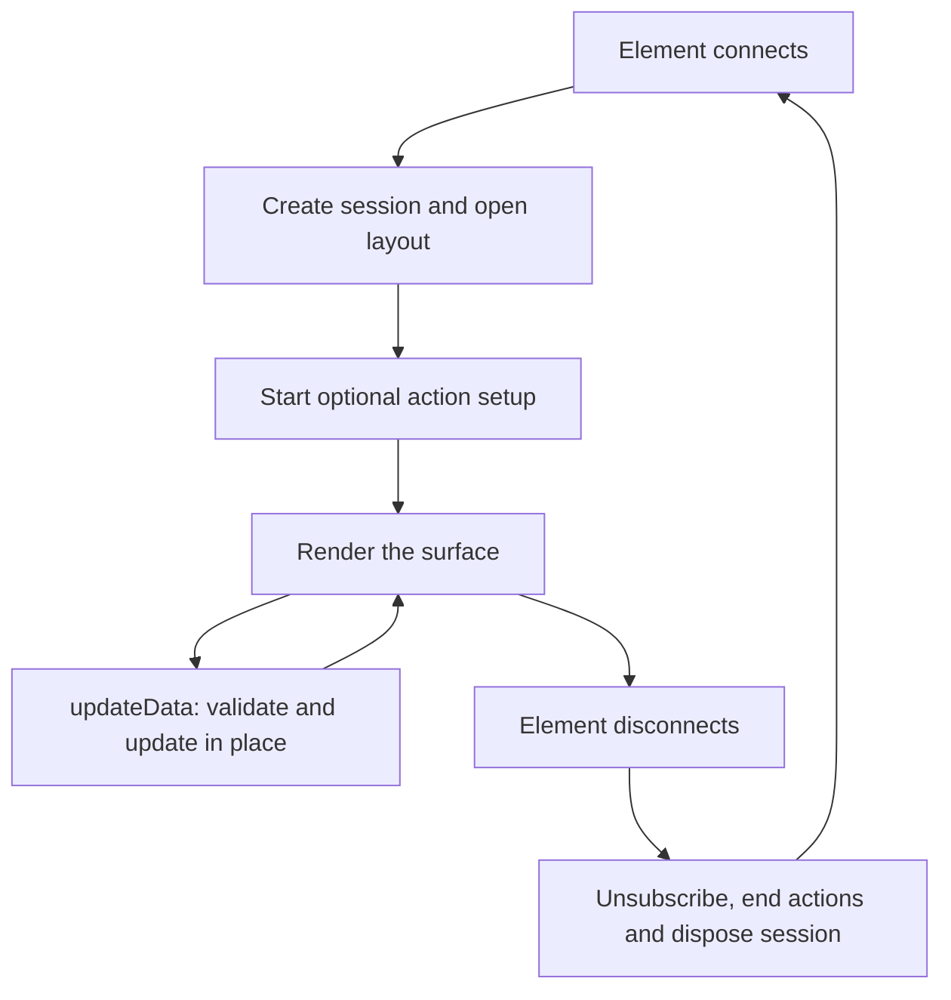

# @saga-a2ui/lit

This package renders A2UI layouts with Lit and connects rendered controls to SAGA's shared action runtime. It also provides the optional FaithfulCard renderer for bounded Markdown content. The application chooses the layout, catalog and behavior; the renderer owns the custom elements and the lifetime of what they display.

For an MCP application, normally install `@saga-a2ui/lit-mcp-stack` and Lit, then import SDK APIs from the stack. It joins this renderer to the host connection and handles startup and teardown. Use this lower-level renderer directly when composing a view without that stack. It does not connect to MCP or authenticate backend requests. See [public installation](https://github.com/MachineWisdomAI/saga-a2ui/blob/main/docs/public-install.md) for the stack recipe.

## Choose an entry point

| Entry | Use |
| --- | --- |
| `@saga-a2ui/lit` | Build an app element for an application-owned A2UI catalog; register catalog elements and use the re-exported catalog interfaces. |
| `@saga-a2ui/lit/actions` | Add `ActionButton`, `actionButtonEntry` and `createLitActions` for direct action attachment. |
| `@saga-a2ui/lit/faithful-card` | Render FaithfulCard on its own or in a catalog, provide its trusted settings and present card content. |

A catalog maps the component types named by a layout to implementations. The root entry includes `Catalog`, `CommonSchemas`, `A2uiLitElement` and `basicCatalog` for catalog composition. It does not import the action control or FaithfulCard. Components is an optional peer: an own-catalog integration need not install it, while a FaithfulCard integration needs the matching `@saga-a2ui/components` package.

## Mount and update an application surface

`createA2uiAppElement({ catalog, layout, actions })` creates a custom-element class for one typed surface. `actions` is optional. A lower-level application registers its catalog's elements with `defineElements`, defines a tag for the returned class and places an instance in the document. Repeating an element definition with the same constructor is harmless; binding an existing tag to a different constructor throws `ElementConflictError` rather than replacing it.

The app element creates a fresh message session when it connects and opens the layout. The application does not construct the decoder or send opening wire messages. Call `updateData(data)` to validate and apply ordinary data changes in place. The mounted controls keep their identities, focus and action bindings. Invalid data or an update to a disconnected element returns a failure and leaves the shown state unchanged.

An update stays within the current presentation; disconnecting ends it. Reconnecting creates a new session, so work from a retired session cannot update the new view. If the layout cannot be opened, for example because its catalog lacks the root component, the element displays a safe fallback. If action setup fails, it does not render a surface with partially attached behavior.

## Attach behavior to the actual control

`createLitActions` takes an `attach` callback, an `onSetupError` handler and optional action limits. The callback receives an instance view: use `watchById` for repeated controls or `getById` for a unique one, then bind an action to the handle's activation event. The component ID locates rendered instances; it is not a handler name encoded in the layout.

Consider a list showing Alpha and Beta, each with an Archive button. One reusable action definition can attach to both, but each binding owns its own pending state. Alpha's click reads Alpha's identity, runs the application's prerequisites and calls its backend handler. The backend independently authorizes the operation. On confirmation the application can update Alpha's status through the view's data; Beta need not become busy. A binding's subject reader and each asynchronous hook's `current()` check prevent an old invocation from presenting on a row that now represents another note. See the [notes Lit view](https://github.com/MachineWisdomAI/saga-a2ui/blob/main/examples/pack1-consumer/src/notes-view.ts) and [action guide](https://github.com/MachineWisdomAI/saga-a2ui/blob/main/docs/actions.md) for the complete attachment and request flow.

The adapter ends bindings when their rendered instances disappear, and ends the presentation's action host before disposing its session. That triggers the action runtime's cancellation and cleanup contract. Ending a client's wait does not undo a request already applied by the backend; application code must reconcile an uncertain result before retrying a consequential action. Setup errors go to `onSetupError`; private exception text is not inserted into the page.

## Render FaithfulCard

FaithfulCard displays application-supplied Markdown under a trusted dialect, size bound and content policy. Choose it for readable content with controlled links and images; choose an application-owned catalog for custom layouts and controls, optionally including the card as one component.

For a direct integration, `createFaithfulCardView` builds the trusted reader, policy, host links, image-enforcement result and consent scope. It takes the document's actual Content-Security-Policy values; it does not read the document itself. `provideContentView` makes those settings available to descendant cards. A card without a supplying view refuses to display content. `registerFaithfulCard` registers the card elements, and `openFaithfulCardSurface` supplies an element plus `present`, `clear` and `dispose` operations. Place that element beneath the provider.

`present(content)` selects a new answer even when its text equals the previous answer. It ends the old presentation's consent and transient controls, rather than preserving them as an ordinary data update would. A structurally invalid presentation is refused without replacing the old one; content the configured reader rejects displays the card's failure instead. `clear()` ends the selection but permits another presentation. `dispose()` ends the surface permanently and is idempotent.

The view owner revokes consent on view-wide replacement and retires the consent scope on final teardown. Consent cannot override the content policy or make absent document restrictions valid. Card styles can be supplied as adopted stylesheets because the elements render inside shadow roots; CSS custom properties inherit normally. See [FaithfulCard styling](https://github.com/MachineWisdomAI/saga-a2ui/blob/main/docs/faithful-card-styling.md) and the [component contract](https://github.com/MachineWisdomAI/saga-a2ui/tree/main/packages/components) for policy and consent details. The Lit MCP stack owns this setup when using its `/faithful-card` entry.

## Versions and compatibility

Lit is published at `0.7.7-rc.1` in the [seven-package release](https://github.com/MachineWisdomAI/saga-a2ui/releases/tag/v0.7.7-rc.1). Release candidates use `next`; verify npm and pin exact matching SAGA versions. Source versions and candidate tarballs do not establish registry availability.

Use Node **22.12.0 or newer**, Lit **3.3.3** or a compatible version in the declared `^3.3.3` range, and a TypeScript-aware bundler. Shipped sources use `static properties` and `declare` for Lit state rather than requiring the application's decorator settings. The consumer-root Markdown override and A2UI Zod 3/MCP Zod 4 separation are described in [public installation](https://github.com/MachineWisdomAI/saga-a2ui/blob/main/docs/public-install.md).

The renderer supports the named surface, action and card APIs above. Installing it does not establish a working host connection or acceptance in every assistant; consult [host compatibility](https://github.com/MachineWisdomAI/saga-a2ui/blob/main/docs/host-compatibility.md) for observed scope. The package is Apache-2.0, with dependency licenses retained separately.
