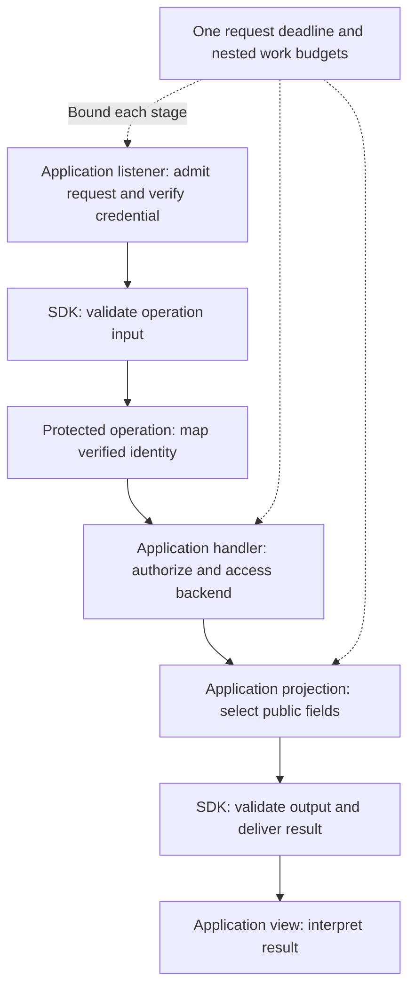

# @saga-a2ui/mcp

This package delivers SAGA operations and views through MCP and MCP Apps. It connects validated server results to an embedded view and manages the request and connection lifetimes around them. It does not render A2UI, interpret application content, host an HTTP service or decide who may access a record.

Most applications use a [Lit or React MCP stack](https://github.com/MachineWisdomAI/saga-a2ui/tree/main/packages), which joins this delivery layer to the selected renderer. Import the stack's browser and `/server` entry points for the capabilities they expose. Use `@saga-a2ui/mcp` directly for lower-level integration or server capabilities beyond those re-exports, such as declaring a protected operation. The application still owns its listener, credential verification, domain authorization, data and backend effects.

## Entry points and responsibilities

There is no root import from `@saga-a2ui/mcp`.

| Entry | Owns |
| --- | --- |
| `/server` | Operation declarations, input/output validation, bounded server work, request lifetimes and view-resource identity. |
| `/view` | MCP Apps view startup, ordered delivery, teardown, host-link requests, sizing and neutral result mapping. |
| `/policy` | Shared resource-permission types, conservative defaults and timing defaults. It contains no application authorization policy. |

Keep `/server` out of browser imports. The view layer depends on core's neutral result and host-link contracts, not a renderer or the optional components package. A renderer can therefore consume a result or link interface without owning the MCP connection.

## Declare a server operation

`registerPublicOperation` and `registerProtectedOperation` attach an operation and its view resource to an MCP server the application created. A declaration supplies input and output schemas, handler, projection, annotations, fixed failure text and the immutable HTML view. Configuration is checked before registration; unusable declarations throw `OperationConfigurationError` rather than exposing a partly configured tool.

Input is validated before the handler runs, and undeclared input fields are not forwarded. The handler returns a record, an absent result or an explicit business refusal. A projection then builds the model-facing text and structured output from that record. Output validation happens before serialization, so a projection that breaks its declared contract produces the configured safe failure rather than leaking the record. Choose the permitted output fields explicitly; copying a whole backend object into the projection defeats that boundary.

For a protected operation, the application's transport first verifies the credential. The declaration's `identity` function maps that verified context to an application identity or refuses it; a tool argument cannot substitute for that identity. The handler still decides whether that principal may access this particular record.

For example, a subscription operation receives a validated status filter and a transport-verified user. Its handler checks access and reads that user's subscriptions, then its projection selects only the title and status fields intended for the caller. A missing accepted identity prevents the handler from running. An absent record, business refusal, failed dependency or invalid projection has its own declared outcome. The application supplies safe text for failures instead of exposing backend errors or credential details. See [the maintained backend recipes](https://github.com/MachineWisdomAI/saga-a2ui/blob/main/docs/attach-to-existing-backend.md) for application hosting and request-context integration.

The diagram shows a protected operation; a public operation deliberately has no identity step. Validation and deadlines surround application decisions without replacing them. A well-formed request is not automatically authorized, and a timed-out handler is not proof that its backend effects were undone.

## Bound server work and finish requests

`createServerBudgets` creates the timing settings from which an adapter starts each request lifetime. The default operation wait is **3,000 ms**, and the default whole-request wait is **10,000 ms**, starting at admission. These are configurable budgets, not latency promises. A declaration's `boundMs` bounds its complete handler and projection; nested authorization, storage or dependency work cannot extend that aggregate budget or the enclosing request's remaining time.

A handler receives an `OperationRequest` with a signal, `within` for bounded dependency work and `reportProgress` for a caller that requested progress. Progress and retries do not restart deadlines. Late results and progress from a retired operation are dropped. Work that ignores its abort signal may still run: the SDK bounds how long it waits, not every external side effect. Application code must stop or clean up work it owns, and check its lifetime before beginning a later effect after an asynchronous result. `throwIfEnded` provides that check for a bounded scope. An unknown remote outcome needs reconciliation before retry.

The HTTP adapter reports disconnect and response completion to the request lifetime. For a per-request MCP server, call `attachRequestLifetime` after creating the server and installing any existing close callback, before returning it from the factory. It finishes the lifetime once whether the transport closes or the server closes before a transport was attached. Reattaching the same lifetime is harmless; attaching a different lifetime throws. This does not replace the adapter's responsibility to start the lifetime at admission and handle its HTTP boundary.

## Deliver results to a view

A lower-level browser integration supplies `runToolResultView` with its bridge, transport and application callbacks. A stack normally supplies those pieces. The runner installs handlers before connecting and waits for the handshake and optional `readyWhen(signal)` work. It retains only the latest early input and latest early result, then applies host context, input and result in that order before resolving `ready`. It is not an event queue for every intermediate result.

`onToolInput` describes the tool call's arguments, not its response, and proves no identity. `deliveredResultFromToolResult` maps a response into core's neutral `DeliveredResult`: the error indication, ordered content blocks and unchecked structured content. It preserves the result rather than choosing a schema, fallback or user-facing explanation. The application's result reader owns those decisions, including whether useful content can accompany an error indication.

A callback that throws during startup automatically ends the runner: it removes delivery handlers, aborts readiness work, runs teardown and awaits the bridge close attempt before rejecting `ready` with `ViewStartFailure`. The caller need not call `dispose()` to trigger that connection cleanup. Calling and awaiting it is still a safe, idempotent completion boundary. A throw after readiness is reported through `onError` and leaves the connection running; earlier application changes are not rolled back. Ending the view through `dispose()`, host teardown or `pagehide` stops delivery, aborts readiness work, drops held input/results, runs teardown once and closes the connection. Late delivery is ignored. Cleanup still proceeds when teardown throws. This layer owns the connection lifetime, while the surrounding renderer or stack removes its rendering and releases its container.

For a lower-level retry, finish any rendering and resources the caller owns, then start a fresh view with a new bridge and transport. The ended runner cannot be restarted and owns no DOM container to release. A renderer stack adds container ownership and may retain a visible startup failure after this connection cleanup; when using a stack, await the stack handle’s `dispose()` before starting again in that container.

View lifetime and server request lifetime are separate. Closing a view does not by itself cancel server work started on its behalf. The application must distinguish “the user no longer sees this result” from “the operation did not happen.”

## Host capabilities and resource policy

`hostLinksFromApp` implements core's host-link interface using the advertised `openLinks` capability. It requests only validated destinations supplied by the caller. Without the capability, or after its lifetime signal aborts, the outcome is `unavailable`; a host refusal is `denied`, a request failure is `failed`, and an accepted request is `opened`. There is no fallback to browser navigation.

`startOwnSizing` lets a view report its dimensions when it owns sizing; do not run it alongside another sizing owner. `readingProfile` derives presentation information from host context so an application can choose its own layout tokens. Neither helper grants authorization or proves host acceptance.

`operationViewFromHtml` builds a view from final HTML, and `viewUriForHtml` derives a content-addressed resource identity. Changing the document changes its identity; request data is not interpolated into that immutable document. This identifies bytes, not the publisher's authenticity.

The `/policy` entry supplies `ViewCsp` and `CLOSED_VIEW_CSP`, whose permission lists allow no network or external resources. These are host resource permissions, not backend access rules. For content requiring additional resources, the application declares the narrow origins it needs. A FaithfulCard integration additionally embeds and verifies its document's content policy; the host's broad resource permission alone is insufficient to establish image restrictions. See [content restrictions](https://github.com/MachineWisdomAI/saga-a2ui/blob/main/docs/development-reference.md#standard-descriptions-pol1) and [request/view lifetimes](https://github.com/MachineWisdomAI/saga-a2ui/blob/main/blueprints/features/request_view_lifetimes.blueprint.md) for the full boundaries.

## Versions and installation

MCP is published at `0.7.7-rc.1` in the [seven-package release](https://github.com/MachineWisdomAI/saga-a2ui/releases/tag/v0.7.7-rc.1). Use Node **22.12.0 or newer** and a TypeScript-aware bundler; the exports are TypeScript source. Release candidates use `next`. Verify npm and pin exact matching SAGA versions instead of inferring registry availability from a source manifest.

Use [public installation](https://github.com/MachineWisdomAI/saga-a2ui/blob/main/docs/public-install.md) for the normal stack route, framework peers and consumer-root Markdown override. Lower-level MCP integration does not itself require a renderer. When combining MCP and A2UI, keep their Zod 4 and Zod 3 contexts separate; see [React consumer dependencies](https://github.com/MachineWisdomAI/saga-a2ui/blob/main/docs/react-consumers.md).

Package publication is distinct from an application's deployment and host acceptance. Consult [host compatibility](https://github.com/MachineWisdomAI/saga-a2ui/blob/main/docs/host-compatibility.md) for observed limits. The package is Apache-2.0, with dependency licenses retained separately.
