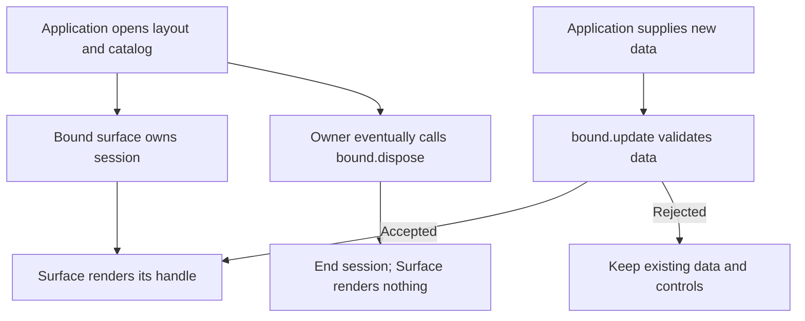

# @saga-a2ui/react

This package renders typed A2UI surfaces in React, attaches SAGA actions to mounted controls and supplies the optional FaithfulCard renderer. Application code chooses the layout, catalog, result interpretation and backend behavior. The renderer connects those choices to React components and their lifetimes; it does not create an MCP connection or authorize an operation.

For an MCP application, normally install `@saga-a2ui/react-mcp-stack` with its React and React DOM peers and import SDK APIs from the stack. Use this lower-level package when composing a React view directly. Its implemented surfaces, actions and card capabilities do not imply parity with every Lit capability or acceptance in every host. The [view composition design](https://github.com/MachineWisdomAI/saga-a2ui/blob/main/blueprints/features/view_composition.blueprint.md) and [host compatibility guide](https://github.com/MachineWisdomAI/saga-a2ui/blob/main/docs/host-compatibility.md) distinguish those scopes.

## Choose an entry point

There is no root import from `@saga-a2ui/react`.

| Entry | Use |
| --- | --- |
| `/a2ui` | Open and render a typed surface; use catalog interfaces and component implementation helpers in the renderer's dependency context. |
| `/actions` | Attach actions using `ActionButton`, `ActionButtonEntry`, `createReactActions` and `ActionsScope`; lower-level provider and setup hooks are also exported. |
| `/faithful-card` | Render `FaithfulCard`, provide trusted card settings, or open a card surface with explicit presentation operations. |
| `/faithful-card.css` | Load the card's presentation styles. Import this explicitly when using FaithfulCard. |

A catalog maps component types in the layout to React implementations. `/a2ui` exposes the catalog contracts and `createComponentImplementation`; upstream React does not supply a basic catalog. Import these through the SAGA renderer or stack rather than adding direct A2UI dependencies. Components is an optional peer: own-catalog rendering does not require FaithfulCard or its Markdown parser, while card rendering needs the matching `@saga-a2ui/components` package.

## Open a surface and own its lifetime

For a lower-level integration, `openSurface(layout, catalog)` returns a bound surface. Render it with `<Surface of={bound.handle} />`, then call `bound.update(data)` for ordinary data changes. The update validates the data and applies it in place; it does not key the React tree on the data or remount controls. Focus, local state and action bindings therefore survive ordinary updates.

The application that opens the surface owns its end. `<Surface>` does not dispose the bound surface when React unmounts it, so React Strict Mode's effect replay cannot accidentally end the underlying session. The owner must call `bound.dispose()` when the view is actually finished. Disposal is idempotent; later updates fail and the component renders nothing. The MCP stack provides that owner when it starts the view.

Opening an invalid layout, such as one referring to a component absent from the catalog, throws with no session left behind. Invalid updates return a structured failure and leave the existing presentation unchanged. The package owns the message session and A2UI decoding connection; the application does not construct its own protocol session alongside the bound surface.

## Bind actions to mounted controls

`createReactActions` records the application's `attach` callback, `onSetupError` handler and optional limits. Mount its returned setup around the surface with `ActionsScope`. Each mount gets its own instance host. The setup finds actual controls through `watchById` or `getById` and binds action definitions to their activation events; the layout does not name handlers.

For example, Alpha and Beta can appear as separate notes with Archive buttons backed by the same action definition. Clicking Alpha admits an invocation for Alpha's binding, reads that row's ID, checks the application's prerequisites and calls the backend. The server independently authorizes the archive. A confirmed reply lets application code update Alpha's displayed status while Beta retains its own pending state. If the row is reused for another note before the reply arrives, the binding's subject reader and the hook's `current()` check prevent the stale result from being presented on the new note. The [notes React view](https://github.com/MachineWisdomAI/saga-a2ui/blob/main/examples/pack1-consumer/src/notes-react-view.tsx) shows this attachment; the [action guide](https://github.com/MachineWisdomAI/saga-a2ui/blob/main/docs/actions.md) follows the request and failure cases.

When a control or action scope unmounts, its bindings are disposed and the shared action runtime handles cancellation and resource cleanup. An application still owns any resource transferred to it. Canceling an invocation does not prove that its backend effect was undone; reconcile an uncertain response before retrying. A setup failure is reported through `onSetupError`, clears its bindings and causes the `ActionsScope` failure boundary to render nothing rather than a partly wired surface. Error text is not rendered into the page.

## Present a FaithfulCard

FaithfulCard presents application-supplied Markdown as readable content under a trusted dialect, size bound and link/image policy. It suits content presentation; a custom catalog suits a bespoke interface and can include the card beside application controls.

Import the card CSS, create a stable view with `createFaithfulCardView`, and supply it through `FaithfulCardProvider`. The view contains the reader, content policy, host-link implementation, document image-enforcement result and view-local consent scope. The factory takes actual document Content-Security-Policy values rather than inspecting the document itself. A card without a provider refuses to display content. Keep the view's parts stable across ordinary rerenders: replacing them resets cards and their transient state.

Use `FaithfulCard` directly for card rendering, or use `openFaithfulCardSurface` with `FaithfulCardSurface` when the application needs explicit `present`, `clear` and `dispose` operations. Presenting a new answer replaces the previous presentation even when the text is identical, ending its image consent and transient controls. This differs from an ordinary own-catalog data update, which preserves mounted state. A structurally invalid presentation leaves the old one untouched; content rejected by the configured reader displays a card failure. Clearing permits a later presentation; disposing ends the surface permanently.

A card releases its own image grant when its content changes or it unmounts. The owner of the whole view must revoke grants on view-wide replacement and retire the consent scope on teardown. Consent cannot make a forbidden image or missing document restriction acceptable. `useHostLink` provides link behavior for application chrome using the same host boundary; a failed or unavailable host request does not fall back to browser navigation. See [FaithfulCard styling](https://github.com/MachineWisdomAI/saga-a2ui/blob/main/docs/faithful-card-styling.md) and the [component contract](https://github.com/MachineWisdomAI/saga-a2ui/tree/main/packages/components) for content policy and consent. The React stack's `/faithful-card` entry owns this setup for a stack application.

## Versions and compatibility

React is published at `0.7.7-rc.1` in the [seven-package release](https://github.com/MachineWisdomAI/saga-a2ui/releases/tag/v0.7.7-rc.1). Pin matching exact SAGA versions and verify current npm tags; source manifests and candidate builds are not publication evidence. Release candidates use `next`.

Use Node **22.12.0 or newer**, a TypeScript-aware bundler, and **React and React DOM 19.3.1**, the exact peers declared by this release. Preserve one application React runtime. The exports are TypeScript source; React's A2UI contracts stay in their Zod 3 dependency context, separate from MCP's Zod 4 context. Follow [public installation](https://github.com/MachineWisdomAI/saga-a2ui/blob/main/docs/public-install.md) for the consumer-root Markdown override and strict peer installation, and [React consumer dependencies](https://github.com/MachineWisdomAI/saga-a2ui/blob/main/docs/react-consumers.md) for dependency resolution details.

The package is Apache-2.0, with dependency licenses retained separately.
