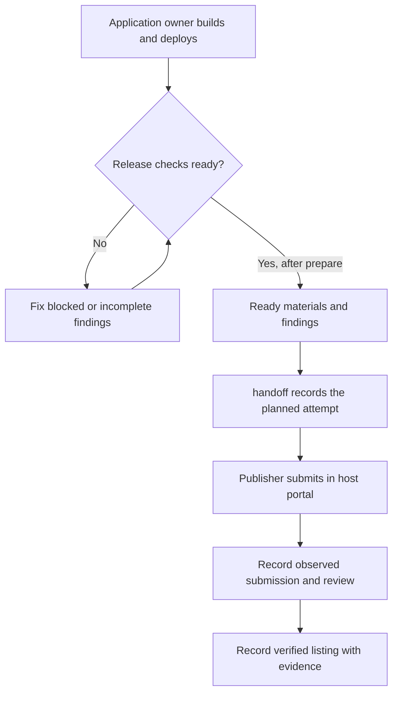

# Prepare an application for host publication

Optional developer tooling in the single `saga` CLI ([`scripts/saga.ts`](../saga.ts)). It checks a
built application, its already deployed HTTPS MCP endpoint and a release input, and prepares one
host's materials with a findings record: the ChatGPT plugin package (CLI3) or the Claude connector
dossier (CLI4). Both targets read the same release input, the same endpoint and the same evidence
record. It deploys, uploads and submits nothing, and a prepared package is never reported as live.
`saga publish handoff` (CLI5) then keeps the resumable record of the manual submission that follows.
Design: [host publication Blueprint](../../blueprints/features/host_publication.blueprint.md).

## Run the source CLI

Run these commands from a SAGA source checkout with the root development dependencies installed
(see [local development](../../docs/development-reference.md#local-development)). The CLI is
`scripts/saga.ts`, not an executable installed by the published `@saga-a2ui` packages. The
`npx tsx` prefix runs that local source entry point; installing an SDK stack in your application
does not install a global `saga` command.

Before checking a release, build the application, deploy its MCP endpoint through your own
process, and write the release input described below. `check` reads those inputs and reports
findings without writing output. `prepare` performs the checks and writes the findings and any
ready submission materials. Both can contact the endpoint; neither deploys the application or
submits it to a host. Fixture calls happen only when you explicitly add `--invoke-fixture`.



The owner performs deployment and portal work. The source CLI inspects the prepared application;
`handoff` only records what the owner observes. A ready package, a confirmed submission, an
approval and an observed live listing remain separate outcomes. If a submission's outcome is
uncertain, inspect the host before retrying, as described under [resuming a handoff](#resuming-a-handoff-saga-publish-handoff-cli5).

```sh
npx tsx scripts/saga.ts publish check   --target chatgpt --release path/to/saga-publication.json
npx tsx scripts/saga.ts publish prepare --target chatgpt --release path/to/saga-publication.json --out ./publication-chatgpt
npx tsx scripts/saga.ts publish check   --target claude  --release path/to/saga-publication.json
npx tsx scripts/saga.ts publish prepare --target claude  --release path/to/saga-publication.json --out ./publication-claude
```

Keep separate output directories when preparing both targets: a later preparation can replace
an earlier tool-generated directory. The examples above preserve each host’s materials.

Options: `--against DIR` compares with an earlier output and fails when its evidence is stale;
`--invoke-fixture` calls the tools the release input declares under `fixture.calls`;
`--bearer-env NAME` reads a bearer credential from that environment variable for a read-only look
at a protected endpoint. A verdict other than `ready` exits 1.

## The release input

`saga-publication.json` (format `saga-publication/1`, see [`release-input.ts`](release-input.ts)) is
the smallest input that carries what the host needs and nothing it does not: the application
`publisher` (who the listing belongs to; the operator running the tool and the SDK's npm publisher
are never substituted for it) with credited `contributors` kept apart, the listing text and links,
PNG or SVG `assets`, the `build` directory and its view files, the `endpoint`, and optional
`review`, `publication` and `fixture` sections. Paths are relative to the file. It holds no
credential; reviewer credentials, authentication and publisher verification stay in the host's
portal. A working example is [`fixture/notes-app`](fixture/notes-app).

`listing` and `assets` (with `review` and `publication`) belong to the ChatGPT target, and a `claude`
section belongs to the Claude target. Each target needs only its own: a release input for Claude alone
has no `listing`, and the `chatgpt` target says so and prepares nothing when `listing` or `assets` is
missing. `claude` is the one section whose missing fields are findings instead of a parse error
(below), so a maintainer sees every missing piece at once.

## What is produced (ChatGPT)

`prepare --out DIR` writes, after everything is checked:

- `chatgpt-plugin.zip`: root `plugin.json` and `mcp.json` (Agent Plugins 1.0.0), `assets/`, and
  OpenAI's `extensions["com.openai"]` listing, review and publication fields. Entries are stored
  uncompressed in sorted order with one fixed timestamp, so unchanged inputs reproduce the same
  bytes and digest.
- `findings.json`: the verdict (`ready`, `incomplete`, `blocked`), every finding, the source
  revision, the digests of the release input, each built view, each tool definition and each served
  resource, the package digest and every file's digest, the deployment identity, the validator
  identity and documentation date, and the pending handoff. It has no timestamp, so unchanged
  inputs reproduce it too.

Any failed check leaves only `findings.json`: no package that could be mistaken for a complete one.
The output is a new directory, or a directory this tool generated earlier, replaced only after the
new output is fully written beside it. An interrupt (SIGINT or SIGTERM) leaves nothing new and the
earlier output unchanged. Ownership is the directory, not the path: the earlier output is verified
by device and inode (the rule `saga init` uses for the directory it creates), and every rename and
removal acts only on a directory that is still that one. If another process puts its own directory
at the output path while the new output is being written, nothing there is changed or removed and
the run fails saying so. Node has no directory-relative calls, so the check narrows the window to
the instant between two adjacent calls; it does not close it.

Everything the command prints passes through a redactor first: secret-looking spans and the
credential given with `--bearer-env` are replaced by a marker. What an endpoint or a proxy says
about a failure is never printed or recorded; only a fixed diagnostic kind is (authentication
challenge, timeout, HTTP status, network error, unusable answer).
The same holds for a failure nobody anticipated: every error the command raises is caught and
reported through that redactor (exit code 1), never rethrown to a caller that prints it raw.

## The Claude connector dossier (CLI4)

Claude's directory takes a remote MCP server as a *connector*, submitted by its URL in the developer
portal (<https://claude.ai/directory/manage>, Submit new, then MCP connector). There is no connector
package to build, so `--target claude` prepares the materials for that submission, in the portal's
own order, bound to the same release evidence as the ChatGPT package. Rules were checked against
Anthropic's documentation as of 2026-10-20 (`DOCUMENTATION_DATE` in [`claude.ts`](claude.ts)):
[publishing](https://claude.com/docs/directory/publish),
[submission](https://claude.com/docs/connectors/building/submission),
[review criteria](https://claude.com/docs/connectors/building/review-criteria),
[authentication](https://claude.com/docs/connectors/building/authentication),
[`ui.domain`](https://claude.com/docs/connectors/building/mcp-apps/getting-started) and
[plugin submission](https://claude.com/docs/plugins/submit).

`prepare --target claude --out DIR` writes `claude-connector-dossier.zip` and `findings.json`
(same record, same rules for unknown and failed). The ZIP holds, stored uncompressed in sorted order
so unchanged inputs reproduce the same digest:

- `connector-dossier.json` (`saga-claude-connector-dossier/1`): the connection URL, the exact tools
  (name, title, read-only or write, definition digest), served resources (URI, digest, metadata
  digest), the listing, use cases, company, authentication, data handling, allowed link URIs, and
  the evidence the record holds (source revision, release input digest, built views, served contract
  digest, deployment identity, declared and installed `@saga-a2ui` packages). Its `distribution` section
  says `webDistribution: not-established`.
- `SUBMISSION.md`: the same, as the ten portal steps to follow.
- `assets/icon.*` and `screenshots/01.png` to `05.png`, with the prompt that produced each.
- `plugin/`: only when the release input supplies `claude.pluginBundle` (below).

The `claude.connector` section of the release input carries what the portal asks for: `name` (100
characters), `oneLiner` (200), `description` (2,000), one to five `categories`, `slug`,
`documentationURL`, `privacyPolicyURL`, `support`, `icon`, three to five `screenshots` (PNG, at least
1,000 pixels wide, each with its `prompt`), `useCases`, `authentication.mode`, `dataHandling`,
optional `allowedLinkUris`, and a `reviewContact`. The application publisher is the company; the
operator and the SDK's npm publisher are never substituted for it. Test-account credentials,
OAuth client secrets and the seven policy acknowledgments belong to the owner in the portal and are
never accepted here.

Checked, as findings that name the repair: the listing limits and links; the company (publisher
name, website and a contact); that use cases, authentication and data handling are complete and that
a declared `read` connector has only read-only tools; every tool has a title, a description, a name of
at most 64 characters and `readOnlyHint: true` or an explicit `destructiveHint`; the allowed link
URIs are HTTPS origins or custom schemes; the icon and screenshots are real images (the PNG and SVG
checks below); a served view that declares `_meta.ui.domain` declares exactly the value Claude computes
for the connector URL (optional, so no declaration is fine); no secret; and no local packaging. All
of it is read back from the ZIP bytes.

**Local packaging is not web distribution.** Claude Desktop extensions (`.mcpb`) are no longer
accepted by the directory, and installing in Claude Code is not the web directory. None is produced,
the dossier states it, and a `.mcpb`/`.dxt` file, a Desktop config or an MCPB `manifest.json` carried
into the ZIP is a failure (`package.distribution`).

**There is no offline validator for a connector submission.** The record says so
(`claude-connector-requirements`) instead of reporting a pass: the portal's Tools step and its
automated policy scan are the check of record, and running every tool through the MCP Inspector and as
a custom connector in Claude is the owner's to confirm. Reviewers also judge what a check cannot
(description accuracy and prompt-injection patterns, whether reads and writes are separate tools,
first-party API ownership); the report lists those as pending handoff.

### The optional plugin bundle

A bundle exists only when the application supplies its scope in `claude.pluginBundle`: the public
GitHub `repository` it will live in, the `skills` directories (each with a `SKILL.md`), a `readme` and
a `license` file. Nothing is invented: no sidebar, onboarding flow, command, agent or hook, and no
skill the application did not write. The bundle is `plugin/.claude-plugin/plugin.json`,
`plugin/.mcp.json` (one server: the connector's own endpoint, as the directory advises so people see
one set of tools), the README, the license and the skills, checked with Claude Code's own
`claude plugin validate`. Where Claude Code is not installed, or the validator cannot run, the bundle
finding is `unknown` and the verdict `incomplete`. The bundle is a separate submission from GitHub
(public before it goes live, with push access for the submitting account); the report lists that as
pending handoff.

## Resuming a handoff (`saga publish handoff`, CLI5)

`prepare` ends where the publisher's own work begins: submitting in the host's portal, the host's review
and, much later, a listing someone can install. `handoff` is the record of that work, kept in a directory
of your choosing, so it can stop at any point (a closed browser, a colleague taking over, a timeout whose
outcome nobody saw) and resume without a second upload and without a prepared package, a submission or an
approval being mistaken for a live listing. It reads and writes local files only. It calls no host and
no network, has no submission interface, hosting or credential of its own, and submits nothing: the
publisher submits by hand in the host's documented flow
([ChatGPT](https://developers.openai.com/plugins/deploy/submission),
[Claude](https://claude.com/docs/connectors/building/submission), portal
<https://claude.ai/directory/manage>).

The following synopsis uses the ChatGPT output above and a separate `./handoff-chatgpt` record.
For Claude, use `./publication-claude` and a different handoff directory, such as
`./handoff-claude`. `./publication-chatgpt-now` denotes a new preparation of the current ChatGPT
release for freshness comparison; create it with `prepare` before using it here.

```sh
npx tsx scripts/saga.ts publish handoff begin               --handoff ./handoff-chatgpt --prepared ./publication-chatgpt --authority-ref "owner agreement, ticket 12"
npx tsx scripts/saga.ts publish handoff status              --handoff ./handoff-chatgpt [--prepared ./publication-chatgpt-now]
npx tsx scripts/saga.ts publish handoff attempt             --handoff ./handoff-chatgpt --prepared ./publication-chatgpt-now
npx tsx scripts/saga.ts publish handoff confirm-submission  --handoff ./handoff-chatgpt --reference <the host's reference> [--observed-at TIME]
npx tsx scripts/saga.ts publish handoff void-attempt        --handoff ./handoff-chatgpt --inspected "<what you looked at in the host>" [--observed-at TIME]
npx tsx scripts/saga.ts publish handoff record-review       --handoff ./handoff-chatgpt --state in-review|changes-requested|approved|rejected [--reference REF] [--observed-at TIME]
npx tsx scripts/saga.ts publish handoff record-listing      --handoff ./handoff-chatgpt --prepared ./publication-chatgpt-now --state verified-live|not-listed --host "<named host>" --evidence REF [--observed-at TIME]
```

The handoff block is a command synopsis: replace placeholders, omit optional bracketed arguments
and choose one value where alternatives are separated by `|`. Run only the command matching the
observation or transition you intend to record.

**What the record holds.** `begin` reads a `prepare` output that is intact (its package matches the
digest in its record) and whose verdict is `ready`, and pins it: the host (target, directory name,
guide and portal), the application and its publisher, the exact release evidence (source revision, release
input and view digests, the tool definitions, served resources and contract digest, the deployment
identity, the declared and installed `@saga-a2ui` packages, the validators and the package digest) and the
references to the intended publisher's authority. Authority references are pointers (an agreement, a
ticket, an owner's confirmation) that this tool does not verify, and every free-text field is refused when
it looks like a credential. The handoff identity is derived from the host, the application, the publisher
and the package digest, so two hosts, or two releases, never share one.

**Four states, each from its own events.** The record is a directory of numbered event files
(`000001.json`, `000002.json`, ...), appended and never rewritten, each naming the digest of the one before it.
`status` derives the states from them:

| State | Values | Set by |
| --- | --- | --- |
| Preparation | `ready`, or `stale` once the release changed | `begin`, and `--prepared` |
| Submission | `not submitted`, `UNRESOLVED attempt`, `submitted` (with the host's reference) | `attempt`, `confirm-submission`, `void-attempt` |
| Review | `not started`, `in-review`, `changes-requested`, `approved`, `rejected` | `record-review` |
| Live listing | `not verified`, `verified-live`, `not-listed` (each on a named host, with evidence) | `record-listing` |

Each observation carries `observedAt`, the time the host showed it (ISO 8601 with an offset, never in the
future; the time of the command when omitted), and the event carries `recordedAt`, when the tool wrote it.
Later stages cannot predate earlier ones, and a review or listing observation cannot predate the newest
review or listing observation already recorded: a delayed observation never supersedes a newer one. An approval is not a listing: `record-listing` is accepted only
after an approval, with a named host and a reference to what was observed, and `status` keeps saying
`not verified` until then. `record-listing` checks that the release is still current before it answers anything, including that a
listing is already recorded as live: an earlier live observation stays in the record as made for the release
the record pins, and does not excuse changed or unusable evidence.

**An uncertain submission is inspected before any retry.** `attempt` records that you are about to submit,
before you do, and prints the host's guide, the pinned package and digest and the owner-only steps. If the
outcome is never recorded, the next `attempt` is refused and says what to inspect. The attempt is settled
only by `confirm-submission` (the host shows it; its reference is recorded) or `void-attempt` (the host
shows none for this release; what you inspected is recorded), and only then can another attempt be
made. Once a submission is recorded, `attempt` is refused, `confirm-submission` with the same reference changes
nothing and with another is refused as a second upload. Of two commands that read the same record, one
is refused: an event is created whole with a hard link, which fails when its number is taken, so none is
lost or doubled, and an interrupt before the link leaves no event (a leftover temporary file, named with a
leading dot, is ignored). An event is also written only into the directory that was read: the command holds that
directory by its identity, and a path replaced or renamed under it is refused with nothing recorded and
nothing changed or removed in the directory now at the path. Where the system names no open directory (macOS),
the command's temporary file is removed only while its name still shows the file it wrote; after a replacement
it can stay behind, in the directory that was moved, as an ignored dot-file. A record that was altered, has a missing event or holds other files is refused and
never repaired.

**Changed inputs invalidate readiness.** Run `prepare` again for the current state, into a new directory,
and pass it as `--prepared`. It is compared with the pinned release by the rule `--against` uses: the release input,
a built view, a tool definition, a served resource and its metadata, the server instructions, the
deployment identity, the packages, the validators, how much of the endpoint was read and the package
content. A preparation that is not `ready` is never current. When stale, `status` lists what changed and
exits 1, and `attempt` and `record-listing` are refused for the old release; begin a new handoff for the new
one. What the host already holds for the old release stays as recorded, and a verified listing is reported
as observed for the earlier release. `attempt` and `record-listing` require `--prepared`, so readiness is
never assumed.

Not covered: submitting, verifying the publisher's authority or the host account, and observing an
installation. Those are the publisher's and the host's, and a `verified-live` record is the maintainer's
statement about a named host, not something this tool can check.

## What is checked

`pass` is only the result of a check that ran and held. A check that could not run or conclude
(an unreachable or protected endpoint, an unavailable validator, an undeclared deployment identity)
is `unknown`, and any `unknown` makes the verdict `incomplete`; any `fail` makes it `blocked`.
The build, endpoint, deployment identity, image, secret and stale-evidence rules below hold for both
targets; the package rules are the ChatGPT target's (the Claude target's are above). A target's own
tool rules differ: ChatGPT asks for three explicit hints, Claude for a title and a read-only or
destructive annotation.

- The build: every view exists inside the build directory, is a regular file, and has a
  content-addressed `ui://views/<filename>.<fingerprint>.html` identity.
  Each `build.views` entry is relative to `build.directory` and must be the same filename the
  application passes to `viewUriForHtml`: for example, `nested/answer.html` retains `nested/`
  in the resource URI. The build directory itself is not part of that name.
- The endpoint: a public HTTPS URL (no local, internal or IP-literal host). Discovery performs
  `initialize`, `tools/list`, `resources/list` and `resources/read` and never `tools/call`. Each tool
  has a description and explicit `readOnlyHint`, `destructiveHint` and `openWorldHint`. The
  endpoint serves every built view byte for byte as `text/html;profile=mcp-app` with a declared
  content security policy, every tool's view belongs to this build, and a served `ui://views/<filename>.<fingerprint>.html`
  name matches its bytes. A deployment that serves a different build is the stale case.
- The deployment identity: `endpoint.expectedServer` (name and version) is compared with what the
  endpoint reports in `initialize`. Equal is `established`, different is a failure, and anything
  else stays `unknown` and explicit in the report and record.
- The package, read back from the ZIP bytes: the official Agent Plugins 1.0.0 `plugin.json` and
  `mcp.json` schemas (below), exactly one `streamable-http` server at the declared endpoint with no
  headers, OpenAI's listing limits and URL rules, the logo and composer icon (square PNG or SVG, at
  least 48 px, at most 5 MiB), no app references, hooks or reviewer credentials, and no secret.
  The logo and icons are read as images, not just recognised by a header: a PNG must have every
  chunk complete with a correct checksum, one `IHDR` first, `IEND` last with nothing after it, and
  image data that inflates to exactly the rows the header promises; an SVG must be accepted by an
  established XML parser (jsdom's, from the repository's development dependencies; this tool keeps no
  grammar of its own, so undefined entities, unbound prefixes, repeated attributes and truncated
  documents are refused) and have an `svg` root element in the SVG namespace, with no entity
  declarations. If that parser cannot be loaded, the assets finding is `unknown`, not a pass.
  The secret scan looks for credential patterns and for the literal discovery credential; findings
  name the kind, never the value.
- Reading is bounded (20 pages of each list, 50 views), and a bound that is reached makes the
  discovery, tool and view findings `unknown` and the record's `endpoint.complete` false: what was
  not read is not certified. A definite failure among what was read still blocks.
- Fixture invocation (`--invoke-fixture`): only the declared calls, and only to a tool that
  advertises `readOnlyHint: true`; others are refused without a call. Only a digest of each result
  is kept, and it is labelled fixture evidence, separate from real-host observations.

## Recorded decisions

- **Format.** The portable Agent Plugins 1.0.0 package, as OpenAI's packaging guide recommends for
  new packages, not the Codex compatibility layout.
- **Validator.** The official schemas in [`schemas/agent-plugins-1.0.0`](schemas/agent-plugins-1.0.0)
  (Apache-2.0, pinned by digest, a differing copy is "unavailable") run through the MCP SDK's public
  Ajv validator (`@modelcontextprotocol/client/validators/ajv`), so no new dependency is added.
  OpenAI's rules are checked against its documentation as of 2026-10-20 (`DOCUMENTATION_DATE`):
  [packaging](https://developers.openai.com/plugins/build/plugins),
  [submission](https://developers.openai.com/plugins/deploy/submission),
  [server review](https://developers.openai.com/plugins/deploy/app-review) and
  [guidelines](https://developers.openai.com/plugins/plugin-guidelines).
- **Authentication is not in `mcp.json`.** OpenAI's guide shows an `extensions["com.openai"].auth`
  object inside a server entry, but the official 1.0.0 `mcp.json` schema has closed server variants
  and "defines no OAuth configuration". The package follows the schema; the publisher configures
  authentication in the portal's connection form. If OpenAI or the schema changes this, update
  `assemblePackage` and the pinned digests together.
- **Declared and installed versions are different facts.** `application.sagaPackages.declared` is
  what the application's `package.json` asks for; `installed` is the version found in the
  `node_modules` that serves it (`null` when none). A placeholder or a range that was declared says
  nothing about what was built. The record of a complete built application, the qualified
  `lit-node` starter installed from packed candidate tarballs, is exercised by
  [`publish.test.ts`](publish.test.ts).
- **Evidence goes stale with the contract the deployment serves.** `--against` compares the release
  input, each built view, each tool definition, each served resource and its metadata (where a
  view's content security policy and so the origins it may reach are declared), the server
  instructions, the deployment identity, the declared and installed packages, the validator and
  documentation date, how much of the endpoint could be read, and the package content, and names
  each change.
- **Deployment identity** is supplied by the release input and compared with the endpoint's own
  report; there is no mechanism that asks the host.

## Not covered here

Portal automation and submission, upload retries (the handoff only records the maintainer's manual
submission), a real ChatGPT or Claude web run, and the owner-only steps listed under "Pending handoff" in every report
(publisher verification and authority, domain verification, reviewer accounts and credentials, the
review walkthrough, the Claude policy acknowledgments). Local validators and fixture runs do not
replace actual-host observation.
