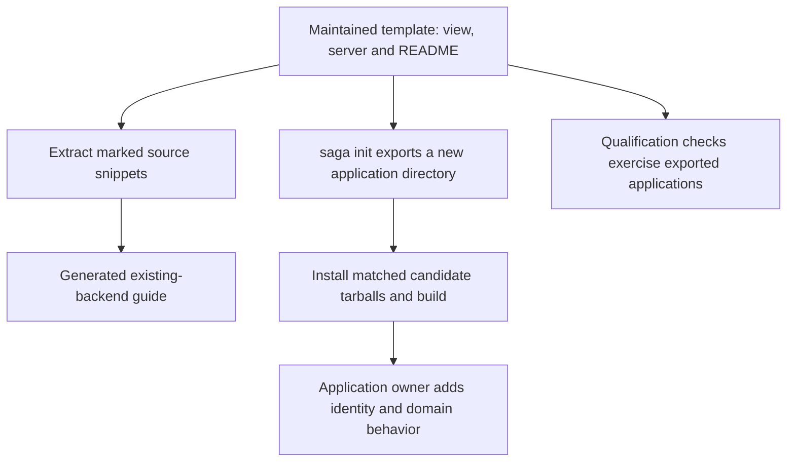

# Starter templates

These directories are the maintained source for a new Lit/MCP application or an attachment to an existing backend. Each starter gives you a public status operation, a protected account operation, a Lit view and a local Clear action. It supplies no accounts or identity provider: protected requests are refused until you implement the verifier, and authorization remains your application's decision.

A template is not an npm package or a runnable checkout directory. `saga init` exports a copy you own, pins its SDK dependencies to one source candidate and removes the authoring metadata. The exported README explains installation and operation. The same source files provide the snippets in [existing-backend recipes](../docs/attach-to-existing-backend.md); those recipes are generated, not maintained as a second implementation.



The starter and guide share one source of truth. Fix a reusable recipe in its template, then regenerate the guide; do not edit the generated page directly. Qualification tests the exported application against packed SDK artifacts rather than relying on workspace imports.

| Template | Stack | Server | Status |
| --- | --- | --- | --- |
| [`lit-node`](lit-node/) | `lit-mcp` (Lit view, MCP delivery) | `node` (`@modelcontextprotocol/node` 2.1.1) | Qualified in CI: [`scripts/starter.test.ts`](../scripts/starter.test.ts) and [`apps/lit-host/e2e/starter.spec.ts`](../apps/lit-host/e2e/starter.spec.ts) |
| [`lit-express`](lit-express/) | `lit-mcp` (Lit view, MCP delivery) | `express` (`@modelcontextprotocol/express` 2.0.2, `express` 5.3.0) | Qualified in CI: [`scripts/starter-express.test.ts`](../scripts/starter-express.test.ts) and [`apps/lit-host/e2e/starter.spec.ts`](../apps/lit-host/e2e/starter.spec.ts) |
| [`lit-fastify`](lit-fastify/) | `lit-mcp` (Lit view, MCP delivery) | `fastify` (`@modelcontextprotocol/fastify` 2.0.1, `fastify` 5.12.7) | Qualified in CI: [`scripts/starter-fastify.test.ts`](../scripts/starter-fastify.test.ts) and [`apps/lit-host/e2e/starter.spec.ts`](../apps/lit-host/e2e/starter.spec.ts) |
| [`lit-hono`](lit-hono/) | `lit-mcp` (Lit view, MCP delivery) | `hono` (`@modelcontextprotocol/hono` 2.0.2 with `hono` 4.13.13 and `@hono/node-server` 1.19.17) | Qualified in CI: [`scripts/starter-hono.test.ts`](../scripts/starter-hono.test.ts) and [`apps/lit-host/e2e/starter.spec.ts`](../apps/lit-host/e2e/starter.spec.ts) |
| [`lit-hapi`](lit-hapi/README.md) | `lit-mcp` (Lit view, MCP delivery) | `hapi` (SAGA-maintained [bridge](lit-hapi/server/bridge.ts) over `@modelcontextprotocol/node` 2.1.1, Hapi 21.4.10) | Qualified in CI: [`scripts/starter-hapi.test.ts`](../scripts/starter-hapi.test.ts), [`scripts/starter-hapi-identity.test.ts`](../scripts/starter-hapi-identity.test.ts) and [`apps/lit-host/e2e/starter.spec.ts`](../apps/lit-host/e2e/starter.spec.ts) |

The synthetic demonstration of the `lit-node` pair is [`demo/lit-node`](../demo/lit-node/README.md): it imports this template's request-authentication files as they ship and keeps every identity and fixture in its own directory.

`lit-hono` is `lit-node` with only the server adapter files replaced (`server/listener.ts`, `server/authenticate.ts`, `package.json` and its README); a test fails if any other file differs.

[`lit-hapi`](lit-hapi/README.md#existing-hapi-app-register-an-endpoint) is maintained here too: it reuses the bridge over the official Node/server SDK,
with Hapi route authentication and request-local immutable identity. [The bridge](lit-hapi/server/bridge.ts) owns
Hapi/raw-response integration, admission lifetimes, bounded body reads, deadlines and transport
cleanup; [the listener](lit-hapi/server/listener.ts) prepares the view, configures authentication
and registers the endpoints. Authentication reads the admitted lifetime through `mcpRequestLifetime(request)`;
the factory receives that same `lifetime` explicitly. No external repository or adapter package is
required. Its view, operations, domain identity and policy seams reuse `lit-node` unchanged.

A pair is offered only while CI qualifies it:
[`scripts/qualified-starters.ts`](../scripts/qualified-starters.ts) lists the qualified templates, the
shared headless suite is [`scripts/starter-qualification.ts`](../scripts/starter-qualification.ts) and
a template directory that is not listed fails `scripts/starter-template.test.ts`. A template is a
complete copy a developer can own, so the files a server framework does not change (the view and
`server/` apart from the listener and its request authentication) are the same text in each; change one and change them together.

## A template's files

- `template.json`: the stack, the server adapter and its version, the SDK packages it installs and the
  snippet names it declares. It is not part of the exported starter.
- Everything else is the starter. `package.json` declares each `@saga-a2ui/*` package as `*`; export
  pins them to one SDK build.
- `// #region saga-snippet:<name>` … `// #endregion saga-snippet:<name>` marks lines an
  existing-backend recipe shows. The markers are not in the exported starter.

## Export a starter or inspect a template

Run these source tools from a SAGA checkout with the repository dependencies installed and Node 22.23.3 or newer. The exported applications require Node 22.12.0 or newer.

```sh
npx tsx scripts/build-starter.ts                      # export, install packed candidate tarballs, build every qualified template; apps/lit-host/dist/starters/<template>
npx tsx scripts/build-starter.ts --template lit-hono      # one of them
npx tsx scripts/starter-snippets.ts                   # list the attach-to-an-existing-backend snippets (--template lit-express or lit-hono for the other pairs)
npx tsx scripts/starter-snippets.ts --out DIR         # write them as files into a new directory
npx tsx scripts/starter-snippets.ts --template lit-fastify   # the Fastify pair's snippets
npx tsx scripts/starter-snippets.ts --template lit-hono   # choose another template (default lit-node)
```

`exportTemplate`, `exportTemplateInterruptibly`, `extractSnippets` and `writeSnippets` in [`scripts/starter-template.ts`](../scripts/starter-template.ts)
are the functions the CLI and guides call. Export writes only into a directory that does not exist,
installs nothing and runs nothing. It removes only the directory it created, which it recognizes by the
directory's identity and not by its path, and leaves a path that was replaced meanwhile as it found it.
`exportTemplateInterruptibly` is the same export for a caller that must react to SIGINT or SIGTERM: it
yields to the event loop between files, which a synchronous copy cannot do.

```sh
npx tsx scripts/saga.ts init --a2ui-stack lit-mcp --server node ./my-app   # a new project from a qualified pair
```

The CLI does not install the output. Its default SDK pins have the form `0.0.0-candidate.g<revision>` and cannot be fetched from npm. Before building the new application, install the five SDK tarballs named by that template from the matching candidate; follow [candidate installation](../docs/candidate-update-and-rollback.md). Do not run `npm install` in these raw template directories, whose SDK dependency placeholders are still `*`.

Both renderer stacks are also published on npm. For a registry-based application, use [public installation](../docs/public-install.md) instead of substituting a published version for one part of a source candidate. The source CLI is not an npm-distributed command, and React has no qualified starter template here.

`scripts/saga.ts` offers the pairs listed in its `SUPPORTED_PAIRS`, not every directory here: today all five
templates (`lit-node`, `lit-express`, `lit-fastify`, `lit-hono`, `lit-hapi`) are offered, each with `--a2ui-stack lit-mcp` and its
own `--server`. When a pair is qualified, its owner adds one row there; while it fails, the row is removed.

`saga demo --a2ui-stack lit-mcp --server node ./my-demo` is a different thing from a starter: it creates the
standalone demonstration (`demo/lit-node`, DEMO1) of the pair `DEMO_TEMPLATE` names. Its synthetic accounts and
data stay in that output and never enter a template or the starter above.

## Maintain the shared source

`QUALIFIED_STARTERS` in `scripts/qualified-starters.ts` is the qualification inventory; `SUPPORTED_PAIRS` in `scripts/saga.ts` controls what `init` offers. A directory alone enables neither qualification nor a CLI pair. Update those owners only with the corresponding implementation and qualification.

When changing a template, preserve framework-independent files across the maintained variants. Regenerate the existing-backend guide with `npm run guide:recipes` after changing its snippet sources. The shared template checks, the framework's starter specification and `scripts/guide.test.ts` verify source/export consistency; `apps/lit-host/e2e/starter.spec.ts` exercises the built view. Passing these checks is source qualification, not deployment or acceptance in every assistant host.
